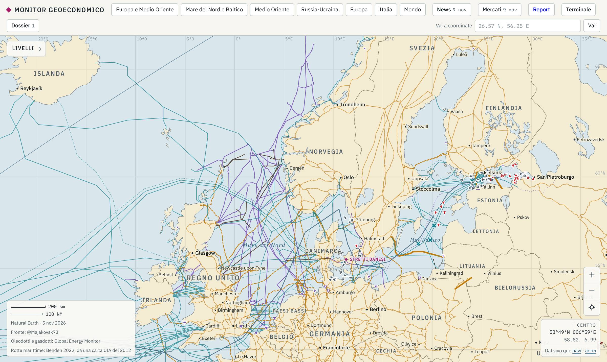

# Monitor geoeconomico

Osservatorio OSINT di rischio geoeconomico: una mappa interattiva che collega **eventi militari e geopolitici**, **passaggi strategici e infrastrutture**, **flussi di energia e merci**, **noli** e **mercati**, con l'Italia in evidenza.

L'idea guida è la *catena delle conseguenze*:

> evento → passaggio strategico → flussi (navi, energia, merci) → noli → prezzi → chi è esposto

**Sito:** https://gabrielegiuliani04.github.io/monitor-geoeconomico/
**Report:** [Hormuz e Mar Rosso: energia, logistica e mercati (novembre 2026)](https://gabrielegiuliani04.github.io/monitor-geoeconomico/report/hormuz-mar-rosso-2026-11.html)
**Crediti e licenze:** [pagina dei crediti](https://gabrielegiuliani04.github.io/monitor-geoeconomico/crediti.html) · [DATA_LICENSES.md](DATA_LICENSES.md)

*English version: [README.md](README.md).*



## Cosa contiene

| Livello | Contenuto | Fonte principale |
|---|---|---|
| Eventi | Attacchi, lanci, intercettazioni, sequestri, blackout, con data e affidabilità | Stampa e analisi da fonti aperte, ogni punto con le sue fonti |
| Russia-Ucraina | Aree controllate e contese, avanzate, colpi lungo il fronte, storico mensile, missili e droni dal 2022 | @Majakovsk73, DeepStateMap, ISW/CTP, dataset di Petro Ivaniuk |
| Europa, attacchi ibridi | Sabotaggi, droni, disturbo GNSS, attacchi informatici, spionaggio | Stampa e fonti ufficiali |
| Basi e difesa aerea | Basi USA, NATO, Israele, Italia; siti iraniani; radar e batterie | Fonti datate, OurAirports, Wikidata |
| Energia | Oleodotti, gasdotti, condotte sottomarine, terminali GNL, nucleare, flussi di gas in Italia, stoccaggi | Global Energy Monitor, ENTSOG, GIE AGSI+, Eurostat, EIA |
| Logistica | Porti, rotte, 13 passaggi strategici con transiti giornalieri, porti italiani, navi AIS, navi sanzionate, ferrovie | IMF PortWatch, World Port Index, Benden (2022), Digitraffic, OFAC, FCDO, OpenSanctions |
| Reti | Rete elettrica ad alta tensione, interconnessioni, cavi sottomarini e incidenti | OpenStreetMap/OpenInfraMap, PyPSA-Eur, TeleGeography |
| AI | Data center e dossier per paese | Epoch AI, comunicati societari |
| Terminale | Prezzi e tassi, agenda, stretti, noli e rischio, scorte, paesi, Ucraina, analisti | Tesoro USA, Yahoo Finance (indicativo), Drewry, Freightos, SSE, GPR di Caldara e Iacoviello, FMI, Banca Mondiale, SIPRI |

## Struttura

```
docs/                 il sito (GitHub Pages): index.html, report/, crediti.html, dati in docs/data/
raccolta/<dominio>/   script di raccolta automatica, uno per dominio
report/agenti/        un rapporto per dominio: fonti provate, licenze, fatti, limiti
report/licenze.md     audit delle licenze
.github/workflows/    aggiornamento automatico
METODO.md             fonti, affidabilità, verifiche, limiti
```

## Aggiornamento

- **Automatico:** `aggiorna-dati.yml` ogni giorno alle 05:15 UTC (flussi, noli, rischio geopolitico, sanzioni, scorte, navi, calendario, energia, analisti, Ucraina, stretti; ogni passo indipendente, e prima del salvataggio un controllo nasconde eventuali chiavi). `aggiorna-mercati.yml` nei giorni feriali alle 21:30 UTC, dopo la chiusura di Wall Street. La cronologia dei commit è anche l'archivio storico.
- **Curato a mano:** eventi, report e dossier richiedono verifica e giudizio, e si aggiornano con una revisione delle fonti.

```bash
cd docs && python3 -m http.server 8000          # il sito in locale
python3 raccolta/scarica_mercati.py docs/data/prezzi.json
python3 raccolta/flussi/raccogli.py
```

## Chi ha fatto cosa

Progetto personale di Gabriele Giuliani. Gabriele ha definito la domanda di analisi e la catena delle conseguenze, lo schema dei dati e le regole di affidabilità, la scelta delle fonti, il flusso di raccolta e verifica, e ha rivisto i risultati. Il codice, l'esecuzione degli script e le prime stesure dei rapporti sono stati fatti con un assistente AI (Claude, tramite Claude Code), in più sessioni parallele coordinate da `STATO.md`. Fonti e verifiche sono riportate punto per punto.

## Licenze

- **Codice:** MIT ([LICENSE](LICENSE)).
- **Dati:** restano sotto le licenze delle fonti, alcune non commerciali o share-alike ([DATA_LICENSES.md](DATA_LICENSES.md), audit in [report/licenze.md](report/licenze.md)).

## Avvertenze

Tutti i dati vengono da fonti aperte e già pubbliche. Il progetto è di analisi: non è uno strumento di tracciamento operativo e non dà consigli di investimento. I prezzi di indici, titoli e futures vengono da Yahoo Finance e sono indicativi.
