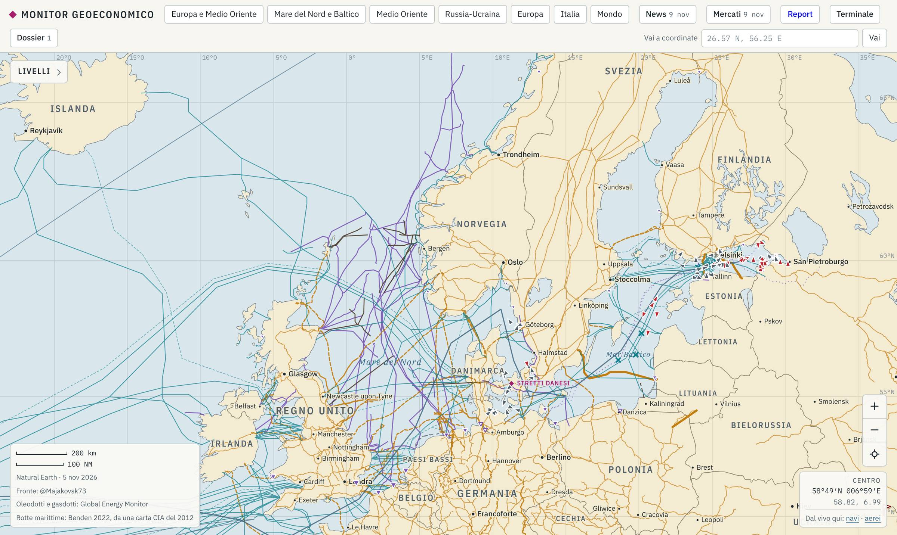
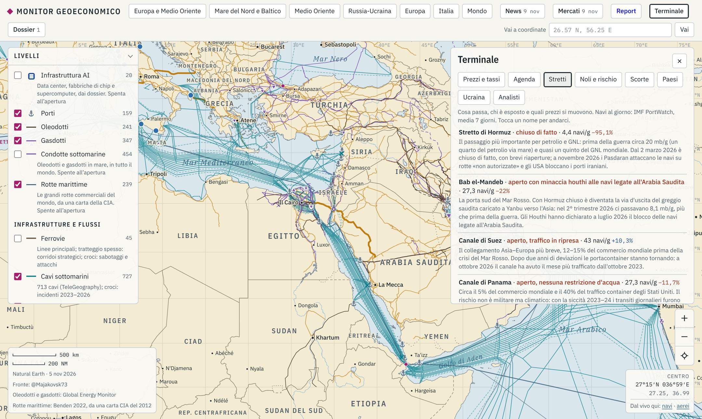
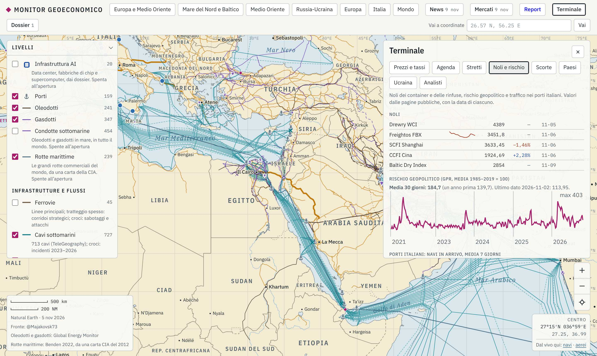
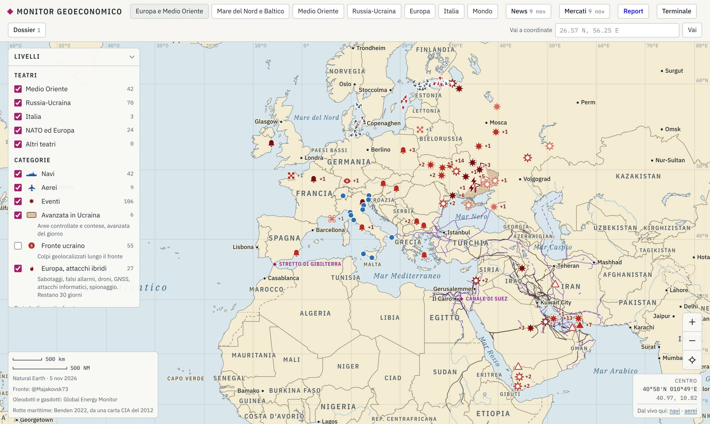
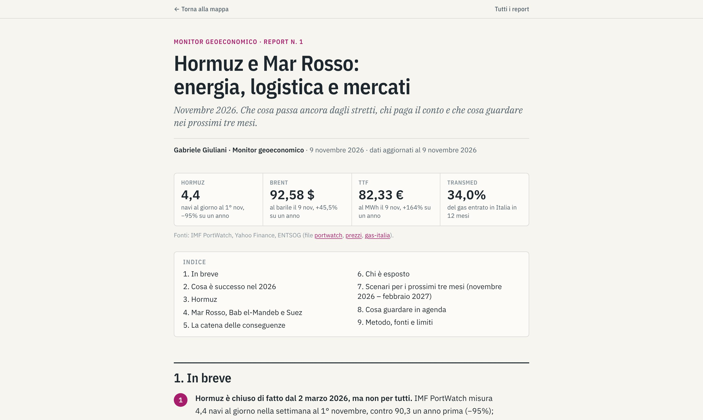

# Geo-economic Risk Monitor

**An open-source OSINT map that follows a shock from the event to the people who pay for it: event → chokepoint → flows → freight rates → prices → who is exposed.**

**Live site:** https://gabrielegiuliani04.github.io/monitor-geoeconomico/
**Case study:** [Hormuz and the Red Sea: energy, logistics and markets (November 2026)](https://gabrielegiuliani04.github.io/monitor-geoeconomico/report/hormuz-mar-rosso-2026-11.html) (in Italian)

*Italian version: [README.it.md](README.it.md). The site and reports are in Italian.*



## What it does

A disruption at sea rarely stays at sea. When transits through the Strait of Hormuz fall, tanker and LNG flows move, freight and insurance costs rise, Brent and TTF react, and some countries and ports are hit much harder than others. The monitor puts each link of that chain on one map, with a source and a date on every number, so you can follow it step by step:

| Step | What the monitor shows | Example from the data (9 Nov 2026) |
|---|---|---|
| **Event** | Attacks, seizures, blackouts, sabotage, sanctions, each with sources and a reliability level | Tankers hit near Hormuz on 7–9 November |
| **Chokepoint / infrastructure** | 13 chokepoints, pipelines, LNG terminals, submarine cables, power grid, ports, rail corridors | Hormuz: 4.4 ships/day vs 90.3 a year earlier (−95%, IMF PortWatch) |
| **Flows** | Daily transits, Italian port calls, gas entry points, AIS positions, sanctioned vessels | 2,022 vessels sanctioned by the US, UK or EU; 111 ships in the Gulf of Finland, 37 sanctioned tankers |
| **Freight** | Container and dry bulk indices | Drewry WCI USD 4,389 per 40ft; Shanghai–Genoa USD 4,166 vs Shanghai–Rotterdam USD 3,615 |
| **Prices** | Brent, WTI, TTF, Henry Hub, US rates and curve, FX, equities, geopolitical risk index | TTF EUR 82.33/MWh (+164% y/y); Brent USD 92.58 (+45.5% y/y) |
| **Who is exposed** | Country profiles, storage levels, import dependence, Italian ports and gas routes | TransMed (Mazara del Vallo) carried 34% of the gas entering Italy in 12 months |



## Layers and sources

| Area | Layers | Main sources |
|---|---|---|
| Events | Military and geopolitical events, hybrid attacks in Europe, Russia–Ukraine front | Press, official statements, OSINT mappers, each point with its own sources |
| Maritime | Chokepoints, shipping lanes, ports, AIS positions, sanctioned vessels, transits | IMF PortWatch, Digitraffic (Fintraffic), aisstream.io, Global Fishing Watch, World Port Index, Benden (2022), OFAC, UK FCDO, EU via OpenSanctions |
| Energy | Oil and gas pipelines, subsea pipelines, LNG terminals, nuclear plants, gas flows into Italy, storage | Global Energy Monitor, ENTSOG, GIE AGSI+, Eurostat, EIA |
| Power and telecom | High-voltage grid, HVDC interconnectors, submarine cables and incidents | OpenStreetMap via OpenInfraMap, PyPSA-Eur, TeleGeography |
| Rail | Main network, Europe–Asia corridors, incidents | Natural Earth, curated sources |
| Markets | 29 daily price series, US yield curve, freight indices, geopolitical risk index | U.S. Treasury, Yahoo Finance (indicative only), Drewry, Freightos, Shanghai Shipping Exchange, Caldara and Iacoviello |
| Countries | Growth, inflation, debt, military spending, energy dependence, trade partners | IMF WEO, World Bank, SIPRI, Eurostat, UN Comtrade, Energy Institute |
| Agenda | 215 dated items: central banks, macro releases, OPEC+, elections, sanctions | Fed, ECB, BoE, BoJ, BLS, BEA, Eurostat, EIA, IFES, OFAC |

Full list with licenses: [DATA_LICENSES.md](DATA_LICENSES.md) and the [credits page](https://gabrielegiuliani04.github.io/monitor-geoeconomico/crediti.html).



## Architecture

```
raccolta/<domain>/raccogli.py   15 collectors, one per domain (Python 3, almost all standard library only)
        │   run by GitHub Actions
        ▼
docs/data/*.json                42 data files, one common format
        │
        ▼
docs/index.html                 static map (canvas + d3), served by GitHub Pages
docs/report/                    analytical reports
report/agenti/<domain>.md       one report per collector: sources tried, licenses, facts, limits
```

**Automatic collection.** Two GitHub Actions workflows:
- `aggiorna-dati.yml`, every day at 05:15 UTC: flows, freight, risk index and sanctions; storage; AIS; calendar; energy; analysts; Ukraine strike data; chokepoint profiles. Each step runs independently, so one broken source does not stop the others. A last step scans every output file and masks anything that looks like an API key before committing.
- `aggiorna-mercati.yml`, weekdays at 21:30 UTC after the US close: prices.

The git history doubles as the archive: every daily change to the data is a commit.

**Data schema.** Every file has the same envelope: `aggiornato` (timestamp), `fonti[]` (name, link, license, data date), `nota` (what the data is and is not), `elementi`, `errori`. Map points use a common 25-field schema (id, class, category, name, status, event date, lat, lon, coordinate origin, precision in km, theatre, country, actor, target, outcome, source, link, source date, reliability, notes…). Lines are `[lon, lat]` parts with at most 4 decimals; time series are `[["YYYY-MM-DD", value], …]`.

**Reliability rules.**
1. No number without a source, a date and a link. If a value is missing, the file says it is missing.
2. Three reliability levels: **high** (official source or several independent sources), **medium** (credible source, not yet confirmed), **low** (unverified, or a claim by a party to the conflict).
3. Coordinates carry their origin (`fonte` or `stimata`) and a precision in km. An event reported only as "near Hormuz" is not drawn as an exact point.
4. Facts and assessments are separated and labelled. For example, `flotta_ombra_probabile` (probable shadow fleet) is marked as the monitor's assessment, not a label from the sanctions lists.
5. Time matters: events fade with age, intraday prices are flagged as provisional, AIS gaps are stated ("no source for this area" is not "zero ships").

**Verification.** Collectors run for real and their reports list which sources worked, which failed and why. The chokepoint collector validates its own file (required fields, date formats, link format, keys consistent with the map, warnings when a fact is older than 90 days) and can test every link. Numbers used in the reports are spot-checked against the data files, and cross-checked with a second source where one exists (for Hormuz, IMF PortWatch against Lloyd's List Intelligence, which counts about five times more transits because it also reconstructs ships with their transponder off).



## My role

I am Gabriele Giuliani. This is a personal project, built to learn and to show how I think about risk in shipping, energy and logistics. I built it with an AI coding assistant (Claude, through Claude Code). Here is the split, as precisely as I can put it.

**What I did**
- Defined the analytical question and the consequence chain (event → chokepoint → flows → freight → prices → exposure), and which questions each layer must answer.
- Designed the data schema and the reliability rules: the common fields, the three reliability levels, coordinate origin and precision, the separation of facts and assessments, "no number without a source and a date".
- Chose the sources and the trade-offs: official and open data first, what to do when a source is blocked or has a non-commercial license, which OSINT mappers to follow.
- Designed the collection and verification workflow: one collector per domain, independent daily steps, one written report per collector, a single coordinating session that is the only one allowed to change the map, key masking before every save.
- Reviewed the results: read the collector reports, spot-checked numbers against the sources, decided what goes on the map and what stays out (no operational tracking, no investment advice).
- Set up the repository, GitHub Pages and the API keys.

**What the AI assistant did**
- Wrote almost all of the code: the map page, the collectors and the workflows, following my schema and rules.
- Ran the collectors, explored sources, and drafted the collector reports and the first version of the case-study report.
- Several assistant sessions worked in parallel on separate domains, coordinated through a shared status file (`STATO.md`) and common rules (`raccolta/AGENTI.md`).

The assistant writes faster than I could. It can also be wrong, so every number keeps its source and date, and the parts I have not checked are labelled as such.

## Case study: Hormuz and the Red Sea

[Read the report](https://gabrielegiuliani04.github.io/monitor-geoeconomico/report/hormuz-mar-rosso-2026-11.html) (Italian; source: [report/hormuz-mar-rosso-2026-11.md](report/hormuz-mar-rosso-2026-11.md)).

- Hormuz has been effectively closed since 2 March 2026: 4.4 ships/day in the week to 1 November vs 90.3 a year earlier (−95%); tankers 1.4 vs 50.1 (IMF PortWatch).
- Traffic did not disappear. It moved: Cape of Good Hope 92.0 ships/day (+89% on 2023), Saudi crude rerouted through Yanbu on the Red Sea, Bab el-Mandeb −22% year on year.
- Prices and exposure: TTF +164% year on year, Brent +45.5%; in Italy, Trieste, Ravenna and Venice show the sharpest falls in port calls, while Augusta grows.



## Limits

- Open sources arrive late and can be wrong or partisan. Nothing here is real time.
- AIS-based counts miss ships that switch off their transponder (shadow fleet, war zones). PortWatch data lag about a week. Free AIS coverage is good in the Baltic and poor in the middle of Hormuz and Bab el-Mandeb.
- Estimated positions are indicative, and their precision is stated.
- Market prices for indices, stocks and futures come from Yahoo Finance, are unofficial and are shown for context only.
- Several sources are non-commercial (TeleGeography, OpenSanctions, Global Fishing Watch, the Ukraine strike dataset). Using this inside a company would require replacing them. See [report/licenze.md](report/licenze.md) (Italian).
- Much of the code and drafting was done with an AI assistant. Sources and checks are given point by point so that anyone can verify them.

## Licenses

- **Code**: MIT, see [LICENSE](LICENSE).
- **Data**: each file stays under the license of its sources, some non-commercial or share-alike. See [DATA_LICENSES.md](DATA_LICENSES.md).
- This is an analysis project. It is not an operational tracking tool and does not give investment advice.

## Run locally

```bash
# serve the site
cd docs && python3 -m http.server 8000
# refresh prices (Python 3 standard library only)
python3 raccolta/scarica_mercati.py docs/data/prezzi.json
# any collector, e.g. flows, freight, risk and sanctions
python3 raccolta/flussi/raccogli.py
```

Optional API keys (free) are read from environment variables: `AISSTREAM_API_KEY`, `GFW_API_KEY`, `AGSI_API_KEY`, `EIA_API_KEY`, `BLS_API_KEY`. Without them the corresponding source is skipped with a warning.

---

### In breve, in italiano

Osservatorio OSINT di rischio geoeconomico: una mappa che segue la catena evento → passaggio strategico → flussi → noli → prezzi → chi è esposto, con l'Italia in evidenza. Dati raccolti ogni giorno da script automatici su GitHub Actions, ogni numero con fonte, data e affidabilità. Progetto personale di Gabriele Giuliani, costruito con l'aiuto di un assistente AI (Claude). Testo completo in italiano: [README.it.md](README.it.md).
