# Capitolo 2 — Usare la mappa

Questo capitolo spiega la mappa pezzo per pezzo: cosa vedi al primo accesso, che cosa fa ogni livello, come si usano i due selettori del tempo e come mostrare il sito a un colloquio in cinque percorsi da 2–3 minuti. Bottoni e livelli hanno il nome inglese che leggi sullo schermo; i testi dentro le schede vengono dai file di dati e sono spesso ancora in italiano. I conteggi tra parentesi quadre sono quelli del pannello al 10 novembre 2026.

## 2.1 Primo accesso

### Il riquadro introduttivo

Alla prima visita si apre un riquadro **Geo-economic Risk Monitor**: riassume la catena (*event → chokepoint or infrastructure → flows of ships and energy → freight rates → prices → who is exposed*) e dà tre consigli: leggere la mappa, toccare uno stretto, aprire **Terminal** e **Reports**. Si chiude con **Got it**. Il browser ricorda la scelta; per riaprirlo davanti a un selezionatore usa il link **How to use it** in basso a sinistra, accanto a *Credits and licences* e *GitHub*.

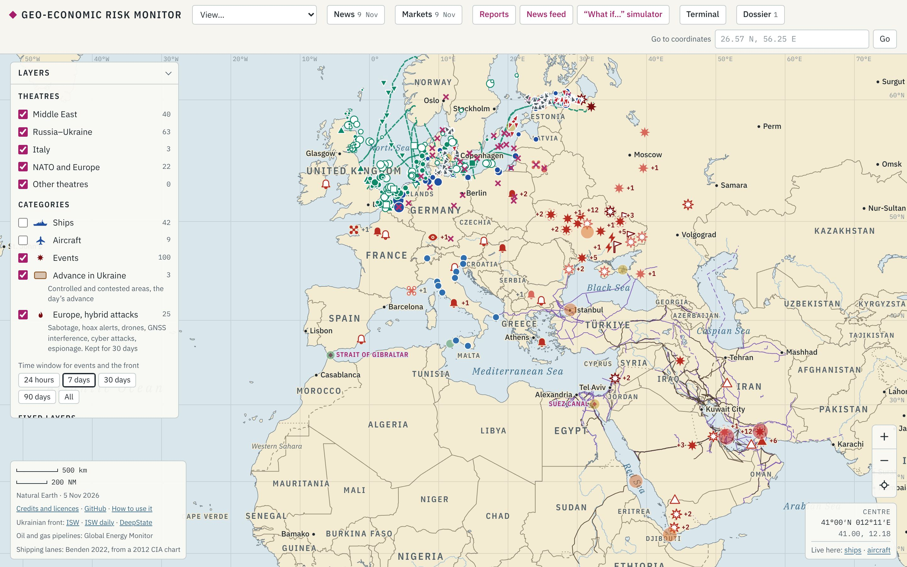

### La barra in alto

| Elemento | Cosa fa |
|---|---|
| **View…** | Sette inquadrature: *Europe and Middle East* (quella di partenza), *North Sea and Baltic*, *Middle East*, *Russia–Ukraine*, *Europe*, *Italy*, *World*. Sposta solo la mappa, non cambia i livelli |
| **News** (data) | Il report quotidiano (`report.json`), con i giorni precedenti nel menu |
| **Markets** (data) | Gli indicatori di mercato del giorno (`mercati.json`) |
| **Reports** | La pagina dei report lunghi (§3.5) |
| **News feed** | Le notizie delle testate per argomento (§3.4) |
| **"What if…" simulator** | Gli scenari di chiusura degli stretti (§3.3) |
| **Terminal** | Il pannello con 14 schede (§3.1) |
| **Dossier** (numero) | Il dossier sull'AI per Paese (`dossier.json`, oggi solo Stati Uniti), con **Show the points on the map** |
| **Go to coordinates** | Scrivi `51.92, 4.21` (o `26.57 N, 56.25 E`) e premi **Go**: la mappa vola lì e mette un segnaposto; **Clear** lo toglie. È il modo più rapido per arrivare a un porto durante una demo |

### Il pannello dei livelli

A sinistra c'è **Layers** (su telefono parte chiuso). Dall'alto: **Theatres** (filtri geografici dei punti «classici»: *Middle East, Russia–Ukraine, Italy, NATO and Europe, Other theatres*); **Categories** (*Ships, Aircraft, Events, Advance in Ukraine, Ukrainian front, Europe, hybrid attacks*) con i bottoni **Time window for events and the front**; **Fixed layers** (basi, porti, condotte, rotte); **Infrastructure and flows** (i livelli tematici: energia, Nord Europa, logistica, AI, Ucraina storica); il selettore **Period for historical events**; infine **Legend**, **Geography** (confini, città, mari, **Chokepoints**, regioni, fiumi, reticolo) e **List**, l'elenco dei punti per teatro. In tutto **42 livelli tematici** più 8 di geografia.

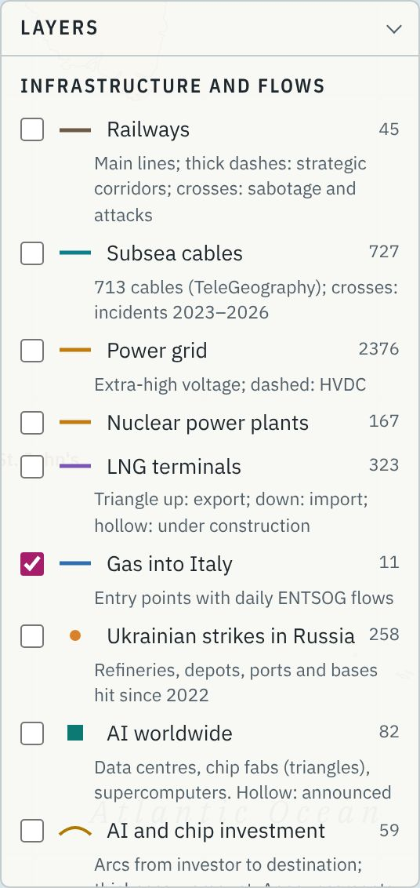

**Accesi all'apertura:** Events, Advance in Ukraine, Europe hybrid attacks, Ports, Oil e Gas pipelines, Gas into Italy, Risk (dashboard), North Sea and Baltic ports, Offshore wind and energy hubs, Baltic and North Sea security, Offshore wind base ports, Port risk index, Ships (AIS) e tutta la geografia. Tutti gli altri sono spenti.

> **Attenzione.** Il sito ricorda nel browser i livelli che accendi o spegni. Se una demo parte «strana», è perché la volta prima hai lasciato accesi dei livelli: apri il sito in una finestra in incognito e riparti dallo stato iniziale.

### Muoversi e leggere una scheda

Trascina per spostarti; rotella, pizzico o **+ / −** per lo zoom; il mirino in basso a destra torna all'inquadratura iniziale. Il riquadro **CENTRE / CURSOR** dà le coordinate e i link *Live here: ships · aircraft* (MarineTraffic e ADS-B Exchange sullo stesso punto). Alcuni simboli compaiono solo da vicino (porti minori, terminali GNL); un «+2» vuol dire «altri due punti qui sotto: avvicinati».

Toccando un elemento si apre una **scheda** a destra: famiglia, categoria e Paese (*Port · port · Netherlands*), nome, una tabella di dati, una nota e in fondo **SOURCES** con link e data. Quasi tutte mostrano **Reliability** e **Position** con il margine di errore. Sugli **stretti** (rombi magenta) la scheda è più ricca: navi al giorno misurate da IMF PortWatch con il confronto sull'anno prima, il grafico settimanale dal 2023, lo stato di oggi, i flussi, l'esposizione di Italia e UE, le alternative e i prezzi collegati.

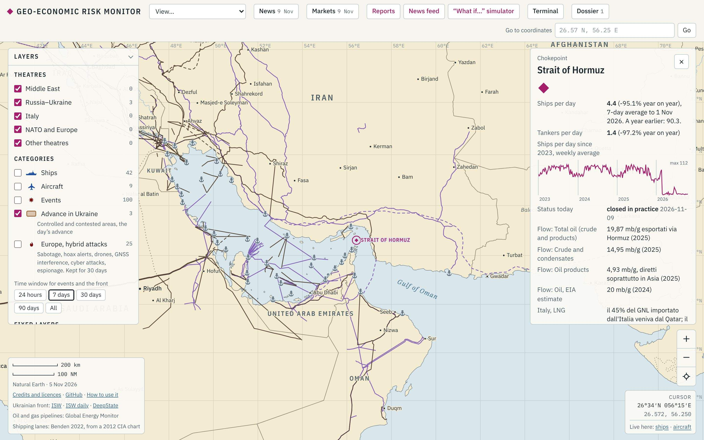

## 2.2 I livelli, per tema

Per ogni livello: che cosa mostra, il file in `docs/data/`, l'aggiornamento, la domanda a cui risponde e il limite principale. Tre ritmi di aggiornamento: **quotidiano** (05:15 UTC), **settimanale** (domenica) e **curato** (voci scritte e riviste a mano, con la data nel campo `aggiornato`). L'elenco completo dei file con fonti e licenze è nel §4.1.

### A. Conflitti, Ucraina, sicurezza

| Livello [n.] | Cosa mostra · file · aggiornamento | Domanda tipica | Limite |
|---|---|---|---|
| **Events** [100] | Attacchi, blackout, eventi strategici (`eventi.json`, 126 punti da 15 raccolte). Colore = età (oggi-ieri, 2–4, 5–7 giorni, archivio); cerchio tratteggiato = incertezza. Curato quasi ogni giorno | «Cosa è successo questa settimana intorno a Hormuz?» | Eventi riportati da fonti aperte, non un radar; i punti senza coordinate e a bassa affidabilità restano fuori (campo `fuori`) |
| **Ships** [42], **Aircraft** [9] | Navi e aerei militari, ultima posizione nota (`mobili.json`). Pieno = confermato; vuoto = segnalato; sbiadito = visto più di 7 giorni fa | «Quante portaerei USA sono nel teatro?» | Non è tracciamento in tempo reale (per quello: *Live here*) |
| **Advance in Ukraine** [3], **Ukrainian front** [0] | Avanzate del giorno (`fronte.json`). Le aree controllate non sono più copiate: rimandi a ISW e DeepState in basso a sinistra | «Dove si è mosso il fronte?» | Senza poligoni è soprattutto un rimando; *Ukrainian front* oggi è spento e vuoto |
| **Europe, hybrid attacks** [25] | Sabotaggi, falsi allarmi, droni, GNSS, cyber, spionaggio (`ibrido.json`, 35 voci); ogni punto resta 30 giorni | «C'è una serie di droni sopra porti e aeroporti del Nord?» | L'attribuzione è quasi sempre incerta |
| **Ukrainian strikes in Russia** [258] | Raffinerie, depositi, porti e basi colpiti dal 2022 (`ucraina-storico.json`) | «Quanto export russo via Baltico e Mar Nero è stato colpito?» | Attacchi riportati; i giorni di fermo spesso non si conoscono |
| **Russian strikes in Ukraine** [192] | Grandi attacchi russi documentati dal 2022 contro energia, porti, ferrovie, città (`attacchi-russi.json`, quotidiano) | «Quante volte è stato colpito il porto di Odesa?» | Coordinate della città o dell'oblast; è una selezione, non un censimento |
| **Russian attacks by region** [25] | Un cerchio per oblast, grande quanto i giorni in cui la regione è citata come bersaglio (dataset Ivaniuk) | «Quali regioni sono sotto pressione costante?» | «Citata» non vuol dire «colpita»; dati da settembre 2022 |
| **Baltic and North Sea security** [48] | Danni a cavi, droni, fermi di petroliere della flotta ombra, GNSS, esercitazioni (`baltico-sicurezza.json`) | «Quanti cavi sono stati danneggiati nel Baltico dal 2023?» (7 danni a cavi nel file) | Coordinate stimate; attribuzione spesso aperta |
| **Cyber incidents in energy** [30] | Precedenti dal 2015 contro eolico, solare, reti, catena del freddo (`cyber-energia.json`, curato) | «Un parco eolico può essere fermato da remoto?» | Coordinate della sede della vittima; taglio difensivo |

### B. Medio Oriente e basi

**US, NATO and Israeli bases** [32], **Iranian military sites** [53], **Air defence** [10], **Bases in Italy** [57], **Bases worldwide** [181], tutti spenti all'avvio (`fissi.json`, `iran.json`, `difesa.json`, `italia.json`, `basi-mondo.json`, curati). Le coordinate degli aeroporti vengono da OurAirports, World Port Index e Wikidata; presenza e stato da fonti datate in ogni punto. Simboli: piastrina con aereo, ancora, stella o cupola; pallino rosso = danneggiata nel 2025–2026; barrata = lasciata. Domanda tipica: «Quali basi USA stanno entro il raggio dei missili iraniani intorno a Hormuz?». Limite: basi note da fonti aperte, senza dettagli operativi; la presenza delle forze cambia più in fretta del dato.

### C. Stretti e rischio

**Chokepoints** (in *Geography*): rombi magenta con il nome in maiuscolo. Dati: `stretti.json`, `stretti-dettaglio.json` (13 schede con circa 100 fonti), `portwatch.json`, `prezzi.json`. Transiti e stato ogni giorno, prezzi nei giorni feriali. Limite: PortWatch stima dai segnali AIS, con circa una settimana di ritardo.

**Risk (dashboard)** [18] e **Port risk index** [39]: un cerchio su ogni stretto o corridoio e su ogni porto; colore = livello, grandezza = punteggio. La scheda dà punteggio su 25, tendenza a 7 giorni, il «perché» e gli indicatori a semaforo. Metodo e classifiche nel §3.2. Dalla scheda **Ports** del Terminal un clic su una riga porta al porto sulla mappa.

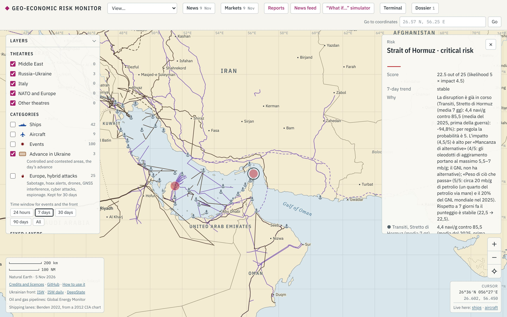

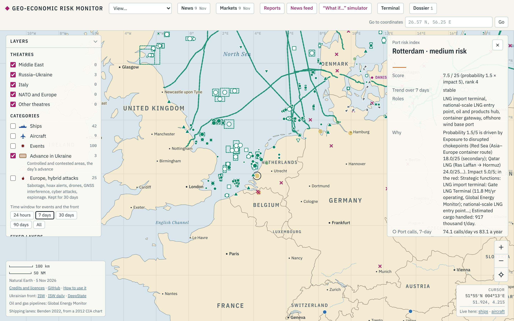

### D. Energia

| Livello [n.] | Cosa mostra · file | Domanda tipica | Limite |
|---|---|---|---|
| **Oil pipelines** [241], **Gas pipelines** [347] | Oleodotti e gasdotti (`linee.json`, Global Energy Monitor, CC BY 4.0). Tratteggio = in costruzione | «Quanto petrolio può aggirare Hormuz via oleodotto?» (East–West fino a Yanbu, ADCOP fino a Fujairah) | Tracciati a volte approssimati; capacità nominale |
| **Subsea pipelines** [454] | Condotte in mare con almeno 20 km di tratta marina (`condotte.json`) | «Quali condotte attraversano il Baltico?» | Km in mare misurati sulla mappa |
| **LNG terminals** [323] | Terminali GNL operativi o in costruzione, dei 840 del file (`terminali-gnl.json`). Triangolo su = export, giù = import | «Quali terminali europei possono sostituire il GNL del Qatar?» (Gate, Eemshaven, Wilhelmshaven, Świnoujście, Klaipėda) | Capacità nominale, non utilizzo reale |
| **Gas into Italy** [11] | Gli 11 punti di ingresso del gas, con i flussi giornalieri ENTSOG (`gas-italia.json`) | «Quanto pesa l'Algeria?» TransMed 34,0% degli ingressi in 12 mesi (220,5 TWh), TAP 16,5%, Adriatic LNG 14,1% | Non conta produzione nazionale e stoccaggi |
| **Power grid** [2.376] | Linee da 380 kV in su e HVDC (`rete-elettrica.json`, OpenStreetMap) più 16 interconnessioni strategiche (Estlink, NordBalt, ELMED…) | «Cosa succede se l'Estlink 2 si rompe?» | Dati OSM non ufficiali né completi |
| **Nuclear power plants** [167] | Centrali in esercizio e in costruzione (`nucleare.json`) | «Quali centrali sono vicine al fronte?» | Stato della centrale, non dei singoli reattori |
| **Hydrogen and ammonia in ports** [48] | 41 progetti e 7 reti di idrogeno (`idrogeno.json`); vuoto = non ancora operativo | «Quanto dell'idrogeno nei porti del Nord è operativo?» | La maggioranza sono annunci |
| **Bunkering hubs** [24] | Prezzi del carburante navale per porto (`bunker-emissioni.json`, Ship & Bunker) | «Quanto è salito il bunker a Rotterdam?» VLSFO 739,5 $/t contro 489,5 il 27 febbraio | Alcuni porti (Amburgo, Danzica) sono a pagamento e mancano |

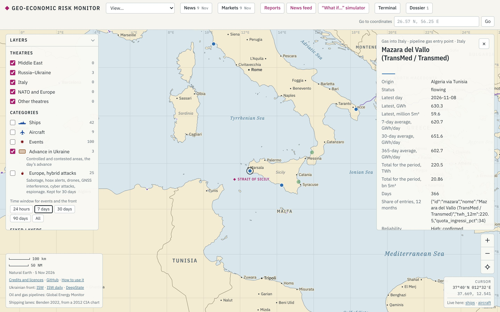

### E. Mare del Nord e Baltico

**North Sea and Baltic ports** [30] (`porti-nord.json`): chiamate giornaliere da IMF PortWatch più traffico annuo delle autorità portuali. Scheda: specializzazione, traffico degli ultimi anni, chiamate al giorno (media a 7 giorni e confronto sull'anno prima), ruolo. Esempio: Rotterdam 74,1 chiamate al giorno (−10,8% sull'anno nella settimana al 30 ottobre), 428,4 milioni di t nel 2025 (−1,7%). Limite: una settimana in un grande porto è rumorosa; le chiamate non sono tonnellate (§5.4, domanda 13).

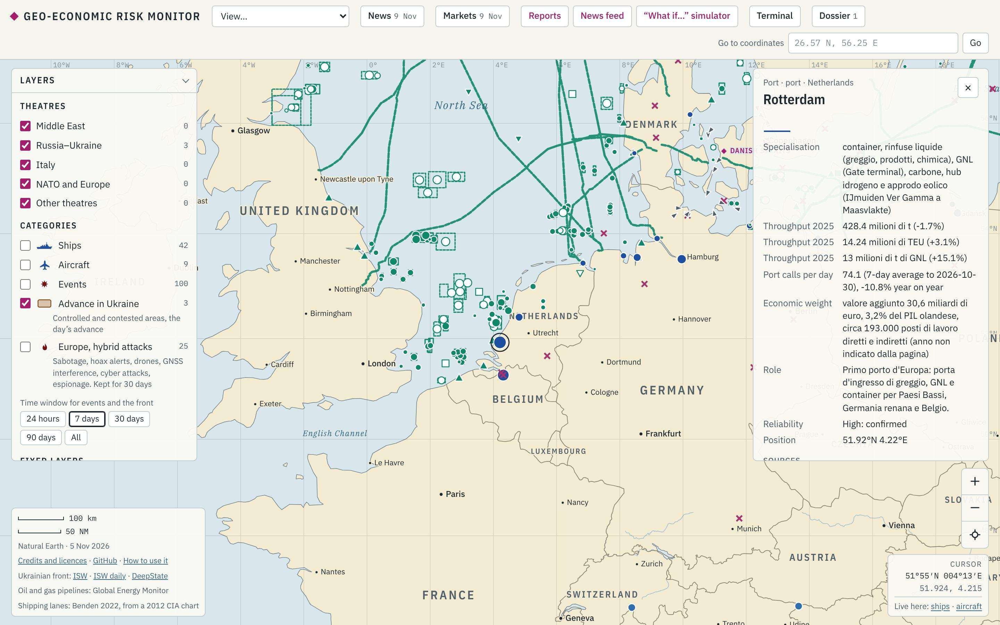

**Offshore wind and energy hubs** [362] (`offshore-nord.json`, EMODnet): 180 parchi eolici con i poligoni, 5 isole energetiche, giacimenti, collegamenti strategici; tratteggio = in costruzione o pianificato. Limite: per il Regno Unito solo la costa est. **Offshore wind base ports** [19] (`eolico-filiera.json`, settimanale): Esbjerg, Eemshaven, Vlissingen, Cuxhaven, Rønne, Danzica T5…, con banchine, aree, progetti serviti e colli di bottiglia. Esempio: Esbjerg è il porto base di Thor (RWE, 1 GW) e ha aggiunto 57 ettari.

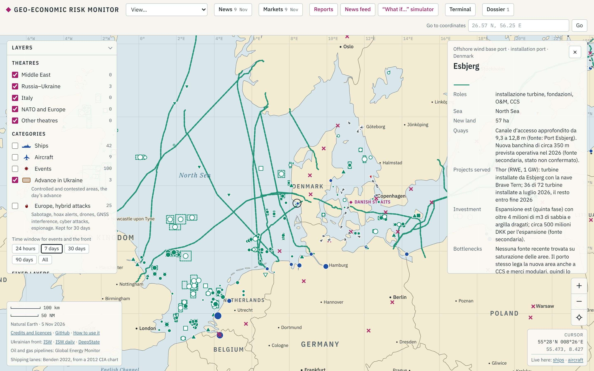

### F. Logistica

| Livello [n.] | Cosa mostra · file | Domanda tipica | Limite |
|---|---|---|---|
| **Ports** [159] | Porti del World Port Index, soprattutto Medio Oriente e Italia (`fissi.json`, `italia.json`) | «Quali porti del Golfo stanno dentro lo stretto?» | Elenco senza traffico |
| **Shipping lanes** [239] | Grandi rotte commerciali (`rotte.json`, Benden 2022, da una carta CIA) | «Quali rotte passano per Bab el-Mandeb?» | Tracciato schematico; licenza non commerciale |
| **Sea routes to Europe** [99] | 99 rotte da 11 origini a 9 porti europei, oggi contro il 2023 (`transit-times.json`). Colore = giorni in più (verde 0–3, ambra 3–8, arancio 8+, rosso tratteggiato = bloccata) | «Quanto costa girare dal Capo?» Al 10 novembre 72 rotte normali, 18 deviate, 9 bloccate per Hormuz | Modello a velocità fissa, non tempi misurati (§3.6) |
| **Railways** [45] | Linee principali, corridoi strategici (Cina–Europa, Middle Corridor, INSTC…), sabotaggi (`ferrovie.json`) | «C'è un'alternativa terrestre al Mar Rosso?» | Rete semplificata (Natural Earth, circa 2017) |
| **Subsea cables** [727] | 713 cavi dati (TeleGeography) e 14 incidenti 2023–2026 | «Quanti cavi passano dal Baltico?» (34; Canale di Sicilia 29) | Tracciati indicativi; licenza non commerciale |
| **Ships (AIS)** [141] | Ultime posizioni AIS nel Baltico, Golfo di Finlandia e Stretti danesi; rosse = sanzionate (`navi.json` incrociato con `sanzioni-navi.json`) | «Quante navi della flotta ombra escono da Primorsk e Ust-Luga?» | Una fotografia al giorno; un'area senza fonte non vuol dire zero navi (oggi nessuna fonte gratuita per Hormuz) |
| **War-risk areas (insurance)** [31] | Le 27 *Listed Areas* del Joint War Committee (circolare JWLA-035 del 16 settembre 2026), dove si paga un premio war risk aggiuntivo (`assicurazioni.json`) | «Quanto costa assicurare una petroliera nel Golfo?» 6–10% del valore per viaggio, contro 0,25% prima della guerra | Premi da quotazioni di broker riportate dalla stampa |
| **Public webcams** [45] | Webcam pubblicate dai proprietari su porti, stretti, canali | «C'è coda al Bosforo adesso?» | Alcune possono essere irraggiungibili |

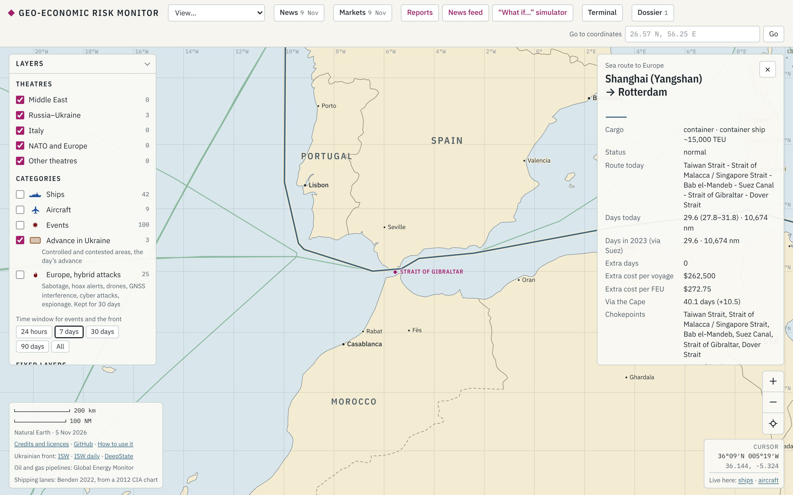

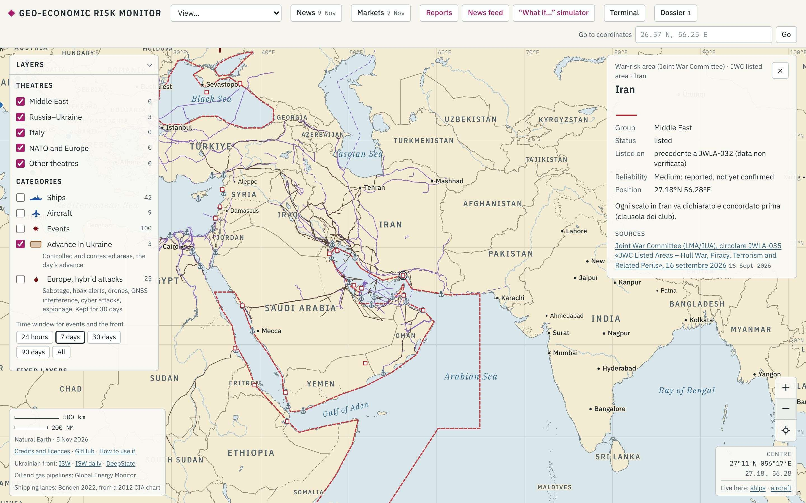

### G. AI

**AI infrastructure** [20] (`ai.json`, dal dossier USA), **AI worldwide** [82] (`ai-mondo.json`: data center, fabbriche di chip, supercalcolatori fuori dagli USA, da Epoch AI e TOP500), **AI and chip investment** [59] (`investimenti.json`: archi dall'investitore alla destinazione; sono annunci, non spese effettive) e **AI value chain** [104] (`supply-chain-ai.json`: 70 nodi e 34 archi, dalla miniera al data center, con ASML a Veldhoven). Domanda tipica: «Quali passaggi della catena dipendono dai Paesi Bassi o dagli stretti asiatici?».

## 2.3 I due selettori del tempo

**1. Time window for events and the front** (*24 hours, 7 days* all'avvio, *30 days, 90 days, All*): vale solo per i punti «freschi», cioè Events, il fronte e gli attacchi ibridi.

**2. Period for historical events (strikes, cyber, Baltic)**, più in basso: vale per Ukrainian strikes in Russia, Russian strikes in Ukraine, Cyber incidents in energy, Baltic and North Sea security e per i cerchi di Russian attacks by region. Due campi **From → To** e i bottoni rapidi **2022, 2023, 2024, 2025, 2026, 30 days, All** (scelta iniziale). Una riga conta gli eventi dei livelli datati accesi («*34 of 240 events in the layers switched on*»): all'avvio è acceso il Baltico, quindi il totale lo include.

> **Attenzione.** All'apertura il campo *From* mostra 24/02/2022 ma il filtro attivo è **All**, dal 2014: per partire dall'invasione tocca **2022**. Il formato della data dipende dal browser (in inglese americano: mese/giorno/anno).

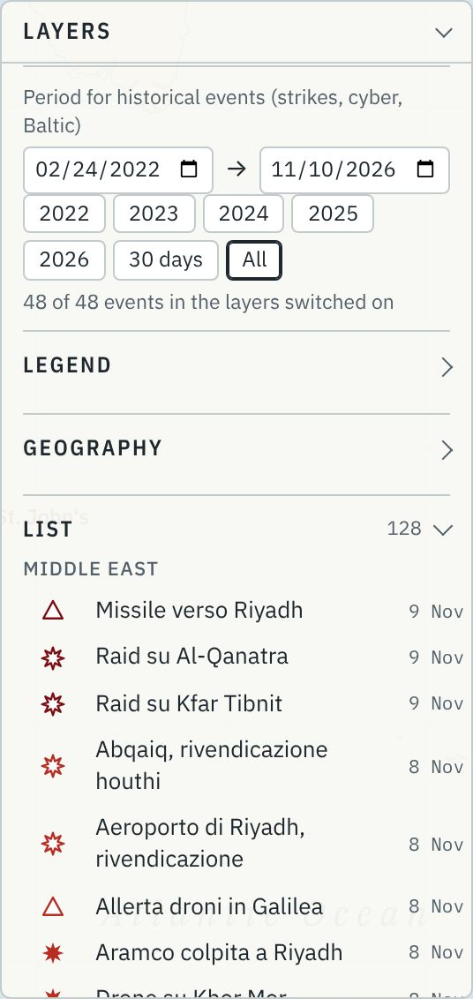

**I cerchi per regione.** Il raggio cresce con la radice quadrata dei giorni di citazione nei mesi del periodo scelto, così le regioni molto colpite non coprono tutto; il confronto è per mese intero. Nella scheda: *Days cited in the chosen period*, *Days cited in total* (Odesa: 364), *Major documented attacks* (Odesa: 49) e *What it measures*. Usali insieme ai punti: i cerchi mostrano la *pressione*, i punti i *colpi documentati* con data, mezzi ed effetto.

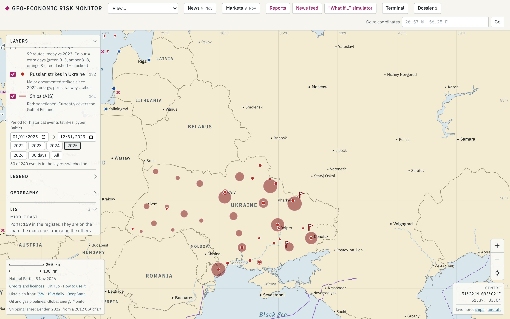

## 2.4 Cinque percorsi guidati per un colloquio

Prima del colloquio: apri il sito in **incognito**, controlla i numeri del giorno, tieni aperta una seconda scheda con il report giusto, metti il browser a tutto schermo e chiudi la **List**. Ogni percorso dura 2–3 minuti.

### (a) Hormuz: dalla mappa al prezzo

*"Let me show you how one event becomes a cost, in five clicks."*

1. **View… → Middle East**; spegni **Events** se ci sono troppi simboli.
2. Tocca il **rombo di Hormuz**: *Ships per day* **4,4** contro **90,3** un anno prima (−95%), grafico dal 2023, *Status today: closed in practice*. «Non è un'opinione: sono transiti misurati da IMF PortWatch, con la data.»
3. Scorri la scheda: flussi (circa 20 mb/g), esposizione dell'Italia (Adriatic LNG, 14,1% degli ingressi di gas), alternative (oleodotto East–West), *Market: Brent* (picco di 119 $ il 19 marzo 2026 secondo la scheda) e prezzi di oggi.

4. Tocca il **cerchio del Risk** sopra lo stretto: **22,5 su 25**, probabilità 5 × impatto 4,5, con il perché e gli indicatori a semaforo.
5. Accendi **War-risk areas (insurance)**: il Golfo è area JWC; il premio è passato da 0,25% a 6–10% del valore dello scafo.
6. Chiudi con **Terminal → Transit times**: 18 rotte verso l'Europa deviate e 9 bloccate.

*Chiusura:* "Event, chokepoint, flows, insurance, freight, prices, exposure: the same chain for every crisis, refreshed every morning."

### (b) Mare del Nord: porti, eolico, sicurezza

*"This is the part closest to your business: ports and offshore energy in the North Sea."*

1. **View… → North Sea and Baltic**: sono già accesi porti, eolico, porti base, sicurezza e Port risk index.

   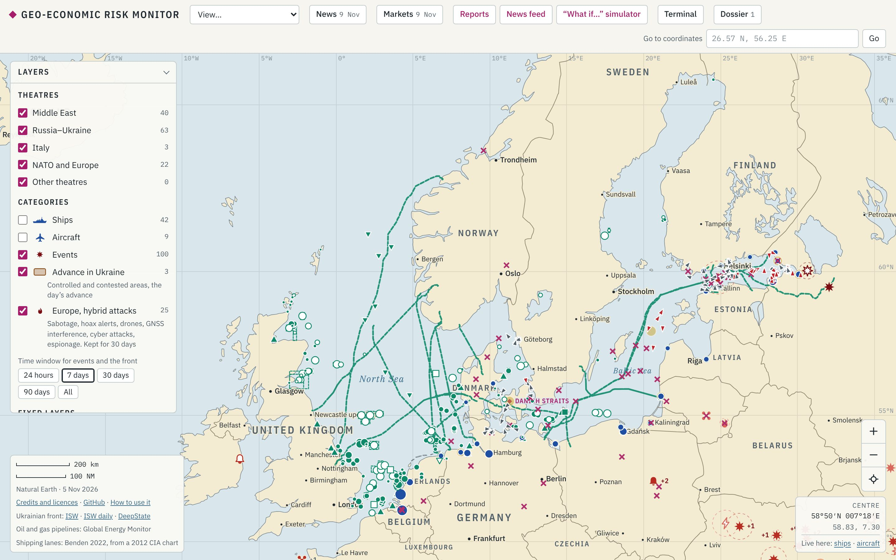

2. Spegni **Events** ed **Europe, hybrid attacks**. **Go to coordinates** `51.92, 4.21` → **Go** → **Clear**, e tocca **Rotterdam**: 428,4 milioni di t nel 2025, 14,24 milioni di TEU, ma 74,1 chiamate al giorno (−10,8% sull'anno in una settimana). «È un segnale da guardare, non un allarme: dall'inizio dell'anno il traffico è −0,5%.»
3. Spegni **North Sea and Baltic ports** e tocca di nuovo Rotterdam: scheda del **Port risk index**, 7,5 (*medium*), quarto in classifica. «Il rischio di Rotterdam non nasce in Olanda: arriva da Hormuz e dal Mar Rosso.»
4. Vai a **Esbjerg** (`55.47, 8.43`), tocca il triangolo: porto base di Thor, 57 ettari nuovi, canale a 12,8 m. «Il collo di bottiglia dell'eolico offshore sono i porti: spazio, banchine, navi d'installazione.»
5. Accendi **Bunkering hubs** e tocca Rotterdam: VLSFO 739,5 $/t contro 489,5 prima della guerra.
6. Chiudi con **Terminal → Ports** o **Wind calendar** (§3.6).

### (c) Baltico: flotta ombra e cavi

*"The Baltic is where shipping, energy and hybrid threats overlap."*

1. Dalla vista **North Sea and Baltic**, premi **+**, spegni i due livelli dell'eolico e accendi **Subsea cables**.
2. Avvicinati al **Golfo di Finlandia** (**Ships (AIS)** è già acceso): i triangolini rossi sono navi sanzionate. Tocca per esempio la **SERDOLIK**: petroliera russa, sanzionata da Regno Unito e UE, *Shadow fleet: likely*. «Nella fotografia AIS del 9 novembre nel Golfo di Finlandia si vedono 109 navi: 44 sanzionate, 38 probabilmente della flotta ombra.»

   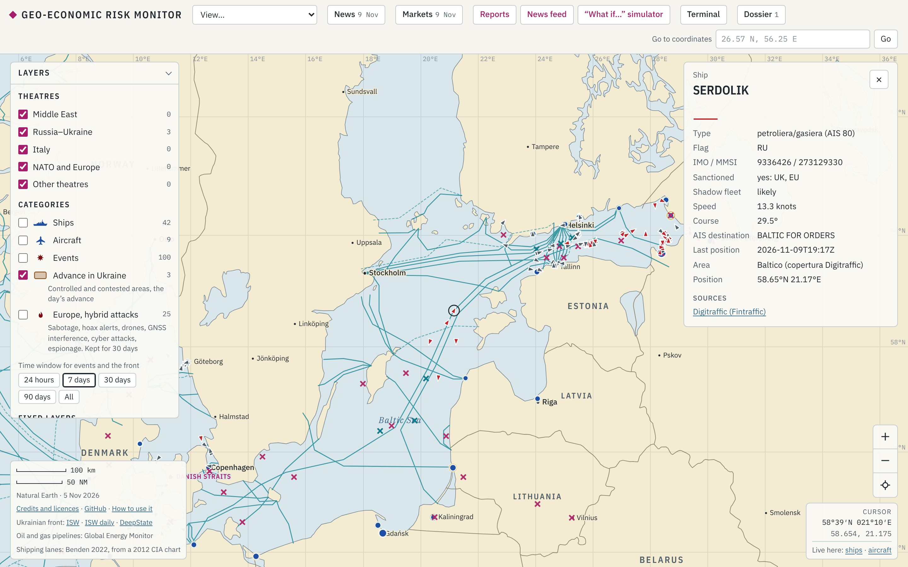

3. Tocca la **croce** sull'Estlink 2: cavo elettrico e quattro cavi dati danneggiati dall'ancora della Eagle S il 25 dicembre 2024.

4. Nel **Period for historical events** premi **2024**, **2025**, **2026**: «Gli incidenti ai cavi arrivano a ondate, quasi sempre d'inverno; nel 2025–2026 si aggiungono i fermi di petroliere.»
5. (Facoltativo) Tocca **Ust-Luga**: in testa al Port risk index (9,3), per il disturbo GNSS e le petroliere sanzionate vicine.

*Limite da dire:* "AIS coverage is partial and shadow-fleet tankers often switch the transponder off."

### (d) Italia esposta: TransMed, GNL, porti

*"Italy is a good test case: one pipeline carries a third of its gas."*

1. **View… → Italy**: i pallini blu sono gli 11 ingressi di **Gas into Italy**.

2. Tocca **Mazara del Vallo**: 34,0% degli ingressi in 12 mesi. Poi TAP (16,5%) e Adriatic LNG a Rovigo (14,1%), che riceveva il GNL del Qatar.
3. Tocca il rombo del **Canale di Sicilia**: gas, 29 cavi, container.
4. Accendi **Risk (dashboard)**: TransMed a rischio basso (5,6), Hormuz critico. «Il rischio per l'Italia oggi non è il TransMed: è il GNL che arriva dal Golfo.»
5. (Facoltativo) Apri il **"What if…" simulator** con Hormuz chiuso: c'è anche la sezione *What happens in Italy* (§3.3).

### (e) Ucraina: porti e logistica nel tempo

*"Here the map becomes a timeline."*

1. **View… → Russia–Ukraine**; accendi **Russian strikes in Ukraine** e **Russian attacks by region**; spegni il Baltico per un conteggio pulito.
2. **2022**: pochi cerchi (i dati per regione partono da settembre) e i primi attacchi alla rete elettrica. **2023**: aumentano i colpi su Odesa dopo la fine dell'accordo sul grano (9 attacchi ai porti contro 2 nel 2022).
3. **2025**: tocca un punto su **Odesa**, per esempio il 1° marzo 2025, missile balistico sul porto, danneggiata la MSC Levante F.

   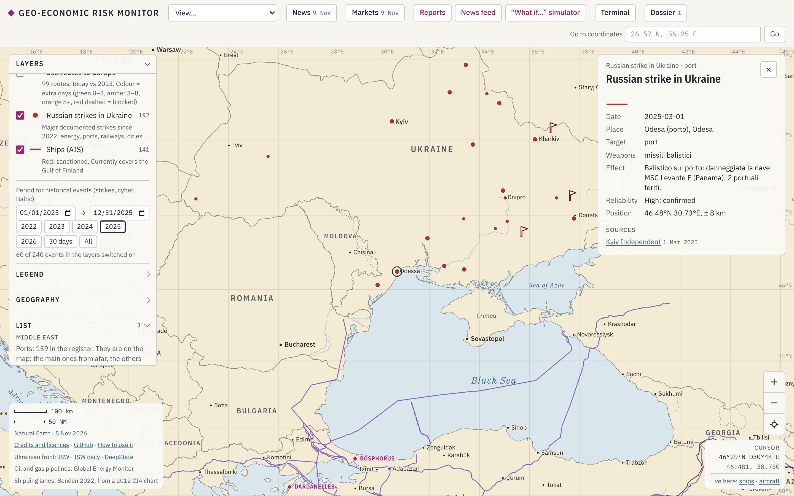

4. **2026**: l'anno con più attacchi all'energia (20) e alle ferrovie (10) nel file. Chiudi con **Terminal → Ukraine** (lanci e abbattimenti dal 2022).

*Chiusura:* "In three years the target moves from grain ports to the power grid and the railways: logistics is what gets hit."

### Promemoria rapido

| Voglio… | Clicco… |
|---|---|
| tornare all'inizio | il mirino in basso a destra |
| arrivare a un porto | **Go to coordinates** → **Go** → **Clear** |
| capire un simbolo | **Legend** |
| vedere un anno solo | **Period for historical events** → anno |
| il punteggio di rischio | **Risk (dashboard)** o **Port risk index**, poi il cerchio |
| togliere il disordine | spengo **Events** ed **Europe, hybrid attacks** |
| ripartire pulito | finestra in incognito |
