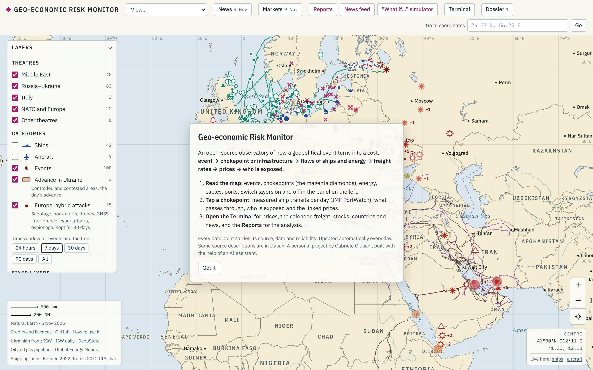
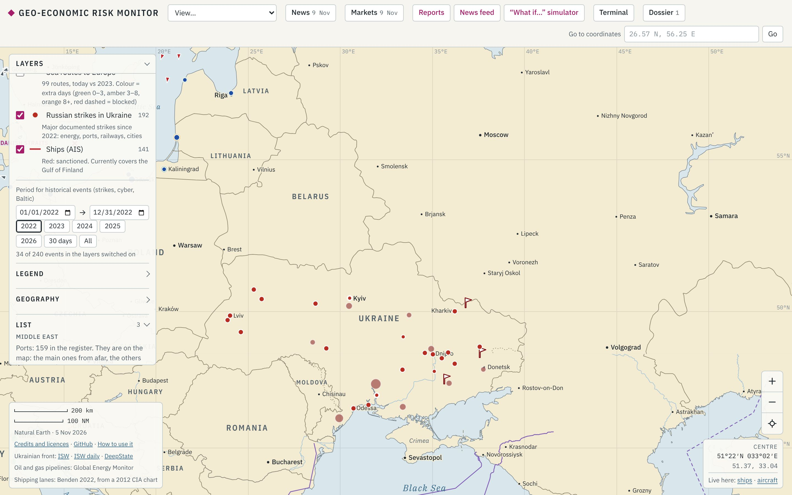
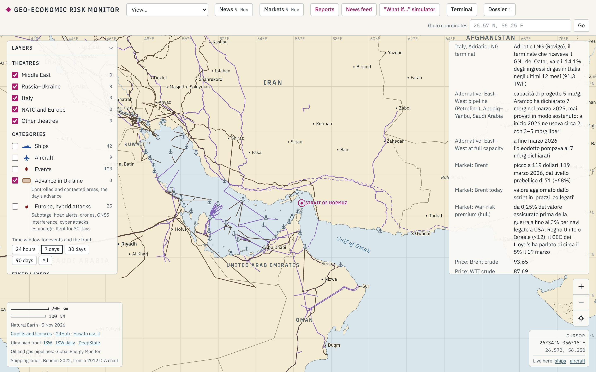
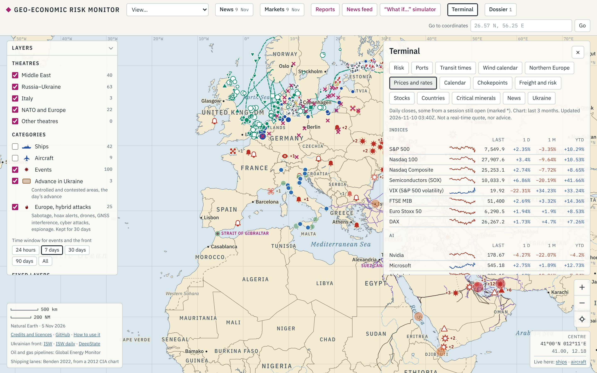
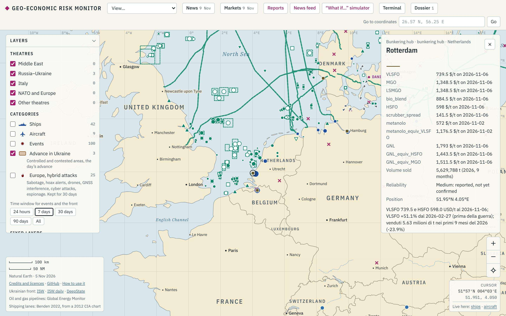
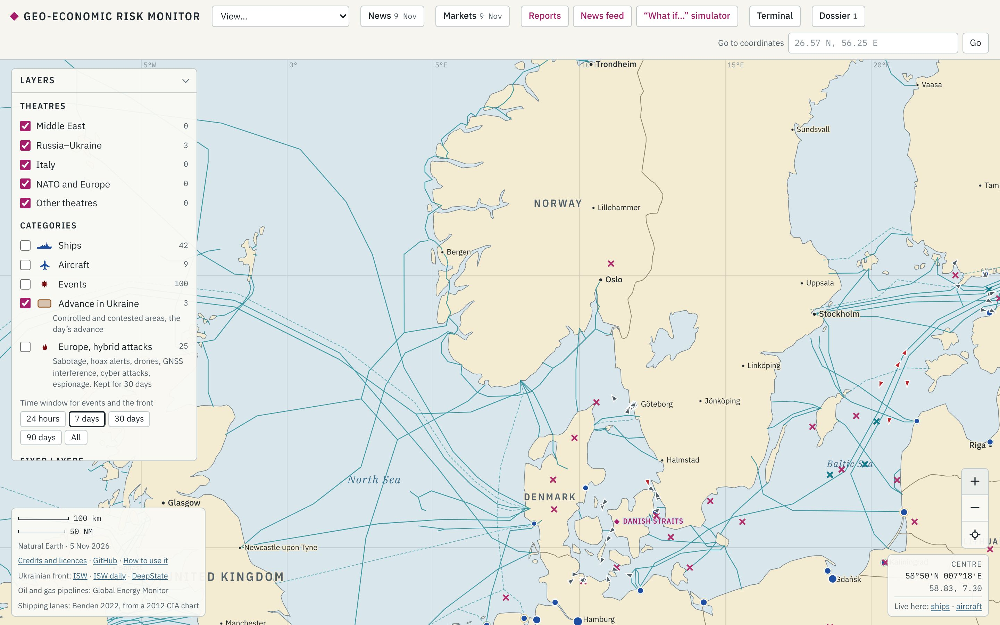
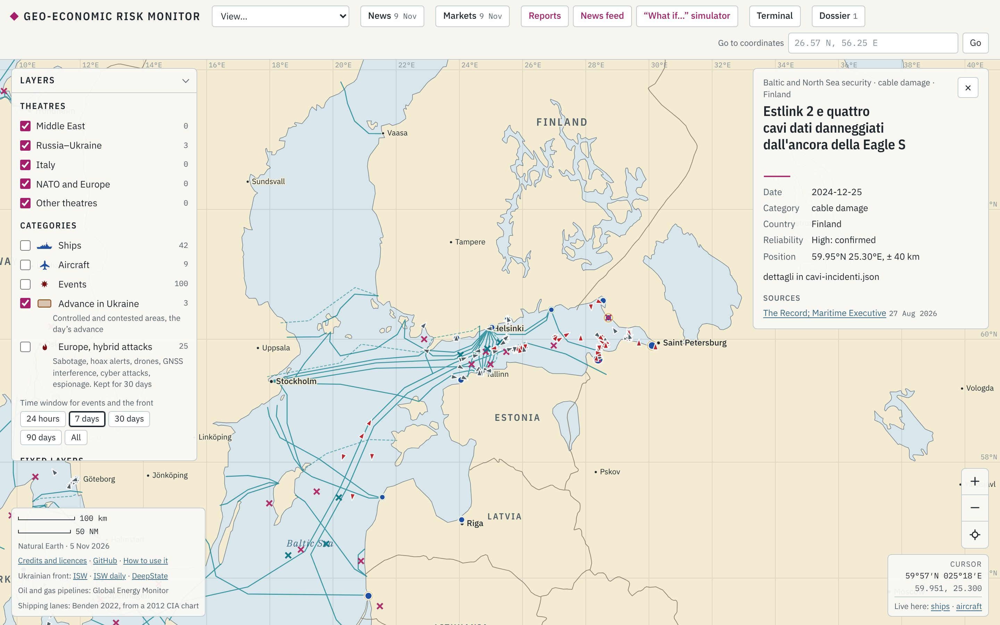
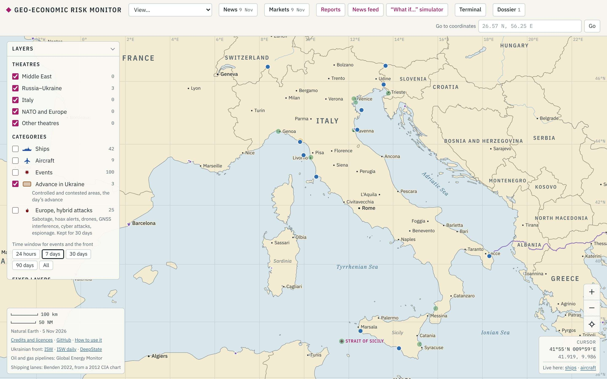

# Capitolo 2 — Usare la mappa

Questo capitolo spiega la mappa pezzo per pezzo: cosa vedi al primo accesso, cosa fa ogni livello, come si usa il selettore del periodo e come mostrare il sito a un colloquio in cinque giri da 2–3 minuti.

> **Nota sui nomi.** Il sito ora è in inglese britannico. In questa guida i bottoni e i livelli hanno il nome che leggi sullo schermo, in inglese, con il vecchio nome italiano tra parentesi quando è cambiato: per esempio **Subsea cables** (*Cavi sottomarini*). I testi dentro le schede vengono dai file di dati e sono spesso ancora in italiano: il sito lo dice nel riquadro iniziale ("Some source descriptions are in Italian"). Le cifre citate sono quelle del 9–10 novembre 2026: cambiano ogni giorno, quindi controllale prima di un colloquio. Dove il nome potrebbe cambiare ancora trovi **[da controllare dopo la traduzione]**.

---

## 2.1 Primo accesso

### Il riquadro introduttivo

Alla prima visita, al centro dello schermo si apre un riquadro con il titolo **Geo-economic Risk Monitor**. Riassume il progetto in una riga, *event → chokepoint or infrastructure → flows of ships and energy → freight rates → prices → who is exposed*, e dà tre consigli: leggere la mappa, toccare uno stretto, aprire il **Terminal** (*Terminale*) e i **Reports** (*Report*). Si chiude con **Got it** (*Ho capito*).

Il sito ricorda la scelta nel browser e non mostra più il riquadro. Per farlo ricomparire (utile davanti a un selezionatore) usa il link **How to use it** in basso a sinistra, nel riquadro dei crediti.

### La barra in alto

Da sinistra a destra:

| Elemento | Cosa fa |
|---|---|
| **View…** (*Vista…*) | Menu a tendina con sette inquadrature pronte: *Europe and the Middle East* (l'inquadratura di partenza), *North Sea and Baltic*, *Middle East*, *Russia–Ukraine*, *Europe*, *Italy*, *World*. Sposta solo la mappa, non accende né spegne livelli. [da controllare dopo la traduzione: nel file `manifest.json` la prima vista ora si chiama "Europe and Middle East"] |
| **News** (data) | Apre il report quotidiano (file `report.json`). Il menu nella scheda permette di scegliere i giorni precedenti. |
| **Markets** (*Mercati*) (data) | Indicatori di mercato del giorno (`mercati.json`). |
| **Reports** (*Report*) | Va alla pagina dei report lunghi (Hormuz e Mar Rosso, supply chain dell'AI, Nord Europa…). |
| **News feed** (*Notizie*) | Pagina con le notizie di 57 testate divise per argomento (`notizie.html`). |
| **"What if…" simulator** (*Simulatore "e se…"*) | Pagina degli scenari: chiudi uno stretto e vedi chi ne paga il costo (capitolo 3). |
| **Terminal** (*Terminale*) | Pannello con le schede **Risk**, **Ports**, **Transit times**, **Wind calendar**, **Northern Europe**, **Prices and rates**, **Calendar**, **Chokepoints**, **Freight and risk**, **Stocks**, **Countries**, **Critical minerals**, **News**, **Ukraine** (vecchi nomi: *Rischio, Nord Europa, Prezzi e tassi, Agenda, Stretti, Noli e rischio, Scorte, Paesi, Minerali critici, Notizie, Ucraina*; *Ports*, *Transit times* e *Wind calendar* sono nuove). È spiegato nel capitolo 3. |
| **Dossier** (numero) | Dossier sull'AI per Paese (`dossier.json`), con il bottone **Show the points on the map** (*Mostra i punti sulla mappa*). |
| **Go to coordinates** (*Vai a coordinate*) | Scrivi una coordinata (es. `26.57 N, 56.25 E`, oppure `51.92, 4.21`) e premi **Go** (*Vai*): la mappa vola lì e mette un segnaposto. **Clear** (*Togli*) lo toglie. È il modo più rapido per arrivare a un porto preciso durante una demo. |

### Il pannello dei livelli

A sinistra c'è il pannello **Layers** (*Livelli*). La freccia accanto al titolo lo chiude e lo riapre (su telefono parte chiuso). Dall'alto in basso contiene:

1. **Theatres** (*Teatri*): *Middle East, Russia–Ukraine, Italy, NATO and Europe, Other theatres*. Sono filtri geografici per i punti "classici" (eventi, navi militari, basi). Il numero a destra conta i punti visibili con i filtri attuali.
2. **Categories** (*Categorie*): **Ships, Aircraft, Events, Advance in Ukraine, Ukrainian front, Europe, hybrid attacks**. Sotto ci sono i bottoni **Time window for events and the front** (*Periodo di eventi e fronte*): *24 hours, 7 days* (scelta iniziale), *30 days, 90 days, All*.
3. **Fixed layers** (*Livelli fissi*): basi, porti, oleodotti, gasdotti, condotte sottomarine, rotte.
4. **Infrastructure and flows** (*Infrastrutture e flussi*): i livelli tematici aggiunti dopo (energia, Nord Europa, logistica, AI, Ucraina storica…). Ognuno ha un piccolo simbolo, il numero di elementi e una riga di spiegazione.
5. **Period for historical events (strikes, cyber, Baltic)** (*Periodo degli eventi storici*): il selettore descritto nel paragrafo 2.3.
6. **Legend** (*Legenda*), **Geography** (*Geografia*: confini, nomi dei Paesi, città, mari, **Chokepoints**, regioni, fiumi, reticolo) e **List** (*Elenco*): l'elenco dei punti per teatro; toccare una riga porta la mappa sul punto.

All'apertura non tutto è acceso. Sono **accesi**: Events, Europe hybrid attacks, Advance in Ukraine, Ports, Oil pipelines, Gas pipelines, Gas into Italy, Ships (AIS), Risk (dashboard), Port risk index, North Sea and Baltic ports, Offshore wind and energy hubs, Offshore wind base ports, Baltic and North Sea security e tutta la geografia. **Spenti**: le navi e gli aerei militari, le basi e tutti gli altri livelli. Il sito ricorda nel browser i livelli che accendi o spegni: se una demo parte "strana", è perché hai lasciato accesi dei livelli la volta prima. In una finestra in incognito riparti dallo stato iniziale.

### Zoom e movimento

- Trascina per spostarti; rotella, pizzico o tasti **+ / −** per lo zoom.
- In basso a destra ci sono i bottoni **+** (*Zoom in*), **−** (*Zoom out*) e il mirino (*Back to the initial view*, torna all'inquadratura iniziale).
- Sotto c'è il riquadro **CENTRE / CURSOR**, con le coordinate del centro o del puntatore e i link *Live here: ships · aircraft*, che aprono MarineTraffic e ADS-B Exchange sullo stesso punto (siti esterni, in tempo reale).
- In basso a sinistra ci sono la scala in km e miglia nautiche, la data dei confini (Natural Earth), i crediti e i link a ISW e DeepState per il fronte ucraino.
- Alcuni simboli compaiono solo da vicino: i porti minori, i terminali GNL (sotto un certo zoom non si disegnano), i punti sovrapposti (un "+2" vuol dire "altri due punti qui sotto: avvicinati").

### Le schede

Toccando un elemento si apre una **scheda** a destra. In alto ci sono la famiglia del livello, la categoria e il Paese (es. *Port · port · Netherlands*), poi il nome, una righina del colore del livello, una tabella di dati, una nota e in fondo **SOURCES**, con il link alla fonte e la sua data. Quasi tutte le schede mostrano anche **Reliability** (*Affidabilità*: *High: confirmed*, *Medium: reported, not yet confirmed*…) e **Position**, con il margine di errore quando la fonte indica solo una zona. Si chiude con la **×**. Se l'elemento è una linea (cavo, gasdotto, rotta), la linea toccata si evidenzia.

Su uno **stretto** (rombo magenta) la scheda è più ricca: navi al giorno misurate da IMF PortWatch con il confronto sull'anno prima, il grafico settimanale dal 2023, lo stato di oggi, i flussi (petrolio, GNL), l'esposizione di Italia e UE, le alternative, gli effetti sui mercati e i prezzi collegati di oggi.

---

## 2.2 I livelli, per tema

Per ogni livello trovi: **cosa mostra**, **dati** (file in `docs/data/` e fonte), **aggiornamento**, **simbolo**, una **domanda** a cui risponde e un **limite**. Il numero tra parentesi quadre è il conteggio che compare nel pannello (novembre 2026).

**Come leggere "aggiornamento".** Ci sono tre ritmi:

- **automatico ogni giorno**: il workflow `aggiorna-dati.yml` gira alle 05:15 UTC e scarica PortWatch, navi AIS, gas, GNL, serie dell'Ucraina, porti del Nord, sicurezza del Baltico, bunker, stretti, tempi di viaggio, rischio e indice di rischio dei porti;
- **automatico nei giorni feriali**: `aggiorna-mercati.yml` aggiorna i prezzi alle 21:30 UTC, dal lunedì al venerdì;
- **curato**: file compilati e rivisti a mano dagli agenti, senza un ritmo fisso. La data di ultima revisione è nel campo `aggiornato` del file (quasi tutti 9–10 novembre 2026).

### A. Ucraina e conflitti

**Events** (*Eventi*) [100] — acceso
- *Cosa mostra*: attacchi, blackout e altri eventi strategici, soprattutto Medio Oriente e Russia-Ucraina.
- *Dati*: `eventi.json` (126 punti da 15 raccolte OSINT, ogni punto con la sua fonte).
- *Aggiornamento*: curato dalle raccolte degli agenti, in pratica quasi ogni giorno. Il filtro **Time window** decide quanti giorni vedi.
- *Simbolo*: glifi *Attack*, *Blackout*, *Other*. Il colore dice solo quanto è recente l'evento: oggi e ieri, 2–4 giorni, 5–7 giorni, archivio. Un cerchio tratteggiato indica il margine di incertezza.
- *Domanda*: "Cosa è successo questa settimana intorno a Hormuz?"
- *Limite*: sono eventi riportati da fonti aperte, non un radar. Un evento a bassa affidabilità e senza coordinate viene escluso (campo `fuori` del file).

**Ships** (*Navi*) e **Aircraft** (*Aerei*) [42 e 9] — spenti
- *Cosa mostra*: navi e aerei militari (portaerei, cacciatorpediniere, cisterne, bombardieri…) con l'ultima posizione nota.
- *Dati*: `mobili.json` (53 punti); fonti dichiarate per punto (USNI Fleet Tracker, comunicati, immagini geolocalizzate).
- *Aggiornamento*: curato, quasi ogni giorno.
- *Simbolo*: sagoma piena = confermata da più fonti; vuota = segnalata, non confermata; sbiadita = vista più di 7 giorni fa (sparisce dopo 30); "?" = forse non è più lì; linea tratteggiata = da dove veniva. Il colore indica lo schieramento (alleati, partner, avversari, altri).
- *Domanda*: "Quante portaerei USA sono nel teatro?"
- *Limite*: non è tracciamento in tempo reale (per quello ci sono i link *Live here*).

**Advance in Ukraine** (*Avanzata in Ucraina*) e **Ukrainian front** (*Fronte ucraino*)
- *Cosa mostra*: avanzate del giorno (bandierine) e colpi geolocalizzati lungo il fronte.
- *Dati*: `fronte.json`. Le aree controllate non sono più copiate, perché le fonti (ISW/CTP, DeepStateMap, la mappa di @Majakovsk73) non ne consentono la ripubblicazione: il file ha zero aree e rimanda alle mappe esterne (link in basso a sinistra).
- *Aggiornamento*: curato; ultima data 5 novembre 2026.
- *Simbolo*: area marrone = controllo russo; area chiara = contesa; bandiera = avanzata del giorno; cerchio numerato = gruppo di colpi.
- *Domanda*: "Dove si è mosso il fronte questa settimana?"
- *Limite*: senza i poligoni è soprattutto un rimando; per la linea del fronte usa ISW o DeepState. Il livello *Ukrainian front* si nasconde da solo quando non ci sono colpi geolocalizzati [da controllare].

**Europe, hybrid attacks** (*Europa, attacchi ibridi*) [25] — acceso
- *Cosa mostra*: sabotaggi, falsi allarmi bomba, droni non identificati, disturbo GNSS, attacchi cyber, spionaggio e arresti in Europa.
- *Dati*: `ibrido.json` (35 punti, una fonte per voce).
- *Aggiornamento*: curato; ogni punto resta 30 giorni.
- *Simbolo*: glifi fiamma, allarme, drone, GNSS, cyber, spia; il colore indica l'età (0–3, 4–14, 15–30 giorni).
- *Domanda*: "C'è una serie di droni sopra porti e aeroporti del Nord?" (scegli *90 days* per vedere la serie).
- *Limite*: l'attribuzione è quasi sempre incerta; un evento ibrido spesso è soltanto un sospetto.

**Ukrainian strikes in Russia** (*Attacchi ucraini in Russia*) [258] — spento
- *Cosa mostra*: raffinerie, depositi, porti e basi aeree in Russia colpiti dal 2022.
- *Dati*: `ucraina-storico.json` (voci curate da Kyiv Independent, Reuters e altre fonti; nello stesso file ci sono le serie giornaliere di missili e droni dell'Aeronautica ucraina, dataset di P. Ivaniuk).
- *Aggiornamento*: le serie sono automatiche ogni giorno; i punti sono curati.
- *Simbolo*: punto; più grande se è una raffineria. Segue il selettore del periodo (2.3).
- *Domanda*: "Quanto della capacità di raffinazione e dell'export russo via Baltico e Mar Nero è stato colpito?"
- *Limite*: sono attacchi rivendicati o riportati; l'effetto reale (giorni di fermo) spesso non si conosce.

**Russian strikes in Ukraine** (*Attacchi russi in Ucraina*) [192] — spento
- *Cosa mostra*: i grandi attacchi russi documentati dal 2022 contro energia, porti, ferrovie, grano e logistica, città.
- *Dati*: `attacchi-russi.json` (`elementi`, curati a mano con data, luogo, mezzi ed effetto; fonti come Kyiv Independent).
- *Aggiornamento*: curato (ultima revisione 10 novembre 2026).
- *Simbolo*: punto rosso, più grande per energia, porti, ferrovie e grano. Segue il selettore del periodo.
- *Domanda*: "Quante volte è stato colpito il porto di Odesa, e con cosa?"
- *Limite*: le coordinate sono quelle della città o dell'oblast, non del punto d'impatto. È una selezione di attacchi grandi, non l'elenco completo.

**Russian attacks by region** (*Attacchi russi per regione*) [25] — spento
- *Cosa mostra*: un cerchio per oblast, grande quanto il numero di giorni in cui la regione è citata come bersaglio, nel periodo scelto.
- *Dati*: `attacchi-russi.json` (`per_oblast`), dal dataset Ivaniuk (comunicati dell'Aeronautica ucraina, CC BY-NC-SA 4.0).
- *Aggiornamento*: con il file (curato, dati mensili).
- *Simbolo*: cerchio semitrasparente; nella scheda trovi i giorni nel periodo scelto, i giorni totali e quanti grandi attacchi documentati ci sono stati nella regione.
- *Domanda*: "Quali regioni sono sotto pressione costante e quali solo a ondate?"
- *Limite*: "citata" non vuol dire "colpita": la scheda lo scrive esplicitamente. Il dataset parte da settembre 2022.

### B. Medio Oriente e basi

**US, NATO and Israeli bases** (*Basi USA, NATO e Israele*) — spento
- *Cosa mostra*: le basi aeree, navali e terrestri e i comandi in Medio Oriente.
- *Dati*: `fissi.json` (192 punti tra basi e porti). Le coordinate degli aeroporti vengono da OurAirports; presenza e stato da fonti datate, citate in ogni punto.
- *Aggiornamento*: curato (5 novembre 2026).
- *Simbolo*: "piastrina" con aereo (base aerea), ancora (navale), stella (terrestre o comando), cupola (radar). Pallino rosso = danneggiata negli attacchi 2025–2026; grigia barrata = lasciata dagli USA; vuota = una sola fonte.
- *Domanda*: "Quali basi USA stanno entro il raggio dei missili iraniani intorno a Hormuz?"
- *Limite*: sono basi note da fonti aperte; la presenza di forze cambia più in fretta del dato.

**Iranian military sites** (*Siti militari iraniani*) — spento
- *Cosa mostra*: siti missilistici, nucleari, basi aeree e navali dell'Iran.
- *Dati*: `iran.json` (53 punti, verificati il 6 novembre 2026; coordinate da OurAirports, World Port Index, Wikidata).
- *Simbolo*: piastrina con razzo (missili) o atomo (nucleare).
- *Domanda*: "Da dove può partire una minaccia alle petroliere nello stretto?"
- *Limite*: per alcuni siti si conosce solo la zona; dove le fonti non danno un punto preciso, le coordinate sono stimate.

**Air defence** (*Difesa aerea*) — spento
- *Cosa mostra*: radar e batterie fisse e mobili, compresi i siti colpiti nel 2026.
- *Dati*: `difesa.json` (8 siti fissi) più le batterie mobili di `mobili.json`.
- *Simbolo*: piastrina con cupola; scudo vuoto = batteria mobile (si vede per 14 giorni, poi sbiadisce).
- *Domanda*: "Quali difese proteggono i terminali del Golfo?"
- *Limite*: dati scarsi e spesso vecchi.

**Bases in Italy** (*Basi in Italia*) — spento
- *Cosa mostra*: basi italiane, USA e NATO in Italia.
- *Dati*: `italia.json` (58 punti; OurAirports, World Port Index, Wikidata). Stato verificato a novembre 2026.
- *Simbolo*: piastrina vuota, colore degli alleati.
- *Domanda*: "Quali infrastrutture militari stanno vicino ai terminali GNL italiani?"
- *Limite*: posizioni da archivi aperti, senza dettagli operativi.

**Bases worldwide** (*Basi nel mondo*) [181] — spento
- *Cosa mostra*: le principali basi all'estero di USA, Russia, Cina, NATO e alleati, con una riga sul perché contano.
- *Dati*: `basi-mondo.json` (OurAirports, Wikidata, Wikipedia, Congressional Research Service, stampa).
- *Simbolo*: quadratino; il colore dice chi la usa; vuoto = lasciata o ridotta.
- *Domanda*: "Chi controlla le basi vicine a Gibuti e Bab el-Mandeb?"
- *Limite*: elenco delle basi principali, non completo.

### C. Stretti e rischio

**Chokepoints** (*Passaggi strategici*, in **Geography**) — acceso
- *Cosa mostra*: i passaggi strategici (Hormuz, Bab el-Mandeb, Suez, Stretti danesi, Canale di Sicilia…).
- *Dati*: `stretti.json` (quote mondiali di ciò che passa), `stretti-dettaglio.json` (13 schede approfondite con circa 100 fonti), `portwatch.json` (transiti giornalieri IMF PortWatch), `prezzi.json` (prezzi collegati).
- *Aggiornamento*: transiti e stato automatici ogni giorno; prezzi nei giorni feriali.
- *Simbolo*: rombo magenta con il nome in maiuscolo.
- *Domanda*: "Quanto traffico è passato da Hormuz questa settimana rispetto a un anno fa?"
- *Limite*: PortWatch stima i transiti dai segnali AIS, con qualche giorno di ritardo (l'ultima data può essere di una settimana prima). Anni diversi non si confrontano.

**Risk (dashboard)** (*Rischio (cruscotto)*) [18] — acceso
- *Cosa mostra*: un cerchio su ogni stretto o corridoio (18 unità: Hormuz, GNL del Qatar, Bab el-Mandeb, TransMed, Baltico, rete elettrica ucraina, chip di Taiwan…).
- *Dati*: `rischio.json`, calcolato da `raccolta/rischio/calcola.py` leggendo gli altri file (transiti, attacchi vicini, clima geopolitico GPR, prezzi, alternative, scorte). Metodo in `report/metodo-rischio.md`.
- *Aggiornamento*: automatico ogni giorno.
- *Simbolo*: colore = livello (basso, medio, alto, critico); grandezza = punteggio. Nella scheda: punteggio su 25 (probabilità × impatto), tendenza a 7 giorni, perché, indicatori con pallino rosso/giallo/verde, cosa osservare, chi è esposto.
- *Domanda*: "Quale passaggio è più rischioso oggi, e per quale indicatore?" (oggi: GNL del Qatar 24, Hormuz 22,5, Bab el-Mandeb 19).
- *Limite*: è una valutazione basata su regole, non una probabilità statistica. Se gli indicatori disponibili coprono meno del 70% dei pesi, il punteggio è fragile.

**Port risk index** (*Indice di rischio dei porti*, nuovo) [39] — acceso
- *Cosa mostra*: 39 porti europei e del Mediterraneo con un punteggio quotidiano.
- *Dati*: `port-risk.json` (17 fonti), metodo in `report/port-risk-method.md`. Probabilità = traffico 30%, sicurezza 30%, stretti 25%, assicurazioni 15%; impatto = ruolo e dimensione del porto per le catene di fornitura europee e italiane.
- *Aggiornamento*: automatico ogni giorno, dopo il rischio degli stretti.
- *Simbolo*: cerchio semitrasparente; colore = livello, grandezza = punteggio. La scheda dà punteggio, posizione in classifica, ruoli, indicatori e cosa osservare. Dal Terminal, scheda **Ports**, un clic su una riga porta al porto sulla mappa.
- *Domanda*: "Perché Rotterdam è a rischio medio se il suo traffico va bene?" Risposta: per l'esposizione al Mar Rosso e al GNL del Qatar.
- *Limite*: per i porti russi l'impatto è limitato a 3, perché il commercio UE con loro è in gran parte sanzionato (la scheda lo spiega in *Note*).

### D. Energia

**Oil pipelines** e **Gas pipelines** (*Oleodotti*, *Gasdotti*) [588 linee] — accesi
- *Cosa mostra*: oleodotti e gasdotti esistenti e in costruzione.
- *Dati*: `linee.json`, da Global Oil e Global Gas Infrastructure Tracker di Global Energy Monitor (CC BY 4.0; file di lavoro scaricati il 5 novembre 2026).
- *Aggiornamento*: statico, ricaricato a mano.
- *Simbolo*: linea marrone (petrolio) o viola (gas); tratteggiata = in costruzione; puntinata = ferma. La scheda dà stato, Paesi, capacità e precisione del tracciato.
- *Domanda*: "Quanto petrolio può aggirare Hormuz via oleodotto?" (l'East–West saudita fino a Yanbu, quello emiratino fino a Fujairah).
- *Limite*: alcuni tracciati sono approssimati (la scheda dice quanto); la capacità è quella nominale.

**Subsea pipelines** (*Condotte sottomarine*) [454] — spento
- *Cosa mostra*: le condotte di petrolio e gas in mare nel mondo (Balticconnector, Nord Stream, quelle del Mare del Nord…).
- *Dati*: `condotte.json` (Global Energy Monitor). Conta come sottomarina una condotta con almeno 20 km in mare, misurati sulla mappa.
- *Simbolo*: stessi colori e tratti di oleodotti e gasdotti.
- *Domanda*: "Quali condotte attraversano il Baltico e potrebbero essere danneggiate da un'ancora?"
- *Limite*: i chilometri in mare sono misurati sulla mappa, quindi sono stime.

**LNG terminals** (*Terminali GNL*) [840] — spento
- *Cosa mostra*: terminali di liquefazione (export) e rigassificazione (import), anche FSRU.
- *Dati*: `terminali-gnl.json` (Global Energy Monitor, Global Gas Infrastructure Tracker e LNG Terminals). La mappa mostra solo quelli operativi o in costruzione.
- *Aggiornamento*: nel workflow quotidiano (passo "Energia").
- *Simbolo*: triangolo in su = export; in giù = import; vuoto = in costruzione; più grande = più capacità (Mt/anno). Compare solo da un certo zoom.
- *Domanda*: "Quali terminali europei possono sostituire il GNL del Qatar?" (Gate a Rotterdam, Eemshaven, Wilhelmshaven, Świnoujście, Klaipėda…).
- *Limite*: la capacità è nominale e non dice quanto il terminale è usato davvero.

**Gas into Italy** (*Gas in Italia*) [11] — acceso
- *Cosa mostra*: gli 11 punti di ingresso del gas in Italia: TransMed a Mazara del Vallo, Greenstream a Gela, TAP a Melendugno, Passo Gries, Tarvisio, Gorizia, i terminali GNL di Panigaglia, Livorno, Rovigo, Piombino e Ravenna.
- *Dati*: `gas-italia.json`, flussi fisici giornalieri della ENTSOG Transparency Platform (GWh/giorno, convertiti in milioni di Sm³).
- *Aggiornamento*: automatico ogni giorno, ultimi 12 mesi.
- *Simbolo*: pallino blu. La scheda dà l'ultimo giorno, le medie a 7, 30 e 365 giorni, il totale del periodo e la quota sugli ingressi a 12 mesi.
- *Domanda*: "Quanto pesa l'Algeria via TransMed?" (34% degli ingressi in 12 mesi; TAP 16,5%, Adriatic LNG 14,1%).
- *Limite*: la produzione nazionale e gli stoccaggi non sono contati. La riga *Share of entries, 12 months* oggi mostra il dato grezzo in formato JSON, un piccolo difetto di visualizzazione [da controllare].

**Power grid** (*Rete elettrica*) [2.367 linee + 16 interconnessioni] — spento
- *Cosa mostra*: le linee ad altissima tensione (380 kV e più) e i collegamenti in corrente continua (HVDC) in Europa, Ucraina, Nord Africa e Medio Oriente, più 16 interconnessioni strategiche più spesse (es. Italia–Montenegro, ELMED Italia–Tunisia, Estlink 1 e 2, NordBalt, Great Sea Interconnector).
- *Dati*: `rete-elettrica.json` (OpenStreetMap tramite le tessere OpenInfraMap) e `interconnessioni.json` (schede curate da Terna, ENTSO-E, Wikipedia e stampa; MW HVDC da PyPSA-Eur).
- *Simbolo*: linea; tratteggiata = HVDC; spessa = interconnessione (la scheda dà MW, kV, km e stato).
- *Domanda*: "Quanta capacità elettrica collega la Finlandia all'Estonia, e cosa succede se l'Estlink 2 si rompe?"
- *Limite*: i dati OSM non sono completi né ufficiali; le tensioni minori di 380 kV mancano.

**Nuclear power plants** (*Centrali nucleari*) [167] — spento
- *Cosa mostra*: le centrali in esercizio e in costruzione.
- *Dati*: `nucleare.json` (Global Energy Monitor, Global Nuclear Power Tracker; per Zaporizhzhia IAEA via ANS e The Moscow Times).
- *Simbolo*: quadratino.
- *Domanda*: "Dove sono le centrali vicine alla linea del fronte?"
- *Limite*: stato prevalente della centrale, non dei singoli reattori.

**Hydrogen and ammonia in ports** (*Idrogeno e ammoniaca nei porti*) [41 + 7 condotte] — spento
- *Cosa mostra*: elettrolizzatori, terminali di ammoniaca e metanolo, reti di idrogeno (Kernnetz tedesco, condotta danese verso la Germania, Rotterdam).
- *Dati*: `idrogeno.json` (comunicati, porti, IEA *Northwest European Hydrogen Monitor 2025*, IEA Hydrogen Projects Database, FNB Gas, Energinet).
- *Simbolo*: cerchio (elettrolizzatore) o quadrato (terminale); grandezza = MW; vuoto o tratteggiato = non ancora operativo.
- *Domanda*: "Quanto dei progetti di idrogeno nei porti del Nord è davvero operativo?" (il file mette a confronto obiettivi e realtà, per esempio i 10 Mt/anno di REPowerEU al 2030).
- *Limite*: molti progetti sono annunci; i "vuoti" sono la maggioranza.

### E. Mare del Nord e Baltico

**North Sea and Baltic ports** (*Porti del Mare del Nord e Baltico*) [30] — acceso
- *Cosa mostra*: 30 porti, da Rotterdam ad Anversa-Bruges, Amburgo, Esbjerg, Danzica, Klaipėda, fino a Primorsk e Ust-Luga.
- *Dati*: `porti-nord.json`: chiamate giornaliere da IMF PortWatch (Daily Ports Data, AIS) più traffico annuo da autorità portuali e statistiche nazionali.
- *Aggiornamento*: le chiamate sono automatiche ogni giorno; il traffico annuo è curato.
- *Simbolo*: pallino blu, più grande se il porto movimenta più tonnellate. Scheda: specializzazione, traffico degli ultimi anni con la variazione, chiamate al giorno (media a 7 giorni e confronto sull'anno prima), peso economico, ruolo.
- *Domanda*: "Rotterdam sta perdendo traffico?" (74,1 chiamate al giorno, −10,8% sull'anno; 428,4 milioni di t nel 2025, −1,7%).
- *Limite*: PortWatch somma tutti i tipi di nave e arriva con qualche giorno di ritardo; le chiamate non sono tonnellate.

**Offshore wind and energy hubs** (*Eolico offshore e hub energetici*) — acceso
- *Cosa mostra*: i parchi eolici offshore (180, con i loro poligoni), le isole energetiche (5 hub), i giacimenti di petrolio e gas (8), i collegamenti strategici (14).
- *Dati*: `offshore-nord.json` (EMODnet Human Activities per parchi e piattaforme, Wikipedia per proprietari e stato, rete da `rete-elettrica.json`, voci curate per hub e collegamenti).
- *Simbolo*: poligono verde; tratteggiato = in costruzione o pianificato; cerchio = parco (grandezza = MW); quadrato = hub; triangolo in giù = giacimento.
- *Domanda*: "Quanta capacità è in costruzione nel Mare del Nord tedesco?"
- *Limite*: per il Regno Unito c'è solo la costa est. Gli stati EMODnet possono essere in ritardo sulla realtà.

**Offshore wind base ports** (*Porti base dell'eolico offshore*) [19] — acceso
- *Cosa mostra*: i porti che installano e fanno manutenzione dei parchi: Esbjerg, Eemshaven, Vlissingen, Maasvlakte 2, Cuxhaven, Bremerhaven, Rostock, Rønne, Danzica T5, Świnoujście, Klaipėda…
- *Dati*: `eolico-filiera.json` (52 fonti: porti, WindEurope, offshoreWIND.biz…). Nello stesso file ci sono le navi d'installazione, i colli di bottiglia e le aste.
- *Aggiornamento*: curato (10 novembre 2026).
- *Simbolo*: triangolo verde. Scheda: ruoli, mare, nuove aree (ettari), banchine, portata (t/m²), progetti serviti, investimenti, colli di bottiglia.
- *Domanda*: "Chi installa il parco Thor?" (Esbjerg: 36 turbine su 72 a luglio 2026; il porto ha aggiunto 57 ettari).
- *Limite*: i colli di bottiglia sono spesso "nessuna fonte recente trovata", e la scheda lo scrive.

**Baltic and North Sea security** (*Sicurezza nel Baltico e Mare del Nord*) [48] — acceso
- *Cosa mostra*: danni a cavi, droni sopra porti, aeroporti e basi, fermi di petroliere della flotta ombra, disturbo GNSS, sabotaggi, esercitazioni NATO.
- *Dati*: `baltico-sicurezza.json`: eventi curati con una fonte per voce, GNSS da GPSJam (ADS-B Exchange), navi da `navi.json` incrociate con le sanzioni.
- *Aggiornamento*: GNSS e flotta automatici ogni giorno; gli eventi sono curati. Segue il selettore del periodo.
- *Simbolo*: croce magenta. Scheda: data, categoria, Paese.
- *Domanda*: "Quanti cavi sono stati danneggiati nel Baltico dal 2023, e da chi?" (7 danni a cavi nel file, tra cui Estlink 2 e la Eagle S il 25 dicembre 2024).
- *Limite*: le coordinate sono stimate (`precisione_km`) e l'attribuzione resta spesso aperta.

**Bunkering hubs** (*Hub del bunker*) [24] — spento
- *Cosa mostra*: i prezzi del carburante navale per porto (VLSFO, HSFO, MGO, GNL) e lo stato dell'elettrificazione delle banchine.
- *Dati*: `bunker-emissioni.json` (Ship & Bunker, MPA Singapore, Port of Rotterdam, EEX per le quote EUA, testi UE su ETS marittimo e FuelEU).
- *Aggiornamento*: automatico ogni giorno.
- *Simbolo*: quadratino. Scheda: prezzo in $/t con la variazione dal 27 febbraio 2026 (prima della guerra) e i volumi venduti.
- *Domanda*: "Quanto è salito il carburante navale a Rotterdam dalla guerra?" (VLSFO 739,5 $/t contro 489,5).
- *Limite*: per alcuni porti (Amburgo, Skagen, Göteborg, Danzica) i prezzi sono riservati agli abbonati e mancano.

### F. Logistica

**Ports** (*Porti*) — acceso
- *Cosa mostra*: i porti del World Port Index (NGA Pub. 150, pubblico dominio), soprattutto in Medio Oriente e Italia.
- *Dati*: `fissi.json` e `italia.json`.
- *Simbolo*: ancora; i porti minori compaiono avvicinandosi.
- *Domanda*: "Quali porti del Golfo stanno dentro lo stretto?"
- *Limite*: è un elenco di porti, senza dati di traffico (per quelli vedi *North Sea and Baltic ports* e *Port risk index*).

**Shipping lanes** (*Rotte marittime*) [239] — spento
- *Cosa mostra*: le grandi rotte commerciali (principali, medie, secondarie).
- *Dati*: `rotte.json`, P. Benden, *Global Shipping Lanes* (2022), da una carta CIA del 2012.
- *Simbolo*: linea blu; spessore = importanza.
- *Domanda*: "Quali rotte passano per Bab el-Mandeb?"
- *Limite*: il tracciato è schematico e la licenza è dichiarata in modo diverso nei tre posti dove il dataset è pubblicato (uso con citazione).

**Sea routes to Europe** (*Rotte verso l'Europa*, nuovo) [99] — spento
- *Cosa mostra*: 99 rotte da 11 origini (Shanghai, Singapore, Ras Laffan…) a 9 porti europei, confrontando oggi con il 2023.
- *Dati*: `transit-times.json`: modello costruito sulle rotte Benden, con prezzi del bunker, premi war risk, stato degli stretti e PortWatch.
- *Aggiornamento*: automatico ogni giorno.
- *Simbolo*: colore = giorni in più (verde 0–3, ambra 3–8, arancio 8+, rosso tratteggiato = bloccata). Scheda: carico e nave, stato, rotta di oggi, giorni oggi e nel 2023, costo in più per viaggio e per unità, alternativa via Capo di Buona Speranza, stretti attraversati.
- *Domanda*: "Quali porti europei dipendono da Suez, e quanto costa girare dal Capo?" (Shanghai → Rotterdam: 29,6 giorni via Suez; dal Capo 40,1, cioè 10,5 in più). Oggi 72 rotte sono normali, 18 deviate e 9 bloccate per Hormuz.
- *Limite*: è un modello (velocità e consumi tipici), non tempi misurati nave per nave.

**Railways** (*Ferrovie*) [49 + rete] — spento
- *Cosa mostra*: le linee principali (Europa, Russia, Asia centrale, Cina), i corridoi strategici (ferrovia Cina–Europa, Middle Corridor, INSTC, corridoio Ucraina–Polonia, corridoi TEN-T…) e i sabotaggi alle ferrovie.
- *Dati*: `ferrovie.json` (Natural Earth 10m per la rete; corridoi e incidenti curati da fonti di stampa e ufficiali).
- *Simbolo*: linea; tratteggio spesso = corridoio strategico; croce = sabotaggio o attacco. Scheda: Paesi, km, volumi.
- *Domanda*: "Esiste un'alternativa terrestre al Mar Rosso tra Cina ed Europa?"
- *Limite*: la rete è semplificata; i volumi dei corridoi sono a volte vecchi di un anno.

**Subsea cables** (*Cavi sottomarini*) [713 + 14 incidenti] — spento
- *Cosa mostra*: i cavi dati attivi e pianificati, più gli incidenti 2023–2026.
- *Dati*: `cavi.json` (TeleGeography, Submarine Cable Map), `cavi-incidenti.json` (curati, una fonte per voce).
- *Simbolo*: linea turchese; tratteggiata = pianificato; croce = incidente. Scheda: proprietari, km, stretti attraversati, approdi in Italia, causa ed esito.
- *Domanda*: "Quanti cavi passano dal Baltico e dal Canale di Sicilia?" (34 e 29 secondo il file).
- *Limite*: i tracciati sono indicativi; la posizione degli incidenti è sempre stimata.

**Ships (AIS)** (*Navi (AIS)*) [141] — acceso
- *Cosa mostra*: le ultime posizioni AIS di petroliere e cargo nel Golfo di Finlandia, nel Baltico e negli Stretti danesi, con le navi sanzionate in rosso.
- *Dati*: `navi.json` (Digitraffic di Fintraffic, aisstream.io, Global Fishing Watch, USNI per le militari) incrociato con `sanzioni-navi.json`.
- *Aggiornamento*: automatico ogni giorno (una "fotografia", non un flusso continuo).
- *Simbolo*: triangolino orientato secondo la rotta; rosso = sanzionata. Scheda: tipo, bandiera, IMO/MMSI, sanzioni, *Shadow fleet: likely*, velocità, rotta, destinazione AIS, ora dell'ultima posizione.
- *Domanda*: "Quante navi della flotta ombra sono in uscita da Primorsk e Ust-Luga?" (Golfo di Finlandia: 109 navi viste, 44 sanzionate, 38 probabile flotta ombra).
- *Limite*: la copertura è parziale: un'area senza fonte non vuol dire zero navi (per Hormuz oggi non c'è una fonte gratuita attiva). Le navi della flotta ombra spesso spengono l'AIS.

**War-risk areas (insurance)** (*Aree a rischio guerra (assicurazioni)*) [27] — spento
- *Cosa mostra*: le Listed Areas del Joint War Committee, cioè le aree dove una nave paga un premio "war risk" aggiuntivo.
- *Dati*: `assicurazioni.json` (circolari JWLA del Joint War Committee, in vigore la JWLA-035 del 16 settembre 2026; premi da Reuters, S&P Global/Marsh, Howden, FT).
- *Aggiornamento*: curato (alla nuova circolare).
- *Simbolo*: poligono rosso tratteggiato per le acque, quadratino vuoto per i Paesi. Scheda: gruppo, stato, data di inserimento, testo della circolare e, dove c'è, il confronto *Premium vs traffic*.
- *Domanda*: "Quanto costa assicurare una petroliera nel Golfo?" (6–10% del valore dello scafo per viaggio a ottobre 2026, contro lo 0,25% di prima della guerra).
- *Limite*: i premi sono quotazioni di broker riportate dalla stampa, non tariffe pubbliche; l'ultima quotazione per Hormuz è di metà ottobre.

**Public webcams** (*Webcam pubbliche*) [45] — spento
- *Cosa mostra*: webcam dal vivo su porti, stretti, canali e ponti (Stretto di Messina, Genova, Pireo, Dover, Bosforo, Øresund, Canale di Kiel, Rotterdam…).
- *Dati*: `webcam.json` (elenco curato, mappa webcam del Port of Rotterdam, verifica dei canali YouTube).
- *Simbolo*: quadratino vuoto; nella scheda il bottone **Watch live ↗** apre la pagina del proprietario.
- *Domanda*: "C'è coda di navi al Bosforo adesso?"
- *Limite*: il sito usa solo webcam pubblicate dai proprietari; alcune possono essere irraggiungibili.

### G. AI

**AI infrastructure** (*Infrastruttura AI*) [25] — spento
- *Cosa mostra*: data center, fabbriche di chip e supercalcolatori degli USA presi dai dossier.
- *Dati*: `ai.json`, collegato al bottone **Dossier**.
- *Simbolo*: piastrina con server, fabbrica o supercalcolatore.
- *Domanda*: "Dove sono i grandi campus AI americani?"
- *Limite*: copre solo i Paesi trattati nei dossier.

**AI worldwide** (*AI nel mondo*) [82] — spento
- *Cosa mostra*: data center AI, fabbriche di chip e supercalcolatori fuori dagli USA.
- *Dati*: `ai-mondo.json` (Epoch AI, TOP500 di giugno 2026, voci curate da comunicati, DCD, TrendForce e Reuters; geocodifica OpenStreetMap).
- *Simbolo*: quadrato (data center, grandezza = MW), triangolo (fabbrica di chip); vuoto = annunciato.
- *Domanda*: "Quanta potenza AI si sta costruendo nei Paesi nordici?"
- *Limite*: per molti siti i MW sono dichiarati, non misurati.

**AI and chip investment** (*Investimenti AI e chip*) [64] — spento
- *Cosa mostra*: archi dall'investitore alla destinazione per gli investimenti in AI e chip 2024–2026.
- *Dati*: `investimenti.json` (comunicati societari e governativi, Reuters/AFP).
- *Simbolo*: arco; spessore = importo (sotto 10, 10–50, oltre 50 miliardi di dollari).
- *Domanda*: "Chi investe in data center in Europa, e quanto?"
- *Limite*: sono annunci, non spese effettive (il pannello lo scrive).

**AI value chain** (*Catena del valore dell'AI*) [70 nodi + 34 archi] — spento
- *Cosa mostra*: la catena dalla miniera al data center in 8 anelli: materie prime, attrezzature (ASML a Veldhoven), fabbricazione, packaging e memoria HBM, progettazione, server, logistica, energia.
- *Dati*: `supply-chain-ai.json` (USGS *Mineral Commodity Summaries 2026*, voci curate).
- *Simbolo*: la forma cambia con l'anello; archi = cosa viaggia e come (aereo, nave, terra); tratteggio = valutazione.
- *Domanda*: "Quali passaggi della catena dipendono dai Paesi Bassi o dagli stretti asiatici?"
- *Limite*: è uno schema dei passaggi principali, non una mappa completa dei fornitori.

### H. Altri livelli

**Cyber incidents in energy** (*Incidenti cyber all'energia*) [30] — spento
- *Cosa mostra*: precedenti dal 2015 di attacchi cyber a eolico, solare, reti elettriche e catena del freddo (Polonia: attacco a oltre 30 parchi eolici e solari; Danimarca: 22 aziende energetiche violate; controller della refrigerazione manomessi nei supermercati…).
- *Dati*: `cyber-energia.json` (voci curate con una fonte ciascuna; CERT Polska, CISA, SektorCERT, ESET, Mandiant…).
- *Simbolo*: croce. Segue il selettore del periodo. Scheda: settore, vittima, effetto, attore, attribuzione e la *Lesson*.
- *Domanda*: "Un parco eolico offshore può essere fermato da remoto?"
- *Limite*: le coordinate indicano la zona o la sede della vittima; il taglio è difensivo, senza dettagli tecnici.

**Theatres** e **Geography**: filtri e sfondo, già descritti in 2.1. Il **Legend** (*Legenda*) cambia con i livelli presenti: tienila aperta quando un simbolo non ti è chiaro.

---

## 2.3 Il selettore del periodo e i cerchi per regione

Nel pannello ci sono due selettori di tempo diversi. Non confonderli.

**1. Time window for events and the front** (*Periodo di eventi e fronte*), in alto: *24 hours, 7 days, 30 days, 90 days, All*. Vale solo per **Events**, il fronte e gli **attacchi ibridi**, cioè per i punti "freschi".

**2. Period for historical events (strikes, cyber, Baltic)** (*Periodo degli eventi storici*), più in basso. Vale per i quattro livelli con una data storica:

- **Ukrainian strikes in Russia**,
- **Russian strikes in Ukraine**,
- **Cyber incidents in energy**,
- **Baltic and North Sea security**.

E vale, in modo particolare, per **Russian attacks by region** (sotto).

Come si usa:

- due campi data, **From → To**, per un periodo qualsiasi (dal 2014 a oggi);
- i bottoni rapidi **2022, 2023, 2024, 2025, 2026, 30 days** (*30 giorni*), **All** (*Tutto*), che è la scelta iniziale;
- sotto, una riga che conta gli eventi: *"34 of 240 events in the layers switched on"*. Il conteggio somma tutti i livelli datati accesi. All'avvio è acceso *Baltic and North Sea security*, quindi nel totale ci sono anche gli eventi del Baltico; spegnilo se vuoi contare solo gli attacchi in Ucraina. Se nessun livello datato è acceso, la riga ti suggerisce di accenderne uno.

> All'apertura il campo *From* mostra 24/02/2022, ma il filtro attivo è **All**, dal 2014. Per partire davvero dall'invasione, scrivi la data o tocca **2022**. Il formato della data nei campi dipende dal browser: in un browser inglese o americano appare come mese/giorno/anno.

### I cerchi per regione (Russian attacks by region)

Ogni oblast ha un cerchio. Il codice somma i giorni in cui la regione è citata come bersaglio nei mesi del periodo scelto, e il raggio cresce con la radice quadrata di quel numero (fino a un massimo), così le regioni molto colpite non coprono tutto. Se in quel periodo la regione non è mai citata, il cerchio sparisce. Il confronto si fa per mese: un periodo dal 15 marzo al 10 aprile conta marzo e aprile interi.

Nella scheda trovi:
- *Days cited in the chosen period*, con il periodo indicato;
- *Days cited in total* (per Odesa: 364);
- *Major documented attacks* (per Odesa: 49 grandi attacchi curati);
- *What it measures*: la spiegazione che sono giorni di citazione nei comunicati dell'Aeronautica ucraina, non colpi confermati.

Usalo insieme a **Russian strikes in Ukraine**: i cerchi mostrano la *pressione* (quanto spesso una regione è nel mirino), i punti mostrano i *colpi documentati* con data, mezzi ed effetto.

---

## 2.4 Cinque percorsi guidati per un colloquio

Ogni percorso dura 2–3 minuti. Prima del colloquio:

- apri il sito in una **finestra in incognito**: riparti dai livelli iniziali e rivedi il riquadro introduttivo;
- controlla i numeri del giorno, perché cambiano;
- tieni aperta una seconda scheda del browser con il report giusto (**Reports**);
- se mostri lo schermo, ingrandisci il browser a tutto schermo e chiudi la **List** nel pannello, per avere più spazio.

Per ogni percorso trovi una frase d'apertura in inglese, cosa cliccare e cosa dire.

### (a) Hormuz: dalla mappa al prezzo

> *"Let me show you how one event becomes a cost, in five clicks."*

1. **View… → Middle East**. Spegni **Events** (nel pannello) se ci sono troppi simboli.
   *Cosa dire*: "Qui c'è il Golfo con gli oleodotti di Global Energy Monitor e i porti del World Port Index."
2. Tocca il **rombo magenta di Hormuz**. La scheda mostra *Ships per day* **4,4** contro **90,3** un anno prima (−95%), petroliere 1,4 al giorno, il grafico settimanale dal 2023 con il crollo nel 2026, *Status today: closed in practice*.
   *Cosa dire*: "Non è un'opinione: sono transiti misurati da IMF PortWatch sui segnali AIS, con la data."
3. Scorri la scheda: flussi (circa 20 milioni di barili al giorno), *Italy, Adriatic LNG terminal* (14,1% degli ingressi di gas in Italia), le alternative (l'oleodotto East–West saudita), *Market: Brent* (picco di 119 dollari il 19 marzo 2026) e i prezzi di oggi.
   *Cosa dire*: "La stessa scheda collega lo stretto a chi è esposto e ai prezzi."

   

4. Chiudi e tocca il **cerchio rosso del Risk** sopra lo stretto: **22,5 su 25**, probabilità 5 × impatto 4,5, con il perché in chiaro e gli indicatori a semaforo.
5. Accendi **War-risk areas (insurance)**: l'area del Golfo è nella lista JWC; il premio war risk è passato dallo 0,25% a circa il 6–10% del valore dello scafo.
6. Apri **Terminal → Prices and rates** per le serie di prezzi e tassi; oppure **Transit times**: 18 rotte verso l'Europa deviate e 9 bloccate.

   

*Chiusura*: "Evento, stretto, flussi, assicurazione, noli, prezzi, chi è esposto. È la catena che il sito segue per ogni crisi, ed è aggiornata da sola ogni mattina."

### (b) Mare del Nord: porti, eolico, sicurezza

> *"This is the part closest to your business: ports and offshore energy in the North Sea."*

1. **View… → North Sea and Baltic**. Sono già accesi i porti (pallini blu), l'eolico (verde), i porti base (triangoli verdi), la sicurezza (croci) e il Port risk index.

   

2. Spegni **Events** ed **Europe, hybrid attacks** per pulire la vista. Scrivi `51.92, 4.21` in **Go to coordinates** → **Go**, poi **Clear**, e tocca **Rotterdam**: 428,4 milioni di t nel 2025 (−1,7%), 14,24 milioni di TEU (+3,1%), GNL +15,1%, ma 74,1 chiamate al giorno, −10,8% sull'anno.
   *Cosa dire*: "Volumi annui stabili, ma le chiamate giornaliere calano: è il primo segnale che guarderei."
3. Spegni **North Sea and Baltic ports** e tocca di nuovo Rotterdam: si apre la scheda del **Port risk index**, rischio medio 7,5, quarto in classifica, *driven by exposure to disrupted chokepoints* (Mar Rosso, GNL del Qatar).
   *Cosa dire*: "Il rischio di Rotterdam non nasce in Olanda: arriva da Hormuz e dal Mar Rosso."
4. Vai a **Esbjerg** (`55.47, 8.43`) e tocca il triangolo: porto base per Thor (RWE, 1 GW), 57 ettari nuovi, canale portato a 12,8 m.
   *Cosa dire* (per la Danimarca): "Il collo di bottiglia dell'eolico offshore sono i porti: spazio a terra, banchine, navi d'installazione."
5. Accendi **Bunkering hubs** e tocca Rotterdam: VLSFO 739,5 $/t contro 489,5 prima della guerra.

   

6. Chiudi con **Terminal → Northern Europe** o **Wind calendar** (le scadenze delle aste e delle FID 2023–2027).

*Chiusura*: "Per un porto olandese o danese il sito tiene insieme traffico, energia offshore, carburanti e sicurezza, ognuno con la sua fonte."

### (c) Baltico: flotta ombra e cavi

> *"The Baltic is where shipping, energy and hybrid threats overlap."*

1. Dalla vista **North Sea and Baltic**, premi una volta **+** e spegni *Offshore wind* e *Offshore wind base ports*. Accendi **Subsea cables**.

   

2. Avvicinati al **Golfo di Finlandia** (**Ships (AIS)** è già acceso): i triangolini rossi sono navi sanzionate. Toccane una, per esempio la **SERDOLIK**: petroliera russa, sanzionata da UK e UE, *Shadow fleet: likely*, destinazione AIS "BALTIC FOR ORDERS".
   *Cosa dire*: "Nel Golfo di Finlandia abbiamo visto 109 navi: 44 sanzionate, 38 probabilmente della flotta ombra. Sono dati AIS di Digitraffic incrociati con le liste delle sanzioni."

   

3. Tocca la **croce** sull'Estlink 2 (tra Helsinki e Tallinn): *Estlink 2 e quattro cavi dati danneggiati dall'ancora della Eagle S*, 25 dicembre 2024.

   

4. Nel **Period for historical events** premi **2024**, poi **2025**, poi **2026**: le croci appaiono e spariscono anno per anno.
   *Cosa dire*: "Gli incidenti ai cavi arrivano a ondate, quasi sempre d'inverno (ottobre 2023, novembre 2024–gennaio 2025, dicembre 2025–gennaio 2026); nel 2025–2026 si aggiungono i fermi di petroliere."
5. (Facoltativo) Tocca **Ust-Luga** o **Primorsk**: sono in testa al Port risk index (9,3), spinti dal disturbo GNSS e dal calo del traffico.

*Chiusura*: "Per un operatore portuale o di energia offshore nel Baltico, il rischio non è teorico: ha date, navi e cavi precisi."
*Limite da dire se te lo chiedono*: "La copertura AIS è parziale e le navi della flotta ombra spesso spengono il transponder."

### (d) Italia esposta: TransMed, GNL, porti

> *"Italy is a good test case: one pipeline carries a third of its gas."*

1. **View… → Italy**. **Gas into Italy** è acceso: i pallini blu sono gli 11 ingressi.

   

2. Tocca **Mazara del Vallo (TransMed)**: Algeria via Tunisia, circa 630 GWh al giorno, il 34% degli ingressi negli ultimi 12 mesi.
   *Cosa dire*: "Dati ENTSOG giornalieri. Poi TAP con il 16,5% e il GNL di Rovigo con il 14,1%: il GNL del Qatar passa da Hormuz, quindi Italia e Hormuz sono collegate."
3. Tocca il rombo del **Canale di Sicilia** (*Strait of Sicily*): passaggio strategico per gas, cavi (29) e container.
4. Accendi **LNG terminals** (avvicinati per vederli) e **Risk (dashboard)**: il TransMed è a rischio basso (5,6), Hormuz critico.
   *Cosa dire*: "Il rischio per l'Italia oggi non è il TransMed: è il GNL che arriva dal Golfo."
5. (Facoltativo) Apri il **"What if…" simulator** e chiudi Hormuz: vedi l'effetto sui prezzi e chi paga di più (capitolo 3).

*Chiusura*: "Lo stesso metodo funziona per qualsiasi Paese: punti di ingresso, quote, stretti a monte."

### (e) Ucraina: attacchi a porti e logistica nel tempo

> *"Here the map becomes a timeline."*

1. **View… → Russia–Ukraine**. Accendi **Russian strikes in Ukraine** e **Russian attacks by region**. Spegni *Baltic and North Sea security* se vuoi un conteggio pulito.
2. Nel **Period for historical events** premi **2022**: pochi cerchi (i dati per regione partono da settembre 2022) e i primi attacchi alla rete elettrica.
3. Premi **2023**: aumentano i colpi su Odesa e sui porti, dopo la fine dell'accordo sul grano nel luglio 2023 (nel file: 9 attacchi ai porti nel 2023 contro 2 nel 2022).
4. Premi **2025**: i cerchi crescono su Kharkiv, Dnipro, Kyiv e Odesa. Tocca un punto su **Odesa**, per esempio l'1 marzo 2025: missile balistico sul porto, danneggiata la nave MSC Levante F.

   

   *Cosa dire*: "Ogni punto ha data, mezzi, effetto e fonte; la scheda dice anche il margine di errore della posizione."
5. Premi **2026**: è l'anno con più attacchi all'energia (20) e alle ferrovie (10) nel file.
6. Per l'altro lato accendi **Ukrainian strikes in Russia**: raffinerie e porti russi (Novorossiysk, Primorsk, Ust-Luga). Poi **War-risk areas (insurance)**: Mar Nero e Mar d'Azov sono area JWC (circolare JWLA-035, settembre 2026).
7. Chiudi con **Terminal → Ukraine**: missili e droni lanciati e abbattuti ogni giorno dal 2022.

*Chiusura*: "In tre anni il bersaglio passa dai porti del grano alla rete elettrica e alle ferrovie: è la logistica che viene colpita, e il selettore del periodo lo fa vedere."
*Limite da dire*: "I cerchi sono giorni di citazione nei comunicati, non colpi confermati; i punti sono una selezione dei grandi attacchi documentati."

---

### Promemoria rapido

| Voglio… | Clicco… |
|---|---|
| tornare all'inizio | il mirino in basso a destra |
| arrivare a un porto preciso | **Go to coordinates** → **Go** → **Clear** |
| capire un simbolo | **Legend** nel pannello |
| vedere un anno solo | **Period for historical events** → anno |
| il punteggio di rischio | **Risk (dashboard)** o **Port risk index**, poi tocco il cerchio |
| i prezzi | **Terminal → Prices and rates** |
| togliere il disordine | spengo **Events** ed **Europe, hybrid attacks** |
| ripartire pulito | finestra in incognito |
