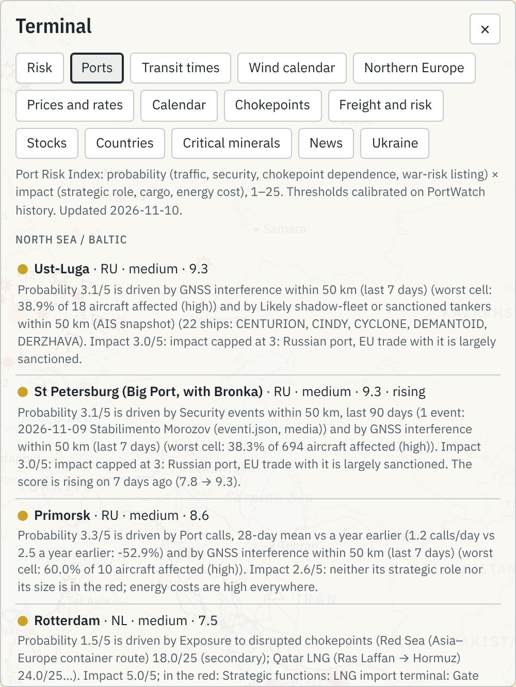
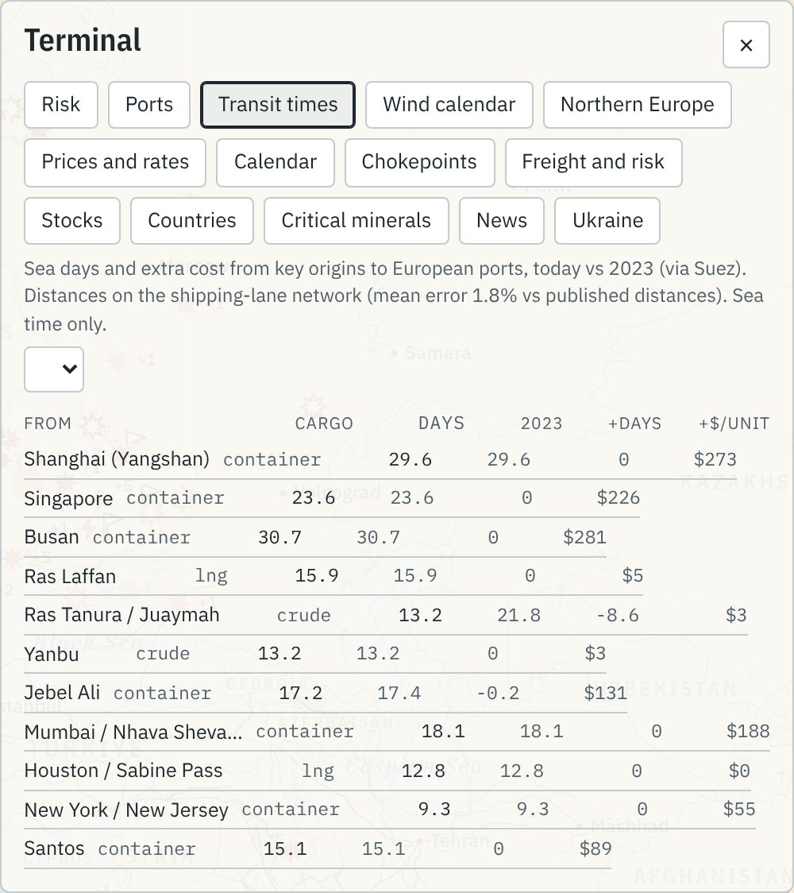
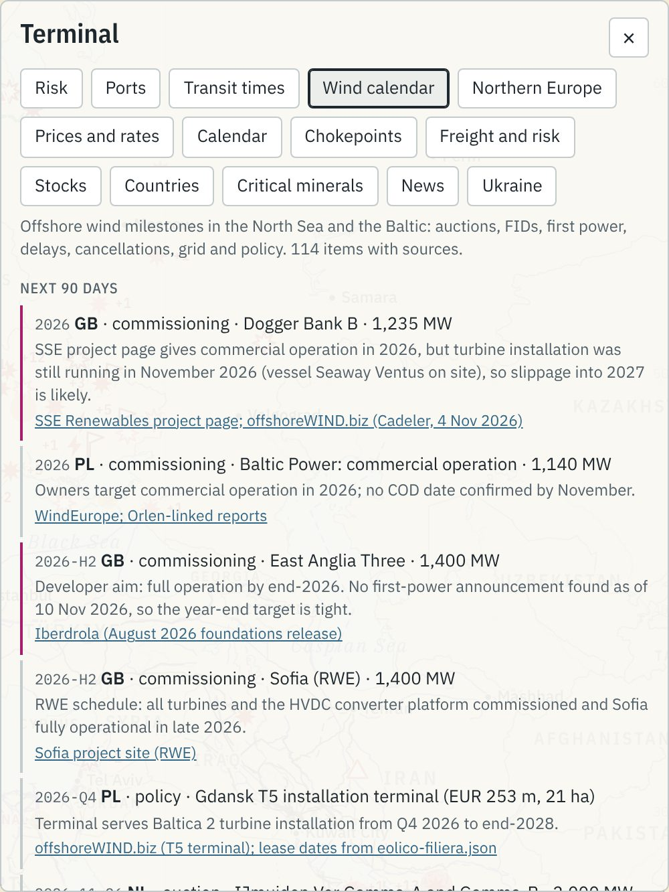

# Capitolo 3 — Gli strumenti di analisi

La mappa (capitolo 2) mostra *dove* succedono le cose. Gli strumenti di analisi dicono *quanto pesano*: il Terminale, il cruscotto del rischio e il Port Risk Index, il simulatore, le notizie, i report, i tempi di viaggio e il calendario dell'eolico. Per ognuno: che cosa mostra, come si legge, da quali file viene, la domanda tipica e il limite. Numeri al 10 novembre 2026 (cruscotto del rischio al 9 novembre, Port Risk Index al 10, PortWatch al 1° novembre per gli stretti e al 30 ottobre per i porti).

## 3.1 Il Terminale

Il Terminale si apre con il pulsante **Terminal** in alto (codice: `docs/index.html`, funzione `renderTerminal()`). Ha **14 schede**, in quest'ordine: *Risk, Ports, Transit times, Wind calendar, Northern Europe, Prices and rates, Calendar, Chokepoints, Freight and risk, Stocks, Countries, Critical minerals, News, Ukraine*. Ogni scheda ha in testa una **nota grigia** con fonte e data: leggerla ad alta voce in un colloquio mostra che sai distinguere un dato fresco da uno vecchio di una settimana.

| Scheda (nome interno) | File in `docs/data/` | In una riga |
|---|---|---|
| Risk (`rischio`) | `rischio.json` | 18 stretti e corridoi: matrice probabilità × impatto e classifica |
| Ports (`porti`) | `port-risk.json` | Port Risk Index di 39 porti, con il «perché» in chiaro |
| Transit times (`tempi`) | `transit-times.json` | giorni di mare e costo in più dalle origini principali ai porti europei |
| Wind calendar (`eolico`) | `wind-calendar.json` | 114 tappe dell'eolico offshore, prossimi 90 giorni in testa |
| Northern Europe (`nord`) | `esposizione-nord.json`, `bunker-emissioni.json` | 10 Paesi del Nord; costo di un viaggio con ETS e FuelEU; prezzo EUA |
| Prices and rates (`prezzi`) | `prezzi.json` | 33 serie di mercato e curva dei tassi USA |
| Calendar (`agenda`) | `calendario.json` | banche centrali, dati macro, energia, elezioni, sanzioni |
| Chokepoints (`stretti`) | `stretti-dettaglio.json`, `portwatch.json` | stato di ogni stretto e navi al giorno |
| Freight and risk (`logistica`) | `noli.json`, `gpr.json`, `portwatch.json` | noli container, rischio geopolitico, porti italiani |
| Stocks (`scorte`) | `scorte.json` | stoccaggi gas, petrolio, grano, oro |
| Countries (`paesi`) | `paesi.json`, `commercio.json` | schede di 33 Paesi |
| Critical minerals (`minerali`) | `minerali.json`, `commercio.json` | produttori e dipendenze critiche di UE e Italia |
| News (`notizie`) | `notizie.json` | notizie OSINT da verificare (§3.4) |
| Ukraine (`ucraina`) | `ucraina-storico.json`, `fronte-storico.json` | lanci e abbattimenti, territorio controllato |

> **Attenzione.** Il sito è in inglese, ma diversi testi generati dagli script sono ancora in italiano: il «perché» di *Risk*, le schede Paese di *Northern Europe*, le sintesi di *Chokepoints*, i titoli del *Calendar*, i nomi dei prodotti in *Critical minerals*. Se mostri lo schermo a un selezionatore straniero, dillo prima tu: «some generated descriptions are still in Italian».

### Risk


Una matrice 5 × 5 con un pallino numerato per ognuna delle 18 unità, poi la classifica: livello (*low, medium, high, critical*), punteggio su 25, tendenza a 7 giorni e il testo «perché», generato da regole. In alto a destra le crisi in corso (GNL del Qatar, Hormuz); in alto a sinistra i rischi da sorvegliare (alto impatto, probabilità bassa: TransMed, Gibilterra, chip di Taiwan). Domanda tipica: *«Che cosa dovrebbe guardare oggi un operatore del Baltico?»* Baltico (cavi, condotte, elettrodotti) a 9,0 e Stretti danesi a 8,3, entrambi *medium*; gli Stretti danesi sono *in aumento* perché i transiti sono sotto l'anno prima e la fotografia AIS conta petroliere sanzionate nel Baltico.

### Ports



La classifica del Port Risk Index divisa in Mare del Nord/Baltico e Italia, con il «perché» in inglese per ogni porto; un clic porta al porto sulla mappa. Metodo e numeri nel §3.2.

### Transit times e Wind calendar

Due schede nuove del 10 novembre, descritte nel §3.6: *Transit times* dà, per ogni origine, giorni di mare oggi, nel 2023, giorni in più e costo in più per unità; *Wind calendar* mette in testa le tappe dei prossimi 90 giorni con fonte e nota.

### Northern Europe


Dieci schede Paese (Paesi Bassi, Danimarca, Germania, Polonia, Lituania, Lettonia, Estonia, Finlandia, Svezia, Norvegia) con livello di esposizione, dipendenza dalle importazioni, provenienza di gas e GNL, porti, collegamenti e rischi; poi tre esempi del **peso di carburante, ETS e FuelEU su un viaggio** e il prezzo della quota di emissione. Paesi Bassi: esposizione *medium-high*, dipendenza dal gas importato 56,5%, GNL per il 77% dagli USA e per il 12% dalla Russia (1° trimestre 2026). Negli esempi, una portacontainer sull'ultima tratta extra UE verso Rotterdam paga circa 3,04 milioni di euro di carburante e 0,55 di ETS (14,8% del totale); tra due porti UE l'ETS sale al 27,6%; con uno scalo in un porto extra UE non in lista scende al 2,2%. **EUA**: la scheda ora mostra il prezzo dell'asta EEX del 9 novembre, **86,91 €/t**, e come riferimento il mercato secondario di Ship & Bunker (87,71 € il 6 novembre).

> **Attenzione.** Gli stoccaggi di gas di Paesi Bassi e Germania mancano ancora in questa scheda (`stoccaggi_gas: null`): lo script del Nord cercava la chiave con il nome sbagliato. Lo script è stato corretto il 10 novembre; i dati compaiono dal prossimo giro del workflow. Nel frattempo usa la scheda *Stocks*.

### Prices and rates, con la curva dei tassi

33 serie in sei gruppi (indici, AI, tassi USA, materie prime, valute, cripto), ciascuna con un mini-grafico di 3 mesi, ultimo valore e variazioni a 1 giorno, 1 mese e da inizio anno; i tassi in punti base. L'asterisco `*` segna una seduta non ancora chiusa. Dopo i tassi c'è la **curva del Tesoro USA** (1 mese – 30 anni: oggi, un mese fa, un anno fa).


Lettura in 30 secondi (`prezzi.json → curva`, 9 novembre): **livello**, il 10 anni è al 4,88% contro il 4,11% di un anno fa; **pendenza**, 10 anni − 2 anni = 0,32 punti (curva positiva ma piatta); **movimento**, rispetto a un mese fa i rendimenti scendono su tutte le scadenze (10 anni da 5,24 a 4,88%). Domanda tipica: *«Come è arrivato lo shock di Hormuz sui mercati?»* Brent 91,70 $ (+50,7% da inizio anno), TTF 82,33 €/MWh (+192,4% da inizio anno), entrambi marcati provvisori. Limite: chiusure da Yahoo Finance (non ufficiali) e Tesoro USA, solo 3 mesi pubblicati per licenza (§4.3).

### Le altre schede

- **Calendar**: appuntamenti dagli ultimi 10 giorni ai prossimi 21, ore UTC, con *Actual / Expected / Previous* per i dati usciti. Nel file: IEA Oil Market Report il 13 novembre, riunione OPEC+ il 29 novembre. Alcune date sono marcate «non confermata».
- **Chokepoints**: stato, navi al giorno (media 7 giorni, PortWatch) con la variazione sull'anno e una sintesi. Hormuz 4,4 (−95,1%), Bab el-Mandeb 27,3 (−22%), Suez 43 (+10,3%). *«Il Mar Rosso si sta riaprendo?»* Suez sale sull'anno, ma Bab el-Mandeb resta al 37% della media gennaio–ottobre 2023 (report *Supply chain*).
- **Freight and risk**: noli container (Drewry WCI 4.389 $/FEU il 5 novembre, Freightos FBX 3.451,8, SCFI 3.633,45 con −1,46% sulla settimana, CCFI 1.924,69); indice GPR (media 30 giorni 184,7, un anno prima 139,7); approdi nei porti italiani (Genova 8,9 al giorno, −4,3%; Ravenna 5,6, −39,8%). Il GPR misura l'attenzione dei giornali, non il danno.
- **Stocks**: stoccaggi gas UE (AGSI+ giornaliero, Eurostat mensile), petrolio USA, scorte di emergenza UE in giorni, grano, oro. All'8 novembre: Italia 88,93% pieni, Paesi Bassi 63,51%, Germania 58,94% (−33,5% sulla media di 5 anni). Ogni Paese ha due righe distinte, *fill level* (%) e *gas in store* (TWh). Danimarca e Polonia non hanno dati AGSI+ giornalieri.
- **Countries**: 33 Paesi (FMI WEO ottobre 2026, Banca Mondiale, SIPRI, Eurostat, UN Comtrade). Italia: dipendenza dal gas 95,2% (2024); greggio da Libia 24,5%, Azerbaigian 15,9%, Kazakistan 12,5% (2025). **Danimarca, Paesi baltici, Finlandia e Svezia non ci sono**: per loro usa *Northern Europe*.
- **Critical minerals**: dipendenze in cui un solo Paese fornisce più del 50% e primi produttori (USGS 2026). I magneti NdFeB importati dall'Italia vengono per l'80,1% dalla Cina (2025). Per gli acquisti intra-UE il fornitore registrato è il Paese di spedizione, non di origine.
- **Ukraine**: dal 28 settembre 2022 al 6 novembre 2026, 156.295 missili e droni lanciati e 122.999 abbattuti (78,7%; il tasso non è confrontabile prima e dopo agosto 2025); territorio controllato dalla Russia 116.864 km² l'8 novembre (19,36%), +937 km² netti nel 2026 contro +4.325 nel 2025. Per porti ed energia è contesto.

## 3.2 Il cruscotto del rischio e il Port Risk Index

### Il metodo in due minuti

> **Cosa dire al colloquio.** «Ogni giorno uno script assegna a ogni stretto e a ogni porto un punteggio da 1 a 25: probabilità di disruption per impatto, entrambi da 1 a 5. È la matrice dei registri dei rischi aziendali (ISO 31000), ma calcolata con regole fisse su dati pubblici. La probabilità risponde a quattro domande: i flussi calano? ci sono attacchi vicino? il clima geopolitico peggiora? il mercato lo prezza? L'impatto ad altre quattro: quanto pesa ciò che passa, ci sono alternative, quanto cuscinetto di scorte c'è, quanto costa già. Ogni indicatore è verde, giallo o rosso con soglie scritte. Se i transiti sono già sotto −50% la probabilità è 5, perché non si stima la probabilità di un fatto già successo; se un dato manca, i pesi si rinormalizzano e il file dice quanto è coperto. Il Port Risk Index applica lo stesso schema a 39 porti e si aggancia al primo: se un porto dipende da uno stretto in crisi, il punteggio dello stretto entra nella sua probabilità. Non è una previsione: è un modo trasparente di dire dove guardare.»

### Gli stretti (`rischio.json`)

Metodo in `report/metodo-rischio.md`, script `raccolta/rischio/calcola.py`. 18 unità: 12 passaggi e 6 corridoi o infrastrutture (TransMed, Baltico, Mar Rosso container, GNL del Qatar, rete elettrica ucraina, chip di Taiwan).

| Asse | Domanda | Peso | Soglia del rosso |
|---|---|---|---|
| Probabilità | I flussi calano? | 35% | transiti sotto −30% sul riferimento |
| | Attacchi o incidenti vicino? | 30% | 3 o più eventi in 30 giorni entro 150 km |
| | Il clima geopolitico peggiora? | 15% | GPR almeno 1,5 volte la media di 5 anni |
| | Il mercato lo prezza? | 20% | prezzo collegato oltre +15% sulla media di 90 giorni |
| Impatto | Quanto pesa ciò che passa? | 35% | quota oltre il 25% o giudizio 4–5 |
| | Ci sono alternative? | 20% | giudizio 4–5 (poche alternative) |
| | Quanto cuscinetto c'è? | 25% | scorte sotto −15% sulla media di 5 anni |
| | Quanto costa già? | 20% | prezzo oltre +40% su un anno |

Ogni indicatore vale 1, 3 o 5; media dentro ogni domanda, media pesata tra le domande. Livelli: *basso* sotto 6, *medio* 6–11,9, *alto* 12–19,9, *critico* da 20. **Perché −30%:** sulla serie PortWatch da gennaio 2024 a febbraio 2026, nei passaggi «normali» un calo oltre −30% non capita mai; è successo solo con crisi vere (Panama con la siccità, Suez con gli Houthi). Per Hormuz, Mar Rosso, Baltico e TransMed ci sono anche tre scenari a 3 mesi con segnali misurabili (`raccolta/rischio/scenari.json`).

**I risultati del 9 novembre 2026** (P = probabilità, I = impatto):

| # | Unità | P | I | Punti | Livello | 7 gg |
|---|---|---|---|---|---|---|
| 1 | GNL del Qatar (Ras Laffan → Hormuz) | 5,0 | 4,8 | 24,0 | critico | stabile |
| 2 | Stretto di Hormuz | 5,0 | 4,5 | 22,5 | critico | stabile |
| 3 | Bab el-Mandeb | 5,0 | 3,8 | 19,0 | alto | stabile |
| 4 | Mar Rosso: rotta container Asia–Europa | 5,0 | 3,6 | 18,0 | alto | stabile |
| 5 | Rete elettrica ucraina | 5,0 | 3,4 | 17,0 | alto | stabile |
| 6 | Stretti turchi | 5,0 | 3,3 | 16,5 | alto | in aumento |
| 7 | Canale di Suez | 2,6 | 3,8 | 9,9 | medio | stabile |
| 8 | Stretto di Kerch | 5,0 | 1,9 | 9,5 | medio | stabile |
| 9 | **Baltico: cavi, condotte, elettrodotti** | 2,3 | 3,9 | 9,0 | medio | stabile |
| 10 | **Stretti danesi** | 2,3 | 3,6 | 8,3 | medio | in aumento |
| 11 | Stretto di Malacca | 2,0 | 3,5 | 7,0 | medio | in aumento |
| 12 | Catena dei chip di Taiwan | 1,3 | 5,0 | 6,5 | medio | stabile |
| 13 | TransMed Algeria–Tunisia–Italia | 1,3 | 4,3 | 5,6 | basso | in calo |
| 14 | Stretto di Gibilterra | 1,3 | 4,2 | 5,5 | basso | stabile |
| 15 | Canale di Sicilia | 1,3 | 4,0 | 5,2 | basso | in calo |
| 16 | Stretto di Taiwan | 1,3 | 3,9 | 5,1 | basso | stabile |
| 17 | Capo di Buona Speranza | 1,3 | 3,2 | 4,2 | basso | stabile |
| 18 | Canale di Panama | 2,2 | 1,6 | 3,5 | basso | stabile |

Copertura dei pesi 1,0 quasi ovunque; più fragili la rete ucraina (0,5), Mar Rosso container, chip e Stretto di Taiwan (0,78), Kerch (0,8).

### I porti (`port-risk.json`)

Metodo in `report/port-risk-method.md`, script `raccolta/porti/rischio_porti.py`. 39 porti: 30 del Mare del Nord e del Baltico e 9 italiani.

| Asse | Domanda | Peso |
|---|---|---|
| Probabilità | Il traffico cala? (approdi sull'anno e 7 giorni contro i 28 precedenti) | 30% |
| | Eventi di sicurezza entro 50 km? (eventi, GNSS, flotta ombra, notizie) | 30% |
| | Dipende da uno stretto in crisi? (punteggi di `rischio.json`) | 25% |
| | È in un'area *listed* del Joint War Committee? | 15% |
| Impatto | Quanto è strategico? (GNL, hub petrolifero, container, porto base eolico, uso militare) | 45% |
| | Quanta merce movimenta? (PortWatch, 30 giorni) | 30% |
| | Quanto costa già l'energia? | 25% |

Per i **porti russi** l'impatto è limitato a 3, perché il commercio UE con loro è in gran parte sanzionato. Le soglie del traffico sono più larghe che per gli stretti e ricalcolate ogni giorno (`calibration`): per i porti con almeno 3 approdi al giorno il giallo scatta nel 15,3% delle settimane, il rosso nel 4,9%.

**Al 10 novembre 2026** nessun porto è *alto* o *critico*. Selezione:

| Porto | P | I | Punti | Livello | Cosa lo spinge |
|---|---|---|---|---|---|
| Ust-Luga (RU) | 3,1 | 3,0 | 9,3 | medio | GNSS entro 50 km, 22 petroliere sanzionate o della flotta ombra vicine |
| St Petersburg (RU) | 3,1 | 3,0 | 9,3 | medio, in aumento | evento di sicurezza e GNSS; impatto limitato a 3 |
| Primorsk (RU) | 3,3 | 2,6 | 8,6 | medio | approdi −52,9% sull'anno, GNSS |
| **Rotterdam** (NL) | 1,5 | 5,0 | 7,5 | medio | impatto massimo: Gate LNG, 917.000 t di merce al giorno; esposto a Mar Rosso e GNL del Qatar |
| Antwerp-Bruges (BE) | 1,5 | 5,0 | 7,5 | medio | come Rotterdam |
| **Klaipėda** (LT) | 1,7 | 4,4 | 7,5 | medio | GNSS, dipendenza da Baltico e Stretti danesi, FSRU |
| **Gdańsk** (PL) | 1,7 | 4,1 | 7,0 | medio | GNSS, 234.000 t al giorno |
| Wilhelmshaven (DE) | 1,5 | 4,4 | 6,6 | medio, in calo | terminali GNL galleggianti |
| **Eemshaven** (NL) | 1,5 | 3,8 | 5,7 | basso | terminale GNL, ingresso del gas nazionale |
| **Esbjerg** (DK) | 1,6 | 2,0 | 3,2 | basso, in aumento | approdi a 7 giorni −42,9% sui 28 precedenti |
| **Aarhus** (DK) | 1,0 | 2,0 | 2,0 | basso | nessun indicatore giallo o rosso: ultimo |

Dove si vede: sulla mappa (livello **Port risk index**), nel Terminale (scheda **Ports**) e nel report *Northern Europe*, sezione 6.

**Un esempio da raccontare: Esbjerg.** Punteggio basso (3,2) ma in aumento: negli ultimi 7 giorni 2,0 approdi al giorno contro 3,5 nei 28 precedenti. Il metodo dice che è un **indizio**, non una diagnosi: congestione, maltempo, sciopero o meno lavoro nei cantieri eolici. È il tipo di cosa che una persona del porto sa spiegare e il modello no: dillo apertamente.

### «Perché questi pesi?»

È la domanda più probabile di un intervistatore tecnico.

1. **Sii onesto: i pesi sono una scelta, non una stima.** Le soglie sono state controllate sulle serie PortWatch, i pesi no. Ragioni da dire a voce (non sono scritte nel file di metodo): i flussi pesano il 35% perché sono l'unico indicatore misurato direttamente; gli attacchi vicini il 30% perché sono il segnale anticipatore classico; il mercato il 20% perché anticipa ma reagisce anche al rumore; il GPR il 15% perché misura l'attenzione dei giornali. Nel Port Risk Index la funzione strategica pesa il 45% perché la chiusura di un porto pesa per il suo ruolo (GNL, petrolio, eolico) più che per i volumi.
2. **Mostra che la classifica regge.** L'autore del capitolo ha ricalcolato i punteggi con tutti i pesi uguali dentro ogni asse: le prime sei unità restano le stesse e allo stesso livello; cambiano livello solo unità vicine alla soglia di 6 (TransMed, Gibilterra, Canale di Sicilia salgono a medio; tra i porti, 6 su 39 passano la soglia, Rotterdam resta a 7,5). Quindi **i pesi spostano i casi al confine, non l'ordine di ciò che conta.** Questo calcolo non è nel repository: rifallo prima di citarlo, o aggiungilo al file di metodo.
3. **Di' come li miglioreresti.** Con uno storico più lungo i pesi si tarano all'indietro: quale combinazione avrebbe segnalato prima le disruption vere (Panama, Suez con gli Houthi, Primorsk e Ust-Luga con i droni del 2026)?

> **Attenzione.** Limiti da dire prima che te li chiedano: non è una probabilità statistica («5» vuol dire «disruption in corso o tutti i segnali in allerta»); le unità non sono indipendenti (Hormuz e GNL del Qatar condividono i transiti), quindi i punteggi non si sommano; il Port Risk Index non misura la congestione, perché non esiste una fonte gratuita dei tempi di attesa; i porti italiani hanno meno indicatori di sicurezza.

## 3.3 Il simulatore «e se…»


La pagina è `docs/simulatore.html` (*"What if…" simulator*); il modello sta in `docs/data/simulatore.json` e lo script `raccolta/simulatore/controlla.py` verifica che ogni numero corrisponda ai file di dati.

**Come si usa.** Tre scelte: **lo stretto** (Hormuz, Bab el-Mandeb, Suez, Malacca, Taiwan, Bosforo, Stretti danesi, Panama, Sicilia/TransMed), **l'intensità** (rallentamento 25%, 50%, chiusura totale) e **la durata** (2 settimane, 1 mese, 3 mesi). Si parte da Hormuz chiuso per un mese. Il risultato segue la catena in passi numerati: flussi coinvolti, alternative e volume scoperto, rotte alternative, noli, prezzi di Brent e TTF, chi è esposto, e dal 10 novembre **What happens in Italy**.

**Le quattro regole da saper spiegare.**

1. **Volume scoperto = flusso × intensità − capacità libera dei bypass** (mai sotto zero): il risultato è sempre una forchetta.
2. **Giorni in più**: se le navi possono girare (Suez, Bab el-Mandeb) l'alternativa è il Capo; se non c'è una rotta (Hormuz, Stretti danesi) il simulatore lo dice e non inventa giorni.
3. **Noli**: aumento in $/FEU sommato al WCI di oggi, tra il solo costo del viaggio via Capo (+160 $/FEU) e il salto del WCI nella crisi del Mar Rosso (+2.256 $ in 35 giorni).
4. **Prezzi dagli episodi storici**: per la *perdita di offerta*, Hormuz 2026 (nei primi 30 giorni Brent da 71,27 $ a una media di 99,60 $, +39,8%, con 15,5 mb/g scoperti: tra 2,56% e 4,26% di Brent per ogni mb/g scoperto); per la *deviazione*, il Mar Rosso 2023–2024 (Brent +3,8%, effetto zero sul gas).

**Hormuz chiuso per un mese** (impostazione predefinita, prezzi del 9 novembre): petrolio scoperto **14,2–16,9 mb/g** su 19,9 (bypass saudita 3,0–5,0, emiratino 0–0,7); 425–506 milioni di barili mancanti in 30 giorni, il 106–127% del rilascio record delle riserve IEA (400 milioni, marzo 2026); 112 bcm/anno di GNL senza alternative; **Brent +36% … +72%, TTF +67% … +96%**; noli +1.500 $/TEU. Esposti: Italia con il 5,6–10,2% del greggio e il 32,6% del GNL importati dal Golfo; Paesi Bassi 8,1–9,4% del greggio e 0% del GNL.

> **Cosa dire al colloquio.** Il simulatore stesso avverte che **per Hormuz descrive ciò che è già successo**: lo stretto è chiuso dal 2 marzo ed è proprio l'episodio su cui il modello è tarato. I «prezzi da oggi» applicano lo shock a prezzi che lo incorporano già: non sono una previsione. Dillo tu per primo: è la prova che conosci il tuo modello.

**Per il Baltico: Stretti danesi chiusi per un mese.** Petrolio scoperto 4,7 mb/g, senza alternativa via mare per il greggio russo del Baltico; **Brent +12% … +20%**; TTF e noli *non disponibili*, perché nei file non c'è un episodio documentato e il modello non inventa un numero. Perdono Primorsk e Ust-Luga, poi Gdańsk, Klaipėda e i porti finlandesi; Rotterdam e Amburgo potrebbero guadagnare come trasbordo.

### What happens in Italy

La sezione (dati in `italia-impatti.json`, regole in `raccolta/italia/raccogli.py`) applica le variazioni di Brent e TTF alle regole di trasmissione italiane, con due punti di partenza: condizioni normali (23 febbraio 2026) e prezzi di oggi. Per **Hormuz chiuso un mese, dai prezzi di oggi**:

| Effetto in Italia | Forchetta | Base |
|---|---|---|
| Gasolio alla pompa | 2,61–3,04 €/l | 2,287 €/l (prezzo MASE del 2 novembre più il taglio delle accise scaduto l'8 novembre) |
| Benzina | 2,24–2,52 €/l | 2,001 €/l (2 novembre) |
| PUN, elettricità all'ingrosso | 340–385 €/MWh | 230,82 €/MWh (ottobre) |
| Inflazione, effetto diretto | +2,70…+4,37 punti | pesi HICP 2026 |
| Rischio fermo dei camion | alto | soglia: gasolio da 2,10 €/l |

**Perché è credibile:** il modello è controllato all'indietro sul primo mese di guerra (gasolio previsto e osservato MASE vicini) e le regole vengono da regressioni settimanali 2021–2026. Le parti marcate come valutazione (catene di effetti, misure probabili del governo) sono stime dell'osservatorio.

**Limiti** (dal file): niente domanda, politiche, aspettative o effetti di secondo giro; non somma più stretti chiusi; ogni meccanismo è tarato su un solo episodio; la Danimarca non è in `paesi.json` né in `scorte.json`. Se modifichi `simulatore.json` a mano, rilancia sempre `python3 raccolta/simulatore/controlla.py`.

## 3.4 La pagina Notizie e le notizie OSINT

Sono **due strumenti diversi**, da non confondere.

| | Pagina *News feed* (`docs/notizie.html`) | Scheda *News* del Terminale |
|---|---|---|
| A cosa serve | leggere la stampa per argomento | trovare possibili nuovi eventi per la mappa |
| File | `notizie-testate.json` | `notizie.json` |
| Fonti | 93 feed di 57 testate | 35 fonti OSINT |
| Finestra | ultimi 3 giorni | ultimi 7 giorni |
| Stato | articoli con link all'editore | tutto «da verificare» |


**La pagina.** 12 argomenti: i primi cinque pensati per i tuoi colloqui (*Ports and logistics, Shipping and freight, Offshore energy and wind, Gas, LNG and oil, Hydrogen and the port transition*), poi stretti, Russia–Ucraina, Medio Oriente, infrastrutture e cyber, mercati, AI e chip, Italia. All'ultimo giro (9 novembre, 20:06 UTC) 1.049 articoli. In cima a ogni argomento *The day's top 5 stories*: prima le storie riprese da almeno due testate nelle ultime 36 ore. Il filtro **No paywall only** serve quando mandi un link a un selezionatore. Limite: la classificazione è automatica, a parole chiave, e sbaglia (in *Ports and logistics* compare anche una crociera a Singapore).

**La regola delle due fonti** (`report/agenti/notizie.md`), da sapere a memoria: **alta** affidabilità = almeno due fonti **indipendenti**, di cui una primaria (avviso UKMTO o JMIC, comunicato ufficiale, foto geolocalizzate, dati satellitari) o di alta affidabilità (Reuters, AP, BBC, Lloyd's List, ISW); due articoli che citano entrambi «Reuters» valgono una fonte sola; **media** = una sola fonte affidabile; le **rivendicazioni** restano *media* anche se riprese da molte testate. Solo con affidabilità alta una notizia diventa un evento sulla mappa. È la risposta a «come eviti di pubblicare propaganda o errori?».

## 3.5 I report


L'indice è `docs/report/index.html` (*Analysis reports*). Al 10 novembre 2026 i **report pubblicati sono quattro**:

| Report | File | In breve |
|---|---|---|
| **Northern Europe: Ports and Energy**, n. 1 (*flagship*) | `en/northern-europe-2026-11.html` (solo inglese) | porti del Mare del Nord e del Baltico, stoccaggi tedeschi e olandesi sotto la norma, eolico offshore, costi della navigazione, sicurezza del Baltico, Port Risk Index. Revisione: 64 affermazioni, 12 corrette |
| **Hormuz e Mar Rosso**, n. 1, 9 novembre | `hormuz-mar-rosso-2026-11.html` · `en/hormuz-red-sea-2026-11.html` | Hormuz chiuso dal 2 marzo, il rischio che si sposta su Bab el-Mandeb; noli, Brent, TTF; tre scenari con soglie. 183 affermazioni, 38 corrette |
| **Supply chain e logistica**, n. 2 | `supply-chain-2026-11.html` · `en/supply-chain-2026-11.html` | Suez in ripresa, noli doppi sull'anno ma fermi, porti italiani a due velocità, cruscotto di 6 indicatori. 59 affermazioni, 9 corrette |
| **La catena dell'AI**, n. 3 | `supply-chain-ai-2026-11.html` · `en/ai-supply-chain-2026-11.html` | otto anelli, dalle miniere alle macchine EUV di Veldhoven ai data center; controlli cinesi all'export. 110 affermazioni, 32 corrette |

> **Attenzione.** In `docs/report/en/` ci sono altre tre bozze, **non ancora pubblicate nell'indice e in revisione**: *Offshore wind in Northern Europe*, *Asia–Europe logistics*, *Italy and the Gulf shock*. Non citarle in un CV finché non hanno la loro revisione in `report/revisioni/`.

**Come sono fatti.** (1) i dati di `docs/data/`; (2) uno script Python legge i JSON, ricalcola ogni numero, disegna i grafici e scrive Markdown e HTML (eccezione: il report Hormuz è scritto a mano, solo i grafici vengono da `report/costruisci_grafici.py`); (3) la bozza segue `report/STANDARD.md`; (4) un revisore, cioè una sessione AI separata con il ruolo di fact-checker severo, ricontrolla ogni numero e scrive una tabella in `report/revisioni/<report>.md` (affermazione, valore, valore verificato, fonte, esito); le correzioni si fanno alla fonte e il report si rigenera.

**Aggiornarli ogni mese** (esempio per dicembre):

```bash
python3 report/build_northern_europe.py --month 2026-12
python3 report/costruisci_supply_chain.py --mese 2026-12
python3 raccolta/supply-chain-ai/raccogli.py && python3 report/costruisci_supply_chain_ai.py --mese 2026-12
python3 raccolta/simulatore/controlla.py
```

Poi leggi gli avvisi dello script (fatti esterni con più di 60 giorni), fai fare la revisione, aggiungi l'edizione all'indice (scritto a mano) e ritraduci le versioni inglesi di *Supply chain* e *Catena dell'AI* (gli script scrivono solo in italiano). Il report Hormuz non ha uno script del testo.

**Quale mandare a chi.** Porti e logistica nel Nord: *Northern Europe*. Eolico offshore: *Northern Europe* (eolico e calendario). Gas e GNL: *Hormuz e Mar Rosso*, poi *Northern Europe*. Armatori e spedizionieri: *Supply chain*. Semiconduttori e fornitori di ASML: *Catena dell'AI*. Consulenza del rischio e assicurazioni: *Hormuz* più il metodo del rischio. Regola pratica: **un solo report per email**, con una riga che dice quale sezione leggere.

## 3.6 Tempi di viaggio e calendario dell'eolico

Due file nuovi del 10 novembre, aggiornati ogni giorno: sulla mappa (*Sea routes to Europe*) e nel Terminale (*Transit times*, *Wind calendar*), citati anche dal report *Northern Europe*.

### Tempi di viaggio (`transit-times.json`)



**Che cos'è.** 99 rotte: 11 origini (Shanghai, Singapore, Busan, Ras Laffan, Ras Tanura, Yanbu, Jebel Ali, Sabine Pass…) verso 9 porti europei (Rotterdam, Anversa, Amburgo, Danzica, Klaipėda, Esbjerg, Genova, Trieste, Pireo), in tre scenari: **base** (tutto aperto, come nel 2023), **Capo** (senza Suez e Bab el-Mandeb), **oggi** (dallo stato degli stretti). Script `raccolta/rotte/tempi.py`, metodo in `report/agenti/transit-times.md`.

**Come calcola.** Percorso più breve (Dijkstra) sulla rete delle rotte di Benden; giorni = miglia / (nodi × 24), **solo tempo in mare**. Costo in più = carburante extra al VLSFO di oggi + ETS + differenza di premio war risk. Errore medio sulle distanze pubblicate 1,8% (massimo 4,6%).

| Rotta | Oggi | Via Capo | Note |
|---|---|---|---|
| Shanghai → Rotterdam, container | 29,6 giorni (via Suez) | 40,1 (+10,5) | circa 1,48 M$ in più a viaggio via Capo |
| Shanghai → Genova, container | 24,4 giorni | 40,1 (+15,7) | |
| Ras Laffan → Rotterdam, GNL | *blocked* | 28,2 (+12,3) se Hormuz riaprisse e Suez no | il GNL del Qatar non ha alternative a Hormuz |
| Ras Tanura → Rotterdam, greggio | 13,2 giorni da Yanbu | | 8,6 giorni **in meno** che da Ras Tanura, con war risk a Yanbu |
| Sabine Pass → Rotterdam, GNL | 12,8 giorni | uguale | non toccata dalla crisi |

Con il 63% della capacità Asia–Europa di nuovo sul Mar Rosso (Alphaliner, ottobre 2026), la media pesata è circa **+4 giorni verso il Nord Europa** e **+6–7 verso Italia e Grecia**.

> **Cosa dire al colloquio.** Due messaggi. Il Nord Europa soffre meno del Mediterraneo la deviazione dal Capo (+10,5 giorni per Rotterdam contro +15,7 per Genova). E l'aumento di costo più grande su ogni rotta è il prezzo del carburante, non la distanza: VLSFO a Singapore 854 $/t contro 521,5 il 27 febbraio (+64%).

**Limiti.** Consumi, valore delle navi e carico sono ipotesi dichiarate; stessa velocità in tutti gli scenari; il pedaggio di Suez non è dedotto. UNCTAD stima 14–24 giorni in più via Capo, il modello 10,5: il report mostra entrambi e spiega perché (più origini e velocità diverse).

### Calendario dell'eolico offshore (`wind-calendar.json`)



**Che cos'è.** 114 tappe dell'eolico offshore nel Mare del Nord e nel Baltico (13 Paesi più l'UE), dal 2023 al 2027: aste, politiche, ritardi, rete, costruzione, messa in esercizio, prima energia, cancellazioni, decisioni finali di investimento (FID). Ogni voce ha fonte, link, data della fonte, affidabilità e precisione della data. Voci curate in `raccolta/eolico/calendario_voci.json`, validate ogni giorno da `raccolta/eolico/calendario.py`.

**Come si legge.** Il campo chiave è `status_effective`: al 10 novembre *done* 84, *scheduled* 18, *at risk* 8, *unconfirmed* 4. *Unconfirmed* lo mette lo script quando una data prevista è passata senza conferma (per esempio He Dreiht a piena potenza, atteso a ottobre 2026). I `candidati_rss` di offshoreWIND.biz sono suggerimenti, non voci verificate.

**Nei prossimi 90 giorni:** Paesi Bassi, gara IJmuiden Ver Gamma-A e Gamma-B (2 GW) dal 26 novembre al 10 dicembre, la prima dopo che Nederwiek I-A non ha ricevuto offerte; Regno Unito, risultati dell'asta AR8 tra il 27 novembre e il 17 febbraio; Germania, voto sulla riforma WindSeeG a dicembre (*at risk*); Lituania, decisione su Curonian Nord (700 MW, *at risk*); Polonia, terminale Gdańsk T5 nel 4° trimestre; Regno Unito, prima energia di Hornsea 3 nel 1° trimestre 2027 (*at risk*).

**Come usarlo.** Prima di un colloquio con un'azienda dell'eolico o un porto base, filtra il Paese dell'azienda, leggi le tre voci più vicine e preparati una domanda («Se anche Gamma andasse senza offerte, l'obiettivo olandese di 21 GW al 2032 regge?»). Il messaggio di sintesi: le aste ripartono dove lo Stato si prende il rischio di prezzo (Regno Unito, Danimarca, Polonia) e restano ferme dove non lo fa; tra il 2023 e il 2025 circa 7,2 GW di gare non hanno avuto aggiudicatari. Limite: è un elenco curato, non tutto ciò che succede.

### In sintesi: lo strumento giusto per ogni domanda

| Domanda del selezionatore | Strumento |
|---|---|
| «Dove sono i rischi oggi?» | Terminal → *Risk* (§3.2) |
| «E per il nostro porto?» | Terminal → *Ports*, livello *Port risk index* (§3.2) |
| «Che cosa succede se chiude lo stretto X?» | Simulatore (§3.3) |
| «Quanto ci mette una nave da Shanghai a Rotterdam?» | Terminal → *Transit times* (§3.6) |
| «Che cosa succede nell'eolico nei prossimi mesi?» | Terminal → *Wind calendar* (§3.6) |
| «Come verifichi le notizie?» | Regola delle due fonti (§3.4) |
| «Come sai che i numeri sono giusti?» | `report/revisioni/`, `controlla.py`, controllo di qualità (§3.5, §4.6) |
