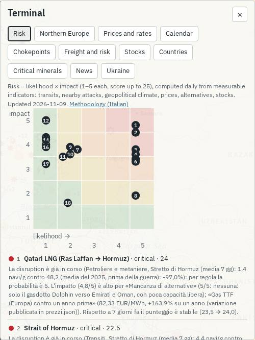
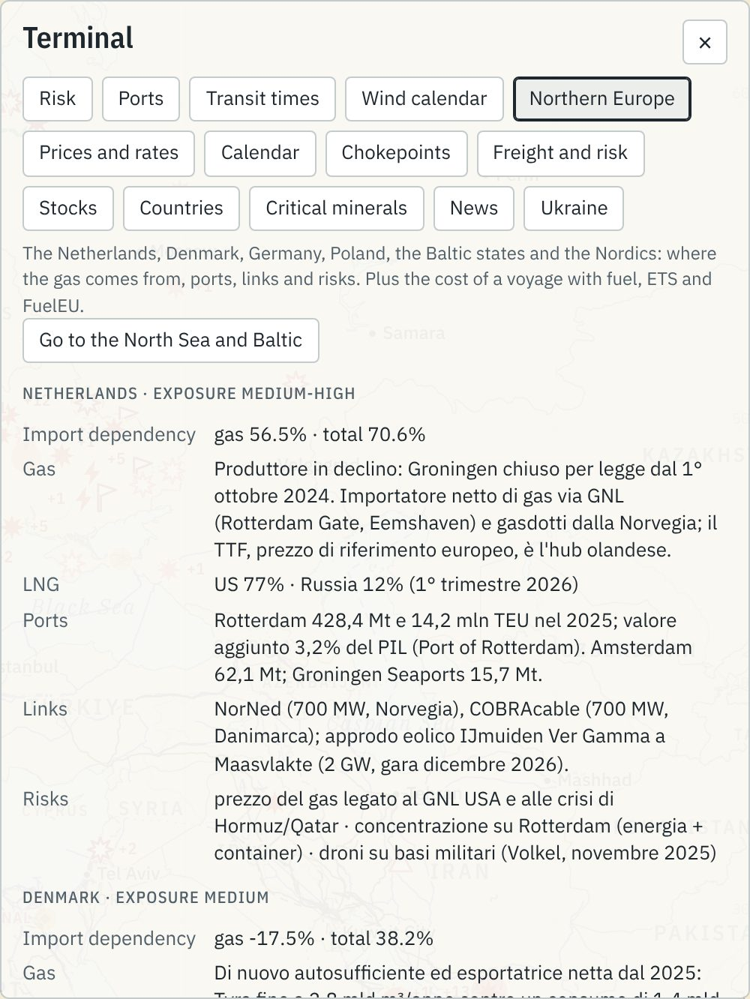
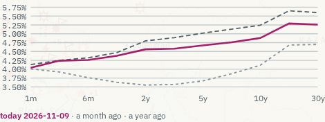
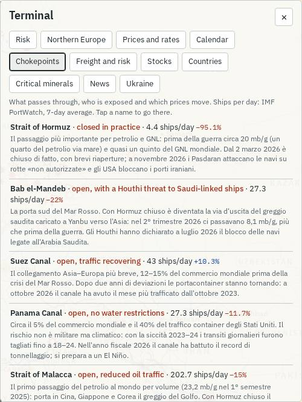
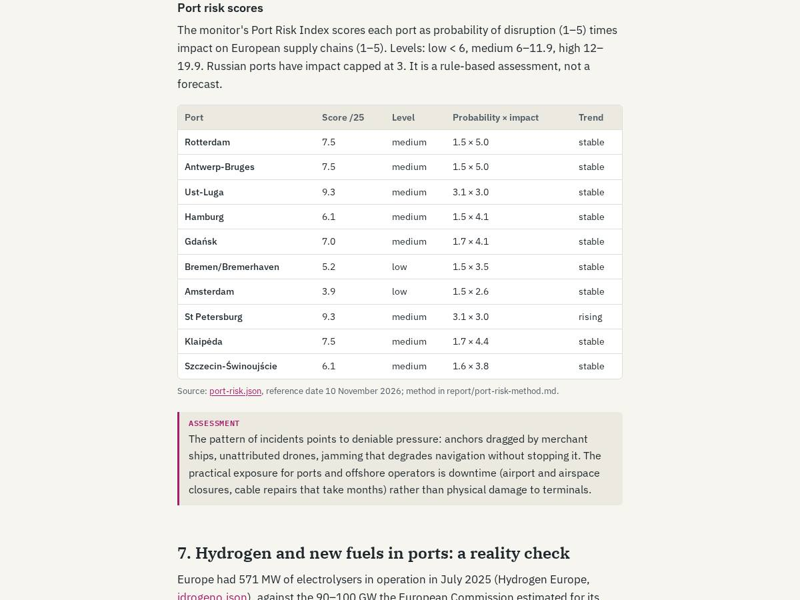
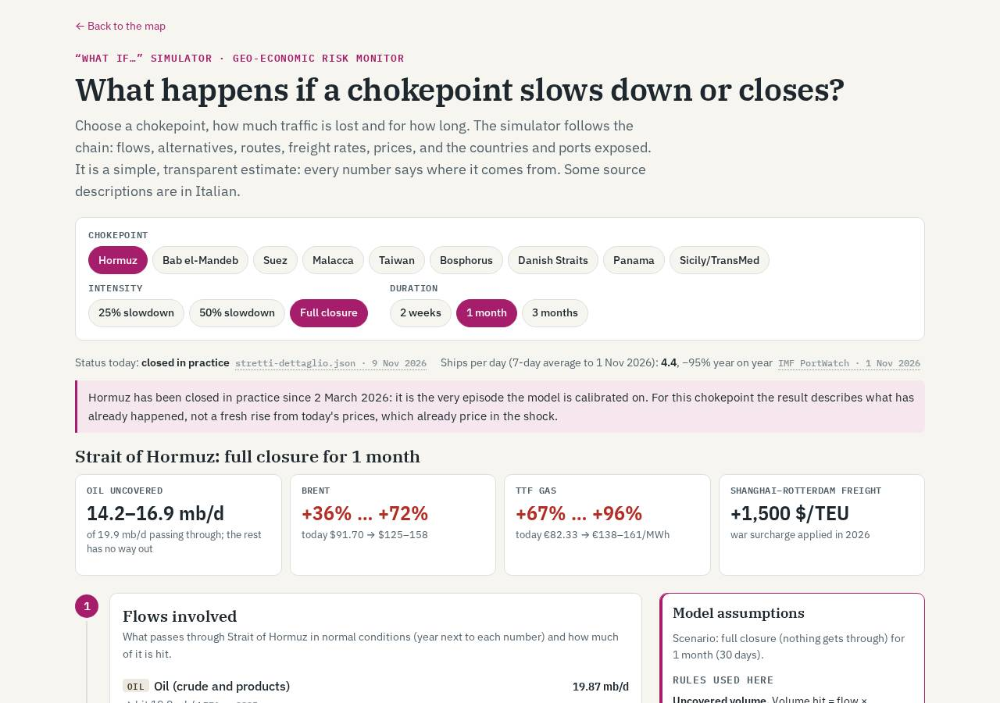
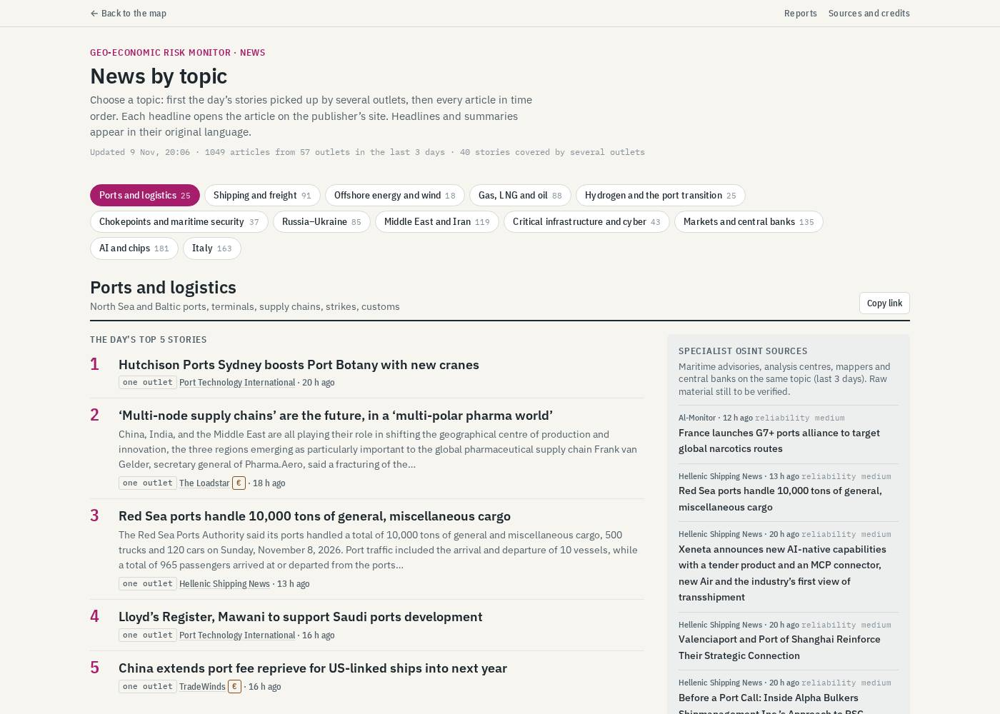
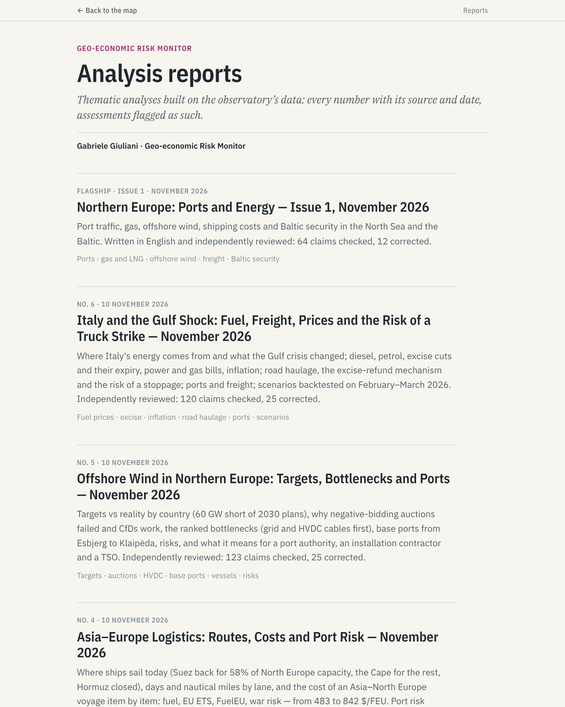

# Capitolo 3 — Gli strumenti di analisi

> **A cosa serve questo capitolo.** La mappa (capitolo 2) mostra *dove* succedono le cose. Gli strumenti di analisi dicono *quanto pesano*: il Terminale, il cruscotto del rischio e il Port Risk Index, il simulatore «e se…», le notizie, i report, i tempi di viaggio e il calendario dell'eolico. Per ognuno trovi che cosa mostra, come si legge, da quali file viene, la domanda tipica a cui risponde in un colloquio e il suo limite principale. È il capitolo da rileggere prima di un colloquio con un porto, una società di logistica o un operatore dell'energia offshore nei Paesi Bassi, in Danimarca o sul Baltico.

**Stato dei dati in questo capitolo.** Numeri letti dai file del repository il **10 novembre 2026** (cruscotto del rischio al 9 novembre, Port Risk Index al 10 novembre, PortWatch al 1° novembre per gli stretti e al 30 ottobre per i porti). Nessun numero è stimato a mano: se un dato cambia, vale il file.

**Nomi e lingua.** Il sito è passato all'inglese: in questo capitolo uso i nomi come compaiono oggi sullo schermo (per esempio *Risk*, *Chokepoints*, *Freight and risk*) e, tra parentesi, il nome interno italiano usato nel codice (`rischio`, `stretti`, `logistica`). Alcuni testi generati dagli script (il «perché» del cruscotto, le descrizioni delle fonti, i titoli di alcuni eventi) sono ancora in italiano anche sul sito inglese. Dove un nome può cambiare con la traduzione lo segnalo con **[da controllare dopo la traduzione]**.

---

## 3.1 Il Terminale

Il Terminale è il pannello che si apre con il pulsante **Terminal** in alto a destra della mappa. Il codice sta in `docs/index.html`, funzione `renderTerminal()`; i file di dati sono elencati nell'oggetto `XF` dello stesso file e caricati da `xLoad()`. Ha **11 schede**, in quest'ordine: *Risk*, *Northern Europe*, *Prices and rates*, *Calendar*, *Chokepoints*, *Freight and risk*, *Stocks*, *Countries*, *Critical minerals*, *News*, *Ukraine*. Si apre sempre sulla scheda *Risk*.

Ogni scheda ha in testa una **nota grigia** con fonte e data dei dati: leggerla ad alta voce in un colloquio mostra che sai distinguere un dato fresco da uno vecchio di una settimana.

| Scheda sul sito (nome interno) | File in `docs/data/` | In una riga |
|---|---|---|
| Risk (`rischio`) | `rischio.json` | 18 stretti e corridoi: probabilità × impatto |
| Northern Europe (`nord`) | `esposizione-nord.json`, `bunker-emissioni.json` | 10 Paesi del Nord: gas, porti, collegamenti, rischi; costo di un viaggio con ETS e FuelEU |
| Prices and rates (`prezzi`) | `prezzi.json` | 33 serie di mercato e curva dei tassi USA |
| Calendar (`agenda`) | `calendario.json` | banche centrali, dati macro, energia, elezioni, sanzioni |
| Chokepoints (`stretti`) | `stretti-dettaglio.json`, `portwatch.json` | stato di ogni stretto e navi al giorno |
| Freight and risk (`logistica`) | `noli.json`, `gpr.json`, `portwatch.json` | noli container, rischio geopolitico, porti italiani |
| Stocks (`scorte`) | `scorte.json` | stoccaggi gas, petrolio, grano, oro |
| Countries (`paesi`) | `paesi.json`, `commercio.json` | scheda macro ed energetica di 33 Paesi |
| Critical minerals (`minerali`) | `minerali.json`, `commercio.json` | chi produce le materie critiche e da chi dipendono UE e Italia |
| News (`notizie`) | `notizie.json` | notizie OSINT da verificare (regola delle due fonti) |
| Ukraine (`ucraina`) | `ucraina-storico.json`, `fronte-storico.json` | lanci russi, territorio controllato, ondate sulla rete |

### Risk (rischio)



**Cosa mostra.** Una matrice 5 × 5 (in orizzontale la probabilità, in verticale l'impatto) con un pallino numerato per ognuna delle 18 unità del cruscotto, poi la classifica dalla più rischiosa alla meno. Ogni riga dice livello (*low, medium, high, critical*), punteggio su 25, tendenza a 7 giorni e il testo **«perché»**, generato da regole, che cita gli indicatori che spingono di più. Un clic sulla riga porta al punto sulla mappa.

**Come si legge.** In alto a destra le crisi in corso (oggi GNL del Qatar e Hormuz); in alto a sinistra i rischi da sorvegliare (alto impatto, probabilità bassa: TransMed, Canale di Sicilia, Gibilterra, chip di Taiwan). Il metodo è spiegato in 3.2.

**Domanda tipica.** *«Quali passaggi dovrebbe guardare oggi un operatore del Baltico?»* Risposta dai dati: Baltico (cavi, condotte, elettrodotti) a 9,0 e Stretti danesi a 8,3, entrambi *medium*; gli Stretti danesi sono *in aumento* (da 5,8 a 8,3 in 7 giorni) perché i transiti sono a −20,5% sull'anno e la fotografia AIS conta 45 petroliere sanzionate o della flotta ombra nel Baltico.

**Limite.** Il testo «perché» e la colonna «cosa osservare» sono ancora in italiano sul sito inglese **[da controllare dopo la traduzione]**; il link al metodo porta a un file in italiano (`report/metodo-rischio.md`).

### Northern Europe (nord)



**Cosa mostra.** Dieci schede Paese (Paesi Bassi, Danimarca, Germania, Polonia, Lituania, Lettonia, Estonia, Finlandia, Svezia, Norvegia), ognuna con un livello di esposizione, la dipendenza dalle importazioni, da dove arriva il gas e il GNL, i porti principali, i collegamenti (cavi, interconnessioni) e i rischi. Sotto, tre esempi di **quanto pesano carburante, ETS e FuelEU su un viaggio**, e il prezzo della quota di emissione (EUA). Il pulsante *Go to the North Sea and Baltic* inquadra la regione sulla mappa.

**Come si legge.** Paesi Bassi: esposizione *medium-high*, dipendenza dal gas importato 56,5%, GNL per il 77% dagli USA e per il 12% dalla Russia (1° trimestre 2026). Danimarca: esposizione *medium*, di nuovo esportatrice netta di gas dal 2025 (Tyra); il rischio indicato è la flotta ombra negli stretti (292 passaggi di petroliere sanzionate UE nel 2025). Negli esempi di costo, una portacontainer sull'ultima tratta extra UE verso Rotterdam paga circa 3,04 milioni di euro di carburante e 0,55 di ETS (14,8% del totale); tra due porti UE l'ETS sale al 27,6%.

**Domanda tipica.** *«Quanto costa l'ETS marittimo a una linea che scala Rotterdam, e perché i porti di trasbordo fuori UE contano?»* Il terzo esempio mostra il meccanismo: con uno scalo in un porto extra UE non in lista, l'ETS scende al 2,2% del costo.

**Limite.** I testi delle schede (gas, porti, rischi) sono ancora in italiano **[da controllare dopo la traduzione]**. Il prezzo EUA mostrato (87,71 €, etichetta «EEX auction») è in realtà il prezzo Ship & Bunker del 6 novembre: il codice prende il primo numero del campo `eua` di `bunker-emissioni.json`. Il report *Northern Europe* usa l'asta EEX del 9 novembre, 86,91 €/t. Se te lo chiedono, cita 86,91 €/t (asta) e segnala la differenza.

### Prices and rates (prezzi), con la curva dei tassi


**Cosa mostra.** 33 serie in sei gruppi (indici, AI, tassi USA, materie prime, valute, cripto), ognuna con un mini-grafico degli ultimi 3 mesi, l'ultimo valore e le variazioni a 1 giorno, 1 mese e da inizio anno (YTD). I tassi sono variati in **punti base** (bp), il resto in percentuale. L'asterisco `*` segna una seduta non ancora chiusa. Passando il mouse su una riga compaiono unità, fonte e data.

**La curva dei tassi USA.** Dopo il gruppo dei tassi c'è la curva dei rendimenti del Tesoro USA, da 1 mese a 30 anni, con tre linee: oggi, un mese fa, un anno fa.



Come leggerla in 30 secondi, con i numeri di oggi (9 novembre 2026, `prezzi.json → curva`):
- **Livello.** Il 10 anni è al 4,88%, un anno fa al 4,11%: i tassi lunghi sono più alti di un anno fa.
- **Pendenza.** Il differenziale 10 anni − 2 anni è 0,32 punti (4,88 − 4,56): curva positiva ma piatta. Un anno fa il 2 anni era al 3,55%.
- **Movimento recente.** Rispetto a un mese fa i rendimenti sono scesi su tutte le scadenze (10 anni da 5,24 a 4,88%, 2 anni da 4,80 a 4,56%).

**Domanda tipica.** *«Come è arrivato lo shock di Hormuz sui mercati?»* Brent a 91,70 $ (+50,7% da inizio anno), TTF a 82,33 €/MWh (+192,4% da inizio anno), entrambi provvisori (`*`).

**Limite.** Chiusure giornaliere da Yahoo Finance (non ufficiali) e Tesoro USA, non quotazioni in tempo reale; il file pubblica solo 3 mesi di serie per ragioni di licenza. La revisione del report Hormuz ha trovato che, tra l'8 marzo e il 1° novembre 2026, lo script registrava le sedute un giorno prima (errore di fuso orario): tienilo presente se confronti date esatte.

### Calendar (agenda)

**Cosa mostra.** Gli appuntamenti dagli ultimi 10 giorni ai prossimi 21: banche centrali, dati macro, energia (OPEC, IEA, EIA), elezioni, vertici, sanzioni (OFAC). Ore in UTC. Gli eventi a importanza bassa sono esclusi, quelli ad alta importanza sono evidenziati. Per i dati già usciti compaiono *Actual*, *Expected* e *Previous*, con il link alla fonte.

**Domanda tipica.** *«Che cosa può muovere il gas e il petrolio nelle prossime tre settimane?»* Nel file: EIA Short-Term Energy Outlook il 10 novembre, IEA Oil Market Report il 13, riunione ministeriale OPEC+ il 29 novembre (quote 2027).

**Limite.** I titoli e i valori sono in italiano **[da controllare dopo la traduzione]**; alcune date sono marcate «non confermata» nel testo (per esempio il rapporto mensile OPEC).

### Chokepoints (stretti)



**Cosa mostra.** Per ogni stretto: stato attuale (per esempio *closed in practice*), navi al giorno (media 7 giorni, IMF PortWatch) con la variazione sull'anno, e una sintesi di che cosa passa e chi è esposto. Un clic porta allo stretto sulla mappa e apre la scheda completa.

**Come si legge.** Oggi: Hormuz 4,4 navi al giorno (−95,1%), Bab el-Mandeb 27,3 (−22%), Suez 43 (+10,3%).

**Domanda tipica.** *«Il Mar Rosso si sta riaprendo?»* Suez sale sull'anno, ma Bab el-Mandeb resta a 27,3 navi al giorno, il 37% della media gennaio–ottobre 2023 (dato del report *Supply chain*).

**Limite.** PortWatch conta solo le navi con l'AIS acceso e arriva con circa una settimana di ritardo: a Hormuz, nella settimana 19–25 ottobre, PortWatch contava 23 transiti e Lloyd's List Intelligence 116. Le sintesi sono in italiano **[da controllare dopo la traduzione]**.

### Freight and risk (logistica)


**Cosa mostra.** Tre blocchi. (1) **Noli container**: Drewry WCI 4.389 $/FEU (5 novembre), Freightos FBX 3.451,8, SCFI 3.633,45, CCFI 1.924,69 (6 novembre). (2) **Rischio geopolitico GPR** di Caldara e Iacoviello (media 1985–2019 = 100): media 30 giorni 184,7, un anno prima 139,7, con grafico settimanale. (3) **Porti italiani**: approdi al giorno (media 7 giorni) e variazione sull'anno, per esempio Genova 8,9 (−4,3%), Ravenna 5,6 (−39,8%).

**Domanda tipica.** *«I noli stanno ancora salendo?»* No: il WCI è circa il doppio di un anno fa (+124% nel report *Supply chain*), ma lo SCFI è sceso dell'1,46% nell'ultima settimana.

**Limite.** WCI e FBX non mostrano la variazione (trattino); il GPR misura l'attenzione dei giornali, non il danno; i porti qui sono solo italiani: quelli del Mare del Nord e del Baltico stanno sulla mappa (livello porti, `porti-nord.json`) e nel Port Risk Index (3.2).

### Stocks (scorte)

**Cosa mostra.** Le scorte strategiche: stoccaggi gas UE (AGSI+ giornaliero ed Eurostat mensile), petrolio USA (EIA), scorte petrolifere di emergenza UE in giorni, grano (USDA), oro delle banche centrali (FMI). Mini-grafico, ultimo valore, variazione su un anno, data.

**Come si legge.** Stoccaggi gas all'8 novembre: Italia 88,93% pieni, Paesi Bassi 63,51%, Germania 58,94%. Per un'azienda del Nord è il numero più importante dell'inverno.

**Domanda tipica.** *«L'Europa del Nord arriva all'inverno con abbastanza gas?»* Germania e Paesi Bassi sono molto sotto la media di 5 anni (−33,5% e −22,9% nel cruscotto del rischio).

**Limite.** Il Terminale taglia l'unità dal nome: «Gas storage Italy» compare **due volte**, una in % di riempimento e una in TWh, e l'unità si vede solo passando il mouse. Per alcune righe la variazione sull'anno è un trattino. Danimarca e Polonia non hanno dati AGSI+ giornalieri (serve una chiave): il report *Northern Europe* usa per loro i dati mensili Eurostat.

### Countries (paesi)

**Cosa mostra.** Un menu con 33 Paesi; per ognuno PIL, crescita e inflazione (FMI, WEO ottobre 2026), debito, partite correnti, popolazione, spesa militare (SIPRI), dipendenza energetica (Eurostat), produzione di petrolio e gas, primi mercati e fornitori, fornitori di greggio e GNL, quota dal Golfo Persico, principali prodotti esportati e importati (UN Comtrade). In fondo i dati mancanti e il pulsante per andare al Paese sulla mappa. Si apre sull'Italia.

**Domanda tipica.** *«Quanto dipende l'Italia dal gas importato e da chi compra il greggio?»* Dipendenza dal gas 95,2% (2024); greggio da Libia 24,5%, Azerbaigian 15,9%, Kazakistan 12,5% (2025).

**Limite.** **Danimarca, Lituania, Lettonia, Estonia, Finlandia e Svezia non ci sono**: per i tuoi colloqui nordici usa la scheda *Northern Europe*. Le quote commerciali sono in valore (dollari), non in volume.

### Critical minerals (minerali)

**Cosa mostra.** Le **dipendenze critiche** di UE e Italia (prodotti per cui un solo Paese fornisce più del 50%) e i **primi produttori** mondiali di ogni materia (USGS 2026, EIA).

**Domanda tipica.** *«Che cosa rischia un'azienda dell'eolico se la Cina stringe sull'export?»* I magneti permanenti NdFeB importati dall'Italia vengono per l'80,1% dalla Cina (2025).

**Limite.** Per gli acquisti da altri Paesi UE il fornitore registrato è il Paese di spedizione, non di origine: il litio «dalla Germania» o il nichel «dai Paesi Bassi» arrivano in realtà da fuori UE (lo dice la nota della scheda). I nomi dei prodotti sono in italiano **[da controllare dopo la traduzione]**.

### News (notizie)

**Cosa mostra.** Le notizie OSINT degli ultimi 7 giorni da 35 fonti aperte (sicurezza marittima, conflitti, energia e logistica, banche centrali), in due blocchi: *Highlights* (le 25 storie con il punteggio più alto) e *Possible new events* (titoli con verbi da evento: attacco, sequestro, esplosione, chiusura…). Ogni voce ha fonte, numero di editori che la riprendono, temi, l'avviso *possibly already on the map*, il link e il pulsante *on the map*. Spiegata in 3.4.

**Limite.** Tutto è **da verificare**: diventa un evento sulla mappa solo con due fonti indipendenti.

### Ukraine (ucraina)

**Cosa mostra.** Missili e droni lanciati dalla Russia e abbattuti (dichiarazioni dell'Aeronautica ucraina, dataset di P. Ivaniuk): dal 28 settembre 2022 al 6 novembre 2026, 156.295 lanciati e 122.999 abbattuti (78,7%), con un grafico mensile. Poi il territorio ucraino controllato dalla Russia: 116.864 km² l'8 novembre 2026 (19,36% dell'Ucraina), con la variazione netta per anno (2026: +937 km²), i momenti chiave e le ondate di attacchi sulla rete elettrica.

**Domanda tipica.** *«Il fronte si muove?»* Poco: +937 km² netti nel 2026, contro +4.325 nel 2025.

**Limite.** Il tasso di abbattimento non è confrontabile prima e dopo agosto 2025 (è cambiato il modo di contare i droni persi per guerra elettronica); dataset CC BY-NC-SA, solo uso non commerciale. Per porti ed energia è contesto, non il cuore del progetto.

---

## 3.2 Il cruscotto del rischio degli stretti e il Port Risk Index

### Il metodo in due minuti (da dire così)

> «Ogni giorno uno script assegna a ogni stretto e a ogni porto un punteggio da 1 a 25: **probabilità di disruption per impatto**, entrambi da 1 a 5. È la classica matrice dei registri dei rischi aziendali (ISO 31000), ma calcolata con regole fisse su dati pubblici, non a sensazione.
>
> La probabilità risponde a quattro domande: i flussi calano? ci sono attacchi vicino? il clima geopolitico peggiora? il mercato lo sta prezzando? L'impatto ad altre quattro: quanto pesa ciò che passa, ci sono alternative, quanto cuscinetto di scorte c'è, quanto costa già. Ogni indicatore è verde, giallo o rosso (1, 3 o 5 punti) con soglie scritte. Dentro ogni domanda faccio la media, tra le domande la media pesata.
>
> Due regole contano: se i transiti sono già sotto −50% la probabilità è 5, perché non si stima la probabilità di un fatto già successo; se un dato manca, la domanda esce e i pesi si rinormalizzano, e il file dice quanta parte dei pesi è coperta.
>
> Il Port Risk Index applica lo stesso schema a 39 porti, 30 del Mare del Nord e del Baltico e 9 italiani, e si aggancia al primo: se un porto dipende da uno stretto in crisi, il punteggio dello stretto entra nella probabilità del porto. Ogni numero ha valore, soglia, fonte e data, quindi chiunque può rifare il conto a mano. Non è una previsione: è un modo trasparente di dire dove guardare.»

### I dettagli che ti possono chiedere

**Cruscotto degli stretti** (`report/metodo-rischio.md`, script `raccolta/rischio/calcola.py`, risultato `docs/data/rischio.json`): 18 unità, 12 passaggi e 6 corridoi o infrastrutture (TransMed, Baltico, Mar Rosso container, GNL del Qatar, rete elettrica ucraina, chip di Taiwan).

| Asse | Domanda | Peso | Esempio di soglia |
|---|---|---|---|
| Probabilità | I flussi calano? | 35% | transiti: verde ≥ −10%, rosso < −30% sul riferimento |
| | Attacchi o incidenti vicino? | 30% | eventi entro 150 km in 30 giorni: rosso con 3 o più |
| | Il clima geopolitico peggiora? | 15% | GPR del Paese chiave contro la sua media 5 anni |
| | Il mercato lo prezza? | 20% | prezzo collegato oltre +15% sulla media 90 giorni |
| Impatto | Quanto pesa ciò che passa? | 35% | giudizio 1–5 con fonte, o quota misurata |
| | Ci sono alternative? | 20% | giudizio 1–5 con fonte |
| | Quanto cuscinetto c'è? | 25% | scorte contro la media 5 anni: rosso sotto −15% |
| | Quanto costa già? | 20% | prezzo contro un anno prima: rosso oltre +40% |

Livelli: *basso* < 6, *medio* 6–11,9, *alto* 12–19,9, *critico* ≥ 20 (con entrambi gli assi almeno a 4). Tendenza: confronto con il giorno salvato più vicino a 7 giorni prima, ±1 punto. Per Hormuz, Mar Rosso, Baltico e TransMed ci sono anche tre **scenari a 3 mesi** con segnali misurabili (`raccolta/rischio/scenari.json`): oggi per Hormuz 4 segnali su 4 sono coerenti con lo scenario base «Stallo armato».

**Port Risk Index** (`report/port-risk-method.md`, script `raccolta/porti/rischio_porti.py`, risultato `docs/data/port-risk.json`): 39 porti, sette domande.

| Asse | Domanda | Peso |
|---|---|---|
| Probabilità | Il traffico cala? (approdi sull'anno, per tipo di nave, 7 giorni contro i 28 precedenti) | 30% |
| | Eventi di sicurezza entro 50 km? (eventi, interferenze GNSS, navi della flotta ombra, notizie) | 30% |
| | Dipende da uno stretto in crisi? (punteggi di `rischio.json`) | 25% |
| | È in un'area *listed* dagli assicuratori war risk (Joint War Committee)? | 15% |
| Impatto | Quanto è strategico? (terminale GNL, hub petrolifero, gateway container, porto base dell'eolico offshore, uso militare) | 45% |
| | Quanta merce movimenta? (PortWatch, media 30 giorni) | 30% |
| | Quanto costa già l'energia? (bunker, TTF, stoccaggi per i porti GNL) | 25% |

Due cose da sapere: per i **porti russi** l'impatto è limitato a 3, perché il commercio UE con loro è in gran parte sanzionato; e le soglie del traffico sono più larghe che per gli stretti perché a livello di singolo porto il dato è più rumoroso. Il file le ricalcola ogni giorno (`calibration`): per i porti con almeno 3 approdi al giorno il giallo scatta nel 15,3% delle settimane e il rosso nel 4,9%.

### I risultati di oggi

**Stretti e corridoi** (`rischio.json`, riferimento 9 novembre 2026). P = probabilità, I = impatto.

| # | Unità | P | I | Punteggio | Livello | Tendenza a 7 gg |
|---|---|---|---|---|---|---|
| 1 | GNL del Qatar (Ras Laffan → Hormuz) | 5,0 | 4,8 | 24,0 | critico | stabile |
| 2 | Stretto di Hormuz | 5,0 | 4,5 | 22,5 | critico | stabile |
| 3 | Bab el-Mandeb | 5,0 | 3,8 | 19,0 | alto | stabile |
| 4 | Mar Rosso: rotta container Asia–Europa | 5,0 | 3,6 | 18,0 | alto | stabile |
| 5 | Rete elettrica ucraina | 5,0 | 3,4 | 17,0 | alto | stabile |
| 6 | Stretti turchi | 5,0 | 3,3 | 16,5 | alto | in aumento |
| 7 | Canale di Suez | 2,6 | 3,8 | 9,9 | medio | stabile |
| 8 | Stretto di Kerch | 5,0 | 1,9 | 9,5 | medio | stabile |
| 9 | **Baltico: cavi, condotte, elettrodotti** | 2,3 | 3,9 | 9,0 | medio | stabile |
| 10 | **Stretti danesi** | 2,3 | 3,6 | 8,3 | medio | in aumento |
| 11 | Stretto di Malacca | 2,0 | 3,5 | 7,0 | medio | in aumento |
| 12 | Catena dei chip di Taiwan | 1,3 | 5,0 | 6,5 | medio | stabile |
| 13 | TransMed Algeria–Tunisia–Italia | 1,3 | 4,3 | 5,6 | basso | in calo |
| 14 | Stretto di Gibilterra | 1,3 | 4,2 | 5,5 | basso | stabile |
| 15 | Canale di Sicilia | 1,3 | 4,0 | 5,2 | basso | in calo |
| 16 | Stretto di Taiwan | 1,3 | 3,9 | 5,1 | basso | stabile |
| 17 | Capo di Buona Speranza | 1,3 | 3,2 | 4,2 | basso | stabile |
| 18 | Canale di Panama | 2,2 | 1,6 | 3,5 | basso | stabile |

Copertura dei pesi: 1,0 per quasi tutte le unità. Fanno eccezione la rete ucraina (0,5, punteggio fragile), il Mar Rosso container, la catena dei chip e lo Stretto di Taiwan (0,78) e Kerch (0,8).

**Porti** (`port-risk.json`, riferimento 10 novembre 2026). Nessun porto è *alto* o *critico*. Selezione: i più alti in classifica e quelli che interessano a te.

| Porto | Paese | P | I | Punteggio | Livello | Tendenza | Cosa lo spinge (dal campo `why`) |
|---|---|---|---|---|---|---|---|
| Ust-Luga | RU | 3,1 | 3,0 | 9,3 | medio | stabile | interferenze GNSS entro 50 km e 22 petroliere sanzionate o della flotta ombra vicine; impatto limitato a 3 (porto russo) |
| St Petersburg | RU | 3,1 | 3,0 | 9,3 | medio | in aumento | impatto limitato a 3 (porto russo) |
| Primorsk | RU | 3,3 | 2,6 | 8,6 | medio | stabile | porto russo (impatto massimo 3) |
| **Rotterdam** | NL | 1,5 | 5,0 | 7,5 | medio | stabile | impatto massimo: Gate LNG (11,8 Mt/anno), 917.000 t di merce al giorno |
| Antwerp-Bruges | BE | 1,5 | 5,0 | 7,5 | medio | stabile | come Rotterdam |
| **Klaipėda** | LT | 1,7 | 4,4 | 7,5 | medio | stabile | interferenze GNSS (60% dei 15 aerei nella cella peggiore); Baltico e Stretti danesi come dipendenze primarie; terminale GNL (FSRU) |
| La Spezia | IT | 2,0 | 3,6 | 7,2 | medio | stabile | Mar Rosso e GNL del Qatar come dipendenze primarie; terminale GNL di Panigaglia |
| **Gdańsk** | PL | 1,7 | 4,1 | 7,0 | medio | stabile | interferenze GNSS (32,5% degli aerei nella cella peggiore), 234.000 t al giorno |
| Wilhelmshaven | DE | 1,5 | 4,4 | 6,6 | medio | in calo | terminali GNL galleggianti (9,5 Mt/anno); da 7,9 a 6,6 in 7 giorni |
| Hamburg | DE | 1,5 | 4,1 | 6,1 | medio | stabile | 323.000 t di merce al giorno |
| **Eemshaven** | NL | 1,5 | 3,8 | 5,7 | basso | stabile | terminale GNL (5,9 Mt/anno), punto d'ingresso del gas su scala nazionale |
| Genoa, Trieste, Gioia Tauro | IT | 2,0 | 2,6 | 5,2 | basso | stabili | |
| **Amsterdam** | NL | 1,5 | 2,6 | 3,9 | basso | stabile | |
| **Copenhagen-Malmö** | DK | 1,8 | 2,0 | 3,6 | basso | stabile | approdi a 7 giorni −25,0% sull'anno |
| **Esbjerg** | DK | 1,6 | 2,0 | 3,2 | basso | in aumento | approdi a 7 giorni −42,9% sui 28 giorni precedenti (rosso) |
| **Aarhus** | DK | 1,0 | 2,0 | 2,0 | basso | stabile | nessun indicatore giallo o rosso: ultimo in classifica |



**Dove si vede.** Oggi il Port Risk Index **non è ancora nel Terminale né sulla mappa**: sta nel file `port-risk.json` e nel report *Northern Europe* (sezione 6, «Port risk scores»). Se lo mostri in un colloquio, apri il report.

**Un esempio da raccontare: Esbjerg.** Punteggio basso (3,2), ma *in aumento* (da 2,0): negli ultimi 7 giorni 2,0 approdi al giorno contro 3,5 nei 28 giorni precedenti (−42,9%). Il metodo dice che questo calo è un **indizio**, non una diagnosi: può essere congestione, maltempo, uno sciopero o semplicemente meno lavoro nei cantieri eolici. È esattamente il tipo di cosa che una persona del porto sa spiegare e il modello no, e puoi dirlo apertamente.

### «Perché questi pesi?»

È la domanda più probabile di un intervistatore tecnico. Risposta in tre passi.

**1. Sii onesto: i pesi sono una scelta, non una stima.** Il metodo lo dice (le soglie sono state controllate sulle serie PortWatch, i pesi no). Una ragione per ciascuno, *come proposta tua da dire a voce* (non è scritta nel file di metodo):
- **flussi 35%**: è l'unico indicatore misurato direttamente, ed è quello che separa una minaccia da un danno;
- **attacchi vicino 30%**: è il segnale anticipatore classico (*early warning*);
- **mercato 20%**: i prezzi anticipano, ma reagiscono anche alle aspettative e al rumore;
- **clima geopolitico 15%**: il GPR misura l'attenzione dei giornali, non il danno, quindi pesa meno;
- **impatto**: ciò che passa (35%) prima di tutto; poi il cuscinetto di scorte (25%), le alternative e il costo già pagato (20% ciascuno).
- Nel Port Risk Index la **funzione strategica pesa 45%** perché quello che rende grave la chiusura di un porto per l'Europa è il suo ruolo (ingresso del GNL, hub petrolifero, base per l'eolico) più dei volumi.

**2. Mostra che la classifica regge.** Per questa guida ho ricalcolato i punteggi dai dati di `rischio.json` e `port-risk.json` con **tutti i pesi uguali** dentro ogni asse (stessi indicatori, stesse regole). Il calcolo con i pesi originali riproduce esattamente i punteggi pubblicati.
- **Stretti:** le prime sei unità restano le stesse e allo stesso livello (GNL del Qatar 24,2 invece di 24,0; Hormuz 22,5). Cambiano livello solo tre unità vicine alla soglia di 6: TransMed (da 5,6 a circa 6,4), Gibilterra (da 5,5 a circa 6,4) e Canale di Sicilia (da 5,2 a circa 6,0) passano da basso a medio.
- **Porti:** cambiano livello 6 porti su 39, tutti a cavallo della soglia di 6: Świnoujście scende a basso (da 6,1 a 5,9); Genova, Trieste, Gioia Tauro, Kaliningrad e Vysotsk salgono a medio (circa 6,0–6,2). Rotterdam resta a 7,5.

Quindi: **i pesi spostano i casi al confine, non l'ordine di ciò che conta.**

**3. Di' come li miglioreresti.** Quando lo storico sarà abbastanza lungo, i pesi si possono tarare all'indietro: quale combinazione avrebbe segnalato prima le disruption vere dei dati (Panama con la siccità, Suez con gli Houthi, Primorsk e Ust-Luga con i droni ucraini del 2026)? Fino ad allora i pesi restano scritti, pochi e uguali per tutti, così chiunque può cambiarli e vedere l'effetto. Se vuoi, aggiungi questi due test al file di metodo: oggi non ci sono.

**Limiti da dire prima che te li chiedano.** Non è una probabilità statistica («5» vuol dire «disruption in corso o tutti i segnali in allerta»). Le unità non sono indipendenti (Hormuz e GNL del Qatar condividono i transiti; Brent e TTF compaiono ovunque): i punteggi non si sommano. Il Port Risk Index non misura la congestione: non esiste una fonte gratuita dei tempi di attesa delle navi, quindi usa il calo degli approdi come indizio. I porti italiani hanno meno indicatori di sicurezza (niente archivio a 12 mesi, niente GNSS né AIS).

---

## 3.3 Il simulatore «e se…»



La pagina è `docs/simulatore.html` (sul sito: *“What if…” simulator*, dal pulsante del menu in alto). Il modello sta tutto in `docs/data/simulatore.json` (versione 1.0, 9 novembre 2026); lo script `raccolta/simulatore/controlla.py` verifica che ogni numero corrisponda ai file di dati.

### Come si usa

Tre scelte: **lo stretto** (Hormuz, Bab el-Mandeb, Suez, Malacca, Taiwan, Bosforo, Stretti danesi, Panama, Sicilia/TransMed), **l'intensità** (rallentamento 25%, 50%, chiusura totale) e **la durata** (2 settimane, 1 mese, 3 mesi). Si parte da Hormuz chiuso per un mese. Il risultato si legge in sei passi numerati, che seguono la catena dell'osservatorio:
1. **Flussi coinvolti**: che cosa passa in condizioni normali (petrolio, GNL, fertilizzanti, container, cibo) e quanto ne viene colpito; navi al giorno per tipo, un anno fa e oggi.
2. **Alternative e volume scoperto**: oleodotti di aggiramento, altri terminali; quanto del flusso resta senza via d'uscita.
3. **Rotte alternative**: giorni e chilometri in più.
4. **Noli**: quanto costa in più spedire.
5. **Prezzi**: Brent e TTF, come forchetta.
6. **Chi è esposto**: Italia, Paesi Bassi, Germania e Danimarca in evidenza, poi i Paesi più esposti al mondo; porti e settori che perdono (−), guadagnano (+) o incerti (?).

A destra, sempre visibili: le ipotesi del modello, le regole usate, i limiti e le fonti.

### Come calcola (le quattro regole da saper spiegare)

1. **Volume scoperto = flusso × intensità − capacità libera dei bypass** (mai sotto zero). Il minimo usa il bypass massimo, il massimo il bypass minimo: per questo il risultato è sempre una forchetta.
2. **Giorni in più**: se le navi possono girare (Suez, Bab el-Mandeb), la rotta alternativa è il Capo di Buona Speranza; se non c'è una rotta (Hormuz, Stretti danesi), il simulatore lo dice e non inventa giorni.
3. **Noli**: per le deviazioni, aumento in dollari per FEU sommato al WCI di oggi. Minimo = solo il costo in più del viaggio via Capo (+160 $/FEU). Massimo = il salto del WCI nella crisi del Mar Rosso (da 1.521 a 3.777 $/FEU in 35 giorni, +2.256 $). Per Hormuz non c'è una rotta alternativa: il simulatore mostra quello che è successo nel 2026 (TD3C quasi triplicato, war risk da 0,25% a 3% del valore della nave, sovrapprezzo container di 1.500 $/TEU).
4. **Prezzi dagli episodi storici**. Due episodi di riferimento, uno per meccanismo:
   - **perdita di offerta** (il petrolio non ha via d'uscita): Hormuz 2026. Nei primi 30 giorni il Brent è passato da 71,27 $ (media 23–27 febbraio) a una media di 99,60 $ (+39,8%) e a un picco di 118,35 $ (+66,1%), con 15,5 mb/g scoperti. Da qui il coefficiente: tra 2,56% e 4,26% di Brent per ogni mb/g scoperto. Per il TTF: tra 0,60% e 0,86% per ogni bcm/anno di GNL fermo;
   - **deviazione** (le navi girano, l'offerta non si perde): Mar Rosso dicembre 2023 – marzo 2024. Il Brent sale poco (media +3,8% nei primi 30 giorni), il TTF scende: il modello assume zero effetto sul gas.

### L'esempio da portare: Hormuz chiuso per un mese

È l'impostazione predefinita, quindi la vedi appena apri la pagina. Risultato (prezzi di oggi del 9 novembre 2026):
- **Petrolio scoperto: 14,2–16,9 mb/g** su 19,9 che passano: 19,87 mb/g colpiti meno 3,0–5,7 mb/g di bypass (oleodotto saudita Est-Ovest 3,0–5,0 di capacità libera, limitato dal porto di Yanbu; ADCOP emiratino 0–0,7; Goreh–Jask iraniano fermo).
- **Barili mancanti in 30 giorni: 425–506 milioni**, il 106–127% del rilascio record delle riserve IEA (400 milioni, marzo 2026).
- **GNL: 112 bcm/anno senza alternative.**
- **Brent: +36% … +72%** (14,2–16,9 mb/g × 2,56–4,26%); **TTF: +67% … +96%**.
- **Noli**: +1.500 $/TEU (il sovrapprezzo di guerra applicato nel 2026).
- **Chi è esposto**: Italia con il 5,6–10,2% del greggio e il 32,6% del GNL importati dal Golfo (UN Comtrade 2025, in valore); Paesi Bassi 8,1–9,4% del greggio e 0% del GNL; per la Danimarca non c'è una quota (vedi limiti). Porti: Adriatic LNG (Rovigo), che riceveva il GNL del Qatar ed è il 14,1% del gas entrato in Italia negli ultimi 12 mesi, poi Ravenna e Trieste; Gate LNG a Rotterdam con effetto incerto.

**Come raccontarlo.** Il simulatore stesso avverte che **per Hormuz descrive ciò che è già successo**, perché Hormuz è chiuso di fatto dal 2 marzo 2026 ed è proprio l'episodio su cui il modello è tarato. I «prezzi da oggi» (Brent da 91,70 a 125–158 $) applicano lo shock a prezzi che lo incorporano già: non vanno letti come una previsione. In un colloquio dillo tu per primo: è la prova che conosci il tuo modello.

**L'esempio per il Baltico: Stretti danesi chiusi per un mese.** Petrolio scoperto 4,7 mb/g (EIA, 2° trimestre 2026; nessuna alternativa via mare per il petrolio russo del Baltico), 141 milioni di barili in 30 giorni (35% del rilascio IEA), **Brent +12% … +20%**. TTF e noli: *non disponibili*, perché nei file non c'è un flusso di gas rilevante né un episodio documentato, e il modello non inventa un numero. Una nota di valutazione aggiunge che un blocco delle sole petroliere russe toglierebbe circa 2 mb/g invece di 4,7. Porti che perdono: Primorsk e Ust-Luga, poi Gdańsk, Klaipėda e i porti finlandesi; Rotterdam e Amburgo potrebbero guadagnare come porti di trasbordo.

### I limiti (dal file `simulatore.json`)

Non considera la domanda, le politiche (rilascio di riserve, razionamenti), le aspettative di mercato né gli effetti di secondo giro (inflazione, tassi). Non somma più stretti chiusi insieme. Tutta la variazione dei prezzi dell'episodio è attribuita allo stretto, anche quando hanno pesato altri fattori (attacchi a Ras Laffan, tagli OPEC+). Ogni meccanismo è tarato su **un solo episodio**: per shock piccoli l'estrapolazione lineare è poco affidabile. Panama e Taiwan hanno pochi numeri verificati. **La Danimarca non è in `paesi.json` né in `scorte.json`**: la sua esposizione è descritta a parole.

### Il controllo: `controlla.py`

```bash
python3 raccolta/simulatore/controlla.py                    # verifica soltanto (nessuna rete)
python3 raccolta/simulatore/controlla.py --scrivi           # ricalcola coefficienti e GNL e li scrive
python3 raccolta/simulatore/controlla.py --scarica          # riscarica da Yahoo le chiusure degli episodi e riscrive
python3 raccolta/simulatore/controlla.py --verifica-online  # riscarica e confronta, senza scrivere
```

Verifica che ogni riferimento (`rif`) punti a una voce esistente di `stretti-dettaglio.json` e che il numero compaia davvero in quella voce; che i nomi usati per PortWatch, cavi, rotte e Paesi esistano; che coefficienti e variazioni siano coerenti. È il dettaglio che distingue il simulatore da un foglio Excel: **ogni numero è tracciabile e controllato da uno script.** Se modifichi `simulatore.json` a mano, rilancialo sempre.

### La parte Italia (non ancora collegata)

I dati sono pronti in `docs/data/italia-impatti.json` (generato da `raccolta/italia/raccogli.py`, aggiornato il 10 novembre 2026), ma **la sezione «What happens in Italy» non è ancora nel simulatore**: in `STATO.md` è segnata da fare dopo la traduzione **[da controllare dopo la traduzione]**. Oggi puoi citarne i risultati dal file. Ci sono quattro scenari già calcolati (Hormuz 1 mese, Hormuz 3 mesi, Mar Rosso 1 mese, TransMed 1 mese). Per **Hormuz chiuso un mese**, partendo dai prezzi di oggi:

| Effetto in Italia | Forchetta | Base |
|---|---|---|
| Gasolio | 2,64–2,98 €/l (+34,9…+68,9 centesimi) | 2,287 €/l stimato dopo la fine del taglio delle accise |
| Benzina | 2,26–2,48 €/l | 2,001 €/l (2 novembre) |
| Prezzo all'ingrosso dell'elettricità (PUN) | 340–385 €/MWh | 230,82 €/MWh (ottobre) |
| Inflazione, effetto diretto | +2,76…+4,26 punti | pesi HICP 2026 |
| Rischio di fermo dei camion | alto | soglia: gasolio da 2,10 €/l in su |

**Perché è credibile: il modello è verificato all'indietro.** Applicando le stesse regole alla fine di febbraio 2026, il gasolio previsto è 1,96–2,21 €/l; quello osservato nel primo mese di guerra (MASE) è stato in media 1,99 e al massimo 2,03 €/l con i tagli delle accise, 2,11 e 2,28 €/l senza i tagli. Le regole vengono da regressioni settimanali 2021–2026 (per esempio gasolio sul Brent a 4 settimane). Le parti con `valutazione: true` (catene di effetti, misure probabili del governo) sono stime dell'osservatorio.

---

## 3.4 La pagina Notizie e le notizie OSINT del Terminale

Sono **due strumenti diversi**, da non confondere in un colloquio.

| | Pagina *News* (`docs/notizie.html`) | Scheda *News* del Terminale |
|---|---|---|
| A cosa serve | leggere la stampa per argomento | trovare possibili nuovi eventi per la mappa |
| File | `notizie-testate.json` (`raccolta/notizie/testate.py`) | `notizie.json` (`raccolta/notizie/raccogli.py`) |
| Fonti | 93 feed di 59 testate (generaliste, economiche, di settore) | 35 fonti OSINT (sicurezza marittima, conflitti, energia, banche centrali) |
| Finestra | ultimi 3 giorni | ultimi 7 giorni |
| Stato | articoli di stampa, con link all'editore | tutto «da verificare» |

### La pagina News



**Argomenti (12).** *Ports and logistics*, *Shipping and freight*, *Offshore energy and wind*, *Gas, LNG and oil*, *Hydrogen and the port transition*, *Chokepoints and maritime security*, *Russia–Ukraine*, *Middle East and Iran*, *Critical infrastructure and cyber*, *Markets and central banks*, *AI and chips*, *Italy*. Accanto a ognuno, il numero di articoli. I primi cinque sono pensati per i tuoi colloqui: porti del Mare del Nord e del Baltico, noli, eolico offshore, gas, idrogeno nei porti. Ogni argomento ha un link copiabile.

**Testate.** All'ultimo giro (9 novembre, 20:06): 1.049 articoli da 57 testate negli ultimi 3 giorni, 40 storie riprese da più testate. Nel file ci sono 93 feed di 59 testate (43 generaliste, 27 economiche, 19 di settore, 4 di analisi).

**Storie del giorno.** In cima a ogni argomento, *The day's top 5 stories*: prima i gruppi di articoli sulla stessa storia (titoli simili, stessa lingua, entro 48 ore) ripresi da **almeno due testate** nelle ultime 36 ore, ordinati per rilevanza; se non bastano, i singoli articoli migliori. La rilevanza somma l'affidabilità della testata, 2 punti per ogni altra testata sulla stessa storia, le parole chiave e la freschezza.

**Filtri.** Lingua (tutte, italiano, inglese) e **No paywall only**. Ogni testata ha un'etichetta *paywall* o *partial paywall*: nel file, 55 feed sono senza paywall, 21 a paywall parziale e 17 a pagamento. Il filtro serve quando mandi un link a un selezionatore: deve poterlo aprire.

**Limite.** La classificazione per argomento è automatica, a parole chiave (`raccolta/notizie/argomenti.json`), e può sbagliare: oggi in *Ports and logistics* compaiono anche una crociera a Singapore e le gru di Sydney. Il sito mostra solo titolo, sommario breve e link: il testo resta dell'editore.

### Le notizie OSINT del Terminale e la regola delle due fonti


All'ultimo giro: 512 notizie in 7 giorni, 25 *Highlights*, 76 marcate come *possibile evento*. Coordinate approssimate: il centro del luogo citato, con la precisione in km dichiarata.

**La regola delle due fonti** (`report/agenti/notizie.md`), da sapere a memoria:
- **alta affidabilità** = almeno **due fonti indipendenti**, di cui almeno una primaria (avviso UKMTO, MARAD o JMIC, comunicato ufficiale, operatore dell'impianto, foto o video geolocalizzati, dati satellitari FIRMS o Sentinel) o di alta affidabilità (Reuters, AP, BBC, Lloyd's List, ISW);
- **indipendenti** vuol dire editori diversi che **non** riprendono la stessa agenzia: due articoli che citano entrambi «Reuters» valgono una fonte. Il numero di editori che il Terminale mostra (*2 publishers*, *4 publishers*) è un indizio, non una prova;
- **media** = una sola fonte affidabile, o due fonti della stessa parte;
- le **rivendicazioni** («Iran says», «General Staff says») restano *media* anche se le riprendono molte testate, finché non arriva un riscontro indipendente.

Solo con l'affidabilità alta una notizia diventa un evento sulla mappa. In un colloquio è la risposta alla domanda «come eviti di pubblicare propaganda o errori?».

---

## 3.5 I report



Indice: `docs/report/index.html` (sul sito: *Analysis reports*). Ci sono quattro report; i primi tre sono nati in italiano e poi tradotti, *Northern Europe* è nato in inglese.

| Report | File (IT · EN) | Riassunto in tre righe |
|---|---|---|
| **Northern Europe: Ports and Energy**, n. 1, novembre 2026 (*flagship*) | solo EN: `docs/report/en/northern-europe-2026-11.html`; testo `report/northern-europe-2026-11.md` | Traffico dei porti del Mare del Nord e del Baltico (Rotterdam stabile sull'anno, Primorsk −52%), stoccaggi gas tedeschi e olandesi molto sotto la norma, eolico offshore sotto la metà dell'obiettivo 2030. Costi della navigazione: carburante, ETS, war risk, tempi di viaggio. Sicurezza nel Baltico (cavi, GPS jamming, flotta ombra), Port Risk Index e cosa guardare il mese prossimo. Revisione: 64 affermazioni controllate, 12 corrette. |
| **Hormuz e Mar Rosso: energia, logistica e mercati**, n. 1, 9 novembre 2026 | `docs/report/hormuz-mar-rosso-2026-11.html` · `en/hormuz-red-sea-2026-11.html` | Hormuz chiuso di fatto dal 2 marzo 2026 (4,4 navi al giorno, −95%) e il rischio che si sposta su Bab el-Mandeb. Effetti su noli, Brent, TTF, inflazione e banche centrali; chi è esposto in Asia, UE e Italia. Tre scenari a tre mesi con le soglie da guardare. Revisione: 183 affermazioni, 38 corrette. |
| **Supply chain e logistica**, n. 2, novembre 2026 | `docs/report/supply-chain-2026-11.html` · `en/supply-chain-2026-11.html` | Suez in ripresa, Bab el-Mandeb a un terzo, Hormuz chiuso; noli container più che doppi sull'anno ma fermi. Porti italiani a due velocità, energia come primo costo, terre rare, chip e GNSS come colli di bottiglia. Una sezione sul Nord Europa e un cruscotto di 6 indicatori con soglie. Revisione: 59 affermazioni, 9 errori corretti. |
| **La catena dell'AI, dalla miniera al data center**, n. 3, novembre 2026 | `docs/report/supply-chain-ai-2026-11.html` · `en/ai-supply-chain-2026-11.html` | Otto anelli, dalle miniere di gallio e terre rare alle macchine EUV di Veldhoven, alle fonderie di Taiwan e ai data center. Controlli cinesi all'export (proroga annunciata al 10 gennaio 2027), memoria HBM, packaging CoWoS, elio di Hormuz. Che cosa significa per l'Europa e il Baltico. Revisione: 110 affermazioni, 32 corrette. |

L'indice annuncia altri report in inglese in preparazione: eolico offshore, logistica Asia–Europa, Italia e lo shock del Golfo.

### Come sono fatti: dati → script → bozza → revisione indipendente

1. **Dati.** I file di `docs/data/`, aggiornati ogni giorno da GitHub Actions (`aggiorna-dati.yml` alle 05:15 UTC, `aggiorna-mercati.yml` alle 21:30 UTC dal lunedì al venerdì).
2. **Script.** Un programma Python (solo libreria standard) legge i JSON, **ricalcola ogni numero**, disegna i grafici SVG e scrive il Markdown e la pagina HTML. Le sole cose scritte a mano sono i fatti esterni (letti sul web, con fonte, link, data e affidabilità: lo script avvisa quando hanno più di 60 giorni), le soglie (dichiarate come valutazioni) e il testo di raccordo. Eccezione: il report Hormuz è scritto a mano in Markdown; solo i suoi grafici vengono da uno script (`report/costruisci_grafici.py`).
3. **Bozza** secondo lo standard editoriale `report/STANDARD.md`: ogni numero con fonte e data, fatti separati dalle valutazioni (*Valutazione:* / *Assessment*), «In breve» di massimo 5 punti leggibile in 60 secondi, sezione finale «Metodo, fonti e limiti», trasparenza sull'uso dell'AI.
4. **Revisione indipendente.** Un revisore (un assistente AI con il ruolo di fact-checker severo) ricontrolla **ogni** numero contro i file o la fonte e scrive una **tabella di verifica** in `report/revisioni/<report>.md`: affermazione, valore nel report, valore verificato, fonte, esito (*ok / corretto / non verificabile*). Le correzioni si fanno alla fonte (script o voci curate), poi si rigenera. In fondo al report, un riquadro «Revisione» riassume i conti.

**La frase da dire in un colloquio:** «Ogni report ha una tabella pubblica in cui ogni numero è stato confrontato con il dato. Nel report Hormuz la revisione ha corretto 38 affermazioni su 183, e ha trovato un errore di fuso orario nello script dei prezzi: preferisco che si veda.»

### Come aggiornarli ogni mese

Dalla radice del repository, all'inizio del mese (esempio: edizione di dicembre 2026):

```bash
git pull
# 1. Northern Europe (in inglese)
python3 report/build_northern_europe.py --month 2026-12            # --offline per non chiamare Eurostat
# 2. Supply chain e logistica (in italiano)
python3 report/costruisci_supply_chain.py --mese 2026-12           # --senza-rete per non scaricare i porti europei
# 3. Catena dell'AI: prima i dati, poi il report
python3 raccolta/supply-chain-ai/raccogli.py
python3 report/costruisci_supply_chain_ai.py --mese 2026-12
# 4. Il simulatore e il cruscotto restano coerenti?
python3 raccolta/simulatore/controlla.py
python3 raccolta/rischio/calcola.py
```

Poi, per ogni edizione nuova:
- leggi gli **avvisi dello script** (fatti esterni con più di 60 giorni, numeri spariti dal testo di origine) e aggiorna le voci a mano con una fonte nuova;
- fai fare la **revisione indipendente** e salva la tabella in `report/revisioni/<report>-AAAA-MM.md`;
- aggiungi l'edizione all'indice `docs/report/index.html` (è scritto a mano; oggi lo modifica solo la sessione che si occupa dei report);
- le versioni inglesi di *Supply chain* e *Catena dell'AI* vanno ritradotte: gli script scrivono solo l'italiano **[da controllare dopo la traduzione]**;
- il report **Hormuz** non ha uno script del testo: una nuova edizione va riscritta, e `costruisci_grafici.py` oggi scrive i grafici dentro la pagina di novembre (`hormuz-mar-rosso-2026-11.html`, percorso fisso nello script).

### Quale mandare a quale azienda

| Tipo di azienda | Report da mandare | Perché |
|---|---|---|
| Autorità portuale, terminalista, logistica nel Mare del Nord o nel Baltico (Port of Rotterdam, Esbjerg, Gdańsk, Klaipėda) | **Northern Europe** | parla dei loro porti, con il Port Risk Index e i tempi di viaggio; è in inglese |
| Energia offshore, eolico, sviluppatori e fornitori (Ørsted, RWE, Vattenfall, porti base dell'eolico) | **Northern Europe** (sezione eolico e calendario), poi la *Catena dell'AI* se l'azienda lavora su energia per data center | obiettivi 2030, aste fallite, colli di bottiglia della rete |
| Gas, GNL, trading energetico (Gasunie, Gate terminal, utility) | **Hormuz e Mar Rosso**, poi Northern Europe (stoccaggi, TTF) | lo shock del GNL del Qatar e l'esposizione europea |
| Spedizionieri, armatori, società di container | **Supply chain e logistica** | noli, stretti, porti, corridoi ferroviari, cruscotto di indicatori |
| Tecnologia, semiconduttori, fornitori di ASML o dei data center | **Catena dell'AI** | Veldhoven, materie critiche, logistica dei chip |
| Società di consulenza sul rischio o assicurazioni | **Hormuz e Mar Rosso** più il metodo del rischio | scenari con soglie, war risk, metodo trasparente |
| Azienda italiana | la versione italiana del report più vicino al suo settore | |

Regola pratica: **un solo report per email**, con una riga che dice quale sezione leggere (per esempio «la sezione 2 sui porti è su Rotterdam»).

---

## 3.6 Tempi di viaggio e calendario dell'eolico

Sono due file nuovi (10 novembre 2026), aggiornati ogni giorno da `aggiorna-dati.yml`. **Oggi non sono visibili né nel Terminale né sulla mappa**: si usano dai file e dal report *Northern Europe*, che li cita (tempi di viaggio nella sezione sui costi della navigazione, calendario nella sezione eolico e nella tabella «What to watch»).

### Tempi di viaggio (`docs/data/transit-times.json`)

**Che cos'è.** 99 rotte: 11 porti di origine (tra cui Shanghai, Singapore, Busan, Ras Laffan, Ras Tanura, Yanbu, Jebel Ali, Sabine Pass) verso 9 porti europei (Rotterdam, Anversa, Amburgo, Danzica, Klaipėda, Esbjerg, Genova, Trieste, Pireo). Per ognuna, tre scenari: **base** (tutti i passaggi aperti, come nel 2023), **Capo** (senza Suez e Bab el-Mandeb), **oggi** (dallo stato degli stretti in `stretti-dettaglio.json`). Script: `raccolta/rotte/tempi.py`, metodo in `report/agenti/transit-times.md`.

**Come calcola.** Rete delle rotte marittime di Benden (via `rotte.json`), percorso più breve (algoritmo di Dijkstra), giorni = miglia / (nodi × 24), **solo tempo in mare** (niente attese ai canali, soste in porto o bunkeraggio). Costo in più del viaggio = carburante in più al prezzo VLSFO di oggi + ETS sulle emissioni in più + differenza di premio war risk. Le distanze sono confrontate con valori pubblicati: errore medio 1,8%, massimo 4,6%.

**Come si legge: i campi da guardare.**
- `status`: *normal*, *re-routed* (per esempio il greggio saudita che parte da Yanbu invece che da Ras Tanura), *blocked* (il GNL del Qatar, che non ha alternative);
- `days_base`, `days_today`, `extra_days`;
- `cape`: giorni e costo se la nave gira dal Capo;
- `extra_cost_usd` e `extra_cost_per_unit_incl_price_effect` (per FEU, barile o MMBtu);
- `freight`: i noli di oggi sulla stessa tratta.

**Numeri chiave di oggi.**

| Rotta | Oggi (via Suez) | Via Capo | Note |
|---|---|---|---|
| Shanghai → Rotterdam, container | 29,6 giorni | 40,1 (+10,5) | via Capo circa 1,48 M$ in più a viaggio; WCI 3.615 $/FEU |
| Shanghai → Danzica, container | 32,1 giorni | 42,6 (+10,5) | |
| Shanghai → Genova, container | 24,4 giorni | 40,1 (+15,7) | WCI 4.166 $/FEU |
| Ras Laffan → Rotterdam, GNL | *blocked* | 28,2 (+12,3) | war risk nel Golfo all'8% del valore della nave |
| Ras Tanura → Rotterdam, greggio | 13,2 giorni da Yanbu | | 8,6 giorni **in meno** dei 21,8 da Ras Tanura, ma con war risk a Yanbu |
| Sabine Pass → Rotterdam, GNL | 12,8 giorni | uguale | rotta non toccata dalla crisi |

Con il 63% della capacità Asia–Europa di nuovo sul Mar Rosso (Alphaliner, ottobre 2026), la media pesata è di circa **+4 giorni verso il Nord Europa** e **+6–7 verso Italia e Grecia** (`days_today_weighted`).

**Come usarlo in un colloquio.** Due messaggi. (1) **Il Nord Europa soffre meno del Mediterraneo la deviazione dal Capo**: +10,5 giorni contro +15,7 per Genova, perché il Capo allunga relativamente meno il viaggio verso Rotterdam. (2) **L'aumento di costo più grande su ogni rotta è il prezzo del carburante, non la distanza**: il VLSFO a Singapore è a 854 $/t contro 521,5 $/t il 27 febbraio 2026 (+64%).

**Limiti.** Consumi, valore delle navi e carico per viaggio sono **ipotesi dichiarate** (per esempio 150 t al giorno per una portacontainer da 15.000 TEU, scafo da 150 milioni di dollari); il report *Northern Europe* segnala che un altro file usa 221,7 milioni per lo stesso tipo di nave. Stessa velocità in tutti gli scenari (in realtà sul Capo molte linee vanno più veloci). Il pedaggio di Suez risparmiato via Capo non è dedotto. UNCTAD stima 14–24 giorni in più via Capo, il modello 10,5: il report mostra entrambi e spiega perché.

### Calendario dell'eolico offshore (`docs/data/wind-calendar.json`)

**Che cos'è.** 114 tappe dell'eolico offshore nel Mare del Nord e nel Baltico (13 Paesi più l'UE), dal 2023 al 2027: aste (36), politiche (23), ritardi (11), rete (9), costruzione (9), messa in esercizio (9), prima energia (7), cancellazioni (6), decisioni finali di investimento (4). Ogni voce ha fonte, link, data della fonte, affidabilità e precisione della data. Voci curate a mano in `raccolta/eolico/calendario_voci.json`, script `raccolta/eolico/calendario.py`, rapporto `report/agenti/wind-calendar.md`.

**Come si legge.** Il campo chiave è `status_effective`: *done* (84), *scheduled* (18), *at risk* (8), *unconfirmed* (4). *Unconfirmed* lo mette lo script quando una data prevista è passata senza conferma, per esempio He Dreiht a piena potenza, atteso a ottobre 2026. Il `riepilogo` contiene i prossimi 90 giorni, gli ultimi 90 e i GW assegnati per Paese contro gli obiettivi. I `candidati_rss` sono **suggerimenti** dal feed di offshoreWIND.biz, **non** voci verificate.

**I prossimi 90 giorni (10 novembre 2026 – 8 febbraio 2027).**
- **Paesi Bassi:** gara IJmuiden Ver Gamma-A e Gamma-B (2 GW), dal 26 novembre al 10 dicembre: la prima gara olandese dopo che Nederwiek I-A non ha ricevuto offerte.
- **Regno Unito:** risultati dell'asta AR8, tra il 27 novembre e il 17 febbraio.
- **Germania:** voto del Bundestag sulla riforma WindSeeG a dicembre (*at risk*), entrata in vigore prevista il 1° gennaio 2027.
- **Lituania:** decisione su Curonian Nord (700 MW) a dicembre (*at risk*).
- **Polonia:** terminale di installazione Gdansk T5 nel 4° trimestre 2026.
- **Regno Unito:** prima energia di Hornsea 3 (2,9 GW) nel 1° trimestre 2027 (*at risk*).


**Come usarlo in un colloquio.** È lo strumento più adatto per un'azienda dell'eolico o un porto base (Esbjerg, Eemshaven, Gdańsk). Prima del colloquio filtra le voci del Paese dell'azienda, leggi le tre più vicine e preparati una domanda. Per esempio, per un colloquio olandese: «Se anche Gamma andasse senza offerte, l'obiettivo di 21 GW al 2032 regge?». Il messaggio di sintesi del calendario: le aste ripartono dove lo Stato si prende il rischio di prezzo (Regno Unito, Danimarca, Polonia) e restano ferme dove non lo fa (aste negative tedesche, modello olandese senza sussidi, Paesi baltici). Tra il 2023 e il 2025 circa 7,2 GW di gare non hanno avuto aggiudicatari.

**Limiti.** È un elenco **curato a mano**: copre ciò che è stato trovato e verificato, non tutto ciò che succede. Le date imprecise (*Q4*, *end-2026*) sono marcate come tali; alcune voci hanno affidabilità bassa (per esempio Dunkerque). I GW assegnati sono un tetto massimo di ciò che verrà costruito: gran parte entra in esercizio dopo il 2030.

---

### In sintesi: lo strumento giusto per ogni domanda

| Domanda del selezionatore | Strumento |
|---|---|
| «Dove sono i rischi oggi?» | Terminale → *Risk* (3.1, 3.2) |
| «E per il nostro porto?» | Port Risk Index nel report *Northern Europe* (3.2) |
| «Che cosa succede se chiude lo stretto X?» | Simulatore (3.3) |
| «Quanto ci mette una nave da Shanghai a Rotterdam oggi?» | `transit-times.json` (3.6) |
| «Che cosa succede nell'eolico nei prossimi mesi?» | `wind-calendar.json` (3.6) |
| «Come verifichi le notizie?» | Regola delle due fonti (3.4) |
| «Come sai che i tuoi numeri sono giusti?» | Tabelle in `report/revisioni/` e `controlla.py` (3.3, 3.5) |
