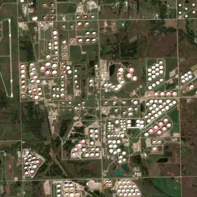
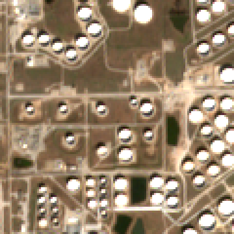
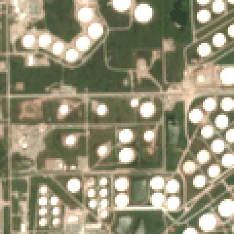
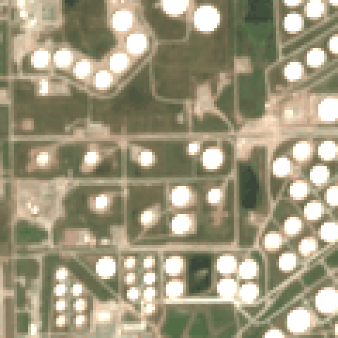
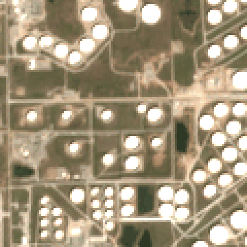
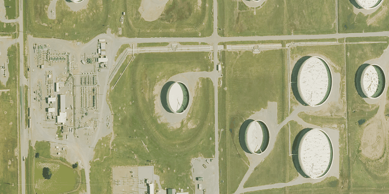
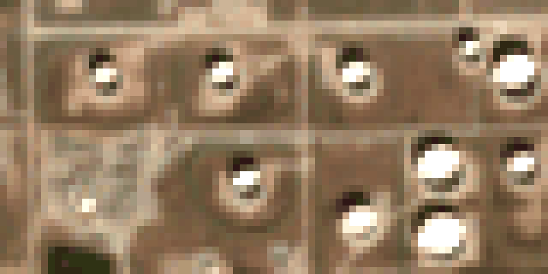
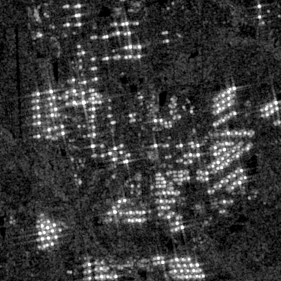
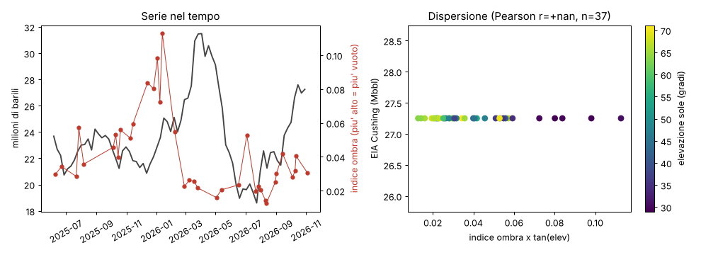

# Studio di fattibilità: scorte di greggio dai serbatoi visti dal satellite (Cushing, OK)

*Agente serbatoi · 9 novembre 2026 · studio dimostrativo, non entra nella raccolta giornaliera (usa librerie esterne)*
Codice: [`serbatoi/prova.py`](serbatoi/prova.py). Risultati per data: [`serbatoi/risultati.csv`](serbatoi/risultati.csv).

## In breve
- **Con Sentinel-2 a 10 m non funziona**: i serbatoi si vedono bene, ma l'ombra interna del tetto galleggiante è più piccola di un pixel. L'indice d'ombra misurato su 129 serbatoi e 37 date **non è correlato** con le scorte EIA (Pearson r = −0,16, p = 0,35).
- Il segnale misurato è quasi tutto **geometria del sole**: segue 1/tan(elevazione solare) con r = 0,90. Il rumore da una data all'altra, a scorte quasi ferme, è grande quanto tutta l'escursione della serie.
- Nelle sole scene invernali, con il sole basso (n = 12), il segno della relazione è quello giusto (r = −0,56) ma non è significativo (p = 0,06). È anche uno di otto test fatti, quindi va letto come rumore finché non si dimostra il contrario.
- **Ad alta risoluzione il metodo si vede a occhio**: su NAIP 2023 (gratuito, 30 cm) le mezzelune d'ombra interne sono nette. NAIP però copre una sola data ogni 2–3 anni, quindi non dà una serie.
- **La strada gratuita migliore è il radar Sentinel-1** (è quello che usano Kayrros e Ursa). Il secondo ripiego, molto più semplice, è un modello di *nowcast* del dato EIA costruito su dati pubblici.

## 1. Come funziona il metodo (dalle fonti)
**Ottico, ombra del tetto galleggiante.** Nei serbatoi a tetto galleggiante esterno il tetto poggia sul greggio e sale e scende con il livello. Con il sole basso la parete proietta due ombre a mezzaluna:
- un'ombra **esterna**, sul terreno, che dipende dall'altezza totale della parete;
- un'ombra **interna**, sul tetto, che dipende dall'altezza libera tra il bordo della parete e il tetto.

Il riempimento si stima più o meno come 1 − (area ombra interna / area ombra esterna), oppure come altezza libera = lunghezza dell'ombra interna × tan(elevazione solare), da confrontare con l'altezza della parete. Altezza e azimut del sole si leggono nei metadati di ogni scena. La catena tipica è: rilevamento dei serbatoi (oggi con reti neurali, ad esempio YOLO), estrazione delle ombre, calcolo del volume.
Fonti: [Towards Data Science, YOLOv3 sui serbatoi](https://towardsdatascience.com/oil-storage-tanks-volume-occupancy-on-satellite-imagery-using-yolov3-3cf251362d9d); [progetto GitHub kheyer/Oil-Tank-Volume-Estimation](https://github.com/kheyer/Oil-Tank-Volume-Estimation). Per Orbital Insight, che misura la mezzaluna d'ombra sul tetto e anticipa i dati su Cushing prima del report governativo: [Business Insider](https://www.businessinsider.in/tech/news/a-startup-backed-by-goldman-sachs-is-measuring-shadows-from-space-to-track-the-worlds-oil-supply-and-its-yielding-shocking-numbers-that-no-one-else-has/articleshow/75070859.cms), [Fortune 2017](https://fortune.com/2017/12/16/satellites-commodity-trading-world/) e il [blog Orbital Insight](https://medium.com/from-the-macroscope/expanding-our-energy-product-monitoring-oil-storage-across-the-globe-ab363a398093).

**Radar (SAR).** Le pareti del serbatoio e il tetto formano un "diedro" che riflette il segnale due volte: ne escono archi brillanti alla base della parete e al bordo del tetto. La loro distanza nell'immagine radar dà l'altezza del tetto. Il radar vede di notte e attraverso le nuvole.
- Villamil Lopez & Stilla, *Monitoring of Oil Tank Filling With Spaceborne SAR Using Coherent Scatterers*, IEEE JSTARS 14 (2021) 5638–5655, [doi:10.1109/JSTARS.2021.3082181](https://doi.org/10.1109/JSTARS.2021.3082181). Usa TerraSAR-X ad alta risoluzione su 167 serbatoi a Rotterdam e ricava dimensioni e livello dalle doppie riflessioni semicircolari.
- Barrilero et al., *Assessment of the capability to monitor oil inventories during the COVID-19 pandemic by using Sentinel-1 data*, IGARSS 2021, pp. 8597–8599, [doi:10.1109/IGARSS47720.2021.9554354](https://doi.org/10.1109/IGARSS47720.2021.9554354). Usa Sentinel-1 gratuito e sfrutta come cambia la retrodiffusione al variare dell'altezza del tetto.
- Brevetto US 10672139: misura del volume nei serbatoi a tetto galleggiante esterno da serie SAR, individuando il punto brillante del tetto ([USPTO](https://image-ppubs.uspto.gov/dirsearch-public/print/downloadPdf/10672139)).
- **Kayrros** usa soprattutto Sentinel-1. Secondo l'azienda, i serbatoi a tetto galleggiante valgono circa il 93 % della capacità di Cushing; per quelli a tetto fisso usa droni e immagini termiche ([Kayrros, droni su Cushing](https://kayrros.com/drone-flights-over-cushing-bringing-transparency-on-crude-inventories-to-100/); [ESA, storia di successo Sentinel-1](https://sentinels.copernicus.eu/web/success-stories/-/copernicus-sentinel-1-helps-monitor-oil-industry-activity)).
- **Ursa Space** usa SAR commerciale e pubblica Cushing il lunedì, due giorni prima dell'EIA. Dichiara una correlazione con l'EIA di 0,98–0,99 e variazioni settimanali affidabili entro ±500 mila barili. Sono dati dell'azienda, non verificati da terzi ([Ursa, prodotto Oil Storage](https://ursaspace.com/node/1025); [Via Satellite 2017](https://www.satellitetoday.com/technology/2017/09/08/ursa-launches-new-weekly-reports-caribbean-oil-stocks/)).

**Limiti noti.** Il metodo vede solo i serbatoi fuori terra a tetto galleggiante esterno. I tetti fissi, conici o a cupola, e i depositi sotterranei sfuggono.

**Che risoluzione serve.** È una mia valutazione geometrica, non una fonte. Con pareti alte 12–20 m (ipotesi tipica per serbatoi grandi, non verificata per Cushing) e il sole a 30–70°, l'ombra interna di un serbatoio vuoto è lunga da circa 4 a 35 m. Una variazione realistica delle scorte di Cushing la sposta di circa 1–4 m (calcolo nel § 3). Servono quindi pixel di **0,3–1,5 m** sull'ottico, oppure un SAR con risoluzione di pochi metri per separare gli archi. A 10 m quello spostamento vale un decimo o mezzo pixel.

## 2. Dati gratuiti: cosa c'è e cosa ho provato
| Fonte | Risoluzione / frequenza | Accesso | Licenza | Esito |
|---|---|---|---|---|
| Sentinel-2 L2A, collezione `sentinel-2-c1-l2a` su [Element84 Earth Search](https://earth-search.aws.element84.com/v1) | 10 m, ogni ~5 giorni | STAC + COG su AWS, **senza chiave** | Copernicus, libera con attribuzione | **Funziona**: 44 scene con meno del 5 % di nuvole sul tile 14SPE (giugno 2025 – novembre 2026), 37 pulite nel ritaglio |
| Sentinel-1 GRD su [Microsoft Planetary Computer](https://planetarycomputer.microsoft.com/api/stac/v1) | ~20 m di risoluzione reale (pixel 10 m), ogni 12 giorni (orbita ascendente) | STAC + token SAS anonimo, **senza account** | Copernicus | **Funziona**: 46 scene nel periodo, ritaglio fatto. Su Earth Search il bucket `sentinel-s1-l1c` è a pagamento per chi scarica (requester-pays), quindi non è stato usato |
| Sentinel-1 RTC su Planetary Computer | come GRD, già corretto per il terreno | serve un account Planetary Computer | CC BY 4.0 | non provato |
| [Copernicus Data Space](https://dataspace.copernicus.eu) | S1/S2 completi, anche SLC | account gratuito | Copernicus | non provato: per Sentinel-2 basta Earth Search |
| Landsat 8/9 C2 L2 (Earth Search) | 30 m, ogni 8 giorni combinati | senza chiave | pubblico dominio | escluso: un serbatoio da 80 m sono circa 3 pixel |
| NAIP (USDA) su Planetary Computer | **0,3 m nel 2023**, 0,6 m nel 2019 e 2021 | token anonimo | pubblico dominio | **Funziona**: ritaglio del 15/06/2023. Copre una sola data ogni 2–3 anni |
| Maxar Open Data | ~0,3–0,5 m | solo eventi catastrofici | CC BY-NC | inutile per Cushing |
| Serie EIA [W_EPC0_SAX_YCUOK_MBBL](https://www.eia.gov/dnav/pet/hist_xls/W_EPC0_SAX_YCUOK_MBBLw.xls) | settimanale (venerdì) | xls pubblico, senza chiave | pubblico dominio (governo USA) | **Funziona**: 1180 settimane, l'ultima è il 30/10/2026 con 27 250 migliaia di barili |

*(Il sito `eia.gov` si scarica con curl o urllib. Lo strumento di lettura web di questa sessione invece non lo raggiunge.)*

## 3. Prova pratica su Cushing
**Area:** ritaglio di 4 × 4 km centrato su 35,9423 N, −96,7497 W, cioè i parchi serbatoi a sud della città. A ogni scena vengono letti pochi MB (lettura a finestra dei COG). Lo script trova **129 serbatoi** tondi e chiari, con diametro mediano stimato di 82 m.

*Sentinel-2, 4 novembre 2026, 10 m: i cerchi rossi sono i serbatoi individuati automaticamente. Ne restano fuori alcuni piccoli o a contatto con altri.*

**Si distinguono i serbatoi? Sì. Si distinguono le ombre interne? No, non in modo misurabile.** Zoom di 1,2 × 1,2 km, ingrandito 4 volte con pixel netti:

| 26/12/2025 – sole a 29° | 09/06/2025 – sole a 71° |
|---|---|
|  |  |
| **22/07/2026 – scorte EIA minime (18,8 Mbbl)** | **26/03/2026 – scorte EIA massime (31,4 Mbbl)** |
|  |  |

In inverno compare una macchia scura sul lato nord dei serbatoi. Ma è soprattutto l'**ombra esterna sul terreno**: a 10 m si "spalma" dentro il disco e non si separa da quella interna. Tra scorte minime e massime, nelle due scene estive, non si vede nessuna differenza.

**Stessa zona a confronto.** NAIP del 15/06/2023, ricampionato a 1 m, contro Sentinel-2 del 26/12/2025. Nel NAIP le mezzelune d'ombra interne sui tetti galleggianti sono chiare (sole da est-sud-est: ombra sul lato ovest dei tetti). Nel Sentinel-2 ogni serbatoio è una chiazza di 8–10 pixel.

**Sentinel-1 (VV, 5 novembre 2026), stesso ritaglio 4 × 4 km.** Ogni serbatoio appare come un punto molto brillante, per la doppia riflessione parete-terreno, con le tipiche "croci" laterali. La disposizione corrisponde a quella ottica. A questa risoluzione però i due archi (base e tetto) non si separano. Per misurare il livello servirebbe lavorare sull'intensità o sulla forma del punto in serie temporale, come Kayrros e Barrilero et al., oppure sui dati SLC.

**Misura grezza.** Per ogni serbatoio e data lo script calcola un contrasto Nord-Sud dentro il disco: (N − S)/(N + S) sulla somma delle bande rosso, verde e blu. Con il sole a sud (azimut ~165°), un tetto basso ha la metà sud in ombra. L'indice viene poi moltiplicato per tan(elevazione solare), per togliere l'effetto della stagione. Si prende la mediana sui serbatoi e si confronta con la serie EIA interpolata alla data della scena.

| Test (n = 37 date, giugno 2025 – novembre 2026) | Pearson r | p |
|---|---|---|
| indice ombra grezzo contro scorte EIA | +0,02 | 0,93 |
| indice × tan(elevazione) contro EIA | −0,16 | 0,35 |
| solo i 107 serbatoi con indice medio > 0 (probabili tetti galleggianti) | −0,16 | 0,34 |
| luminosità media dei tetti contro EIA | +0,10 | 0,55 |
| indice al netto della regressione sull'elevazione solare | −0,35 | 0,034 |
| solo scene con sole sotto 45° (n = 12) | −0,56 | 0,06 |
| *controllo*: indice grezzo contro 1/tan(elevazione) | **+0,90** | < 0,001 |

Il segno atteso è negativo: più ombra vuol dire serbatoi più vuoti, quindi scorte più basse.

**Lettura onesta dei risultati:**
- La misura reagisce alle ombre, come mostra il controllo con r = 0,90. Ma è dominata dalla geometria del sole e dall'ombra esterna, non dal livello del greggio.
- **Rumore.** Tra il 5 ottobre e il 14 novembre 2025 le scorte EIA restano tra 21,5 e 22,5 Mbbl, eppure l'indice corretto oscilla da 0,096 a 0,179 (deviazione standard 0,030). Sull'intera serie la deviazione standard è 0,043: il rumore è circa quanto tutto il segnale.
- **Segnale atteso.** Nelle date analizzate le scorte EIA vanno da 18,8 a 31,4 Mbbl. La variazione di 12,6 Mbbl è circa il 16 % della capacità di 76,6 Mbbl citata dall'EIA ([Today in Energy, 21/09/2021](https://www.eia.gov/todayinenergy/detail.php?id=49636)). Con pareti di circa 15 m (ipotesi), il tetto medio si sposta di circa 2,5 m e l'ombra interna di circa 4 m con il sole a 30°, circa 1 m a 70°. Sono da 0,1 a 0,4 pixel Sentinel-2.
- **Correlazioni deboli.** Le due correlazioni "quasi significative" (−0,35 e −0,56) vengono da 8 test su pochi punti e da poche date (febbraio e novembre 2026). Correggendo per i test multipli non reggono.
- **Contesto.** Il minimo di giugno-luglio 2026 (sotto 20 Mbbl) è reale. L'EIA lo ha commentato parlando di livelli vicini ai "tank bottoms" ([Today in Energy, 16/07/2026](https://www.eia.gov/todayinenergy/detail.php?id=67866)). Proprio in quei mesi però il sole è a circa 70° e l'ombra interna è minima.

## 4. Conclusione
**Valutazione: con Sentinel-2 o Landsat gratuiti la stima delle scorte di Cushing dalle ombre non è fattibile.** Si può fare il rilevamento e il conteggio dei serbatoi, non la misura del livello. Il metodo delle ombre richiede immagini sotto 1–1,5 m, che gratis esistono solo come istantanee rare (NAIP).

Strade possibili, dalla più promettente:

1. **Sentinel-1 SAR in serie temporale** (gratuito, Planetary Computer o Copernicus Data Space). È la strada di Kayrros e del lavoro di Barrilero et al.
   - Metodo: per ogni serbatoio si estrae l'intensità VV/VH del punto brillante e della zona interna, si usa sempre la stessa orbita (geometria fissa), si costruisce una serie di circa 30 scene all'anno e si confronta con l'EIA su almeno 2–3 anni.
   - Rischio: a ~20 m il legame tra intensità e livello è indiretto e il rumore (speckle) è alto. Non è detto che funzioni su Cushing.
   - Lavoro: **3–6 settimane** part-time.
2. **Nowcast del report EIA con dati pubblici.** È la strada più solida per il CV.
   - Variabili: storia settimanale EIA (Cushing, PADD 2 e PADD 3), lavorazioni delle raffinerie, importazioni ed esportazioni, prezzi e spread WTI-Brent, struttura dei futures (contango o backwardation, dato che si può ricavare dai prezzi pubblici).
   - Il **report API** settimanale **non è gratuito** (è in abbonamento): se ne possono usare solo i numeri riportati dalla stampa, quindi va escluso da una pipeline riproducibile.
   - Un buon risultato è battere un modello di base del tipo "la variazione della settimana scorsa".
   - Lavoro: **1–2 settimane**.
3. **Petroliere e porti (IMF PortWatch, dati AIS)**: utile per le esportazioni del Golfo (Houston, Corpus Christi), non per Cushing, che è nell'entroterra e collegato solo da oleodotti. Si combina bene con la strada 2.
4. **Ottico ad alta risoluzione**: NAIP per una dimostrazione su una sola data (ad esempio stima del riempimento di ogni serbatoio dalle mezzelune nel giugno 2023, da confrontare con l'EIA di quella settimana). Altrimenti Planet o SkySat tramite programmi accademici o di ricerca: condizioni da verificare, non gratuiti per chi non ne fa parte.

**Cosa si può mostrare nel CV già ora:**
- pipeline STAC con lettura a finestra dei COG, filtro nuvole SCL, rilevamento automatico di 129 serbatoi, geometria sole-ombra, confronto statistico con la serie ufficiale;
- il risultato negativo documentato, con controlli (dipendenza dal sole), stima del rapporto segnale/rumore e test multipli;
- il passaggio successivo motivato (Sentinel-1 o nowcast).

Un "no, ed ecco perché, in numeri" è un risultato credibile. Una correlazione gonfiata non lo è.

## Riproducibilità e limiti della prova
- `pip install numpy scipy rasterio pystac-client pillow pandas xlrd matplotlib`, poi `python3 report/agenti/serbatoi/prova.py` (circa 5 minuti, scarica qualche centinaio di MB in tutto).
- Le scene restano sempre le stesse finché DATA_A non cambia. I risultati dipendono dal ritaglio, dalle soglie di rilevamento e dalla scelta dell'indice.
- Limiti:
  - nessuna distinzione affidabile tra tetti galleggianti e tetti fissi;
  - il riempimento dei soli serbatoi nel ritaglio non equivale alle scorte totali di Cushing (l'EIA esclude riempimento degli oleodotti e transiti, ci sono altri parchi fuori dal ritaglio, ogni operatore si comporta in modo diverso);
  - l'altezza delle pareti (12–20 m) è un'ipotesi, non un dato.
- Licenze: Copernicus Sentinel (uso libero con attribuzione "contiene dati Copernicus Sentinel modificati 2025–2026"); NAIP e EIA pubblico dominio.
