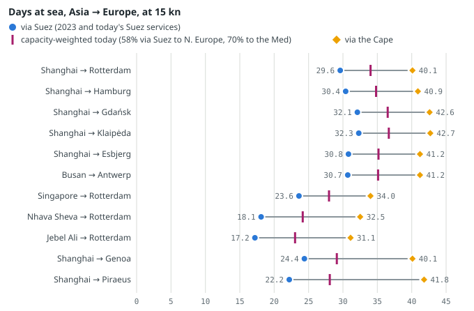
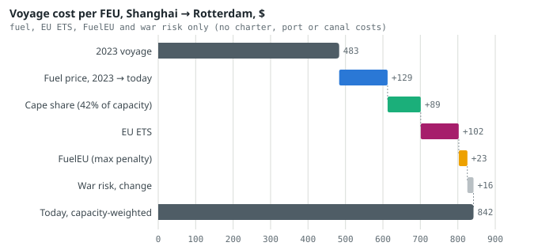
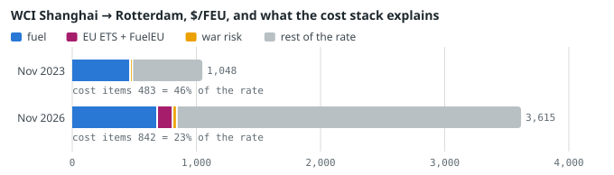
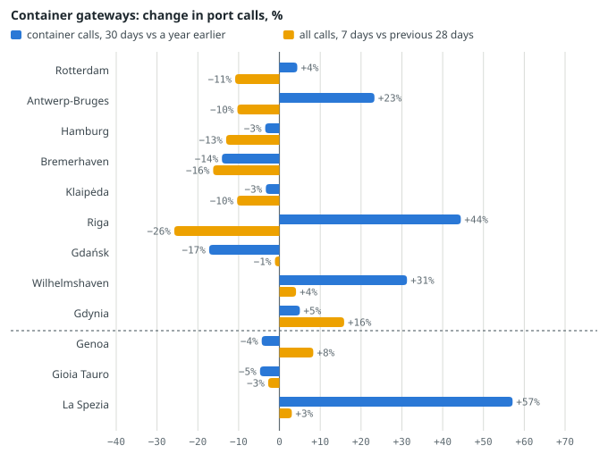

# Asia–Europe Logistics: Routes, Costs and Port Risk — November 2026

*Sea routes, the cost of a container from Asia to Northern Europe, freight rates, port risk, alternatives, sanctions and Q1 2027 scenarios, November 2026.*

Gabriele Giuliani · Geo-economic Risk Monitor · November 2026 · data read on 10 November 2026

Every number has a source and a date. Paragraphs marked *Assessment* are the monitor's reasoning, not facts.

**Contents:** [Key points](#key-points) · [The route map today](#routes) · [Cost stack of an Asia–North Europe voyage, today against 2023](#costs) · [Freight rates and what drives them](#freight) · [Ports](#ports) · [Alternatives](#alternatives) · [Sanctions and the shadow fleet](#sanctions) · [Scenarios for Q1 2027](#scenarios) · [Method, sources and limits](#method) · [Review](#review)

## 1. Key points

- **Suez is back for 63% of Asia–Europe container capacity; the rest still sails round the Cape.** A Shanghai–Rotterdam voyage takes 29.6 days at sea via Suez and 40.1 via the Cape, so today's mix averages 33.5 days (Alphaliner via [transit-times.json](../docs/data/transit-times.json), October 2026; model at 15 knots). Hormuz is de facto closed: 4.4 transits a day against 89.1 three years ago (IMF PortWatch, week to 1 November 2026).
- **The cost of moving one box from Shanghai to Rotterdam has risen by about 72% since late 2023.** Fuel, EU ETS, FuelEU and war risk come to about 832 $ per 40-foot container (FEU) today against 483 $ in 2023. The largest single increase is the fuel price (+129 $/FEU), not the detour (+78 $/FEU) (calculation in section 3; fuel price of 6 November 2026, carbon price of 9 November 2026).
- **Freight rates have risen far more than these costs.** The Drewry WCI Shanghai–Rotterdam is 3,615 $/FEU (5 November 2026), against 1,048 $ on 2 November 2023: +2,567 $, of which the cost items explain about 349 $ (14%). Capacity and demand, not fuel or carbon, set the rate.
- **No North Sea or Baltic port is at high risk; Rotterdam and Antwerp-Bruges carry the most impact.** Both score 7.5 of 25 (medium) on the monitor's Port Risk Index: impact 5.0 of 5, probability 1.5 ([port-risk.json](../docs/data/port-risk.json), 10 November 2026). The highest scores are the Russian Gulf of Finland ports, at 9.3.
- **For Q1 2027 the signal to watch is the Red Sea war-risk premium, not Suez traffic.** In this model the Cape becomes cheaper than Suez when the premium passes about 0.43–1.09% of hull value, depending on the canal toll. The last public quote is 0.2–0.3% (24 September 2026, [assicurazioni.json](../docs/data/assicurazioni.json)).

> *Assessment.* For Dutch, Danish and Baltic logistics the corridor is now a cost problem more than a capacity problem. Ships are getting through, but each box carries a higher fuel bill and a new carbon bill. The schedule mix (63/37) still adds about 3.9 days on average, and it could flip back within weeks if the Red Sea relapses. The full return to Suez expected by Q1 2027 would lower costs, but it would also bring back the bunching of arrivals at North Sea hubs seen when routings change.

## 2. The route map today: Suez back for 63% of capacity, Cape for the rest, Hormuz closed

**Passages, 9 November 2026.** Suez is «open, traffic recovering»; Bab el-Mandeb «open, high threat»; Hormuz «de facto closed» ([stretti-dettaglio.json](../docs/data/stretti-dettaglio.json), via [transit-times.json](../docs/data/transit-times.json)). IMF PortWatch counts transits of ships with AIS on (the Automatic Identification System, the ship's position transponder). In the week to 1 November 2026: Suez 43.0 a day (+10.3% on a year earlier, −43.4% on three years earlier); Bab el-Mandeb 27.3 (−65.7% on three years); Cape of Good Hope 92.0 (+89.3%); Hormuz 4.4 (−95.1%).

**The 63/37 split.** 63% of Far East–Europe container capacity was on Red Sea services in October 2026 (Alphaliner); Linerlytica expects a full return by Q1 2027 ([Seatrade Maritime](https://www.seatrade-maritime.com/containers/full-suez-return-for-container-carriers-expected-by-q1-2027), in [stretti-dettaglio.json](../docs/data/stretti-dettaglio.json), reliability medium). BIMCO counts 753,000 TEU a week through Suez in the first two weeks of October 2026, against 1,457,000 in the same weeks of 2023 ([BIMCO](https://www.bimco.org/news-insights/market-analysis/shipping-number-of-the-week/2026/1014-snow/), 14 October 2026). The report uses the 63% share as the weight of Suez routings for all Asia–Europe lanes, as the transit model does.

<small>**Days at sea by lane.** Sea time only at 15 knots (no canal queue, port time or bunkering stops). Dot: route via Suez, the 2023 routing and today's Suez services; diamond: via the Cape; bar: capacity-weighted average with 63% via Suez. Jebel Ali loads at Khor Fakkan today (land bridge), so its Suez point is the sea leg from there. Source: [transit-times.json](../docs/data/transit-times.json) (routes on Benden shipping lanes, Dijkstra shortest path), updated 2026-11-10.</small>

| Lane | nm 2023 | nm today | Days via Suez | Via the Cape | Cape penalty, days | Weighted today (63% Suez) |
|---|---|---|---|---|---|---|
| Shanghai → Rotterdam | 10,674 | same | 29.6 | 14,440 nm, 40.1 d | +10.5 | 33.5 |
| Shanghai → Hamburg | 10,953 | same | 30.4 | 14,718 nm, 40.9 d | +10.5 | 34.3 |
| Shanghai → Gdańsk | 11,555 | same | 32.1 | 15,321 nm, 42.6 d | +10.5 | 36.0 |
| Shanghai → Klaipėda | 11,612 | same | 32.3 | 15,378 nm, 42.7 d | +10.4 | 36.1 |
| Shanghai → Esbjerg | 11,084 | same | 30.8 | 14,850 nm, 41.2 d | +10.4 | 34.6 |
| Busan → Antwerp | 11,049 | same | 30.7 | 14,815 nm, 41.2 d | +10.5 | 34.6 |
| Singapore → Rotterdam | 8,482 | same | 23.6 | 12,247 nm, 34.0 d | +10.4 | 27.4 |
| Nhava Sheva → Rotterdam | 6,501 | same | 18.1 | 11,702 nm, 32.5 d | +14.4 | 23.4 |
| Jebel Ali → Rotterdam | 6,262 | 6,188 | 17.2 | 11,205 nm, 31.1 d | +13.9 | 22.3 |
| Shanghai → Genoa | 8,797 | same | 24.4 | 14,436 nm, 40.1 d | +15.7 | 30.2 |
| Shanghai → Piraeus | 8,004 | same | 22.2 | 15,052 nm, 41.8 d | +19.6 | 29.5 |

<small>Nautical miles (nm) and days from [transit-times.json](../docs/data/transit-times.json). «2023» is the routing with every passage open; the Suez route today is the same, except from Jebel Ali. The model's distances are within 4.6% of published references; the Cape route is overstated by 2.4–4.6%, so Cape penalties are slightly too high (validation in the same file).</small>

**North versus south.** The Cape penalty is 10.5 days to Rotterdam but 15.7 to Genoa, 18.7 to Trieste and 19.6 to Piraeus. Gdańsk and Klaipėda sit 881 and 938 nm beyond Rotterdam on the same voyage (2.5 and 2.7 more days), and pass the Danish straits.

**Hormuz.** Qatari LNG to Rotterdam is «blocked (Hormuz de facto closed)»: Qatar has no export terminal outside the Gulf. Saudi crude piped to Yanbu reaches Rotterdam in 13.2 days, against 21.8 from Ras Tanura via Hormuz, but Yanbu carries a war-risk premium of 3.0% of hull value for Saudi-linked ships (Reuters (four market sources), via Insurance Journal (2026-09-24), 3.0-3.0%). Jebel Ali boxes are trucked to Khor Fakkan on the Gulf of Oman; the sea leg to Rotterdam is 17.2 days ([transit-times.json](../docs/data/transit-times.json)).

> *Assessment.* The return to Suez helps the Mediterranean about twice as much as the North Sea, because the Cape penalty to Genoa or Piraeus is 16–20 days against about 10 to Rotterdam. For Rotterdam, Antwerp, Hamburg and the Baltic feeders the routing question is mainly one of schedule reliability: services are being moved between two routes that differ by 10 days.

## 3. Cost stack of an Asia–North Europe voyage, today against 2023

One voyage Shanghai → Rotterdam with a container ship of about 15,000 TEU (twenty-foot equivalent units), at 15 knots, burning 150 t of very-low-sulphur fuel oil (VLSFO) a day and carrying 6,375 FEU (15,000 TEU × 85% utilisation ÷ 2). Hull value 150 M$. These are the transit model's declared hypotheses ([transit-times.json](../docs/data/transit-times.json)), not the data of a real ship. Four scenarios: **2023** (Suez, 2023 fuel price, no carbon rules, pre-crisis war risk), **today via Suez**, **today via the Cape**, and **today weighted** 63/37.

### The calculation

- **Fuel** = sea days × 150 t/day × VLSFO price. Suez 29.6 d → 4,440 t; Cape 40.1 d → 6,015 t. Price today: Singapore 854.0 $/t (6 November 2026, Ship & Bunker in [bunker-emissioni.json](../docs/data/bunker-emissioni.json)). Price 2023: 668.5 $/t, Singapore VLSFO, October 2023 monthly average ([Ship & Bunker monthly price review, as quoted by PortNews](https://en.portnews.ru/news/356287), reliability medium: search-result excerpt; the page itself was not reachable from the session). Fuel today via Suez: 4,440 × 854.0 = 3.79 M$.
- **EU ETS** (the EU Emissions Trading System, which since 2024 makes ships buy allowances for their emissions). It covers 50% of the last voyage into the EU from a non-EU port; a call at Tanger Med or East Port Said does not break the voyage. Assumption: the last non-EU call is Singapore, so the covered leg is Singapore → Rotterdam, 23.6 d via Suez (3,540 t) or 34.0 d via the Cape (5,100 t). Cost per tonne burnt: 3.1631 t CO2e × 50% × 100% phase-in (2026) × 86.91 €/allowance (EEX auction, 9 November 2026) = 137.45 €/t, or 154.25 $/t at 1.1222 $/€. Via Suez: 0.55 M$. In 2023 maritime ETS did not exist (in force from 1 January 2024).
- **FuelEU Maritime** (the EU rule capping the greenhouse-gas intensity of ship fuel, in force since 2025). For VLSFO the 2026 limit is exceeded, and the maximum cost is the penalty: 31.10 €/t on the same 50% leg ([bunker-emissioni.json](../docs/data/bunker-emissioni.json), example «asia-rotterdam»). Via Suez: 0.12 M$. Pooling or bio-blends can cost less; zero in 2023.
- **War risk** = premium × hull value. Today via Suez: 0.25% × 150 M$ = 0.38 M$ (midpoint of Reuters (four market sources), via Insurance Journal (2026-09-24), 0.2-0.3%). Via the Cape: no listed area on the route, so zero. 2023: 0.075%, the pre-crisis level (less than 0.1% in late 2023, Moody's via [assicurazioni.json](../docs/data/assicurazioni.json)) = 0.11 M$.
- **Per FEU** = voyage cost ÷ 6,375 FEU. **Weighted** = 63% × Suez + 37% × Cape.

| Item (per voyage · per FEU) | 2023 via Suez | Today via Suez | Today via the Cape | Today weighted 63/37 |
|---|---|---|---|---|
| Fuel | 2.97 M$ · 466 $ | 3.79 M$ · 595 $ | 5.14 M$ · 806 $ | 4.29 M$ · 673 $ |
| EU ETS | 0.00 M$ · 0 $ | 0.55 M$ · 86 $ | 0.79 M$ · 123 $ | 0.64 M$ · 100 $ |
| FuelEU (max penalty) | 0.00 M$ · 0 $ | 0.12 M$ · 19 $ | 0.18 M$ · 28 $ | 0.14 M$ · 23 $ |
| War risk | 0.11 M$ · 18 $ | 0.38 M$ · 59 $ | 0.00 M$ · 0 $ | 0.24 M$ · 37 $ |
| Total | 3.08 M$ · 483 $ | 4.84 M$ · 759 $ | 6.10 M$ · 957 $ | 5.30 M$ · 832 $ |

<small>Calculated by report/build_logistics.py from [transit-times.json](../docs/data/transit-times.json), [bunker-emissioni.json](../docs/data/bunker-emissioni.json) and [assicurazioni.json](../docs/data/assicurazioni.json); 2023 fuel price from outside the repository (see above). Not included: charter hire of the extra days, Suez Canal tolls (about 0.5 M$–1.0 M$ per transit according to the transit model's notes), port and terminal costs, cargo inventory cost. These are the costs that changed most, not the full cost of a voyage.</small>

<small>**From 2023 to today, $ per FEU.** Shanghai → Rotterdam, capacity-weighted 63/37. Steps: fuel price on the Suez voyage (668.5 → 854.0 $/t); extra Cape fuel for 37% of capacity; EU ETS and FuelEU on the covered leg; change in war risk. Sources and calculation in the table above; data of 6 November 2026 (fuel), 9 November 2026 (EUA), 24 September 2026 (war risk), October 2023 (2023 fuel).</small>

**Reading.** The stack rises from 483 to 832 $/FEU (+72%). Fuel price adds 129 $, the Cape share 78 $, carbon rules 122 $ together, war risk 19 $. Since the eve of the Iran war, the Suez voyage's fuel bill alone has grown by 1.48 M$ (Singapore VLSFO 521.5 $/t on 27 February 2026), the same figure as in [transit-times.json](../docs/data/transit-times.json).

**When does the Cape pay?** Via the Cape the voyage costs 1.64 M$ more in fuel, ETS and FuelEU than via Suez. The Cape avoids the Red Sea premium and the canal toll. Without the toll, the break-even premium is 1.09% of a 150 M$ hull; with a toll of 0.5 M$–1.0 M$ it falls to 0.43–0.76%. [assicurazioni.json](../docs/data/assicurazioni.json) finds 0.32% for a new 221.7 M$ ship, using UNCTAD's 2024 extra Cape cost of 0.7 M$: a different ship value and cost base, shown here rather than reconciled.

> *Assessment.* Carriers decide the route on the whole voyage economics (charter cost of ten more days, schedule, crew safety), not on this stack alone. Even so, a Red Sea premium back above about 0.5% would make the Cape competitive again for most large ships, and the July 2026 quotes (0.75–1.00%) were above that line.

## 4. Freight rates and what drives them

| Index | Value | Date | Note |
|---|---|---|---|
| Drewry WCI Shanghai–Rotterdam | 3,615 $/FEU | 5 November 2026 | 1,048 $ on 2 November 2023 (secondary source) |
| Drewry WCI Shanghai–Genoa | 4,166 $/FEU | 5 November 2026 | premium over Rotterdam +15.2% |
| Freightos FBX11 China–North Europe | 3,422 $/FEU | 6 November 2026 | −4.8% on the week |
| Freightos FBX13 China–Mediterranean | 4,324 $/FEU | 6 November 2026 | −1.17% on the week |
| Freightos FBX global | 3,451.8 $/FEU | 6 November 2026 | −6.5% since 14 August 2026 (3,689.8), the high of the series kept since then |
| CCFI Europe | 1,860.07 points | 6 November 2026 | +1.53% on the week |
| Maersk emissions surcharge, Far East → North Europe | 170 $/FEU | Q4 2026 | based on an average EUA of 78.97 € over 16 May–15 August 2026 (ICE EUA Daily Futures) |

<small>Freight indices from [noli.json](../docs/data/noli.json) (Drewry, Freightos/Baltic Exchange, Shanghai Shipping Exchange; © the publishers, values cited). WCI and FBX measure spot rates with different methods and dates, so they differ by 193 $ on the same lane. Surcharge from [bunker-emissioni.json](../docs/data/bunker-emissioni.json) ([Maersk](https://www.maersk.com/news/articles/2026/09/01/emissions-surcharge-ems-ess), 1 September 2026).</small>

<small>**How much of the freight rate the cost stack explains.** Drewry WCI Shanghai–Rotterdam on 2 November 2023 (secondary source, reliability medium) and 5 November 2026 ([noli.json](../docs/data/noli.json)), split into the cost items of section 3 (capacity-weighted today) and the rest, which covers charter, port, canal, overheads and margin. Carrier costs and spot prices are different things: the split is an order of magnitude.</small>

**What drives the rate.** (1) *Capacity released by the Suez return.* Each ship moved back from the Cape to Suez saves about 10.5 days each way, so the same fleet offers more weekly slots. (2) *Fuel.* Singapore VLSFO is up 63.8% since 27 February 2026 and 82.7% on a year earlier ([bunker-emissioni.json](../docs/data/bunker-emissioni.json)). (3) *Carbon.* Maersk charges 170 $/FEU from the Far East to North Europe for ETS and FuelEU; the model's own ETS + FuelEU cost is 122 $/FEU at today's EUA. A surcharge is a price, not a cost: it can include other lanes, feeder legs and a margin. (4) *War risk*, now 37 $/FEU in the weighted case. (5) *The Mediterranean premium*: Shanghai–Genoa costs 15.2% more than Shanghai–Rotterdam, inside the 5–20% band the risk dashboard reads as «gradual return under threat» ([rischio.json](../docs/data/rischio.json), 9 November 2026).

> *Assessment.* Spot rates are drifting down (FBX global from its August high, FBX11 down on the week) while the CCFI, which weights contract rates, edges up. The cost floor computed here, about 830 $/FEU for fuel, carbon and war risk, is 23% of today's WCI. That leaves room for spot rates to fall as Cape capacity returns. Fuel would have to rise sharply to stop that.

## 5. Ports: risk ranking for the North Sea, the Baltic and the Mediterranean

The **Port Risk Index** scores 39 ports every day: probability of disruption (1–5: traffic, security events, exposure to disrupted chokepoints, war-risk listing) × impact on European supply chains (1–5: strategic role, cargo handled, energy cost) = 1–25. Low below 6, medium 6–11.9, high 12–19.9, critical 20 and above. It is a rule-based assessment, not a forecast (method in report/port-risk-method.md; [port-risk.json](../docs/data/port-risk.json), 10 November 2026; PortWatch calls to 30 October 2026).

| North Sea and Baltic (non-Russian) | Country | P | I | Score | Level | Trend (7 days ago) |
|---|---|---|---|---|---|---|
| Antwerp-Bruges | BE | 1.5 | 5.0 | 7.5 | medium | stable (8.0) |
| Klaipėda | LT | 1.7 | 4.4 | 7.5 | medium | stable (7.5) |
| Rotterdam | NL | 1.5 | 5.0 | 7.5 | medium | stable (7.5) |
| Gdańsk | PL | 1.7 | 4.1 | 7.0 | medium | stable (7.0) |
| Wilhelmshaven | DE | 1.5 | 4.4 | 6.6 | medium | falling (7.9) |
| Hamburg | DE | 1.5 | 4.1 | 6.1 | medium | stable (6.1) |
| Świnoujście | PL | 1.6 | 3.8 | 6.1 | medium | stable (6.1) |
| Eemshaven | NL | 1.5 | 3.8 | 5.7 | low | stable (5.7) |
| Bremerhaven | DE | 1.5 | 3.5 | 5.2 | low | stable (6.0) |
| Gdynia | PL | 1.7 | 2.9 | 4.9 | low | stable (4.9) |
| Tallinn | EE | 2.3 | 2.0 | 4.6 | low | stable (4.6) |
| Rostock | DE | 1.5 | 2.9 | 4.3 | low | stable (4.3) |
| Helsinki | FI | 2.0 | 2.0 | 4.0 | low | stable (4.0) |
| Riga | LV | 2.0 | 2.0 | 4.0 | low | stable (3.4) |
| Sköldvik | FI | 2.0 | 2.0 | 4.0 | low | stable (4.0) |
| Amsterdam | NL | 1.5 | 2.6 | 3.9 | low | stable (3.9) |
| Gothenburg | SE | 1.5 | 2.6 | 3.9 | low | stable (3.9) |
| HaminaKotka | FI | 1.9 | 2.0 | 3.8 | low | stable (3.8) |
| Copenhagen-Malmö | DK | 1.8 | 2.0 | 3.6 | low | stable (4.2) |
| Brunsbüttel | DE | 1.7 | 2.0 | 3.4 | low | stable (3.8) |
| Inkoo | FI | 1.7 | 2.0 | 3.4 | low | stable (3.4) |
| Paldiski | EE | 1.7 | 2.0 | 3.4 | low | stable (3.4) |
| Esbjerg | DK | 1.6 | 2.0 | 3.2 | low | rising (2.0) |
| Ventspils | LV | 1.6 | 2.0 | 3.2 | low | stable (3.2) |
| Aarhus | DK | 1.0 | 2.0 | 2.0 | low | stable (2.0) |

<small>[port-risk.json](../docs/data/port-risk.json). The 7-day-ago score is reconstructed for this first week. Russian ports: Ust-Luga 9.3; St Petersburg 9.3; Primorsk 8.6; Kaliningrad 4.6; Vysotsk 4.4 (impact capped at 3 by rule).</small>

| Mediterranean (Italian ports only) | P | I | Score | Level | Trend (7 days ago) |
|---|---|---|---|---|---|
| La Spezia | 2.0 | 3.6 | 7.2 | medium | stable (7.2) |
| Livorno | 2.0 | 2.7 | 5.4 | low | stable (5.4) |
| Augusta | 1.5 | 3.5 | 5.2 | low | stable (5.2) |
| Genoa | 2.0 | 2.6 | 5.2 | low | stable (5.7) |
| Gioia Tauro | 2.0 | 2.6 | 5.2 | low | stable (5.2) |
| Trieste | 2.0 | 2.6 | 5.2 | low | stable (5.2) |
| Venice (Lido entrance) | 2.4 | 2.0 | 4.8 | low | rising (3.6) |
| Ravenna | 2.6 | 1.8 | 4.7 | low | rising (3.6) |
| Venice (Malamocco entrance) | 2.1 | 2.0 | 4.2 | low | rising (3.0) |

<small>[port-risk.json](../docs/data/port-risk.json). **Missing:** the index scores no non-Italian Mediterranean port (Piraeus, Valencia, Algeciras, Tanger Med, Koper).</small>

**What changed in a week** (score moves of 0.5 or more): St Petersburg 7.8 → 9.3; Venice (Malamocco entrance) 3.0 → 4.2; Esbjerg 2.0 → 3.2; Venice (Lido entrance) 3.6 → 4.8; Ravenna 3.6 → 4.7; Ust-Luga 8.7 → 9.3; Riga 3.4 → 4.0; Antwerp-Bruges 8.0 → 7.5; Genoa 5.7 → 5.2; Copenhagen-Malmö 4.2 → 3.6; Bremerhaven 6.0 → 5.2; Wilhelmshaven 7.9 → 6.6. Rotterdam and Antwerp-Bruges rank high on impact (5.0) and low on probability: Rotterdam's only amber is «Red Sea (Asia–Europe container route) 18.0/25 (secondary); Qatar LNG (Ras Laffan → Hormuz) 24.0/25 (secondary); Strait of Hormuz 22.5/25 (secondary)».

**Denmark.** Copenhagen-Malmö 3.6, Esbjerg 3.2, Aarhus 2.0: all low. Esbjerg rose from 2.0: «2.0 calls/day vs 3.5 in the previous 28 days: −42.9%». It is an offshore-wind base, not a container gateway.

<small>**Congestion proxies for the container gateways.** Blue: container calls a day, 30-day mean against the same days a year earlier; amber: all calls, last 7 days against the previous 28, the index's short-term disruption proxy. Above the dashed line: North Sea and Baltic; below: Italy. Source: IMF PortWatch via [porti-nord.json](../docs/data/porti-nord.json), [portwatch.json](../docs/data/portwatch.json) and [port-risk.json](../docs/data/port-risk.json), data to 30 October 2026.</small>

**Reading.** Over 30 days, container calls are +4.4% at Rotterdam and +23.3% at Antwerp-Bruges, but −14.1% at Bremerhaven and −17.2% at Gdańsk. The last week is below the previous four at most northern hubs (Rotterdam −10.9%, Hamburg −13.1%, Bremerhaven −16.2%), while the Italian gateways are flat or up. A fall in calls is what congestion, strikes, weather or weaker demand all look like in AIS data. **Missing:** vessel waiting times and berth occupancy: no free source is in the repository.

> *Assessment.* A drop of 11–16% in a week at three North Sea hubs at once is more likely a schedule effect than port trouble. Ships switching from the Cape to Suez arrive in a different order, and blank sailings follow. It is worth watching in the next PortWatch release: two more weeks below −20% would cross the index's amber line.

## 6. Alternatives: rail, air and nearshoring

**China–Europe rail.** 20,022 trains in 2025 (+3.2% on 2024), carrying about 2.05 million TEU (−1.3% on 2024); 5,460 trains in Q1 2026 (+29% on Q1 2025) ([CGTN](https://news.cgtn.com/news/2026-06-19/China-Europe-freight-train-trips-up-10-8-fold-in-a-decade-1O6lmqO1Ka4/p.html), [Railmarket](https://railmarket.com/news/freight-rail/51534), [Index1520](https://index1520.com/en/news/obemy-perevozok-po-marshrutu-kitay-evropa-vyrosli-na-chetvert-za-pervye-dva-mesyatsa-2026-goda/), in [ferrovie.json](../docs/data/ferrovie.json); TEU figure reliability medium). The northern route crosses Russia and Belarus, with sanctions and border risk at the Belarus–Poland crossing.

**Middle Corridor** (Trans-Caspian route via Kazakhstan, the Caspian, Azerbaijan and Georgia): 4.7 million tonnes in 2025 (Organisation of Turkic States via [BESA](https://besacenter.org/azerbaijan-uses-the-middle-corridor-to-consolidate/); other 2025 estimates 4.5–5.2 Mt), target 11.4 Mt by 2030 (reliability low). **INSTC** (North–South corridor, Russia–Iran–India): 12.9 Mt by rail in 2024; work on the missing Rasht–Astara link has slipped to 2027 ([Interfax](https://interfax.com/newsroom/top-stories/119557/), 15 October 2026). It runs through Iran, so it is no alternative for EU shippers under current sanctions.

> *Assessment.* Rail is a niche for time-sensitive cargo, not a substitute. 2.05 million TEU a year is about 39,000 TEU a week, roughly 5% of the capacity that passed Suez each week in early October 2026. The two figures measure different things: loaded boxes on trains against ship capacity. **Missing:** rail transit times and $/FEU rates for 2026.

**Air for high-value cargo: chips and lithography.** Every EUV (extreme-ultraviolet) lithography scanner in the world is assembled by ASML at Veldhoven, near Eindhoven; ASML sold 113 new lithography systems in Q3 2026 with revenue of 11.7 billion € ([ASML results](https://seekingalpha.com/pr/20684919), 14 October 2026). One EUV machine travels as about 40 containers, 20 trucks and three Boeing 747 freighters ([Asia Times](https://asiatimes.com/2021/09/the-150mn-machine-that-is-changing-the-world/), 2021, reliability medium); a High-NA EXE:5000 went to Oregon in 43 containers. Schiphol as the departure airport is an assessment: ASML does not publish the airports it uses ([supply-chain-ai.json](../docs/data/supply-chain-ai.json)). Chips and AI servers fly because they are light and valuable: AI-related cargo is 40–50% of EVA Air's freight ([DIGITIMES](https://www.digitimes.com/news/a20260527PD246.html), reliability medium). **Missing:** an air-cargo rate series (Asia–Europe $/kg) in the repository.

**Dependence that a shorter route does not remove.** EU imports from outside the EU of NdFeB permanent magnets: 88.3% from China; artificial graphite 66.1% from China (UN Comtrade 2025, [commercio.json](../docs/data/commercio.json)). China's share of total imports in 2025: Germany 12.9%, Poland 15.5%, the Netherlands 8.3% (same file; Dutch figures include goods re-exported through Rotterdam).

> *Assessment.* **Nearshoring signals.** The repository holds no data that measures nearshoring directly: no import share series by origin over time, no factory-announcement tracker. What it shows is consistent with *hedging*, not relocation: rail volumes up while sea capacity returns, carriers adding Mediterranean transhipment (Tanger Med 11.1 million TEU in 2025, +8.4%, Port Strategy in [stretti-dettaglio.json](../docs/data/stretti-dettaglio.json)), and dependencies on China for magnets and graphite still above 60%. For a logistics employer, the practical consequence is more routing options to price, not fewer Asian boxes.

## 7. Sanctions and the shadow fleet: compliance risk for shippers and ports

**The lists.** 2,022 ships are sanctioned by at least one of the US (OFAC, 1,570), the UK (683) and the EU (734); 275 by all three. 950 are linked to Russia and 679 to Iran; 1,163 are tankers (or of unknown type) sanctioned for Russia or Iran, which the monitor counts as probable shadow fleet ([sanzioni-navi.json](../docs/data/sanzioni-navi.json): OFAC 6 November 2026, UK 3 November 2026, EU via OpenSanctions 28 October 2026). Of the 672 Russia-linked ships on EU lists, most are under the port-access ban of Regulation 833/2014.

**Container ships are on the lists too.** 59 container ships are sanctioned: 55 linked to Iran and 4 to Russia, all by the US only. A box on one of them can breach US secondary-sanctions rules even when the EU lists do not name the ship. New first designations in the last 90 days: 6 ships, between 1 October 2026 and 2 October 2026 (UK, USA; scope Russia; types: LNG Carrier, LNG Tanker, type not given) ([sanzioni-navi.json](../docs/data/sanzioni-navi.json)).

**Baltic exposure.** In the AIS snapshot of 9 November 2026 38 of 96 tankers seen in the Gulf of Finland were sanctioned; in the Danish straits 0 of 19 ([navi.json](../docs/data/navi.json)). The Port Risk Index counts likely shadow-fleet or sanctioned tankers within 50 km of Ust-Luga (22), Primorsk (17), St Petersburg (6), Tallinn (2) ([port-risk.json](../docs/data/port-risk.json)). Russia as a whole is a Joint War Committee listed area under JWLA-035 (16 September 2026).

> *Assessment.* For shippers and ports in the Netherlands, Denmark and the Baltic the compliance risk sits in three places. (1) **Screening by IMO number, not by name**: sanctioned ships change name and flag often, and the flag is frequently false. (2) **US-only listings**: the container ships on the lists are almost all US designations for Iran, which an EU-only screening misses. (3) **Ship-to-ship transfers and bunkering** near the Gulf of Finland and Skagen, where sanctioned tankers meet others. Ports are also exposed operationally: an old, poorly insured tanker at anchor near a cable or a fairway is a spill and liability risk.

## 8. Scenarios for Q1 2027

> *Assessment.* These scenarios are the monitor's reasoning, without probabilities: each comes with observable thresholds. The first three follow the Red Sea scenarios of the risk dashboard ([rischio.json](../docs/data/rischio.json), 9 November 2026); the cost per FEU uses the section 3 model at today's fuel and EUA prices. Try each case on the [«What if» simulator](../docs/simulatore.html), which estimates the effect of a slowdown or closure of a passage.

| Scenario | Route mix | Cost items, $/FEU | Indicators and thresholds | Simulator |
|---|---|---|---|---|
| A. Gradual return under threat (base: the dashboard's current reading, 4 of 4 signals met) | 63% Suez, rising slowly | 832 | Suez between 40 and 50 ships a day (now 43.0, met); Bab el-Mandeb between 25 and 35 ships a day (now 27.3, met); no attack on ships in the Red Sea or Gulf of Aden in the last 30 days (now 0, met); Genoa premium over Rotterdam between 5% and 20% (now 15.2%, met) | [Bab el-Mandeb −25%, 1 month](../docs/simulatore.html#bab-el-mandeb/r25/1m) |
| B. Full return by Q1 2027 (better) | 100% Suez | 759 | Suez above 50 ships a day (now 43.0); Bab el-Mandeb above 35 ships a day (now 27.3); WCI composite below 4,000 $/FEU (now 4,389); Genoa premium over Rotterdam below 5% (now 15.2%); FBX11 below 3,000 $/FEU (set here; now 3,422) | — |
| C. Houthi attacks resume (worse) | back to the Cape | 957 | at least one attack on ships in the Red Sea or Gulf of Aden in the last 30 days (now 0); Bab el-Mandeb below 20 ships a day (now 27.3); Suez below 35 ships a day (now 43.0); WCI Shanghai–Genoa above 5,000 $/FEU (now 4,166); Genoa premium over Rotterdam above 20% (now 15.2%); Red Sea war risk above 0.5% of hull (set here); FBX11 above 4,500 $/FEU | [Bab el-Mandeb closed, 3 months](../docs/simulatore.html#bab-el-mandeb/chiuso/3m) |
| D. Gulf escalation spills over (overlay on A–C) | unchanged for boxes; LNG and crude repriced | +102 on the Suez voyage if VLSFO reaches 1,000 $/t | Singapore VLSFO above 1,000 $/t (now 854.0; high of the year 1,120.5 on 13 March 2026); Hormuz below 5 ships a day (now 4.4) | [Hormuz closed, 3 months](../docs/simulatore.html#hormuz/chiuso/3m) |
| E. Baltic incident (overlay) | feeders to Gdańsk, Klaipėda delayed | not modelled | a cable or pipeline incident within 30 days; Danish straits below −30% on a year (now −20.5%); sanctioned tankers in the Gulf of Finland above 50 (now 38) | [Danish straits −25%, 1 month](../docs/simulatore.html#stretti-danesi/r25/1m) |

<small>Signal texts translated from rischio.json; values from rischio.json, noli.json, bunker-emissioni.json, transit-times.json, navi.json. Thresholds marked «set here» are this report's assessment, in THRESHOLDS in report/build_logistics.py.</small>

**Dates in the window.** IMO, from 23 November 2026: ISWG-GHG 23, MEPC 85 and, on 4 December 2026 if confirmed, the resumed extraordinary session that may vote the Net-Zero Framework, a global carbon price for shipping. 29 November 2026: OPEC+ ministerial meeting on 2027 output quotas; 24 February 2027: EU sanctions over Russia's annexation of Ukrainian territory up for renewal; 28 February 2027: EU sanctions on Belarus (involvement in the Russian aggression) up for renewal ([calendario.json](../docs/data/calendario.json), [bunker-emissioni.json](../docs/data/bunker-emissioni.json)).

## 9. Method, sources and limits

| Source | What | Date of the data |
|---|---|---|
| [transit-times.json](../docs/data/transit-times.json) | 99 routes, nm and days today vs 2023, Cape alternative, vessel hypotheses | 2026-11-10 |
| [bunker-emissioni.json](../docs/data/bunker-emissioni.json) | VLSFO prices (Ship & Bunker), EUA auction (EEX), ETS and FuelEU rules and cost example, Maersk surcharge | 2026-11-06 / 2026-11-09 |
| [assicurazioni.json](../docs/data/assicurazioni.json) | war-risk premiums (press quotes), JWC listed areas | 2026-09-24 / 2026-09-16 |
| [noli.json](../docs/data/noli.json) | WCI, FBX, CCFI | 2026-11-05 / 2026-11-06 |
| [port-risk.json](../docs/data/port-risk.json) | Port Risk Index, 39 ports | 2026-11-10 |
| [porti-nord.json](../docs/data/porti-nord.json), [portwatch.json](../docs/data/portwatch.json) | IMF PortWatch port calls and chokepoint transits | 2026-10-30 |
| [stretti-dettaglio.json](../docs/data/stretti-dettaglio.json), [rischio.json](../docs/data/rischio.json) | passage status, risk dashboard and scenario signals | 2026-11-09 |
| [ferrovie.json](../docs/data/ferrovie.json), [supply-chain-ai.json](../docs/data/supply-chain-ai.json), [commercio.json](../docs/data/commercio.json) | rail corridors, EUV logistics, trade dependencies | 2025–2026 (per item) |
| [sanzioni-navi.json](../docs/data/sanzioni-navi.json), [navi.json](../docs/data/navi.json) | sanctioned ships (OFAC, UK, EU), AIS snapshot | 2026-11-09 |
| [Ship & Bunker monthly price review, as quoted by PortNews](https://en.portnews.ru/news/356287) | Singapore VLSFO, October 2023 monthly average (reliability medium; search-result excerpt; the page itself was not reachable from the session) | 2023-10 |
| [Drewry World Container Index, as reprinted by Air Freight News and Hellenic Shipping News](https://www.hellenicshippingnews.com/drewry-world-container-index-up-7-this-week/) | Drewry WCI Shanghai–Rotterdam, 2 November 2023 (range in November 2023: 1,048–1,272 $/FEU) (reliability medium; search-result excerpts; Drewry's archive and the reprints were not opened from the session) | 2023-11-02 |

- **Model, not ship data.** Daily consumption, hull value, utilisation and speed are declared hypotheses of the transit model. A real service calls at several ports, sails faster on the Cape to keep a weekly schedule and has its own MRV emissions data. The cost stack is an order of magnitude for comparison.
- **Same speed in every scenario**, so the Cape penalty is distance only; faster Cape sailing would raise fuel per mile (UNCTAD: 14 → 16 knots = +31% fuel per mile).
- **2023 baselines from outside the repository**: the fuel price (October 2023) and the WCI (2 November 2023) come from search-result excerpts of secondary sources. They should be checked against the publishers before quotation.
- **War-risk premiums** are press quotes for tankers; no public quote exists for container ships. The last Red Sea quote is from 24 September 2026.
- **AIS** counts only ships with the transponder on, about a week late. The congestion proxy is not waiting-time data.
- **Inconsistent perimeters, declared not resolved:** hull value 150 M$ here (transit model) against 221.7 M$ (new ship) in [assicurazioni.json](../docs/data/assicurazioni.json); the 63% Suez share is for Far East–Europe capacity and is applied to every Asian origin.
- **Not repeated here**: the Italian report *Supply chain e logistica — novembre 2026* covers strait-by-strait transits, Italian ports and energy prices.
- **AI assistance.** An AI assistant (Claude, Anthropic) wrote the build script, ran the calculations and drafted the text from the monitor's data files and the cited sources. Every figure is generated from the files; the two external 2023 values are flagged. Gabriele Giuliani is responsible for publication.

---

### Review

**Pending.** This edition has not yet been reviewed. An independent reviewer will check every number against the data files and the cited sources under report/STANDARD.md, and check the text against the charts and the other reports. The log will be in report/revisioni/asia-europe-logistics-2026-11.md; this box will then give the date, the number of claims checked, the corrections and what remains unverifiable.

---

Gabriele Giuliani · Geo-economic Risk Monitor · November 2026

Note on AI use: this report was prepared with an AI assistant (Claude, Anthropic), which wrote the build script (report/build_logistics.py), the calculations and the draft text from the monitor's data files and the sources cited. Numbers come from the data files and linked sources; assessments are marked. An independent review is pending. Gabriele Giuliani is responsible for publication.
