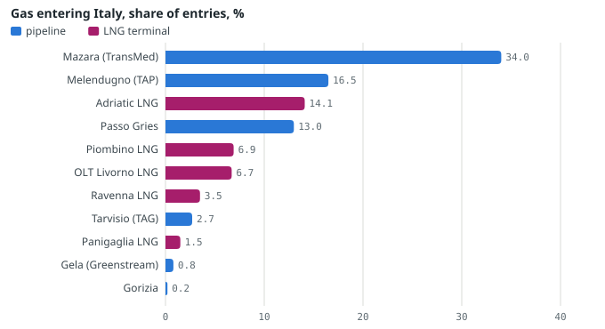
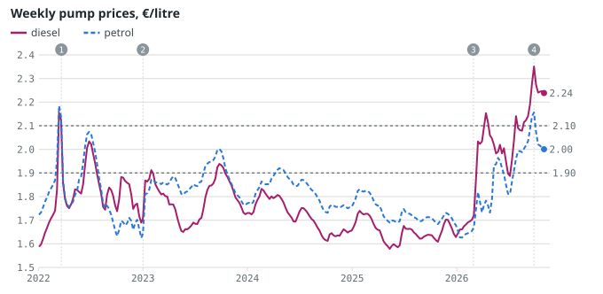
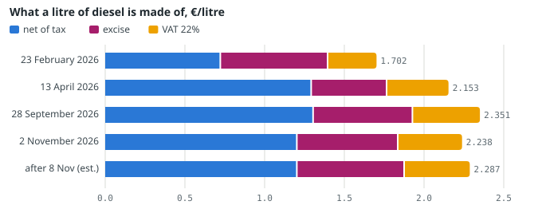
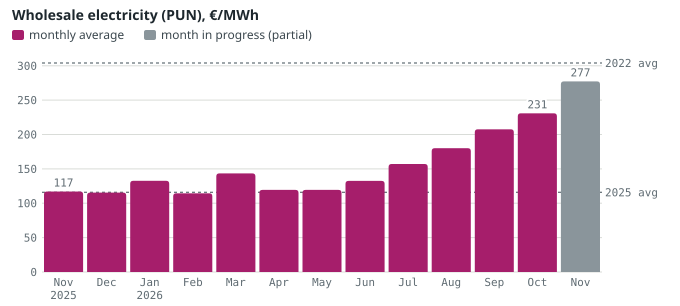
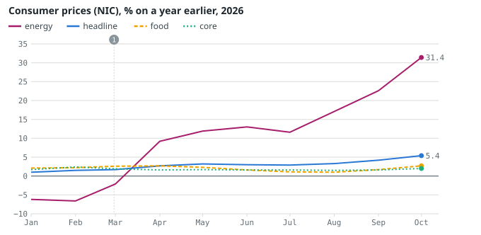
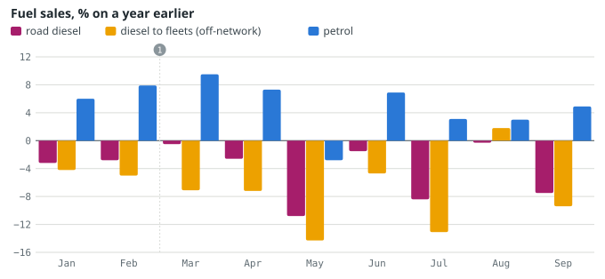
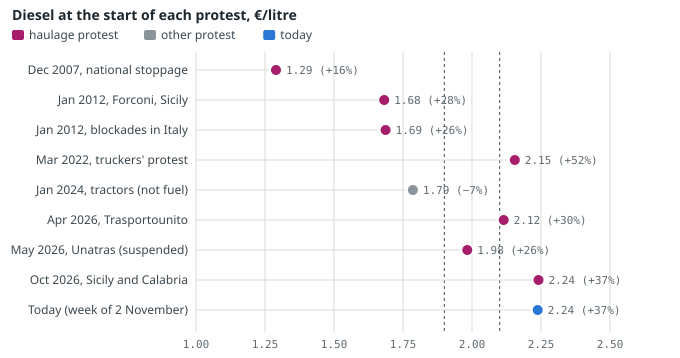
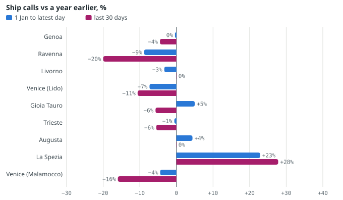
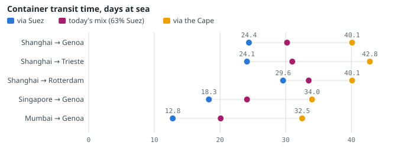
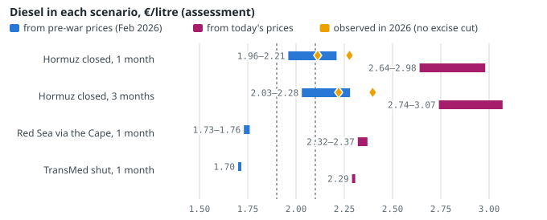

# Italy and the Gulf Shock: Fuel, Freight, Prices and the Risk of a Truck Strike — November 2026

*How the closure of Hormuz reaches Italian pumps, bills, prices, ports and road haulage, and what a new shock would do. November 2026.*

Gabriele Giuliani · Geo-economic Risk Monitor · November 2026 · data read on 10 November 2026

Every number has a source and a date. Paragraphs marked *Assessment* are the monitor's reasoning, not facts.

**Contents:** [Key points](#key) · [Where Italy's energy comes from and what the Gulf crisis changed](#supply) · [At the pump and in the bill](#pump) · [Inflation and households](#households) · [Road haulage and the risk of a stoppage](#haulage) · [Ports and freight](#ports) · [Scenarios: what a new shock would do](#scenarios) · [Method, sources and limits](#method) · [Review](#review)

## 1. Key points

- **Diesel is back near €2.29 a litre after the last excise cut expired on 8 November.** The weekly average of the energy ministry (MASE) was €2.238 for diesel and €2.001 for petrol on 2 November 2026; without the 4.9-cent cut, diesel works out at €2.287. That is +37% on a year earlier.
- **Gas and power bills now drive inflation more than fuel.** Consumer prices (Istat NIC, preliminary) rose 5.4% in October 2026, from 1.5% in February. Energy items rose 31.4%, electricity 35.8%, gas 35.6%. The wholesale power price (PUN) averaged 230.8 €/MWh in October.
- **Italy has the gas; the problem is its price.** Storage was 88.9% full on 8 November (Germany 58.9%). Algeria's TransMed pipeline brought 34% of gas entering Italy in 12 months; Qatar, in force majeure, supplied 32.6% of LNG imports in 2025. Gas (TTF) is +164% on a year.
- **Hauliers: no national stoppage had been called by 9 November.** A stoppage needs 25 days' notice, so one called on 10 November could not start before 5 December. Diesel has stayed above the monitor's €2.10 alert level since 24 August. *Assessment:* risk of a call is high; a lawful stoppage in November is ruled out.
- **A second Hormuz shock would push diesel to €2.64–2.98 within a month** (*assessment*, rule-based). Tested on 2026: from February prices the rule gave €1.96–2.21; diesel actually averaged €2.11 once the excise cuts are added back. A TransMed outage hits bills, not pumps.

> **Words used in this report.** *MASE*: Ministry of the Environment and Energy Security; publishes the weekly national average of fuel prices, with tax and excise broken out. *Mimit*: Ministry of Enterprises and Made in Italy; runs the daily fuel-price observatory fed by every filling station. *ARERA*: the energy regulator; sets the gas price for 'vulnerable' households still on regulated terms. *GME*: the operator of Italy's power and gas exchanges. *PUN*: the national wholesale electricity price, set daily on the GME exchange, in €/MWh. *PSV / TTF*: the Italian and Dutch wholesale gas prices; the Italian one tracks the Dutch one closely. *Istat, NIC, HICP*: the national statistics institute; NIC is its consumer price index for the whole population, HICP the EU-harmonised version. *Excise (accisa)*: a fixed tax per litre on fuel; VAT at 22% is charged on top of it. *Fermo*: a stoppage of road hauliers: firms keep their trucks off the road; it is treated like a strike. *Unatras*: the joint committee of the main road-haulage associations. *Law 146/1990*: the law on strikes in essential public services; an independent Strike Guarantee Commission (Commissione di garanzia) enforces notice and minimum services. *LNG, FSRU*: liquefied natural gas; a floating storage and regasification unit is a ship-based import terminal. *FEU, AIS*: a 40-foot container; the transponder ships use to broadcast position, the basis of PortWatch counts.

## 2. Where Italy's energy comes from and what the Gulf crisis changed

Italy imports 73.9% of the energy it uses, 95.2% of its gas and 89.8% of its oil (net imports over gross supply, 2024, Eurostat via [`paesi.json`](../docs/data/paesi.json)). Fuels (HS chapter 27) were 10.7% of the value of everything Italy imported in 2025, 71.5 billion dollars (UN Comtrade, [`commercio.json`](../docs/data/commercio.json)).

### Gas: six pipelines, five LNG terminals

In the 12 months to 8 November 2026 the largest entry point was **Mazara del Vallo**, where Algerian gas arrives through the TransMed pipeline system (several parallel lines under the Sicily Channel): 220.5 TWh, 34.0% of all gas entering by pipe and ship. Next came the TAP pipeline from Azerbaijan at Melendugno (16.5%) and the five LNG terminals together (32.7%; Adriatic LNG alone 14.1%). Residual Russian gas through Tarvisio was 2.7% (ENTSOG daily physical flows, [`gas-italia.json`](../docs/data/gas-italia.json)). National production and storage are not in these shares.

*Share of gas entering Italy by entry point, 12 months to 8 November 2026, % of physical entries (pipelines and LNG terminals; national production and storage excluded). Source: ENTSOG Transparency Platform (Snam Rete Gas data), [`gas-italia.json`](../docs/data/gas-italia.json), data to 8 November 2026; the last days may be revised.*

Two movements stand out. OLT, the floating terminal off Livorno, delivered 0.8 TWh in October against 4.0 in September; it restarted on 8 November (105 GWh). Mazara dipped to 11.3 TWh in September, from 16.9 in August, and recovered to 20.2 in October. **Missing:** the cause of either change is not in the data.

**LNG from Qatar.** In 2025 the United States supplied 45.3% of the value of Italy's LNG imports, Qatar 32.6% and Algeria 10.8% (UN Comtrade, [`paesi.json`](../docs/data/paesi.json)). QatarEnergy has been in force majeure since 4 March 2026; for the cargoes due to Edison (the Adriatic LNG terminal) it was extended to the end of December ([gasworld](https://www.gasworld.com/story/qatarenergy-extends-lng-force-majeure-on-edison-cargoes-to-end-december/2262726.article/)), and two liquefaction trains at Ras Laffan (about 12.8 Mt a year) are out of service ([Cyprus Mail](https://cyprus-mail.com/2026/10/12/qatar-lng-exports-remain-severely-disrupted-despite-recovery-in-gulf-oil-shipments)). The monitor's risk dashboard rates Qatari LNG **critical**, 24.0 out of 25 ([`rischio.json`](../docs/data/rischio.json), 9 November 2026). **Missing:** the origin of the cargoes that reached Italian terminals in 2026 (it would need Kpler or GIIGNL data).

**TransMed.** The same dashboard rates the pipeline **low** at 5.6 out of 25 (probability 1.3 of 5, impact 4.3 of 5), down from 8.0 a week earlier. Flows were normal: 620.7 GWh a day over the last seven days against a 12-month average of 602.7. It is Italy's largest single gas dependency, not its most likely disruption.

### Crude oil: little from the Gulf

| Supplier | Share of crude imports, 2025 | How it reaches Italy |
|---|---|---|
| Libya | 24.5% | Mediterranean |
| Azerbaijan | 15.9% | pipeline to Ceyhan (Turkey), then tanker |
| Kazakhstan | 12.5% | CPC pipeline to the Black Sea, then the Turkish Straits |
| United States | 8.8% | Atlantic, Gibraltar |
| Nigeria | 6.1% | Atlantic, Gibraltar |

*Share of the value of crude imports (UN Comtrade, as declared by Italy), [`paesi.json`](../docs/data/paesi.json). Routes are the usual ones, added by the monitor.*

Between 5.6% and 10.2% of Italy's crude came from the Gulf in 2025 (the lower figure counts only suppliers with no route around Hormuz; the higher one adds Saudi Arabia and the UAE). The exposure is through price and refined products. The fuel industry association Unem says Italy is more exposed on products than on crude, because Gulf refineries ship through Hormuz and more than 30 European refineries have closed in fifteen years ([Il Fatto Quotidiano, 17 April 2026](https://www.ilfattoquotidiano.it/2026/04/17/fermo-autotrasporto-unatras-gasolio-logistica-notizie/8358442/); reliability medium).

### Emergency stocks: oil below the norm, gas close to target

Italy's emergency oil stocks covered **77.2 days** in August 2026, against 90.5 a year earlier and a five-year average of 89.3 (Eurostat, [`scorte.json`](../docs/data/scorte.json)). EU law (directive 2009/119/EC) requires the larger of 90 days of net imports or 61 days of consumption. The series fell from 90.2 days in March to 76.7 in April 2026. Germany held 97.1, France 96.5 and the Netherlands 95.5 days. The June figure (89.7) breaks the pattern and is treated as an anomaly.

Gas storage was **88.9%** full on 8 November 2026 (180.9 TWh of about 203.4), −4.7 points on a year earlier and −5.4 on the five-year average; it fell 0.23 points on the last day as winter withdrawals began. Germany was at 58.9%, the Netherlands 63.5%, Austria 64.3% and France 80.8% (GIE AGSI+, [`scorte.json`](../docs/data/scorte.json)). For the IEA, EU storage enters the winter at its lowest level since 2013 ([IEA, 3 November 2026](https://www.iea.org/reports/global-gas-security-review-2026/executive-summary)).

*Assessment.* Italy's physical position is better than northern Europe's: full storage, two large pipelines from the south and five LNG terminals. Its weak points are the price, which follows the Dutch TTF, and the oil stocks, which were drawn down in spring and have not been rebuilt. A cold winter would test Germany and Austria first; Italy would feel it through the price.

## 3. At the pump and in the bill

### Diesel and petrol

On 2 November 2026 a litre of diesel cost **€2.238** on average: €1.202 for the fuel itself, €0.6329 of excise and €0.4036 of VAT. Petrol cost **€2.001** (net €0.967, excise €0.6729) (MASE weekly national average, [`italia-impatti.json`](../docs/data/italia-impatti.json)). The MASE average mixes self-service and attended pumps.

That survey still included the last diesel excise cut, 4.9 cents a litre with VAT, in force from 28 October to 7 November and not renewed ([Rai News, 8 November 2026](https://www.rainews.it/articoli/2026/11/carburanti-scade-lo-sconto-di-49-cent-sulle-accise-del-diesel-rischio-rincari-c2f0e782-44ba-426d-9017-19a5504f37b7.html)). With the ordinary excise of €0.6729 and an unchanged net price, diesel comes to **€2.287** (calculation). The first daily reading after the expiry is lower: the Mimit daily average reported by ANSA on 9 November: diesel 2.232 €/l, petrol 2.000 €/l ([ANSA](https://www.ansa.it/sito/notizie/economia/2026/11/09/mimit-prezzo-benzina-stabile-a-2000-euro-gasolio-in-leggero-aumento-a-2232_9d0752c9-8a30-4d1f-9149-b033ff112a55.html)). The two are not the same measure: the Mimit figure is a daily average, and since 28 September Eni/Enilive and IP have capped prices voluntarily at about 4,100 of 20,000 stations (diesel €2.19, petrol €1.99; [La Prealpina, 28 September 2026](https://www.prealpina.it/news/economia/553287/corsa-al-pieno-scontato-alcuni-distributori-a-secco-code-e-lo-spettro-degli-scioperi.html)).

*Weekly national average pump prices, €/litre, January 2022 to 2 November 2026. Dashed lines: the monitor's diesel alert levels (€1.90 and €2.10; an assessment). Events: 1 = excise cut of 25 cents (30.5 with VAT), 22 March 2022; 2 = cut fully withdrawn, 1 January 2023; 3 = war on Iran begins, 28 February 2026, followed by an excise cut of 20 cents (24.4 with VAT) in the MASE survey of 23 March; 4 = Eni/IP price caps, 28 September 2026. Source: MASE, DGSAIE weekly prices, [`italia-impatti.json`](../docs/data/italia-impatti.json), data to 2 November 2026.*

In the last week before the war (23 February 2026) diesel cost €1.702 and petrol €1.655. Diesel peaked at **€2.351** in the week of 28 September 2026, the highest weekly average in the file's series (which starts in January 2022). Since February the net price of diesel has risen 66%, while Brent crude in euro rose 35% (from 71.27 to 91.7 dollars a barrel; calculation on [`italia-impatti.json`](../docs/data/italia-impatti.json)).

Since January 2026 diesel and petrol carry the same ordinary excise (€0.6729). Diesel now costs 23.7 cents more than petrol, against 4.7 cents before the war. With equal excise, the gap is in the pre-tax price.

*Assessment.* Diesel has risen about twice as fast as crude because the refining margin on diesel widened: Europe imports diesel, and part of it came from Gulf refineries. That is why haulage, which runs on diesel, is under more pressure than private motoring.

*Diesel price per litre split into net price, excise and VAT, for the last pre-war week, the April and September peaks, the latest survey (2 November 2026) and the estimate after the cut expired (net price unchanged, ordinary excise, VAT 22%; calculation). Source: MASE, [`italia-impatti.json`](../docs/data/italia-impatti.json).*

| MASE survey | Fuel | Excise from → to, €/l | Change with VAT, cents |
|---|---|---|---|
| 5 January 2026 | petrol | 0.7134 → 0.6729 | −4.9 |
| 5 January 2026 | diesel | 0.6324 → 0.6729 | +4.9 |
| 23 March 2026 | petrol | 0.6729 → 0.4729 | −24.4 |
| 23 March 2026 | diesel | 0.6729 → 0.4729 | −24.4 |
| 4 May 2026 | petrol | 0.4729 → 0.6229 | +18.3 |
| 25 May 2026 | diesel | 0.4729 → 0.5729 | +12.2 |
| 8 June 2026 | diesel | 0.5729 → 0.6229 | +6.1 |
| 6 July 2026 | petrol | 0.6229 → 0.6729 | +6.1 |
| 6 July 2026 | diesel | 0.6229 → 0.6729 | +6.1 |
| 3 August 2026 | diesel | 0.6729 → 0.5329 | −17.1 |
| 21 September 2026 | diesel | 0.5329 → 0.5729 | +4.9 |
| 28 September 2026 | diesel | 0.5729 → 0.6229 | +6.1 |
| 12 October 2026 | diesel | 0.6229 → 0.6729 | +6.1 |
| 2 November 2026 | diesel | 0.6729 → 0.6329 | −4.9 |

*Excise changes in 2026 as recorded in the MASE weekly series (field ACCISA), [`italia-impatti.json`](../docs/data/italia-impatti.json). Dates are the Monday surveys that first show the change, not the legal start dates. In 2022 the cut was 25 cents (30.5 with VAT) from 22 March, reduced to 15 in December and ended on 1 January 2023.*

**How crude reaches the pump.** At constant refining margins, 10 dollars a barrel on Brent is worth 6.8 cents a litre with VAT (at 1.1225 dollars per euro). Estimated on the Italian data, the net price of diesel moves 1.40 times the change in Brent after 4 weeks, 1.66 after 8 and 1.88 in the long run; for petrol 1.03, 1.15 and 1.40. About 35% of the long-run effect on diesel passes in one week, 74% in four. Excise cuts pass faster but unevenly: in the first three days of the March 2026 cut only 60% of stations applied it ([Mimit observatory via Today.it](https://www.today.it/economia/benzina-esaurita-cartelli-distributori.html)). These are the monitor's regressions (fit R² 0.52 at 4 weeks), reliability medium.

### Electricity: the PUN

The PUN averaged **230.82 €/MWh** in October 2026 and 277.29 in the first 10 days of November (293.86 on 10 November). Annual averages were 303.9 in 2022, 127.2 in 2023, 108.5 in 2024 and 115.9 in 2025 (GME, [`italia-impatti.json`](../docs/data/italia-impatti.json)). Gas sets the power price in most hours: on 18 monthly and annual points the monitor fits PUN ≈ 47.8 + 1.96 × TTF (R² 0.95), so 10 €/MWh on gas adds about 20 on power. With October's TTF of 86.8 the formula gives 218, against an actual 231.

*Monthly average PUN, €/MWh, November 2025 to November 2026 (November partial, 10 days). Dashed lines: annual averages of 2022 and 2025. Source: GME, [`italia-impatti.json`](../docs/data/italia-impatti.json), read on 10 November 2026.*

### Regulated gas

For 'vulnerable' households (the elderly, the disabled, people on social bonuses and others still on regulated terms) ARERA sets the gas cost as the monthly average of the Italian wholesale price, so wholesale changes reach the bill in full a month later. The October 2026 value was **88.36 €/MWh**, against 46.01 in April and 46.89 in May; the typical customer's bill rose 9.1% on September ([ARERA, 3 November 2026](https://www.arera.it/comunicati-stampa/dettaglio/gas-valore-materia-prima-vulnerabilita-ottobre-2026)), and the reference price was 176.80 cents per cubic metre ([Sky TG24](https://tg24.sky.it/economia/2026/11/03/bollette-gas-prezzi-rialzo-utenti-vulnerabili-arera)). Rule of thumb: 10 €/MWh on wholesale gas adds 10.6 cents per cubic metre plus VAT, about 7% of the bill. **Missing:** the June and August values.

On 9 November the cabinet approved a decree on energy bills: from January an average cut of about 15 €/MWh, according to the energy minister ([ANSA](https://www.ansa.it/sito/notizie/economia/2026/11/09/dal-cdm-ok-al-decreto-bollette-15-euro-in-meno-al-megawattora_cbf74d76-2c12-4718-89af-73ab9c1e6fec.html)); less than 30 euros a year per household, according to [Corriere della Sera](https://www.corriere.it/economia/energie/26_novembre_09/bollette-il-governo-ha-approvato-il-nuovo-decreto-9a245b11-fe65-4be6-93e8-4f024d742xlk.shtml); a cap on the gas price according to Il Sole 24 Ore. Bloomberg's headline the same day: "Meloni Backs Gas Price Cap to Curb Bills Ahead of Italy Election" (headline only). **Missing:** the text of the decree.

## 4. Inflation and households

Istat's preliminary estimate puts consumer price inflation (NIC) at **5.4%** in October 2026, the highest since August 2023 (5.4%); the 2022 peak was 11.8% in October 2022. The EU-harmonised index (HICP) was 5.6% (Istat and Eurostat, [`italia-impatti.json`](../docs/data/italia-impatti.json)). Energy items rose 31.4%: regulated energy 59.5% (from 25.8% in September), electricity 35.8%, gas 35.6%, fuels 27.0%. Food rose 2.7% and core inflation (excluding energy and fresh food) 2.0%.

*Consumer prices, Istat NIC, % change on the same month a year earlier, January–October 2026 (latest month preliminary). Event 1 = war on Iran begins, 28 February 2026. Source: Istat, dataflow 167_745, [`italia-impatti.json`](../docs/data/italia-impatti.json).*

Energy weighs 10.9% of the 2026 HICP basket (fuels 4.7%, electricity 2.8%, gas 3.1%) and food 20.9% (Eurostat). A 10% rise in consumer energy prices therefore adds about 1.1 points of inflation directly. Weight times annual rate gives energy about 3.4 of the 5.6 points of HICP inflation in October: electricity and gas about 2.1, fuels about 1.3 (weights × NIC annual rates; approximation, calculation).

*Assessment.* More than half of Italian inflation is the direct effect of energy. Indirect effects (transport, food) come later; food inflation has started to rise (1.0% in August, 2.7% in October) and freight transport services in the HICP rose 3.2% in September 2026.

Consumer confidence (Istat, 2021 = 100) was **90.3** in October 2026, against 97.4 in February; the judgement on the economy fell to 82.9, close to April's 82.7. The low of 2022 was 80.9 (October 2022). The file holds the series not adjusted for season; Istat's press release uses the adjusted one, which can differ.

**Fuel sales.** Road diesel sales fell 7.5% in September 2026 on a year earlier and diesel sold off the retail network (to fleets and hauliers) 9.4%; in May the falls were 10.8% and 14.3%. Petrol sales rose 4.9% (MASE, [`italia-impatti.json`](../docs/data/italia-impatti.json)). Diesel was already falling and petrol rising in January and February, before the war.

*Fuel sales by month, % on the same month a year earlier, January–September 2026: road diesel, off-network diesel (fleets, hauliers) and petrol. Event 1 = first full month of the war (March 2026). Source: MASE, DGSAIE, petroleum consumption (provisional), [`italia-impatti.json`](../docs/data/italia-impatti.json).*

*Assessment.* Three things are mixed in the diesel figures: a long shift of the car fleet from diesel to petrol and hybrids (visible before the war), weaker economic activity, and genuine saving. The literature puts the short-run price elasticity of petrol demand at −0.09 ([Havranek, Irsova and Janda, 2012](https://econpapers.repec.org/RePEc:eee:eneeco:v:34:y:2012:i:1:p:201-207)): a 10% price rise cuts consumption by about 1%. Off-network diesel, the hauliers' fuel, falling faster than road diesel points to less freight moved.

The IMF expects Italian growth of 0.8% and average inflation of 3.3% in 2026 (World Economic Outlook, October 2026, [`paesi.json`](../docs/data/paesi.json)). For the ECB, a geopolitical supply shock that raises the real oil price by 10% lowers euro-area growth by about 0.2–0.3 points in each of the first three years ([ECB Economic Bulletin 4/2026](https://www.ecb.europa.eu/press/economic-bulletin/focus/2026/html/ecb.ebbox202604_04~9b6a4036fc.en.html)).

**Queues and empty shelves.** In 2026 the queues and 'sold out' signs at filling stations came from price changes, not shortages: after the March excise cut, drivers rushed to the stations that had applied it; on 28 September they rushed to the Eni and IP stations with capped prices (sources in the precedents of [`italia-impatti.json`](../docs/data/italia-impatti.json)). Food hoarding is documented only when trucks stopped: Sicily in January 2012 (water, milk) and March 2022 (pasta, flour, oil, sugar, rice).

## 5. Road haulage and the risk of a stoppage

### How much diesel weighs

There is no up-to-date official Italian figure for the share of diesel in a haulier's costs (the association Federtrasporti noted the gap in September). The closest reference is French: diesel is **20.9%** of the cost of a 40-tonne articulated truck on long-haul work in 2026, after 22.1% in 2025 and 24.4% in 2024 (Comité national routier, [CNR](https://www.cnr.fr/index.php/download/file/publications/CNR%20-%20Historique%20des%20pond%C3%A9rations%20indiciaires%20TRM%20-%202026.pdf); reliability medium, read from a research summary). The CNR estimated that the March 2026 rise alone added 4.2% to the total cost ([CNR, 27 March 2026](https://www.cnr.fr/sites/default/files/2026-03/Communique%CC%81%20de%20presse%20CNR%20-%20hausse%20du%20carburant%20-%2027%20mars%202026.pdf)). Excluding VAT, which firms recover, diesel has gone from €1.395 to about €1.875 a litre since February (+34%); with the French weight that is roughly **+7% on total cost** before any excise refund (calculation).

The associations' own figures: about €100 a day and €2,000 a month more for a firm with one heavy truck (CNA Fermo, [Logisticamente.it, October 2026](https://www.logisticamente.it/articoli/60800/caro-gasolio-autotrasporto-in-agitazione-rischio-fermo-nazionale/)); up to 40 cents a litre of extra burden and an average loss of about €9,000 a month per firm (Unatras, [Il Fatto Quotidiano, 17 April 2026](https://www.ilfattoquotidiano.it/2026/04/17/fermo-autotrasporto-unatras-gasolio-logistica-notizie/8358442/)). These are claims by parties to the dispute.

### The excise refund, and why tax cuts annoyed hauliers

Hauliers with heavy trucks get back part of the excise on diesel: 26.5 cents a litre, according to Federtrasporti. When the government cuts the excise for everybody, the refundable part shrinks by the same amount. In May Unatras called the general cut 'a wrong decision that shifted the 20-cent reduction onto haulage firms' ([Shipping Italy, 23 May 2026](https://www.shippingitaly.it/2026/05/23/sospeso-il-fermo-dellautotrasporto-in-programma-dal-25-maggio/)), and this was the main reason for the stoppage it called for 25–29 May.

The government suspended that stoppage on 22 May with a package: a tax credit on diesel of 300 million euros (200 of them new), the quarterly excise refund paid in 30 days instead of 60, and a standing table with the sector. By November 242.2 million of the 480 million allocated had been granted, to be used by 31 December 2026 (Ministry of Transport via [TrasportoEuropa](https://www.trasportoeuropa.it/notizie/autotrasporto/semaforo-rosso-del-garante-al-fermo-dellautotrasporto/), 9 November). In October Unatras said 434 million of credits had not yet reached firms ([Logisticamente.it](https://www.logisticamente.it/articoli/60800/caro-gasolio-autotrasporto-in-agitazione-rischio-fermo-nazionale/)); the two sources use different totals.

*Assessment.* For a truck that qualifies for the refund, a general excise cut is worth little: the price at the pump falls, the refund falls with it. The expiry of the cut on 8 November therefore raises motorists' costs; for hauliers it mainly raises the cash they must advance until the quarterly refund, rather than their final cost. The grievance that moves hauliers is the credit that must be used by 31 December and the pressure from clients on rates, not the expiry itself.

### The rules on stoppages

Law 146 of 1990, amended in 2000, governs strikes in essential public services: notice, duration, minimum services, conciliation. The Strike Guarantee Commission reviews each call, can ask for it to be withdrawn and can refer it for a *precettazione*, an order by the minister or the prefect that requires the service to run ([Normattiva](https://www.normattiva.it/uri-res/N2Ls?urn:nir:stato:legge:1990-06-12;146)). For haulage stoppages the sector's self-regulation code requires **25 days' notice** to the Commission (more than the legal minimum of 10) and minimum services; a rule of 'objective spacing' forbids stoppages in the same sector too close together. In March 2022 and April 2026 the Commission challenged stoppages called with less than 25 days' notice ([LaPresse, 20 April 2026](https://www.lapresse.it/cronaca/2026/04/20/sciopero-autotrasportatori-trasportounito-camionista-muore-investito-sospeso-il-fermo/)). The national stoppages called properly in 2026 lasted five days; the maximum duration allowed by the code is **not verified** (the Commission's site was not reachable from this environment).

### Precedents: what triggered past protests

| When | What | Diesel that week | On a year | In 8 weeks | Source |
|---|---|---|---|---|---|
| 10–14 December 2007 | National truck stoppage | €1.290 | +15.8% | — | [VareseNews](https://www.varesenews.it/2007/12/camion-ancora-fermi-ma-garantiti-latte-benzina-e-medicinali/225029/) |
| 16–20 January 2012 | Forconi blockades, Sicily | €1.682 | +27.6% | — | [Balarm](https://www.balarm.it/news/magazine/protesta-dei-forconi-esaurite-scorte-e-benzina-8548) |
| 23–27 January 2012 | Truck blockades across Italy | €1.687 | +25.9% | — | [Il Post](https://www.ilpost.it/2012/01/23/sciopero-tir-autotrasportatori/) |
| 12 March 2022 | Truckers' protest | €2.155 | +51.6% | +33.0% | [La Sicilia (ANSA)](https://www.lasicilia.it/news/economia/1208929/il-garante-ferma-lo-sciopero-degli-autotrasportatori-ma-e-solo-una-tregua.html) |
| 22 January – 17 February 2024 | Tractor protests (farm income tax, EU farm policy) | €1.786 | −6.6% | +1.8% | [Il Post](https://www.ilpost.it/2024/02/09/irpef-agricola-agricoltori-meloni-lollobrigida/) |
| 20 April 2026 | Trasportounito stoppage (suspended on day one) | €2.115 | +29.5% | +24.3% | [TrasportoEuropa; LaPresse](https://www.lapresse.it/cronaca/2026/04/20/sciopero-autotrasportatori-trasportounito-camionista-muore-investito-sospeso-il-fermo/) |
| 25–29 May 2026 | Unatras national stoppage (suspended) | €1.983 | +25.6% | −2.0% | [Shipping Italy](https://www.shippingitaly.it/2026/05/23/sospeso-il-fermo-dellautotrasporto-in-programma-dal-25-maggio/) |
| 16–20 October 2026 | Regional stoppages, Sicily and Calabria | €2.241 | +37.0% | +7.8% | [Logisticamente.it](https://www.logisticamente.it/articoli/60800/caro-gasolio-autotrasporto-in-agitazione-rischio-fermo-nazionale/) |

*Diesel: MASE weekly national average in the week the protest began ([`italia-impatti.json`](../docs/data/italia-impatti.json)); the 8-week change is computed only where the weekly series in the file covers it (from January 2022). Sources are news reports (reliability medium, LaPresse and Shipping Italy high).*

*Diesel price in the week each protest began, €/litre, with the change on a year earlier in brackets; 'today' is the MASE survey of 2 November 2026. Dashed lines: the monitor's alert levels €1.90 and €2.10. The 2024 tractor protest was about farm income tax and EU farm policy, not fuel. Source: MASE weekly prices, curated precedents in [`italia-impatti.json`](../docs/data/italia-impatti.json).*

What happened: in December 2007 the stoppage lasted three days, with milk, medicines and petrol guaranteed from 12 December; in January 2012 the Forconi blockades left most of Sicily's filling stations dry by the fourth day, and about 60 pickets then blocked motorway toll gates across Italy; in March 2022 a stoppage was blocked by the Commission for lack of notice, and the excise cut followed on 22 March; in April 2026 Trasportounito's stoppage was suspended on its first day after a truck driver was killed on the A1 motorway; in May Unatras's was suspended after the government package; in October regional stoppages ran in Sicily and Calabria after wildcat blockades that started in Puglia.

*Assessment.* The monitor's thresholds, built on these precedents, rate the risk **low** with diesel below €1.90 and an 8-week rise below 8%, **medium** between €1.90 and €2.10 or a rise of 8–15%, and **high** from €2.10 or a rise above 15%. Protests started at or near a new price peak and, in every haulage case, with diesel 16–52% above a year earlier. The November supply-chain report uses €1.90 and €2.20; the upper level here is lower because March 2022 and April 2026 started below €2.20.

### Where things stand

**No national haulage stoppage had been called** in the sources consulted on 9 November (Rai News list of 8 November; the Ministry of Transport's strike calendar was not reachable from this environment). Unatras raised the possibility in October, and a meeting at the ministry was set for 27 October; its outcome was not found. Other national actions this month: a general strike by the CGIL union on 20 November and rail strikes, including freight, from 21:00 on 20 November to 20:00 on 21 November ([Rai News, 8 November 2026](https://www.rainews.it/articoli/2026/11/scioperi-novembre-di-mobilitazioni-trasporti-scuola-e-settore-pubblico-le-proteste-88aa7da4-ad6b-4ec7-a964-d9829015bf04.html)). With 25 days' notice, a stoppage called on 10 November could not start before **5 December 2026**.

Against the thresholds: diesel at €2.238 (about €2.29 after the expiry) is in the high band, where it has been since the week of 24 August 2026; the 8-week change is +4.5% (from €2.142 on 7 September), in the low band; the change on a year is +37.1%, inside the range of past protests.

*Assessment.* The level of diesel alone has not been enough: it has been above €2.10 for more than two months without a national call. The 2026 calls came from a policy grievance on top of the price (the refund cut in May, unpaid credits in October). The risk that a national stoppage is **called** before the end of the year is rated **high**; a lawful stoppage before 5 December is ruled out by the notice rule. Wildcat blockades, like Sicily in 2012 or Puglia in October 2026, need no notice and remain possible at any time. Signals that would raise the risk: a filing with the Commission; credits not usable by 31 December; a new general excise cut without compensation for hauliers; diesel up more than 8% in 8 weeks. Signals that would lower it: the credit extended into 2027, or an automatic fuel surcharge on haulage rates, which Federtrasporti has proposed.

## 6. Ports and freight

From 1 January to 30 October 2026 the busiest Italian ports in the PortWatch sample had about the same number of ship calls as a year earlier: Genoa −0.4%, Trieste −0.6%, Gioia Tauro +5.0% (calls per day, same days of 2025; IMF PortWatch, [`portwatch.json`](../docs/data/portwatch.json)). The falls are in the Adriatic energy ports: Ravenna −8.8% for the year and −20.0% in the last 30 days, Venice (Lido) −7.4% and −10.6%. La Spezia is up, +22.9% for the year.

*Ship calls per day, change on the same days of 2025, %: 1 January to 30 October 2026 and the last 30 days. Ports ordered by calls per day this year. PortWatch counts only ships with AIS switched on; data arrive about a week late. Source: IMF PortWatch, [`portwatch.json`](../docs/data/portwatch.json), data to 30 October 2026.*

The numbers are small: Ravenna had 6.4 calls a day in the last 30 days against 8.0 a year earlier, with tankers at 1.6 against 2.0. Weekly figures swing widely; the year-to-date figure is the one to lead with.

### Transit times and costs to Genoa and Trieste

A 15,000-TEU container ship from Shanghai takes **24.4 days** to Genoa via Suez and 40.1 via the Cape of Good Hope (15.7 more); to Trieste 24.1 and 42.8 (18.7 more). Northern Europe gains less from Suez: Shanghai–Rotterdam is 29.6 days against 40.1. With 63% of Far East–Europe capacity back on Suez services in October, the weighted average is 30.2 days to Genoa and 31.0 to Trieste (model in [`transit-times.json`](../docs/data/transit-times.json): sea days at a fixed speed, no port time).

*Days at sea from Asian ports, via Suez, via the Cape and today's mix (63% of capacity via Suez). Model: Benden shipping lanes, fixed speed per ship type, no waiting or port time. Source: [`transit-times.json`](../docs/data/transit-times.json), updated 10 November 2026.*

Spot freight from Shanghai to Genoa was **4,166 dollars per FEU** on 5 November 2026, against 3,615 to Rotterdam (Drewry WCI, [`noli.json`](../docs/data/noli.json)); the Freightos China–Mediterranean index was 4,324 (−1.17% on the week). The Red Sea war-risk premium, about 0.25% of hull value per voyage (Reuters via Insurance Journal), adds 262,500 dollars to a Suez voyage compared with before the war; with dearer bunker fuel the model puts the extra cost at about 232 dollars per FEU to Genoa.

For energy cargoes the routes have changed more. LNG from Ras Laffan is **blocked**: Qatar has no export terminal outside the Gulf. Saudi crude is piped to Yanbu on the Red Sea and reaches Genoa in 7.0 days via Suez, inside the war-risk area. LNG from the US Gulf (Sabine Pass) takes 13.8 days to Genoa ([`transit-times.json`](../docs/data/transit-times.json)).

### La Spezia's exposure

In the monitor's Port Risk Index La Spezia scores **7.2 out of 25 (medium)**, rank 7 of 39 ports and the highest in Italy (next is Livorno at 5.4) ([`port-risk.json`](../docs/data/port-risk.json), 10 November 2026). The score comes from impact (3.6 of 5), not from traffic: the index counts three strategic roles (the Panigaglia LNG terminal, a container gateway, the naval base) and assigns the port a primary dependency on Qatari LNG and on the Red Sea container route. Traffic is rising: 2.2 calls/day vs 1.8 a year earlier: +26.0% over 28 days.

*Assessment.* The index describes a structural exposure rather than a current disruption. Panigaglia is a small terminal: it delivered 9.8 TWh in 12 months, 1.5% of gas entering Italy (ENTSOG). The data in the repository do not show where its cargoes come from, so the dependency on Qatar is the index's rule, not an observed flow. What would change La Spezia's risk is a fall in its container calls, which the index triggers below half of last year's level.

## 7. Scenarios: what a new shock would do

*Assessment.* Everything in this section is the monitor's reasoning. The scenarios have no probabilities. They show what the transmission rules give when a shock of a known shape hits Italian prices, with no new government measures and excise unchanged.

**Method.** The changes in Brent and TTF come from the monitor's simulator: for Hormuz, the average and the peak change in the 2026 episode over 30 or 91 days; for the Red Sea, the 2023–24 episode; for TransMed, the loss of 20.86 billion cubic metres a year net of spare LNG terminal capacity. Italian prices then follow the rules of section 3 ([`italia-impatti.json`](../docs/data/italia-impatti.json), field `scenari`). There are two starting points: **pre-war prices** (week of 23 February 2026: Brent 71.27 dollars, TTF 31.59 €/MWh, diesel €1.702) and **today's prices** (Brent 91.7, TTF 82.33, diesel €2.287 after the expiry). Because Hormuz is already closed in practice, the 'today' version is a *second* shock on top of the first.

| Scenario | Start | Diesel €/l | Petrol €/l | PUN €/MWh | Regulated gas | Inflation, points (direct) | Stoppage risk |
|---|---|---|---|---|---|---|---|
| Hormuz closed, 1 month | pre-war | 1.96–2.21 | 1.85–2.01 | 156–174 | +25 to +35 c/m³ | +1.4 to +2.3 | high |
|  | today | 2.64–2.98 | 2.26–2.48 | 340–385 | +36% to +52% of the bill | +2.8 to +4.3 | high |
| Hormuz closed, 3 months | pre-war | 2.03–2.28 | 1.89–2.08 | 148–174 | +20 to +35 c/m³ | +1.4 to +2.5 | high |
|  | today | 2.74–3.07 | 2.31–2.58 | 317–385 | +29% to +52% of the bill | +2.5 to +4.5 | high |
| Red Sea: ships via the Cape, 1 month | pre-war | 1.73–1.76 | 1.67–1.70 | 114 | unchanged | +0.1 | low |
|  | today | 2.32–2.37 | 2.03–2.06 | 231 | unchanged | +0.1 | high |
| TransMed shut, 1 month | pre-war | 1.70 | 1.66 | 119–125 | +3 to +7 c/m³ | +0.1 to +0.2 | low |
|  | today | 2.29 | 2.00 | 243–260 | +4% to +10% of the bill | +0.2 to +0.6 | high |

*Assessment. Ranges: average to peak of the input shock, 4-week to 8-week coefficients (1 month) or 8–13-week to long-run (3 months). Inflation: direct effect of energy only. Stoppage risk from the monitor's thresholds; 'high' for every scenario from today because diesel is already above €2.10. Source: [`italia-impatti.json`](../docs/data/italia-impatti.json).*

*Assessment. Diesel price ranges in each scenario, €/litre, from pre-war prices and from today's; diamonds: what diesel actually did in 2026 without the excise cuts (average and peak over 4 weeks to 1 April and 13 weeks to 1 June). Dashed lines: alert levels €1.90 and €2.10. Source: [`italia-impatti.json`](../docs/data/italia-impatti.json).*

### Backtest on February–March 2026

Applied to the prices of 23 February 2026, the rule gave diesel at €1.96–2.21 after one month of Hormuz. What happened (MASE, 4 weeks to 1 April): an average of €1.990 and a peak of €2.033 with the excise cuts, **€2.112 and €2.277 without them** (observed net price plus the pre-war excise, with VAT). At three months the rule gave €2.03–2.28; without the cuts diesel averaged €2.221 and peaked at €2.397 on the week of 13 April: the average falls inside the range, the peak above it.

Inflation rose from 1.5% in February to 2.7% in April and 3.0% in June: +1.2 and +1.5 points, against a direct effect of +1.4 to +2.3 (1 month) and +1.4 to +2.5 (3 months) in the rule, which ignores the excise cuts. The PUN was overestimated: the rule gave 156–174 €/MWh, March averaged 143.4.

For the Red Sea, the 2023–24 episode: diesel was €1.754 in the week of 11 December 2023 and averaged €1.728 in the next 4 weeks; the small rise the rule implies did not happen.

*Assessment.* The rule is good enough for orders of magnitude on fuel at one to three months, underestimates the peak at three months and overestimates power in spring, when solar and hydro cut the hours in which gas sets the price. Excise cuts weigh heavily on the outcome: in 2026 they took 12–19 cents off the average diesel price.

### Likely government measures

- **Hormuz closed, 1 month:** an excise cut on fuel (2022: 30.5 cents with VAT; 2026: 24.4); a tax credit and faster excise refunds for hauliers (2026: 300 million euros); pressure for voluntary price caps (Eni and IP, September 2026).
- **Hormuz closed, 3 months:** repeated extensions of the excise cut in decreasing amounts (2026); tax credits for energy-intensive firms and larger social bonuses on bills (2022); decrees on bills (November 2026: −15 €/MWh from January); aid to hauliers to head off a stoppage (May 2026).
- **Red Sea: ships via the Cape, 1 month:** no fuel measures in 2023–24; possible support to ports.
- **TransMed shut, 1 month:** maximum use of the LNG terminals; tax credits for energy- and gas-intensive firms (2022); larger social bonuses on power and gas (2022); a possible cut in the system charges on bills (2022).

Measures are drawn from what governments did in 2022 and 2026 ([`italia-impatti.json`](../docs/data/italia-impatti.json), field `misure_governo`). *Assessment:* in the TransMed case Italy's storage, at about 89%, makes it a problem of price, not quantity, unless the winter is cold; the energy-intensive industries (paper, ceramics, glass, steel) would be hit first. In the Hormuz cases, physical fuel shortages are unlikely in the first month thanks to emergency stocks, but queues appear wherever prices or excise change. Shortages on shelves have come only with truck stoppages (2012, 2022).

### Indicators to watch

| Indicator | Now | Threshold that matters (assessment) | Source |
|---|---|---|---|
| Diesel, weekly average | €2.238 (2 November); ≈€2.29 after 8 Nov | 8-week rise above 8% | MASE |
| Stoppage filed with the Strike Commission | none (9 Nov) | any filing; start ≥ 25 days later | MIT, Commissione di garanzia |
| Haulage tax credit used | 242.2 of 480 million granted | deadline 31 December 2026 | Ministry of Transport |
| Off-network diesel sales | −9.4% (September) | below −10% on a year | MASE |
| PUN, monthly | 230.8 €/MWh (Oct) | above the 2022 average (304) | GME |
| Regulated gas (ARERA) | 88.36 €/MWh (Oct) | +10 €/MWh ≈ +7% on the bill | ARERA |
| NIC inflation | 5.4% (October, prelim.) | food above 3% | Istat |
| Gas storage Italy | 88.9% (8 November) | falling faster than last winter | GIE AGSI+ |
| Mazara del Vallo flow | 621 GWh/day (7 days) | below 70% of the annual average | ENTSOG |
| Hormuz tanker and LNG transits, 7 days | −97.0% on the 2025 average | above −30% for two weeks = disruption over | IMF PortWatch, rischio.json |

*Thresholds are the monitor's assessment; the last two follow report/metodo-rischio.md.*

| Date | What | Source |
|---|---|---|
| 13 November 2026 | IEA Oil Market Report - November 2026 | [`calendario.json`](../docs/data/calendario.json) |
| 18 November 2026 | Euro area: HICP inflation, final | [`calendario.json`](../docs/data/calendario.json) |
| 20 November 2026 | CGIL general strike; rail strikes incl. freight (21:00 on 20 Nov to 20:00 on 21 Nov) | Rai News |
| 29 November 2026 | OPEC+ ministerial meeting: 2027 quotas | [`calendario.json`](../docs/data/calendario.json) |
| 1 December 2026 | Euro area: HICP inflation, flash estimate | [`calendario.json`](../docs/data/calendario.json) |
| 1 December 2026 | end of the window for the EU 90% storage target | [`scorte.json`](../docs/data/scorte.json) |
| 5 December 2026 | earliest start of a haulage stoppage called today | calculation (25 days' notice) |
| 17 December 2026 | Euro area: HICP inflation, final | [`calendario.json`](../docs/data/calendario.json) |
| 17 December 2026 | ECB monetary policy decision | [`calendario.json`](../docs/data/calendario.json) |
| 31 December 2026 | deadline to use the haulage tax credit; end of Qatar's force-majeure extension for Edison | TrasportoEuropa; gasworld |
| January 2027 | bill decree takes effect | ANSA |

*Missing: Istat's release dates for the November inflation estimate and ARERA's November gas value are not in the calendar file.*

## 8. Method, sources and limits

**How it is made.** Text, tables and charts are generated by `report/build_italy.py` from the files in `docs/data/` (standard library only; it can be re-run every month). No number from the data is typed by hand. Facts the files do not hold are kept in one table in the script (`EXTERNAL`) with source, link, date and reliability. Paragraphs marked *Assessment* are the monitor's reasoning on the sources cited.

| Source | What | Date of the data | File |
|---|---|---|---|
| MASE, DGSAIE | weekly fuel prices with excise and VAT; monthly fuel sales | 2 November 2026; September 2026 | [`italia-impatti.json`](../docs/data/italia-impatti.json) |
| GME | PUN and gas exchange prices | 10 November 2026 | [`italia-impatti.json`](../docs/data/italia-impatti.json) |
| ARERA | regulated gas for vulnerable customers | October 2026 | [`italia-impatti.json`](../docs/data/italia-impatti.json) |
| Istat, Eurostat | NIC and HICP inflation, basket weights, consumer confidence | October 2026 | [`italia-impatti.json`](../docs/data/italia-impatti.json) |
| Curated news sources | haulage rules, precedents, statements, measures, strikes | to 9 November 2026 | [`italia-impatti.json`](../docs/data/italia-impatti.json) |
| ENTSOG | gas physical flows by entry point | 8 November 2026 | [`gas-italia.json`](../docs/data/gas-italia.json) |
| GIE AGSI+, Eurostat | gas storage; emergency oil stocks | 8 November 2026; August 2026 | [`scorte.json`](../docs/data/scorte.json) |
| UN Comtrade, Eurostat, IMF | suppliers, import shares, dependence, forecasts | 2024–2025; WEO October 2026 | [`paesi.json`](../docs/data/paesi.json), [`commercio.json`](../docs/data/commercio.json) |
| IMF PortWatch | ship calls at Italian ports | 30 October 2026 | [`portwatch.json`](../docs/data/portwatch.json) |
| Monitor's models | Port Risk Index; transit times; risk dashboard | 10 November 2026 | [`port-risk.json`](../docs/data/port-risk.json), [`transit-times.json`](../docs/data/transit-times.json), [`rischio.json`](../docs/data/rischio.json) |
| Yahoo Finance; Drewry, Freightos | Brent, TTF; container freight | 9 November 2026; 5 November 2026 | [`prezzi.json`](../docs/data/prezzi.json), [`noli.json`](../docs/data/noli.json) |

**Limits.**

- The Mimit daily price file could not be downloaded from this environment; the report uses the MASE weekly average (self-service and attended together) and one daily figure from ANSA.
- The pass-through coefficients are simple regressions over a period with two large crises (2021–2026; the weekly series kept in the file starts in January 2022). They work for large shocks, less for small moves, and treat rises and falls alike, whereas pump prices usually fall more slowly than they rise.
- Inflation in the scenarios is the direct effect of energy only. The ratio from the PUN to household power prices (0.75) comes from a single year, 2022 (reliability low).
- The stoppage thresholds are a judgement on precedents, not a model. The diesel weight in haulage costs is French (CNR) and was read from a summary, not the PDF.
- Brent is 91.7 dollars on 9 November 2026 in [`prezzi.json`](../docs/data/prezzi.json) (provisional, −6.7% on the day); the risk dashboard and the other November reports used an earlier reading of the same session, 92.62 dollars.
- The haulage tax credit appears as 480 million euros allocated (Ministry of Transport) and as 434 million not yet paid (Unatras): the sources do not say how the figures relate.
- The emergency-stock series has an anomalous June 2026 value. Consumer confidence is not seasonally adjusted. Comtrade shares are by value and rely on the importer's declaration.
- PortWatch counts only ships with AIS on and arrives a week late. The transit-time model has no port or waiting time.
- **Missing:** an official Italian figure for diesel in haulage costs; the text of the haulage self-regulation code (maximum durations); the official strike calendar; the outcome of the 27 October meeting; the origin of LNG cargoes in 2026; the ARERA values for June and August 2026; the text of the 9 November bill decree.

---

### Review · pending

**Pending.** This box is a placeholder. An independent reviewer will check every number in this report against the data files or the cited source, and the logic and tone against report/STANDARD.md, before the report is published. The verification table, corrections and what remains unverifiable will be logged in report/revisioni/italy-gulf-shock-2026-11.md and summarised here.

---

Gabriele Giuliani · Geo-economic Risk Monitor · November 2026

Note on AI use: this report was prepared with an AI assistant (Claude, Anthropic), which wrote the build script, the calculations, the charts and the draft text from the monitor's data files and the sources cited. Numbers come from the data files and linked sources; assessments are marked. An independent review is pending. Gabriele Giuliani is responsible for publication.
