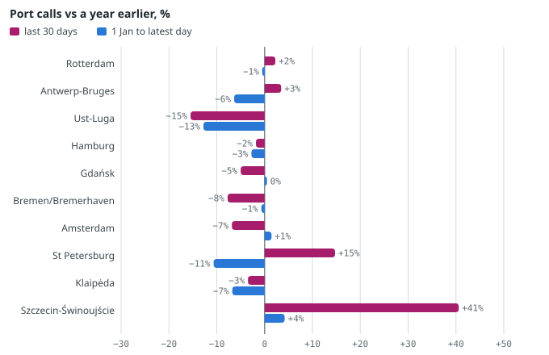
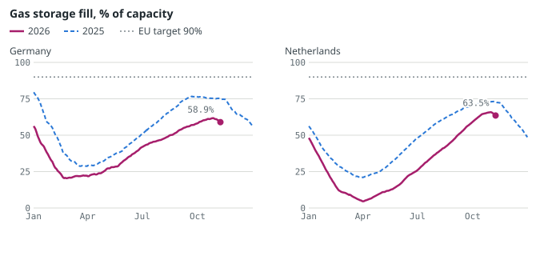
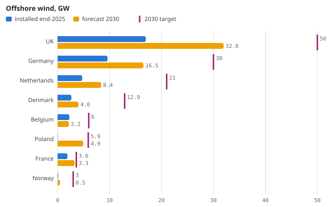
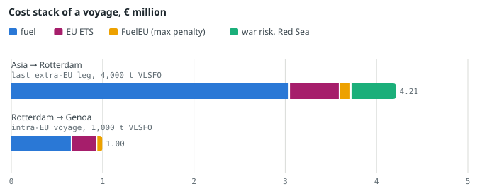

# Northern Europe: Ports and Energy

*Port traffic, gas, offshore wind, shipping costs and Baltic security in the North Sea and Baltic, November 2026.*

Gabriele Giuliani · Geo-economic Risk Monitor · Issue no. 1 · November 2026 · data read on 10 November 2026

Every number has a source and a date. Paragraphs marked *Assessment* are the monitor's reasoning, not facts.

**Contents:** [Key points](#key-points) · [Port traffic: the ten biggest North Sea and Baltic ports](#ports) · [Energy: gas storage, LNG, TTF and power links](#energy) · [Offshore wind: installed, auctions, bottlenecks](#wind) · [Shipping costs: fuel, carbon, insurance, freight, time](#costs) · [Security: cables, drones, GPS jamming, shadow fleet](#security) · [Hydrogen and new fuels in ports: a reality check](#hydrogen) · [What to watch next month](#watch) · [Method, sources and limits](#method)

## 1. Key points

- **Rotterdam's traffic is flat on the year; the weekly drop is noise.** From 1 January to 30 October 2026, Rotterdam averaged 82.7 ship calls a day, −0.5% on the same days of 2025; Antwerp-Bruges −6.4%. The −10.8% in Rotterdam's latest week is noise. The clear fall is at Russia's oil port of Primorsk, −52% (IMF PortWatch).
- **German and Dutch gas storage is far below normal before winter.** On 8 November 2026 Germany was 58.9% full and the Netherlands 63.5%, against an EU goal of 90%. Germany is 15.9 points below a year ago (GIE AGSI+). The TTF gas price is 82.33 €/MWh, +164% on a year.
- **Offshore wind will reach under half of the North Sea goal for 2030.** Europe connected only 1.96 GW in 2025. For Denmark, Germany, the Netherlands and Belgium WindEurope expects 31.1 GW in 2030, 48% of the 65 GW promised at Esbjerg.
- **Carbon rules now add a fifth to a half of fuel costs.** At the EU auction price of 86.91 €/t (9 November 2026), the EU ETS costs 275 € per tonne of fuel burnt on voyages between EU ports and 138 € on voyages to or from outside the EU (bunker-emissioni.json).
- **Sabotage risk sits in the Baltic, above all the Gulf of Finland.** In the AIS snapshot of 9 November 2026, 44 of the 109 ships seen there were on Western sanction lists. Since November 2024 six Baltic cable incidents have been recorded. GPS jamming hit 214–246 areas a day in the week to 8 November 2026 (GPSJam).

## 2. Port traffic: the ten biggest North Sea and Baltic ports

The ten ports are the largest by tonnes handled in 2025 among the 30 in [porti-nord.json](../docs/data/porti-nord.json), with the annual figure from each port authority. **Ship calls** are estimated by IMF PortWatch from AIS transponder signals; the latest day available is 30 October 2026 (about ten days' delay). Changes compare the same days of the previous year.

| Port | Country | 2025, Mt (y/y) | Calls/day, 30 days | 30 days y/y | Year to date y/y | Tankers 30d | Container 30d | Dry bulk 30d |
|---|---|---|---|---|---|---|---|---|
| Rotterdam | Netherlands | [428.4](https://www.portofrotterdam.com/en/node/5524) (−1.7%) | 81.4 | +2.3% | −0.5% | +2% | +4% | −19% |
| Antwerp-Bruges | Belgium | [266.5](https://newsroom.portofantwerpbruges.com/hubfs/260122_Factsheet_Jaarcijfers_2025_DUI.pdf) (−4.1%) | 65.5 | +3.5% | −6.4% | +7% | +23% | −39% |
| Ust-Luga | Russia | [130.5](https://www.themoscowtimes.com/2026/03/05/russian-ports-warn-of-cargo-slowdown-due-to-tighter-inspections-and-ice-conditions) (−3.4%) | 6.0 | −15.5% | −12.8% | −30% | n/a | 0% |
| Hamburg | Germany | [114.6](https://www.verkehrsrundschau.de/nachrichten/transport-logistik/containerumschlag-treibt-hafen-hamburg-ins-plus-3770706) (+2.6%) | 16.2 | −1.8% | −2.8% | +19% | −3% | −17% |
| Gdańsk | Poland | [80.4](https://dailymare.com/news/port-of-gdansk-posts-strong-2025-performance-as-liquid-fuels-dominate-and-container-volumes-hit-record-high,2192) (+4.0%) | 9.5 | −5.0% | +0.5% | −4% | −17% | n/a |
| Bremen/Bremerhaven | Germany | [65.3](https://www.bremenports.de/fileadmin/bremenports/Haefen/Monatsberichte/2025_12_Monatsbericht.pdf) (+5.4%) | 14.3 | −7.7% | −0.7% | +13% | −14% | n/a |
| Amsterdam | Netherlands | [62.1](https://www.portofamsterdam.com/en/annual-report-2025-steadfast-and-motion) (−0.2%) | 20.4 | −6.8% | +1.4% | −6% | n/a | n/a |
| St Petersburg | Russia | [54.6](https://www.themoscowtimes.com/2026/03/05/russian-ports-warn-of-cargo-slowdown-due-to-tighter-inspections-and-ice-conditions) (+3.0%) | 14.8 | +14.7% | −10.7% | −22% | +12% | +39% |
| Klaipėda | Lithuania | [39.0](https://www.hellenicshippingnews.com/2025-a-record-breaking-year-for-the-port-of-klaipeda/) | 8.3 | −3.5% | −6.8% | +21% | −3% | n/a |
| Szczecin-Świnoujście | Poland | [34.8](https://www.trade.gov.pl/en/news/the-ports-of-szczecin-and-swinoujscie-summed-up-the-record-year-2025) (+7.5%) | 9.7 | +40.6% | +4.2% | +43% | +19% | n/a |

*Mt = million tonnes, as published by each port (links). Calls: PortWatch, 30 days to 30 October 2026 and 1 January to 30 October 2026, both against the same days of 2025 ([porti-nord.json](../docs/data/porti-nord.json)). By vessel type, 30-day averages; «n/a» where the year-earlier base is under one call a day. Primorsk and Gothenburg are missing from the ranking because the file has no 2025 total in tonnes for them; Wilhelmshaven reports only containers.*

**Port calls, change on a year earlier, %.** Ten largest ports by 2025 tonnage. Pink: 30-day average to 30 October 2026; blue: 1 January to 30 October 2026. Source: IMF PortWatch via [porti-nord.json](../docs/data/porti-nord.json), data to 30 October 2026.

**What the numbers say.** Over the year to date six of the ten ports are within ±5% of 2025. The biggest falls are Ust-Luga (−12.8%) and St Petersburg (−10.7%); the biggest rise is Szczecin-Świnoujście (+4.2%). The weekly figures swing much more: Rotterdam is −10.8% on the week to 30 October 2026 but +2.3% on 30 days. Calls count ships, not cargo: a port can handle fewer, larger ships.

**Containers moved east and to deep water in 2025.** Rotterdam handled 14.24 million TEU (+3.1%), Hamburg 8.3 million (+7.3%), Wilhelmshaven 1.47 million (+74%) and Gdańsk 2.77 million (+23%), according to the port authorities ([porti-nord.json](../docs/data/porti-nord.json)). TEU is the 20-foot container unit.

**Russia's Baltic oil ports.** Primorsk averaged 1.3 calls a day this year against 2.7 in 2025 (−52%); Ust-Luga −12.8%. Ukrainian drones hit Primorsk on 23 March and Ust-Luga on 29 March, and the Baltic oil ports again in July 2026 (baltico-sicurezza.json). PortWatch does not see ships with AIS switched off, so Russian ports are undercounted.

*Assessment.* Three forces probably drive the pattern. First, some Asia–Europe services have returned to Suez (transits +10.3% on a year, portwatch.json); this may add Mediterranean calls before the North Sea and keep Rotterdam and Antwerp flat. Second, the Baltic is redistributing: Polish ports hold or gain, ports that lived on Russian transit (HaminaKotka −17%, Riga −5% year to date) lose. Third, energy: tanker calls follow the oil and LNG trade, and Rotterdam lost bunker sales (−23.9% in tonnes of oil and bio-blends in the first nine months of 2026, −23.2% counting LNG; Port of Rotterdam via bunker-emissioni.json). These are links we draw; the data do not prove causation.

## 3. Energy: gas storage, LNG, TTF and power links

### Gas storage

| Country | Fill | Gas in storage | vs a year ago | vs 5-year average | vs 90% target | Source |
|---|---|---|---|---|---|---|
| Germany | 58.94% (8 Nov 2026) | 145.8 TWh | −15.9 pp | −29.7 pp | −31.1 pp | GIE AGSI+ (daily) |
| Netherlands | 63.51% (8 Nov 2026) | 91.5 TWh | −9.3 pp | −18.9 pp | −26.5 pp | GIE AGSI+ (daily) |
| Denmark | n/a (no fill % without capacity) | 6.89 TWh (end September 2026) | +26.7% in TWh | n/a | n/a | Eurostat (monthly) |
| Poland | n/a (no fill % without capacity) | 39.36 TWh (end September 2026) | −1.6% in TWh | n/a | n/a | Eurostat (monthly) |

*pp = percentage points. Germany and the Netherlands: [scorte.json](../docs/data/scorte.json) (GIE AGSI+, 8 November 2026). Denmark and Poland: Eurostat nrg_stk_gasm, end-of-month stock on national territory, read by this script (report/dati/eurostat-gas-nord.json); AGSI+ daily fill for these two countries needs an API key the monitor does not have.*

**Gas storage fill, % of working capacity, Germany and the Netherlands,** daily, 2026 against 2025; dotted line: EU 90% target. Source: GIE AGSI+ via [scorte.json](../docs/data/scorte.json), data to 8 November 2026.

Both countries are drawing gas already: over the last two weeks German storage fell by 0.19 points a day and Dutch by 0.14. At that pace Germany would be near 54% and the Netherlands near 60% on 1 December (straight-line projection by this script, not a forecast: cold weather speeds withdrawals). The EU as a whole held 729 TWh at the end of August 2026, −19.4% on a year (Eurostat, [scorte.json](../docs/data/scorte.json)).

Denmark and Poland look better. At the end of September 2026 Danish stocks were 6.89 TWh, +27% on a year; Polish stocks 39.4 TWh, −1.6% (Eurostat, updated 3 November 2026). Denmark is a net gas exporter again thanks to the Tyra field (up to 2.8 bcm a year against consumption of 1.4 bcm, [esposizione-nord.json](../docs/data/esposizione-nord.json)); Poland receives Norwegian gas through Baltic Pipe.

### LNG and the US share

| Country | US share of LNG | Period | Operating import capacity (terminals) | Source |
|---|---|---|---|---|
| Germany | 89% | Q1 2026 (highest in Europe) | 23.1 bcm/y (4) | [IEEFA European LNG Tracker, May 2026](https://ieefa.org/european-lng-tracker) |
| Netherlands | 77% | Q1 2026 | 24.0 bcm/y (2) | [IEEFA European LNG Tracker, May 2026](https://ieefa.org/european-lng-tracker) |
| Poland | 75% (Qatar 21%) | Q1 2026 | 8.3 bcm/y (1) | [IEEFA European LNG Tracker, May 2026](https://ieefa.org/european-lng-tracker) |
| Lithuania | 71% | year 2025 (30 cargoes, 23.9 TWh regasified) | 3.9 bcm/y (1) | [Klaipėda LNG / KN](https://lngprime.com/europe/lithuanias-kn-says-majority-of-klaipeda-fsru-capacity-booked-in-2027/192262/) |

*bcm = billion cubic metres. Capacity: Global Energy Monitor via [terminali-gnl.json](../docs/data/terminali-gnl.json) and [esposizione-nord.json](../docs/data/esposizione-nord.json). Germany's figure still counts the Mukran floating terminal, which IEEFA reports has left for Egypt: the real German capacity is lower.*

Europe-wide, the United States supplied 58% of Europe's LNG imports in 2025 and 63% in the first quarter of 2026 ([IEEFA](https://ieefa.org/european-lng-tracker), May 2026; not verified against the source in review). Norway remains the EU's largest gas supplier: 30.9% of EU gas imports in 2025, 89.3 bcm ([esposizione-nord.json](../docs/data/esposizione-nord.json), Council of the EU). The Netherlands closed the Groningen field by law on 1 October 2024.

### TTF price

The **TTF**, the Dutch hub price that sets gas prices for most of Europe, closed at 82.33 €/MWh on 9 November 2026 (front-month future, provisional close): −3.8% on the day, +1.1% on a month and +164% on a year. US Henry Hub was 3.203 $/MMBtu. Converted at 1.1225 $/€, TTF equals 27.1 $/MMBtu: the transatlantic gap of about 24 $/MMBtu is what pulls US cargoes to Europe (calculation by this script; [prezzi.json](../docs/data/prezzi.json), Yahoo Finance).

### Power links

North Sea countries trade power through subsea direct-current (HVDC) cables: NorNed (700 MW) and COBRAcable (700 MW) from the Netherlands, Viking Link (1.4 GW, Denmark–UK) and NordLink (1.4 GW, Norway–Germany) ([esposizione-nord.json](../docs/data/esposizione-nord.json)). OpenStreetMap shows these HVDC export and interconnector cables under construction: Bornholm–Germany, Eastern Green Link 1, Eastern Green Link 2, IJmuiden Ver Alpha, IJmuiden Ver Beta, IJmuiden Ver Gamma, Nederwiek 1, NeuConnect ([rete-elettrica.json](../docs/data/rete-elettrica.json)). In the Baltic, Estlink 2 (650 MW, Estonia–Finland) was cut by the anchor of the Eagle S on 25 December 2024 and restored in June 2025 ([interconnessioni.json](../docs/data/interconnessioni.json)).

*Assessment.* The winter risk for North-West Europe is storage, not supply routes. German storage is 30 points below its five-year average and most LNG comes from the US. So the TTF depends on two things a port or energy company cannot control: winter temperatures and the Qatar outage linked to the Strait of Hormuz (rated «critical» on the monitor's [rischio.json](../docs/data/rischio.json)).

## 4. Offshore wind: installed, auctions, bottlenecks

Europe had 38.6 GW of offshore wind at the end of 2025 and added 1.96 GW during the year, the lowest since 2016. WindEurope expects 72.8 GW in 2030 ([WindEurope](https://www.rinnovabili.it/wp-content/uploads/2026/02/WindEurope-European-Stats-2025.pdf), February 2026, via [eolico-filiera.json](../docs/data/eolico-filiera.json)).

**Offshore wind by country, GW:** installed at the end of 2025, WindEurope forecast for 2030 and the 2030 target (pink tick). National totals, so Germany and Denmark include the Baltic and the UK the Irish Sea. Source: WindEurope 2025 Statistics (February 2026) and national targets, via [eolico-filiera.json](../docs/data/eolico-filiera.json).

| Declaration | 2030 goal | Installed end-2025 | Forecast 2030 | Forecast as % of goal |
|---|---|---|---|---|
| Esbjerg (2022) | 65.0 GW | 19.27 GW | 31.08 GW | 48% |
| Ostend (2023) | 120.0 GW | 38.29 GW | 66.94 GW | 56% |
| Marienborg, Baltic (2022) | 19.6 GW | 0.26 GW | 5.82 GW | 30% |

*Sums of national WindEurope figures for the signatories (Marienborg: only countries with a mainly Baltic coast, without Germany and Denmark). Calculation in eolico-filiera.json; national totals overstate the single sea basin.*

For the Baltic as a whole the EMODnet map gives 2.7 GW operating and 3.8 GW under construction, mostly Polish, against the 19.6 GW promised at Marienborg ([offshore-nord.json](../docs/data/offshore-nord.json); EMODnet status can lag reality).

### Auctions

| Date | Country | Round | GW | Mechanism | Outcome |
|---|---|---|---|---|---|
| 2024-12 | Denmark | three North Sea sites (3 GW) | 3.0 | negative bidding / no subsidy | [no bids](https://www.offshorewind.biz/2026/11/06/vattenfall-signs-final-agreements-for-new-danish-offshore-wind-farms) |
| 2025 | Denmark | Kattegat II, Kriegers Flak II, Hesselø (no subsidy) | — | no subsidy | [cancelled](https://www.rinnovabili.it/wp-content/uploads/2026/02/WindEurope-European-Stats-2025.pdf) |
| 2025 | Germany | N-9.4 (1 GW, site not pre-investigated) | 1.0 | negative bidding | [awarded](https://www.rinnovabili.it/wp-content/uploads/2026/02/WindEurope-European-Stats-2025.pdf) |
| 2025 | Lithuania | second offshore round (re-run, 0.7 GW) | 0.7 | CfD | [invalidated (fewer than two bids)](https://www.rinnovabili.it/wp-content/uploads/2026/02/WindEurope-European-Stats-2025.pdf) |
| 2025 | Norway | Sørvest F (1.5 GW) | 1.5 | CfD | [cancelled](https://www.rinnovabili.it/wp-content/uploads/2026/02/WindEurope-European-Stats-2025.pdf) |
| 2025-08 | Germany | N-10.1 and N-10.2 (2.5 GW) | 2.5 | uncapped negative bidding | [no bids](https://www.offshorewind.biz/2026/08/12/german-govt-proposes-changes-to-offshore-wind-act-industry-says-cfd-mechanism-should-not-be-fallback-option) |
| 2025-10-30 | Netherlands | Nederwiek I-A (1 GW) | 1.0 | no subsidy | [no bids](https://www.offshorewind.biz/2025/10/31/zero-bids-in-1-gw-dutch-offshore-wind-tender/) |
| 2025-12-17 | Poland | first offshore CfD round | 3.4 | two-sided CfD, 25 years | [awarded: Baltica 9, Baltic East, Bałtyk I](https://notesfrompoland.com/2025/12/19/poland-completes-first-offshore-wind-power-auction-allocating-3-4-gw-of-capacity/) |
| 2026 | Netherlands | IJmuiden Ver Gamma-A (1 GW) and Gamma-B (1 GW) | 2.0 | temporary subsidy (TOWOZ) | [open: applications 26 Nov–10 Dec 2026](https://www.offshorewind.biz/2026/01/19/dutch-govt-plans-single-site-tender-in-september-temporary-subsidy-mechanism-to-support-1-gw-of-offshore-wind) |
| 2026-01-14 | United Kingdom | CfD Allocation Round 7 | 8.4 | CfD | [awarded (record)](https://www.gov.uk/government/publications/contracts-for-difference-cfd-allocation-round-7-results/contracts-for-difference-allocation-round-7-results-accessible-webpage) |
| 2026-08-04 | Denmark | North Sea I Mid / Holmsland (1 GW) and Hesselø (0,8 GW) | 1.8 | two-sided CfD, 20 years | [awarded](https://www.en.kefm.dk/news/news-archive/2026/aug/vattenfall-vindkraft-as-to-build-off-shore-wind-farms-in-the-north-sea-and-kattegat) |
| 2026-08-10 | Germany | WindSeeG reform (draft) | — | two stages (bid + fallback CfD) | [in parliament; rounds of 2–4.8 GW a year from 2027](https://www.offshorewind.biz/2026/08/12/german-govt-proposes-changes-to-offshore-wind-act-industry-says-cfd-mechanism-should-not-be-fallback-option) |

*From [eolico-filiera.json](../docs/data/eolico-filiera.json) (curated, one source per round). Negative bidding: the developer pays the state for the site. Two-sided CfD: the state guarantees a strike price and pays or collects the difference with the market price.*

The pattern is clear in the data: rounds where the developer pays the state for the site failed in Denmark (3 GW, December 2024), Germany (2.5 GW, August 2025) and the Netherlands (1 GW, October 2025), with no bids. Rounds with a **two-sided contract for difference (CfD)** worked. Under a CfD the state guarantees a fixed price and pays or collects the difference with the market. The UK awarded 8.4 GW in January 2026, Poland 3.4 GW in December 2025 and Denmark 1.8 GW in August 2026, signed on 6 November 2026. Next: the Dutch IJmuiden Ver Gamma-A and Gamma-B rounds (2 GW) take applications from 26 November to 10 December 2026 (RVO, secondary source).

### Bottlenecks

- **Auctions and cost of capital** — strain: high. offshore capacity in failed negative-bidding rounds, 2024–2025: 6.5 GW ([WindEurope, 2025 Statistics](https://www.rinnovabili.it/wp-content/uploads/2026/02/WindEurope-European-Stats-2025.pdf), February 2026).
- **HVDC cables** — strain: high. Prysmian transmission order backlog: 16.5 billion € ([Prysmian, comunicato Q3 2026](https://www.prysmian.com/sites/www.prysmian.com/files/media/documents/PR_Q326_ENGLISH.pdf), 29 October 2026).
- **HVDC converter platforms** — strain: high. new in-service date of Amprion's BalWin1 (2 GW) grid link: 15 September 2031 ([HVDC World](https://hvdcworld.com/news/amprion-delays-balwin1-hvdc-connection-to-2031), 8 July 2026).
- **Turbines** — strain: medium. Siemens Gamesa loss before special items, Q2 of financial year 2026: -44 million € ([Renewables Now](https://renewablesnow.com/news/siemens-gamesa-narrows-loss-in-q2-parent-lifts-2026-outlook-1293658/), May 2026).
- **Vessels** — strain: medium. Western installation vessels (WTIV) for turbines of 15 MW or more by 2028, more than: 25 ([Intelatus via Offshore Engineer](https://www.oedigital.com/news/538691-vessel-sector-deep-dive-wtivs), 1 May 2026).
- **Ports** — strain: medium. investment announced since 2022 in factories, ports and vessels: 15.4 billion € ([WindEurope, 2025 Statistics](https://www.rinnovabili.it/wp-content/uploads/2026/02/WindEurope-European-Stats-2025.pdf), February 2026).
- **Foundations** — strain: overcapacity. European XXL monopile capacity from 2027: 2.7 million tonnes a year ([Rystad Energy](https://www.rystadenergy.com/insights/from-scarcity-to-surplus-europes-monopile-factories-face-utilization-squeeze), 18 September 2026).

In plain terms: Prysmian holds about 16.5 billion € of transmission orders (29 October 2026) and NKT 13.0 billion (30 June 2026). New HVDC cable capacity is booked for years. Amprion's 2 GW BalWin1 grid link slipped from September 2030 to 15 September 2031 because of extra work on the offshore converter platform. European monopile factories, by contrast, will run at about 32% of capacity in 2026 and 19% in 2028 (Rystad).

### Ports and vessels

Esbjerg has shipped over 27.5 GW of offshore wind in total ([Port Esbjerg](https://portesbjerg.dk/en/news/record-number-of-wind-vessels-calling-at-port-esbjerg-in-2025)). Rotterdam plans a 45-hectare wind terminal for mid-2029 and Cuxhaven a 1,250-metre heavy-load quay for about 2028, while the Bremerhaven terminal was never built ([eolico-filiera.json](../docs/data/eolico-filiera.json)). Vessels are no longer the main constraint. Western installation ships able to handle 15 MW turbines go from zero in 2020 to more than 25 by 2028 (Intelatus). Cadeler, the market leader, used its fleet at 66% in the first half of 2026 and had a 2.5 billion € order book.

### Offshore wind calendar: the next 90 days

| Date | Country | Type | Milestone | MW | Status | Source |
|---|---|---|---|---|---|---|
| 2026-Q4 | Poland | policy | Gdansk T5 installation terminal (EUR 253 m, 21 ha) | — | scheduled | [offshoreWIND.biz (T5 terminal); lease dates from eolico-filiera.json](https://www.offshorewind.biz/2024/07/16/poles-getting-ready-to-build-eur-253-million-offshore-wind-terminal-at-port-of-gdansk) |
| 2026-11-26 | Netherlands | auction | IJmuiden Ver Gamma-A and Gamma-B | 2,000 | scheduled | [RVO (Dutch page, Gamma-B); Renewable Energy Industry](https://www.rvo.nl/onderwerpen/windenergie-op-zee/ijmuiden-ver-gamma-b) |
| 2026-11-27 | United Kingdom | auction | CfD Allocation Round 8 (AR8): results | — | scheduled | [Foot Anstey / law-firm summaries of the AR8 framework](https://www.footanstey.com/our-insights/articles-news/contracts-for-difference-allocation-round-8-the-changes-to-be-aware-of/) |
| 2026-12 | Germany | policy | WindSeeG reform: Bundestag adoption | — | at risk | [Bundestag Drucksache 21/8238; Riviera; balticwind.eu](https://dserver.bundestag.de/btd/21/082/2108238.pdf) |
| 2026-12 | France | auction | AO10 first winners | 10,000 | scheduled | [Enerdata](https://www.enerdata.net/publications/daily-energy-news/france-launches-10-gw-offshore-wind-tenders-under-ppe-3.html) |
| 2026-12 | Lithuania | FID | Curonian Nord: decision on further implementation | 700 | at risk | [Windtech International](https://www.windtech-international.com/projects-and-contracts/ignitis-proposes-postponing-curonian-nord-offshore-wind-project) |
| 2027-01-01 | Germany | policy | WindSeeG reform: entry into force | — | scheduled | [offshoreWIND.biz](https://offshorewind.biz/2026/09/02/german-cabinet-approves-offshore-wind-act-amendment-industry-calls-for-further-changes) |
| 2027-Q1 | United Kingdom | delay | Hornsea 3 (Orsted) | 2,900 | at risk | [Orsted, Q1 2026 earnings call transcript](https://cdn.orsted.com/-/media/q12026/q1-2026---earnings-call-transcript.pdf) |

*Source: [wind-calendar.json](../docs/data/wind-calendar.json) (curated, 114 milestones, reference date 10 November 2026; «unconfirmed» = a scheduled date has passed without confirmation). Across the calendar: 84 done, 18 scheduled, 8 at risk, 4 unconfirmed.*

**Also flagged at risk or unconfirmed in the calendar:**

- Dogger Bank B (United Kingdom, 2026): SSE project page gives commercial operation in 2026, but turbine installation was still running in November 2026 (vessel Seaway Ventus on site), so slippage into 2027 is likely.
- Swedish state-led tender and support system (Sweden, 2026-07-01): Government commission proposed state-identified sites and support (offshore wind 'not commercially viable' otherwise), with the system taking effect from 1 Jul 2026.
- He Dreiht: full 960 MW (Germany, 2026-10): EnBW expected the full 960 MW for the first time in October 2026.
- Bornholm offshore wind farms: joint DK-DE tender launch (Denmark, 2026-H1): In January 2026 the two governments said the joint tender for the wind farms would launch 'in the coming months'. No launch found by November 2026.
- East Anglia Three (United Kingdom, 2026-H2): Developer aim: full operation by end-2026.

*Assessment.* For a port the binding constraint is now the auction pipeline and the grid, not ships or steel. Work is secured until 2027–2028; after that, demand depends on whether the Dutch December round attracts bids and on the German auction reform, meant to take effect on 1 January 2027 if the Bundestag adopts it in time.

## 5. Shipping costs: fuel, carbon, insurance, freight, time

| Bunker hub | VLSFO, $/t | Date | 27 Feb 2026, $/t | Since 27 Feb | On a year |
|---|---|---|---|---|---|
| Rotterdam | 739.5 | 6 Nov 2026 | 489.5 | +51% | +71% |
| Antwerp | 730.5 | 6 Nov 2026 | 470.5 | +55% | +68% |
| Gibraltar | 810.0 | 6 Nov 2026 | 520.5 | +56% | +74% |
| Singapore | 854.0 | 6 Nov 2026 | 521.5 | +64% | +83% |
| Fujairah | 865.0 | 6 Nov 2026 | 519.5 | +66% | +88% |

*VLSFO = very low sulphur fuel oil, the standard marine fuel. 27 February 2026 is the last price before the war with Iran. Source: Ship & Bunker via [bunker-emissioni.json](../docs/data/bunker-emissioni.json) (averages of quotes, not transactions).*

**EU ETS and FuelEU.** Since 2026 shipping surrenders emission allowances (EUA) for 100% of its emissions, counted in full on voyages between EU ports and at half on voyages to or from outside the EU. At 86.91 €/t (EEX auction, 9 November 2026; 2026 auction average 78.81 €) that is 275 € per tonne of VLSFO burnt intra-EU and 138 € on extra-EU legs. **FuelEU Maritime** limits the greenhouse intensity of fuel; a ship running only on fossil fuel pays at most 62 € and 31 € per tonne. Together they equal about 51% of the fuel bill intra-EU and 22% on extra-EU legs ([bunker-emissioni.json](../docs/data/bunker-emissioni.json)).

What carriers charge: Maersk's emissions surcharge for the fourth quarter is 170 $ per 40-foot container (FEU) from the Far East to North Europe, 4.7% of the Drewry Shanghai–Rotterdam rate of 3,615 $ ([Maersk](https://www.maersk.com/news/articles/2026/09/01/emissions-surcharge-ems-ess), 1 September 2026).

**Cost stack of a voyage, € million.** Top: last leg from an Asian port to Rotterdam burning 4,000 t of VLSFO bought in Singapore (an illustrative assumption, not a real ship), with ETS at 50% and the FuelEU penalty cap, plus one Red Sea war-risk premium at 0.25% of a 221.7 million $ hull. Bottom: an intra-EU voyage burning 1,000 t. Sources: [bunker-emissioni.json](../docs/data/bunker-emissioni.json) (bunker 6 November 2026, EUA 9 November 2026) and [assicurazioni.json](../docs/data/assicurazioni.json) (premium 24 September 2026).

In the Asia–Rotterdam example fuel is 3.04 million €, the ETS 0.55 million, FuelEU at most 0.12 million and one war-risk premium 0.40–0.59 million: 4.21 million in total with the mid premium. The insurance figure is approximate: the last public Red Sea quote (0.2–0.3% of hull value, 24 September 2026) is for tankers without Saudi ties, and the hull value is the price of a new 15,500-TEU ship, a maximum.

**War-risk insurance in the Baltic.** The Joint War Committee of the London market lists all Russian ports, the Baltic ones included (Primorsk, Ust-Luga), as areas of heightened risk (circular JWLA-035 of 16 September 2026, [assicurazioni.json](../docs/data/assicurazioni.json)): a ship calling there must notify its insurer and pay an additional premium. **Missing:** no public premium for Baltic calls was found. The coastal states face a different insurance risk: shadow-fleet tankers with unknown cover sail through Danish waters.

**Freight.** Drewry's index puts a 40-foot container from Shanghai at 3,615 $ to Rotterdam and 4,166 $ to Genoa (5 November 2026). The Freightos China–North Europe index (FBX11) is 3,422 $ (−4.8% on the week to 6 November 2026) and the Shanghai CCFI Europe index 1,860.07 points (+1.53%) ([noli.json](../docs/data/noli.json)).

### Transit times to Rotterdam

Ships rerouted around the Cape of Good Hope need roughly 7,000 km and 14–24 days more between Asia and Europe than via Suez (UNCTAD 2024, in [stretti-dettaglio.json](../docs/data/stretti-dettaglio.json)). In the week to 1 November 2026 the Suez Canal saw 43.0 transits a day (+10.3% on a year) and the Cape 92.0 (+5.0%) ([portwatch.json](../docs/data/portwatch.json)). BIMCO counts 753,000 TEU a week of container capacity through Suez in early October 2026 against 1,457,000 in 2023: just over half of the pre-crisis level.

The monitor's routing model (transit-times.json, updated 10 November 2026) puts a ~15,000 TEU container ship from Shanghai (Yangshan) to Rotterdam at 29.6 days at sea via Suez today (10,674 nautical miles at 15 knots), and 40.1 days via the Cape, 10.5 days more. Sea time only: no canal waiting, port time or bunkering stops; distances are within 5% of published ones. The model's extra days via the Cape are fewer than UNCTAD's 14–24 because they are sea days at one fixed speed from one origin; UNCTAD's range covers several origins and speeds.

| Origin | Cargo | Status today | Nautical miles today | Days today (speed range) | Days, pre-crisis route | Days via Cape | Extra days via Cape |
|---|---|---|---|---|---|---|---|
| Shanghai (Yangshan) | container | normal | 10,674 | 29.6 (27.8–31.8) | 29.6 | 40.1 | 10.5 |
| Singapore | container | normal | 8,482 | 23.6 (22.1–25.2) | 23.6 | 34.0 | 10.4 |
| Busan | container | normal | 11,050 | 30.7 (28.8–32.9) | 30.7 | 41.2 | 10.5 |
| Ras Laffan | lng | blocked (Hormuz de facto closed) | 6,473 | 15.9 (15.0–16.9) | 15.9 | 28.2 | 12.3 |
| Ras Tanura / Juaymah | crude | re-routed (Hormuz de facto closed) | 3,964 | 13.2 (12.7–13.8) | 21.8 | 39.3 | 17.5 |
| Yanbu | crude | normal | 3,964 | 13.2 (12.7–13.8) | 13.2 | 39.3 | 26.1 |
| Jebel Ali | container | re-routed (Hormuz de facto closed) | 6,188 | 17.2 (16.1–18.4) | 17.4 | 31.1 | 13.7 |
| Mumbai / Nhava Sheva (JNPA) | container | normal | 6,501 | 18.1 (16.9–19.3) | 18.1 | 32.5 | 14.4 |
| Houston / Sabine Pass | lng | normal | 5,223 | 12.8 (12.1–13.6) | 12.8 | 12.8 | 0.0 |
| New York / New Jersey | container | normal | 3,354 | 9.3 (8.7–10.0) | 9.3 | 9.3 | 0.0 |
| Santos | container | normal | 5,430 | 15.1 (14.1–16.2) | 15.1 | 15.1 | 0.0 |

*Source: [transit-times.json](../docs/data/transit-times.json) (Benden shipping lanes, Dijkstra routing; speeds from Alphaliner/UNCTAD; statuses from stretti-dettaglio.json). «Blocked»/«re-routed» refer to the Strait of Hormuz being de facto closed.*

*Assessment.* Fuel still dominates the voyage bill, but carbon is the cost that rises by rule: FuelEU's target tightens from −2% today to −6% in 2030 and −14.5% in 2035. For North Sea ports the competitive question is less the bunker price than where carriers place their last non-EU call before Europe.

## 6. Security: cables, drones, GPS jamming, shadow fleet

### Cables and pipelines

| Date | Cable or pipeline | Suspected cause | Link |
|---|---|---|---|
| 8 Oct 2023 | Balticconnector gas pipeline and Finland–Estonia cables | anchor of the NewNew Polar Bear (suspected) | [source](https://www.aljazeera.com/news/2023/10/25/finland-pipeline-damage-cause) |
| 17 Nov 2024 | BCS East-West Interlink (Lithuania–Gotland) | anchor of the Yi Peng 3 (suspected) | [source](https://lieber.westpoint.edu/baltic-sea-cable-cuts-ship-interdiction-c-lion1-incident/) |
| 18 Nov 2024 | C-Lion1 (Helsinki–Rostock) | anchor of the Yi Peng 3 (suspected) | [source](https://www.datacenterdynamics.com/en/news/chinese-bulk-carrier-suspected-of-being-behind-baltic-sea-cable-cuts/) |
| 25 Dec 2024 | Estlink 2 power cable and four data cables | anchor of the Eagle S (suspected) | [source](https://therecord.media/finland-appeals-court-revives-case-against-eagle-s) |
| 26 Jan 2025 | Ventspils–Gotland data cable (LVRTC) | anchor of the Vezhen (suspected) | [source](https://therecord.media/sweden-seizes-ship-suspected-cable-sabotage) |
| 31 Dec 2025 | Elisa and Arelion Helsinki–Tallinn cables | anchor of the Fitburg (suspected) | [source](https://www.euronews.com/2026/11/05/finnish-court-jails-russian-captain-over-baltic-sea-cable-sabotage) |
| 2 Jan 2026 | Šventoji (LT) – Liepāja (LV) data cable | under investigation | [source](https://gcaptain.com/latvia-police-board-vessel-after-baltic-sea-telecom-cable-breach) |

*Baltic incidents in [cavi-incidenti.json](../docs/data/cavi-incidenti.json), plus the Šventoji–Liepāja cable recorded so far only in [baltico-sicurezza.json](../docs/data/baltico-sicurezza.json). Causes are hypotheses of investigators or the press unless a court has ruled; intent is not proven in most cases.*

On 5 November 2026 a Helsinki court sentenced the captain of the Fitburg to 42 months for the damage to the Helsinki–Tallinn cables (first instance, not final; [baltico-sicurezza.json](../docs/data/baltico-sicurezza.json), Euronews). The monitor's risk dashboard rates the Baltic cable corridor «medium» (9.0 out of 25) ([rischio.json](../docs/data/rischio.json)).

### Drones

[baltico-sicurezza.json](../docs/data/baltico-sicurezza.json) records 15 drone events around North Sea and Baltic airports, bases, ports and energy sites since September 2025. Copenhagen airport closed for nearly four hours on 22 September 2025; drones flew over the Antwerp port area on 6 November 2025 and over the Doel nuclear plant on 9 November 2025; on 4 August 2026 a drone carrying explosives hit an Antonov An-124 at Leipzig. On 18 October 2026 Lithuania closed Kaunas airport after detecting an unidentified flying object. On 25 June 2026 Copenhagen police said they could neither prove nor rule out that drones had been there on 22 September 2025 (Wikipedia and sources cited, reliability medium): an alarm alone can shut a hub.

### GPS jamming (GNSS interference)

GNSS satellite navigation signals are jammed or spoofed daily in the eastern Baltic. GPSJam, which reads the navigation quality reported by aircraft, showed 214 to 246 map cells a day at a high level (over 10% of aircraft affected) between 2 November and 8 November 2026. Almost all were east of 17°E (Kaliningrad, Lithuania, the Gulf of Finland, eastern Poland); one lay just west of it, at 55.8°N 16.96°E (10.7% of 681 aircraft). Aircraft data show where interference reaches, not where the jammers are, and say nothing directly about ships ([baltico-sicurezza.json](../docs/data/baltico-sicurezza.json)).

### Shadow fleet in the Danish straits and the Gulf of Finland

The Danish Maritime Authority counted 292 passages of EU-sanctioned tankers through Danish waters in 2025, almost one a day ([Euronews](https://www.euronews.com/2026/02/11/russias-shadow-fleet-of-tankers-reported-in-danish-waters-almost-daily-in-2025-denmark-say)). PortWatch measures only the Øresund, not the Great Belt used by the largest tankers: there, 38.7 transits a day in the week to 1 November 2026, −20.5% on a year (tankers −18.9%) ([porti-nord.json](../docs/data/porti-nord.json)).

In the AIS snapshot of 9 November 2026 the monitor saw 109 ships in the Gulf of Finland: 44 on US, UK or EU sanction lists and 38 probable shadow fleet. Counting tankers only, 38 of 96 were sanctioned there and 7 more in the rest of the Baltic ([navi.json](../docs/data/navi.json), [baltico-sicurezza.json](../docs/data/baltico-sicurezza.json)). The Danish straits snapshot showed 27 ships and 1 sanctioned, but coverage there is thinner. Ships with AIS off are not counted.

Coastal states have become more active: [baltico-sicurezza.json](../docs/data/baltico-sicurezza.json) lists 6 detentions, boardings or refusals of entry in 2026, one of them by Russia. They include Swedish detentions of tankers off Gotland and Trelleborg and Germany's refusal of the tanker Tavian. Russia detained a Greek-owned tanker leaving an Estonian port on 26 July 2026. The Danish straits are rated «medium» on the risk dashboard (8.3 out of 25, from 5.8 a week earlier).

Cyber: on 29 December 2025 a destructive attack hit more than 30 wind and solar farms in Poland; the plants lost remote control and communication, but power output did not stop ([cyber-energia.json](../docs/data/cyber-energia.json)).

### Port risk scores

The monitor's Port Risk Index scores each port as probability of disruption (1–5) times impact on European supply chains (1–5). Levels: low < 6, medium 6–11.9, high 12–19.9. Russian ports have impact capped at 3. It is a rule-based assessment, not a forecast.

| Port | Score /25 | Level | Probability × impact | Trend |
|---|---|---|---|---|
| Rotterdam | 7.5 | medium | 1.5 × 5.0 | stable |
| Antwerp-Bruges | 7.5 | medium | 1.5 × 5.0 | stable |
| Ust-Luga | 9.3 | medium | 3.1 × 3.0 | stable |
| Hamburg | 6.1 | medium | 1.5 × 4.1 | stable |
| Gdańsk | 7.0 | medium | 1.7 × 4.1 | stable |
| Bremen/Bremerhaven | 5.2 | low | 1.5 × 3.5 | stable |
| Amsterdam | 3.9 | low | 1.5 × 2.6 | stable |
| St Petersburg | 9.3 | medium | 3.1 × 3.0 | rising |
| Klaipėda | 7.5 | medium | 1.7 × 4.4 | stable |
| Szczecin-Świnoujście | 6.1 | medium | 1.6 × 3.8 | stable |

*Source: [port-risk.json](../docs/data/port-risk.json), reference date 10 November 2026; method in report/port-risk-method.md.*

*Assessment.* The pattern of incidents points to deniable pressure: anchors dragged by merchant ships, unattributed drones, jamming that degrades navigation without stopping it. The practical exposure for ports and offshore operators is downtime (airport and airspace closures, cable repairs that take months) rather than physical damage to terminals.

## 7. Hydrogen and new fuels in ports: a reality check

Europe had 571 MW of electrolysers in operation in July 2025 (Hydrogen Europe, [idrogeno.json](../docs/data/idrogeno.json)), against the 90–100 GW the European Commission estimated for its 2030 goal of 10 million tonnes of domestic renewable hydrogen. Among the North-West European port projects tracked by the monitor, 300 MW operate, 525 MW are under construction, 450 MW are in development and 460 MW are suspended (a sample, not a census).

| Project | Port | Type | Status | MW | Year |
|---|---|---|---|---|---|
| GET H2 Nukleus, RWE electrolyser, Lingen | (inland, Ems) | electrolyser | operating | 300 | 2026 |
| Ship-to-ship ammonia bunkering pilot (Rotterdam) | Rotterdam | bunkering | operating | — | 2025 |
| Kassø, e-methanol plant (European Energy) | (southern Jutland) | e-fuel | operating | — | 2025 |
| Holland Hydrogen 1 (Shell) | Rotterdam | electrolyser | under construction | 200 | 2026 |
| ELYgator (Air Liquide) | Rotterdam | electrolyser | under construction | 200 | 2027 |
| Hamburg Green Hydrogen Hub (Moorburg) | Hamburg | electrolyser | under construction | 100 | 2027 |
| Hyoffwind (Zeebrugge) | Zeebrugge (Antwerp-Bruges) | electrolyser | under construction | 25 | 2026 |
| HH-WIN, Hamburg industrial hydrogen grid | Hamburg | local H2 grid | under construction | — | 2027 |
| Ammonia import terminal Wilhelmshaven (Uniper) | Wilhelmshaven | import terminal | development | 1,000 | 2028 |
| H2Maasvlakte (Uniper), phase 1 | Rotterdam | electrolyser | development | 200 | 2030 |
| OranjeWind electrolyser (RWE) at Magnum power plant | Eemshaven | electrolyser | development | 100 | — |
| Green H2, electrolyser at Gdańsk refinery (Orlen) | Gdańsk | electrolyser | development | 100 | 2027 |
| Eemshydrogen (RWE) | Eemshaven | electrolyser | development | 50 | 2027 |
| Ammonia terminal + cracker VTTI (Rotterdam) | Rotterdam | import terminal | development | — | — |
| ACE Terminal (Gasunie, HES, Vopak) | Rotterdam | import terminal | development | — | — |
| NH3 Antwerp Terminal (Fluxys, Advario) | Antwerp | import terminal | development | — | 2028 |
| Esbjerg PtX cluster (HOST, Njordkraft, Vidar, Frigg, Albatros, Heimdal) | Esbjerg | electrolyser | development | — | 2030 |
| H2-Fifty (BP) | Rotterdam | electrolyser | suspended | 250 | — |
| H2-Hub Lubmin (Deutsche ReGas) | Lubmin | electrolyser | suspended | 210 | — |
| Immingham Green Energy Terminal (Air Products) | Immingham | import terminal | cancelled | 300 | 2025 |
| H2M Eemshaven, blue hydrogen with CCS (Equinor) | Eemshaven | blue hydrogen | cancelled | — | 2026 |
| ArcelorMittal Bremen steelworks: hydrogen DRI plan | Bremen | industrial demand | cancelled | — | 2025 |
| FlagshipONE, e-methanol (Örnsköldsvik) | Örnsköldsvik | e-fuel | cancelled | — | 2024 |
| H2Teesside, blue hydrogen (BP) | Teesside | blue hydrogen | cancelled | — | 2025 |
| Ammonia cracker BP (Wilhelmshaven) | Wilhelmshaven | import terminal | announced | — | 2028 |
| Ammonia terminal RWE (Brunsbüttel) | Brunsbüttel | import terminal | announced | — | — |

*Source: [idrogeno.json](../docs/data/idrogeno.json), one source per project (dates 2022–2026).*

**Costs.** The IEA put hydrogen from offshore wind at 5.3–7 €/kg in 2024. Grey hydrogen made from gas would cost about 3.8 €/kg at today's TTF (82.33 €/MWh), an interpolation by the monitor that ignores the carbon price. Expensive gas narrows the gap but does not close it.

**Pipes.** The Delta Rhine Corridor from Rotterdam to Germany is now expected in 2031–2032, about four years late; until then hydrogen derivatives move by barge. Denmark's first hydrogen pipeline (Esbjerg–German border) is built only if the market books at least 0.5 GW by 1 December 2026 ([Pipeline Journal](https://www.pipeline-journal.net/news/denmark-opens-capacity-sales-first-hydrogen-pipeline)). Germany's core network has its first operating stretches (Lubmin–Bobbau, Lingen–Marl).

**Ship fuels.** Rotterdam ran an 800 m³ ship-to-ship ammonia bunkering pilot in April 2025. In the third quarter of 2026 the port sold 23,613 m³ of bio-LNG and 4,166 t of bio-methanol, next to 215,420 m³ of fossil LNG ([bunker-emissioni.json](../docs/data/bunker-emissioni.json)). Kassø in Denmark can make up to 42,000 t a year of e-methanol.

*Assessment.* Before 2030 North Sea ports will be local hydrogen producers for refineries and developers of ammonia import terminals, not import hubs. The test to watch is commercial: offtake contracts and pipeline bookings, such as the Danish 1 December deadline, say more than new announcements.

## 8. What to watch next month

Thresholds are the monitor's **assessment** of when a change becomes material for ports and energy companies in the region; they are not forecasts. «Now» is the latest value in the data.

| Indicator | Now | Threshold (assessment) | File | Frequency |
|---|---|---|---|---|
| TTF front-month | 82.33 €/MWh (9 Nov 2026) | above 100 €/MWh | prezzi.json | daily |
| German gas storage | 58.9% (8 Nov 2026) | below 50% on 1 Dec | scorte.json | daily |
| Dutch gas storage | 63.5% | below 55% on 1 Dec | scorte.json | daily |
| EUA auction price | 86.91 €/t (9 Nov 2026) | above 95 €/t | bunker-emissioni.json | daily |
| Rotterdam calls, 30 days y/y | +2.3% | below −10% | porti-nord.json | weekly |
| Øresund transits, 7 days y/y | −20.5% | below −30% (dashboard red) | porti-nord.json | weekly |
| Sanctioned ships in the Gulf of Finland (AIS snapshot) | 44 | above 50 | baltico-sicurezza.json | daily |
| High GPS-interference cells west of 17°E (week) | 1 | 3 or more, or any west of 15°E (Bornholm, Øresund, German ports) | baltico-sicurezza.json | daily |
| New Baltic cable or pipeline incident | last: 2 Jan 2026 | any | cavi-incidenti.json | on event |
| IJmuiden Ver Gamma bids | window 26 Nov–10 Dec | no bids or Gamma-B withdrawn | eolico-filiera.json | 10 Dec |
| Danish hydrogen backbone bookings | deadline 1 Dec | under 0.5 GW booked (project not built) | idrogeno.json | 1 Dec |
| Maersk ETS surcharge Q1 2027, Far East → N. Europe | 170 $/FEU (Q4) | above 170 $/FEU | bunker-emissioni.json | about 1 Dec |
| Red Sea war-risk quote | 0.2–0.3% (24 Sep 2026) | above 0.5% of hull value | assicurazioni.json | on quote |
| CfD Allocation Round 8 (AR8): results | scheduled (2026-11-27) | results slip into 2027 | wind-calendar.json | on event |
| WindSeeG reform: Bundestag adoption | at risk (2026-12) | no adoption in December | wind-calendar.json | on event |

*Also on the calendar: the IMO vote on the global Net-Zero Framework, planned to resume on 4 December 2026 ([bunker-emissioni.json](../docs/data/bunker-emissioni.json)). Risk dashboard levels for reference: Danish straits «medium», Baltic cables «medium», Red Sea container route «high», Qatar LNG «critical» ([rischio.json](../docs/data/rischio.json)).*

## 9. Method, sources and limits

| File | Updated | Main sources |
|---|---|---|
| [porti-nord.json](../docs/data/porti-nord.json) | 2026-11-09T20:05Z | IMF PortWatch; Autorità portuali e statistiche nazionali |
| [scorte.json](../docs/data/scorte.json) | 2026-11-09T19:19Z | GIE AGSI+; Eurostat – Gas products stock levels, monthly |
| [prezzi.json](../docs/data/prezzi.json) | 2026-11-10T03:40Z | Yahoo Finance, US Treasury |
| [eolico-filiera.json](../docs/data/eolico-filiera.json) | 2026-11-10T06:25Z | WindEurope, Wind energy in Europe - 2025 Statistics and the outlook fo; Port Esbjerg, 'Port Esbjerg expands by 570,000 square metres' |
| [offshore-nord.json](../docs/data/offshore-nord.json) | 2026-11-09T20:05Z | EMODnet Human Activities: wind farms; Wikipedia, List of offshore wind farms |
| [bunker-emissioni.json](../docs/data/bunker-emissioni.json) | 2026-11-09T20:06Z | Ship & Bunker, prezzi bunker per porto; MPA Singapore via data.gov.sg |
| [assicurazioni.json](../docs/data/assicurazioni.json) | 2026-11-09T20:12Z | Joint War Committee; IUA, Joint War Committee Risk List |
| [noli.json](../docs/data/noli.json) | 2026-11-09T19:16Z | Drewry; Freightos / Baltic Exchange |
| [portwatch.json](../docs/data/portwatch.json) | 2026-11-09T19:16Z | IMF PortWatch |
| [baltico-sicurezza.json](../docs/data/baltico-sicurezza.json) | 2026-11-09T20:05Z | Eventi curati con fonte per voce; docs/data/cavi-incidenti.json e ibrido.json |
| [navi.json](../docs/data/navi.json) | 2026-11-09T19:29Z | Elenco navi sanzionate del progetto; Digitraffic, AIS marittimo |
| [cavi-incidenti.json](../docs/data/cavi-incidenti.json) | 2026-11-09T18:57Z | Curato a mano dall'agente CAVI da notizie e analisti |
| [idrogeno.json](../docs/data/idrogeno.json) | 2026-11-09T20:09Z | Voci curate; IEA, Northwest European Hydrogen Monitor 2025 |
| [esposizione-nord.json](../docs/data/esposizione-nord.json) | 2026-11-09T20:05Z | Eurostat, Energy imports dependency; IEEFA European LNG Tracker, maggio 2026 |
| [rete-elettrica.json](../docs/data/rete-elettrica.json) | 2026-11-09T19:17Z | OpenStreetMap via tessere vettoriali OpenInfraMap |
| [rischio.json](../docs/data/rischio.json) | 2026-11-09T20:03Z | Yahoo Finance, US Treasury |
| [port-risk.json](../docs/data/port-risk.json) | 2026-11-10T06:17Z | port risk scores (PORT-RISK agent) |
| [transit-times.json](../docs/data/transit-times.json) | 2026-11-10T06:23Z | transit times to Rotterdam (TRANSIT agent) |
| [wind-calendar.json](../docs/data/wind-calendar.json) | 2026-11-10T06:24Z | offshore wind calendar (WIND-CALENDAR agent) |
| report/dati/eurostat-gas-nord.json | 2026-11-10T06:28Z | Eurostat nrg_stk_gasm (DK, PL) |

*Each file lists its sources, licences and the date of each datum; the text cites the date of the datum, not of the reading.*

- **Coverage.** PortWatch counts ships with AIS on; it sees about ten days late and undercounts Russian ports. Port tonnages are curated by hand from port authorities, some via trade press.
- **Seven days is too short.** Weekly port-call changes swing by ±10–30% on small numbers; the report leads with 30-day and year-to-date averages.
- **Conflicting counts.** baltico-sicurezza.json counts all sanctioned ships in the Gulf of Finland (44 of 109); navi.json counts tankers (38 of 96 sanctioned) and the risk dashboard counts sanctioned tankers in the whole Baltic (45). They are different perimeters of the same snapshot.
- **Offshore wind** totals differ between WindEurope (national, end-2025) and EMODnet (map polygons, status sometimes late, duplicates removed).
- **Brent** in prezzi.json is a provisional front-month close updated overnight; other files of the monitor quote an earlier reading. This report does not use Brent.
- **Missing:** AGSI+ daily fill for Denmark and Poland; monthly LNG import volumes by country and origin; any public war-risk premium for Baltic calls.
- **Hand-written items:** the external fact on the EU-wide US LNG share and the thresholds of section 8. Figures quoted from curated text fields of the files (for example the 292 tanker passages or the Fitburg sentence) are typed in the script and checked against the source text at every run; all other numbers are computed by report/build_northern_europe.py from the files above.
- **Different assumptions between files.** The cost stack uses a 221.7 million $ hull (assicurazioni.json); transit-times.json uses 150 million $ for the same ship type, so its Red Sea premium is lower. Port-risk.json computes its own 7-day port-call changes, which can differ by a few tenths from porti-nord.json.

**Glossary.** AIS: transponder by which ships broadcast identity and position. TEU/FEU: 20-/40-foot container. TTF: Dutch gas hub price. LNG: liquefied natural gas. HVDC: high-voltage direct current. CfD: contract for difference. EUA: EU emission allowance (1 t CO₂e). FuelEU Maritime: EU rule on the greenhouse intensity of ship fuel. War risk: separate insurance for war, mines and seizure. Shadow fleet: old tankers with opaque ownership used to move sanctioned oil. GNSS: satellite navigation (GPS, Galileo).

---

### Review · 10 November 2026

Independent check of every number against the data files or the cited source, done before publication with a second pass by an AI assistant (Claude) acting as reviewer under report/STANDARD.md. Full log: report/revisioni/northern-europe-2026-11.md.

**Claims checked.** 64 claims checked (over 150 numbers): 58 recomputed from the data files (porti-nord, scorte, prezzi, eolico-filiera, offshore-nord, bunker-emissioni, assicurazioni, noli, portwatch, baltico-sicurezza, navi, cavi-incidenti, idrogeno, esposizione-nord, rete-elettrica, interconnessioni, rischio, port-risk, transit-times, wind-calendar, Eurostat) and 6 also against the original source: 3 confirmed (Maersk surcharge, Pipeline Journal on the Danish hydrogen pipeline, HVDC World on BalWin1), 3 not reachable. No calculation errors in the data files; 12 errors or weaknesses in the draft, corrected (list below); 4 inconsistencies between files, declared.

**Corrections.**

- Ports: the draft led with 7-day changes (Rotterdam −10.8%); the report now leads with 30-day (+2.3%) and year-to-date (−0.5%) averages, which are less noisy.
- GPS jamming: the NORD agent wrote that all high-interference cells were east of 17°E; one cell at 55.8°N 16.96°E was high in the week to 8 November. Text and watch-list threshold corrected.
- Rotterdam bunker sales: bunker-emissioni.json says its −23.9% includes LNG, but the figure is oil and bio-blends only; with LNG it is −23.2%. Both are now stated.
- Storage projection: the slope used 13 days, not 14; recomputed (Germany −0.19 points a day, not −0.21).
- Baltic cables: the draft counted five incidents since November 2024 and gave 31 December 2025 as the last one; the Šventoji–Liepāja cable (2 January 2026, baltico-sicurezza.json) makes six.
- Copenhagen police statement: attributed to the agent report in the draft; it is in baltico-sicurezza.json (Wikipedia and sources, reliability medium).
- Detentions in 2026: one of the six is by Russia, not by a Western coastal state; wording corrected.
- Norway: «largest pipeline supplier» corrected to «largest gas supplier», as in the source.
- Key points: 2025 offshore additions given as 2.0 GW in the key points and 1.96 GW in the body; aligned to 1.96.
- Italian text from curated files (auction outcomes, bottleneck indicators, cable incidents, hydrogen projects, risk levels) translated into English.
- Charts: tick labels of the port chart were broken by a character substitution; value labels on the wind chart overlapped the target ticks. Fixed and checked at 1440 and 390 px.
- Transit times: the model's 10.5 extra days via the Cape (transit-times.json) and UNCTAD's 14–24 days are now both shown, with the reason they differ.

**Still unverifiable.**

- EU-wide US share of LNG (58% in 2025, 63% in Q1 2026) and the country shares: IEEFA page returns 403; figures from the agent report and esposizione-nord.json.
- 292 shadow-fleet passages (Danish Maritime Authority via Euronews) and the Fitburg sentence of 42 months: Euronews not reachable from the session.
- Prices from Ship & Bunker, EEX auction results, WindEurope statistics and offshoreWIND.biz articles: checked only against the data files.
- IJmuiden Ver Gamma dates (26 November–10 December 2026): secondary source (RVO via trade press) in two files that agree.
- Inconsistent perimeters declared, not resolved: sanctioned ships in the Gulf of Finland (44 of 109 ships; 38 of 96 tankers; 45 tankers in the whole Baltic); hull value of a large container ship (221.7 vs 150 million $); German LNG capacity still counting the Mukran terminal; Brent (91.70 in prezzi.json, 92.62 elsewhere).

---

Gabriele Giuliani · Geo-economic Risk Monitor · November 2026

Note on AI use: this report was prepared with an AI assistant (Claude, Anthropic), which wrote the build script, the calculations and the draft text from the monitor's data files and the sources cited, and then reviewed it against report/STANDARD.md. Numbers come from the data files and linked sources; assessments are marked. Gabriele Giuliani is responsible for publication.
