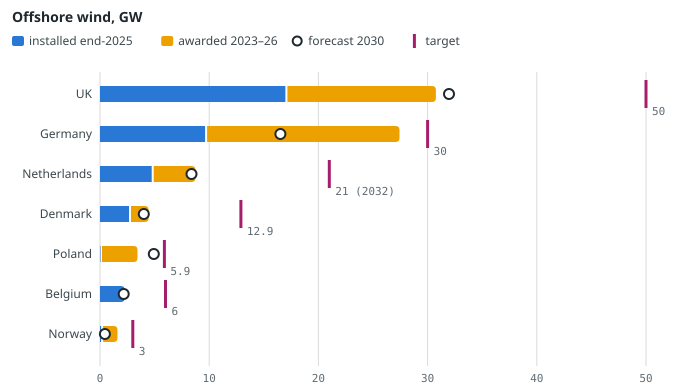
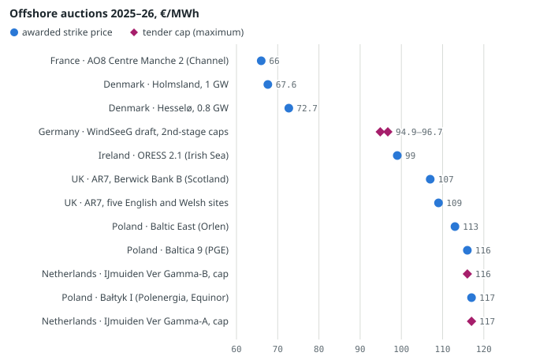
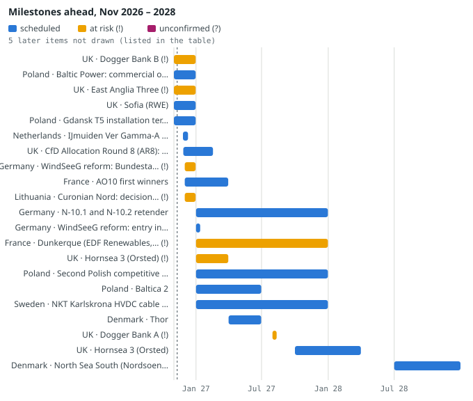
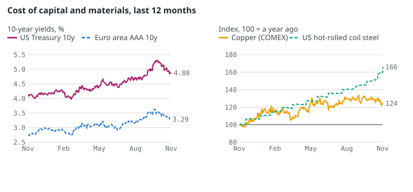

# Offshore Wind in Northern Europe: Targets, Bottlenecks and Ports

*Where North Sea and Baltic offshore wind stands against its targets, why auctions failed and are recovering, what holds delivery back, and what it means for ports, contractors and grid operators — November 2026.*

Gabriele Giuliani · Geo-economic Risk Monitor · November 2026 · data read on 10 November 2026

Every number has a source and a date. Paragraphs marked *Assessment* are the monitor's reasoning, not facts. For ports, gas, shipping costs and Baltic security in general, see the companion report *Northern Europe: Ports and Energy* (docs/report/en/northern-europe-2026-11.html).

**Contents:** [Key points](#key-points) · [Targets against reality, country by country](#targets) · [Auctions: why negative bidding failed and what comes next](#auctions) · [Bottlenecks, ranked](#bottlenecks) · [Base ports: what they need, what they are building, what holds them back](#ports) · [Risks: interest rates, metals, security, China](#risks) · [What it means for a port authority, an installation contractor and a TSO](#implications) · [Indicators and thresholds to watch](#watch) · [Method, sources and limits](#method) · [Review](#review)

## 1. Key points

- **Seven North Sea and Baltic countries are forecast to miss their targets by 60.4 GW.** WindEurope expects 68.4 GW in 2030 in the UK, Germany, the Netherlands, Denmark, Poland, Belgium and Norway, against national targets of 128.8 GW (the Dutch one for 2032). Europe connected only 1.96 GW in 2025, the lowest since 2016 (WindEurope, February 2026).
- **Auctions clear again where the state carries the price risk.** Zero-subsidy and negative-bidding rounds for 6.5 GW drew no bids in Denmark, Germany and the Netherlands in 2024–2025. With two-sided contracts for difference, Denmark awarded 1.8 GW in August 2026 at about 67.6–72.7 €/MWh; contracts were signed in November.
- **The next test starts on 26 November.** The Dutch IJmuiden Ver Gamma round (2 GW) takes applications until 10 December 2026, with price caps of 117 and 116 €/MWh (RVO; wind calendar). UK AR8 results are due between 27 November and 17 February 2027; Germany's auction reform must pass the Bundestag in December to start in January.
- **Grid links are the most common cause of delay.** Five of the 11 delays in the monitor's wind calendar cite grid links, platforms or energy islands; Amprion's 2 GW BalWin1 slipped a year, to 15 September 2031. Monopile factories, by contrast, are expected to run at about 19% of capacity in 2028 (Rystad).
- **Baltic ports are adding capacity; German North Sea quays come late.** Gdańsk's 253 million € T5 terminal serves Baltica 2 from the fourth quarter of 2026; Klaipėda's 201 million € upgrade ends in 2027. Cuxhaven's 1,250 m heavy quay arrives around 2028; Bremerhaven's terminal was never built.

## 2. Targets against reality, country by country

Three ministerial declarations set the goals. At **Esbjerg** (May 2022) Denmark, Germany, the Netherlands and Belgium promised at least 65 GW in the North Sea by 2030 and 150 GW by 2050. At **Ostend** (April 2023) nine countries raised this to about 120 GW by 2030 and 300 GW by 2050. At **Marienborg** (August 2022) eight Baltic states promised 19.6 GW in the Baltic by 2030. The **Hamburg** summit of January 2026 kept the 300 GW for 2050, added up to 100 GW of cross-border projects and an investment pact for 15 GW of installations a year in 2031–2040 ([eolico-filiera.json](../docs/data/eolico-filiera.json)).

| Declaration | 2030 goal | Signatories' installed, end-2025 | WindEurope forecast 2030 | Forecast as share of goal |
|---|---|---|---|---|
| Esbjerg (2022) | 65 GW | 19.27 GW | 31.08 GW | 48% |
| Ostend (2023) | 120 GW | 38.29 GW | 66.94 GW | 56% |
| Marienborg, Baltic (2022) | 19.6 GW | 0.26 GW | 5.82 GW | 30% |

*Sums of WindEurope national totals for the signatories, calculated in eolico-filiera.json. National totals include other seas (German and Danish Baltic, Irish Sea, Channel), so they overstate the North Sea alone. Marienborg counts only countries with a mainly Baltic coast, without Germany and Denmark.*

The pace tells the story. Europe connected 1.96 GW in 2025. To reach WindEurope's forecast of 72.8 GW in 2030 from 38.6 GW it needs 6.8 GW a year on average. The Hamburg pact asks for 15 GW a year after 2030, 7.7 times the 2025 rate. Investment decisions (FID) are the leading signal: offshore FIDs in 2025 covered 5.4 GW for 22.5 billion €, and four of the six projects were Polish ([WindEurope, p. 35](https://www.rinnovabili.it/wp-content/uploads/2026/02/WindEurope-European-Stats-2025.pdf)).

**Offshore wind by country, GW.** Bar: installed at the end of 2025 (blue) plus capacity awarded in auctions in 2023–2026 (amber). Ring: WindEurope forecast for 2030. Pink tick: national target (2030; the Netherlands now 2032). Sources: WindEurope 2025 Statistics (February 2026) via [eolico-filiera.json](../docs/data/eolico-filiera.json); awards from [wind-calendar.json](../docs/data/wind-calendar.json) (`awarded_vs_targets`, read 10 November 2026). Awards are gross: they include the UK's Hornsea 4 (2.4 GW), dropped in May 2025.

| Country | Installed end-2025 | Under construction (EMODnet) | Awarded 2023–26 | FID 2025–26 (calendar) | Forecast 2030 | Target (year) | Gap: target − installed | Shortfall: target − forecast |
|---|---|---|---|---|---|---|---|---|
| UK | 16.98 | 10.63 | 13.8 | — | 32.0 | 50.0 (2030); range 43–50 | 33.0 | 18.0 |
| Germany | 9.62 | 2.35 | 17.8 | 1.60 | 16.5 | 30.0 (2030) | 20.4 | 13.5 |
| Netherlands | 4.74 | 3.56 | 4.0 | — | 8.4 | 21.0 (2032) | 16.3 | 12.6 |
| Denmark | 2.65 | 1.26 | 1.8 | — | 4.0 | 12.9 (2030) | 10.2 | 8.9 |
| Poland | 0.00 | 3.36 | 3.4 | 2.94 | 4.9 | 5.9 (2030) | 5.9 | 1.0 |
| Belgium | 2.26 | 0 | 0.0 | — | 2.2 | 6.0 (2030) | 3.7 | 3.8 |
| Norway | 0.10 | 0 | 1.5 | — | 0.5 | 3.0 (2030) | 2.9 | 2.5 |

*GW. Installed and forecast: WindEurope national totals. Under construction: EMODnet polygons in offshore-nord.json (North Sea and Baltic only; for the UK the east coast only; EMODnet status can lag). Awarded: supported or zero-subsidy capacity awarded in 2023–2026 rounds (wind-calendar.json). FID: final investment decisions recorded in the calendar since January 2025 (Baltica 2 and Bałtyk 2+3 in Poland, Nordlicht in Germany); WindEurope counts more offshore FIDs in 2025, so the column is incomplete.*

**Across the seven countries** the gap between targets and end-2025 capacity is 92.4 GW; capacity awarded since 2023 (42.3 GW) covers 46% of it, or 43% net of Hornsea 4. That is an upper bound: most of it comes online after 2030 and not all awarded sites have an FID. The 60.4 GW shortfall in the key points is a different measure: targets minus WindEurope's 2030 forecast. **Germany** has awarded 17.8 GW, 87% of its gap, yet 16 GW of awarded sites still lack an FID (Offshore Wind Foundation, September 2026, via the calendar). **The UK** has the largest gap, 33.0 GW against the upper end of its 43–50 GW range; net of Hornsea 4 its awards since 2023 are 11.4 GW. **The Netherlands** moved its 21 GW target from 2030 to the end of 2032 in 2024 and cut its 2040 goal to 30–40 GW in July 2025; WindEurope expects 8.4 GW in 2030. RVO's roadmap (checked 19 August 2026) now cites 23 GW with no target year and gives commissioning dates only for about 12.2 GW, up to the Gamma sites in Q2 2032 ([RVO](https://english.rvo.nl/topics/offshore-wind-energy/plans-2030-2050)). **Denmark** expects 4.0 GW against 12.9 GW (a target taken from a secondary source). **Poland** is the exception: from zero at end-2025 to a forecast of 4.9 GW, 84% of its Marienborg share.

**In the Baltic**, EMODnet maps 2.7 GW operating and 3.8 GW under construction, 33% of the Marienborg goal even if every site under construction is finished by 2030 ([offshore-nord.json](../docs/data/offshore-nord.json)). Esbjerg also promised about 20 GW of green hydrogen by 2030; Europe had 571 MW of electrolysers in operation in July 2025 ([Hydrogen Europe via Renewables Now](https://renewablesnow.com/news/europe-hosts-571-mw-of-operational-electrolysis-capacity-1282499/)), 2.9% of that figure.

*Assessment.* The 2030 targets are now political anchors, not delivery plans: no country on the chart except Poland is forecast to reach more than two thirds of its goal. For employers the useful number is not the target but the awarded-and-financed pipeline, which pushes the bulk of North Sea construction into 2028–2033 and makes the Dutch and German auction rounds of 2026–2027 decisive for port and vessel demand after 2030.

## 3. Auctions: why negative bidding failed and what comes next

### Why negative bidding failed

In a **negative-bidding** or zero-subsidy round the developer pays the state for the site, or bids for it with no support, and sells its power at market prices. The model worked while capital was cheap. It stopped working when turbine, steel and financing costs rose: in July 2023 Vattenfall halted Norfolk Boreas, citing costs up to 40% higher, and the UK's AR5 round that September attracted no offshore bids. Ørsted dropped Hornsea 4 in May 2025 despite a contract, with break costs of DKK 3.5–4.5 billion ([wind-calendar.json](../docs/data/wind-calendar.json)).

Then the rounds themselves emptied. Denmark's 3 GW tender drew no bids in December 2024; Germany's N-10.1 and N-10.2 (2.5 GW) none in August 2025, a first; the Netherlands' Nederwiek I-A (1 GW) none in October 2025. WindEurope counts 6.5 GW of failed negative-bidding rounds in 2024–2025; Norway (1.5 GW), France (1.2 GW) and Lithuania (0.7 GW) also cancelled or voided CfD rounds. The reasons given by the sources: full merchant price risk, up-front payments to the state, high costs and interest rates, and power demand growing more slowly than planned ([eolico-filiera.json](../docs/data/eolico-filiera.json)).

*Assessment.* An offshore wind farm is almost all up-front capital, so the cost of capital sets the price the developer needs. Merchant exposure raises that cost twice: lenders demand more equity and a higher margin, and the developer prices in low-price years. A two-sided CfD removes both, which is why the same seabed attracts bids under a CfD and none without one (see the illustrative calculation in section 6).

### Contracts for difference are back

Under a **two-sided contract for difference (CfD)** the state guarantees a strike price: it pays the developer when the market is below it and collects when the market is above. The UK's AR7 awarded a record 8,437.5 MW of offshore wind (192.5 MW of it floating) on 14 January 2026, at 91.20 £/MWh in England and Wales and 89.49 £/MWh in Scotland for fixed-bottom sites (2024 prices; about 19–21% below the 113 £/MWh ceiling). Poland's first CfD round awarded 3,435 MW in December 2025 at about 113–117 €/MWh. Denmark, after zero bids, redesigned its tender with CfDs and got two bids for Holmsland and five for Hesselø; Vattenfall won both at DKK 504 and 542 per MWh for 20 years. Belgium's new Princess Elisabeth framework (July 2026) uses a single two-sided CfD and requires at least 75% of turbines not made or assembled in China. The EU Grids Package (December 2025) is reported to make two-sided CfDs mandatory for new renewables from 2027 ([wind-calendar.json](../docs/data/wind-calendar.json); [GOV.UK, AR7 results](https://www.gov.uk/government/publications/contracts-for-difference-cfd-allocation-round-7-results/contracts-for-difference-allocation-round-7-results-accessible-webpage)).

**Offshore wind auction prices and caps, €/MWh, 2025–2026 rounds.** Dots: awarded strike prices; diamonds: tender caps (maximum allowed bid). Prices are not like for like: CfD length (20 years in Denmark, 25 in Poland), indexation, grid cost and currency differ. UK prices are WindEurope's euro conversion; on GOV.UK they are 91.20 and 89.49 £/MWh in 2024 prices. German caps are from a secondary source. Sources: [WindEurope 2025 Statistics, table 3](https://www.rinnovabili.it/wp-content/uploads/2026/02/WindEurope-European-Stats-2025.pdf) (February 2026, via report/dati/offshore-wind-esterni.json); Danish prices from [eolico-filiera.json](../docs/data/eolico-filiera.json) (offshoreWIND.biz, 4 August 2026, checked online); Dutch caps from [wind-calendar.json](../docs/data/wind-calendar.json) and RVO.

The spread is wide: Denmark's 67.6 €/MWh sits about 49 €/MWh below Poland's highest award (117 €/MWh). Baltic projects pay for a young supply chain and first-of-a-kind grid; Danish sites reuse an existing one. The Dutch caps (117 and 116 €/MWh, raised from 104) show what the government thinks it must offer to avoid another empty round.

### What is next

- **IJmuiden Ver Gamma-A and Gamma-B (Netherlands, 2 × 1 GW).** Applications from 26 November 2026 to 10 December 2026 at 17:00. RVO's Gamma-B page shows a subsidy budget of 4.698 billion € ([RVO](https://www.rvo.nl/onderwerpen/windenergie-op-zee/ijmuiden-ver-gamma-b), read 10 November 2026); Gamma-A's budget is 3.98 billion € (secondary source). The two sites share one TenneT 2 GW platform landing at Maasvlakte; RVO's roadmap now expects the farms in Q2 2032, a year after the earlier Q2 2031, because the platform is late for supply-chain reasons. The government expects to award the permits in the first quarter of 2027 ([letter to Parliament, 16 March 2026](https://english.rvo.nl/sites/default/files/2026-04/20260316_Letter%20to%20Parliament%20-%20Announcement%20tender%20IJmuiden%20Ver%20Gamma-B.pdf)). It is the first Dutch round since Nederwiek I-A's zero bids, under a temporary subsidy (TOWOZ) before a CfD in 2027.
- **UK Allocation Round 8.** Opened in July 2026 with the offshore administrative strike price frozen at 113 £/MWh (2024 prices); RenewableUK counts more than 17 GW eligible. Results are expected between 27 November 2026 and 17 February 2027, depending on appeals (reliability medium).
- **German WindSeeG reform.** The bill moves to annual rounds of 2–4.8 GW from 2027 in two stages: dynamic negative bidding first, a two-sided CfD only as a fallback (second-stage caps of 94.87 and 96.72 €/MWh, secondary source). The Bundesrat rejected the two-stage model in a non-binding opinion on 16 October 2026. Adoption is needed in December for a 1 January 2027 start; the calendar marks it **at risk**. The retender of N-10.1 and N-10.2 is set for 2027.
- **Curonian Nord (Lithuania, 700 MW).** The energy minister said in July 2026 that the project is not feasible on commercial terms without state funding; it got a positive environmental assessment on 30 June 2026 and Ignitis is buying Ocean Winds' 49%. A decision to continue, postpone or seek state aid is due by the end of 2026 (**at risk**). Lithuania's second 700 MW tender failed twice.
- **Later:** Poland's second CfD auction (2027); the joint Danish–German Bornholm tender (promised for the first half of 2026, not launched); Denmark's North Sea South (bids in the second half of 2028); France's AO10 winners (about 10 GW, none in the North Sea, end-2026 or early 2027).

**Milestones ahead, from the monitor's offshore wind calendar.** Each bar is the date window of a scheduled, at-risk (!) or unconfirmed (?) item; dashed line: today. Items with a year or half-year date are drawn across the whole period, to avoid false precision. Source: [wind-calendar.json](../docs/data/wind-calendar.json), 114 curated milestones, reference date 10 November 2026: 84 done, 18 scheduled, 8 at risk, 4 unconfirmed.

*Assessment.* December 2026 decides a large part of the 2030s pipeline: whether the Dutch Gamma round attracts at least two bidders per site, whether AR8 clears near AR7's price under a higher ceiling, and whether Germany starts 2027 with a law that bidders accept. A German law that keeps uncapped negative bidding as the first stage risks repeating 2025. The Dutch 21 GW by end-2032 is already out of reach on RVO's own dated roadmap; a failed Gamma round would also leave no Dutch site with a date after Beta (Q4 2029).

## 4. Bottlenecks, ranked

The ranking weighs three things: how much capacity one failure holds up, how long the constraint lasts, and how few suppliers there are. Auction design and the cost of capital (section 3) sit above all of them: without a clearing round there is nothing to build. The ranking is the monitor's assessment; the indicators are facts.

| Rank | Link | Strain (curated) | Key indicator | When it eases | Who is exposed |
|---|---|---|---|---|---|
| 1 | HVDC cables and converter platforms | high | Prysmian 16.5 bn € and NKT 13.0 bn € transmission backlogs; BalWin1 +1 year | new cable lines from 2027 (Karlskrona); platforms not before 2030 | TSOs, developers with 2 GW connections |
| 2 | Grid connections onshore and offshore | high | 5 of 11 calendar delays cite the grid | 2028–2031 as 2 GW links land | developers, ports' campaign windows |
| 3 | Turbine makers' finances | medium | first quarterly profits: Siemens Gamesa (Q3 FY2026), GE Vernova wind EBITDA +72 M$ (Q3 2026); GE still guides a 2026 wind loss of 400–500 M$ | when prices cover risk; two Western suppliers left | developers, pre-assembly ports |
| 4 | Vessels | medium | Cadeler utilisation 66% (H1 2026; 67% a year earlier); foundation vessels 8–9 by 2028 | WTIV ample to 2030, tight in Europe from 2032 | installation contractors |
| 5 | Monopiles | overcapacity | utilisation ~32% in 2026, 19% in 2028; China ~41% cheaper | loading near 50% in 2031 | Sif (Rotterdam), EEW (Rostock), Steelwind |
| 6 | Ports and labour | medium, local | at least 15 bn € announced since 2022 for factories, ports, vessels; technicians ~10,000 (2028) to over 19,000 (2032–33) | German North Sea quays ~2028 | Eemshaven, Esbjerg, Gdańsk; O&M towns |

*Strain as curated in eolico-filiera.json (colli_bottiglia). Ranking, timing and exposure: the monitor's assessment.*

### 1. HVDC cables and converter platforms

German and Dutch TSOs have standardised 2 GW, 525 kV HVDC connections. Three European cable makers (Prysmian, NKT, Nexans) plus LS Cable (Korea) and Sumitomo (Japan) supply them. Prysmian's transmission backlog was 16.5 billion € on 29 October 2026 (now including the Xtera submarine telecom business), plus about 2 billion awarded but not yet booked; NKT's 13.0 billion € on 30 June 2026; Nexans' 7.7 billion € (adjusted, June 2026, secondary). Together Prysmian and NKT hold 29.5 billion € (at different dates; NKT's third-quarter report was not found by 10 November), several years of output. NKT's new Karlskrona line starts in 2027, and Sumitomo opened the UK's first HVDC cable factory in October 2026. Platforms are scarcer still: few suppliers (Hitachi Energy, Siemens Energy, GE Vernova) and few yards. Hitachi Energy's order book more than tripled in four years to over 30 billion $ (IEA). BalWin1 (Amprion, 2 GW) moved from 16 September 2030 to 15 September 2031, its original target year, because of extra work on the offshore converter platform and difficult ground onshore; it connects the North Sea farm Windbostel Ost, and BalWin2 slips too ([HVDC World](https://hvdcworld.com/news/amprion-delays-balwin1-hvdc-connection-to-2031), 8 July 2026).

OpenStreetMap shows 14 offshore wind HVDC connections under construction in the North Sea and Baltic ([rete-elettrica.json](../docs/data/rete-elettrica.json)): BEI-Interkonnektor Bornholm-Deutschland, BorWin4, BorWin6, Dogger Bank C, DolWin4, East Anglia THREE, Hornsea 3, IJmuiden Ver Alpha, IJmuiden Ver Beta, IJmuiden Ver Gamma, Nederwiek 1, Norfolk Offshore wind zone, Norfolk Vanguard East, Norfolk Vanguard West. Mapped length is indicative.

### 2. Grid connections

Of the 11 delays in the calendar, 5 cite a grid link, a platform, a substation or an energy island:

- **North Sea Energy Island (Energio Nordsoen)** (Denmark, August 2024): Artificial island postponed again (to 2036) over costs above DKK 200 bn; tender suspended, a platform-based hub is studied instead.
- **Princess Elisabeth Zone lot 1** (Belgium, 1 July 2025): Tender halted: legal uncertainty, unrealistic calendar for the energy island and onshore grid, unclear financial framework.
- **Sorlige Nordsjo II (Ventyr)** (Norway, 24 August 2026): Licence application deadline extended by 12 months while an alternative grid route (via Lista) is reviewed.
- **Hornsea 3 (Orsted)** (UK, Q1 2027): National Grid's enabling and reinforcement works at Norwich Main substation delay the grid connection by up to two months on the critical path: Orsted now expects first power in Q1 2027 (aim in Nov 2024: commissioning end-2026/H1 2027). Grid, not turbines, is the constraint.
- **BalWin1 (Amprion, 2 GW) and BalWin2** (Germany, 15 September 2031): BalWin1 slips one year from 16 Sep 2030 to 15 Sep 2031 (extra converter platform work, difficult onshore ground); BalWin2 revised date pending. Blocks 2 GW of already awarded turbines for a year.

Completed projects tell the same story. Borkum Riffgrund 3 reached commercial operation on 31 August 2026, about five months late, after delays on the DolWin5 link and unplanned TSO outages; in Sweden, Vattenfall paused Kriegers Flak in 2024 partly for lack of a reasonable offshore grid connection ([wind-calendar.json](../docs/data/wind-calendar.json)).

### 3. Turbine makers' finances

Two Western makers, Vestas and Siemens Gamesa, dominate European offshore. Siemens Gamesa's loss before special items narrowed to 44 million € in the second quarter of financial year 2026, from 249 million a year before ([Renewables Now](https://renewablesnow.com/news/siemens-gamesa-narrows-loss-in-q2-parent-lifts-2026-outlook-1293658/)); in the third quarter (April–June) it reported a positive result for the first time since financial year 2022, about 75 million € before special items according to secondary summaries ([Siemens Energy, 5 August 2026](https://www.siemens-energy.com/global/en/home/press-releases/earnings-release-q3-fy-2026.html)). GE Vernova's wind segment lost 275 million $ (EBITDA) in Q2 2026, then earned 72 million $ in Q3 (against −61 million a year earlier), mainly on lower offshore project costs; it still expects a wind loss of 400–500 million $ in 2026 ([GE Vernova, 28 October 2026](https://www.sec.gov/Archives/edgar/data/0001996810/000199681026000162/gevpressrelease3q26.htm)) and, according to reNEWS, has suspended new offshore orders ([reNEWS](https://www.renews.biz/other-news/finance/ge-vernova-wind-losses-deepen/)). Dogger Bank A's turbine repairs moved the start of its first 300 MW contract to 31 July 2027. Chinese makers offer 16–25 MW machines and are studying factories in the UK and Europe. Average offshore turbines installed in 2025 were 10.7 MW.

*Assessment.* The constraint is margin, not factory space. One profitable quarter does not end it: makers now sign only at prices that cover their risk, and that cost passes into auction bids. With GE out of new offshore orders, a developer in Europe effectively chooses between two Western suppliers, or a Chinese one where rules allow.

### 4. Vessels

Western installation vessels (WTIV) able to install 15 MW-plus turbines go from none in 2020 to more than 25 by 2028, and Intelatus sees European supply tight in that segment only from 2032. Foundation vessels stay short: from 8 to 9 by 2028 outside China. Cable-lay vessels: 37 in 2025; 48 expected in 2030, with a possible shortage for inter-array cables early in the 2030s. Cadeler, the leading owner, used its ten vessels at 66% in the first half of 2026, against 67% a year earlier (47.6% in the first quarter as new ships joined); it says its 2026 order book is substantially filled, and its backlog was 2.49 billion € on 25 August 2026, 77% of it for projects with an FID. Day rates for 2026 are not public ([Intelatus via Offshore Engineer](https://www.oedigital.com/news/538691-vessel-sector-deep-dive-wtivs); [Cadeler](https://www.sec.gov/Archives/edgar/data/0001978867/000197886726000095/cadelerh1interimreport2026.htm)).

### 5. Monopiles

In 2021–2022 monopiles were scarce; now Europe has too many factories. XXL monopile capacity rises from about 1.2 million tonnes in 2024 to 2.7 million tonnes a year from 2027, while utilisation falls from about 32% in 2026–2027 to 19% in 2028, before recovering to about 50% in 2031. Chinese production costs about 41% less (3.46 vs 2.03 million $ per kilotonne, Europe vs China): a 1.6 kt Chinese monopile lands in Europe at about 6.35 million $ including freight and the EU carbon border charge (CBAM), against 6.69 million for a European one. Contracted tonnage: Sif 31%, EEW 22%, Dajin 12% ([Rystad Energy](https://www.rystadenergy.com/insights/from-scarcity-to-surplus-europes-monopile-factories-face-utilization-squeeze), 18 September 2026, checked online).

### 6. Ports and labour

Manufacturers and suppliers have announced at least 15 billion € of investment since 2022, from turbines and components to ports and vessels; 70% is focused on offshore ([WindEurope, p. 35](https://www.rinnovabili.it/wp-content/uploads/2026/02/WindEurope-European-Stats-2025.pdf)). A new heavy quay takes three to five years; demand is running one to two years behind plan, so pressure in 2026–2028 is local (Eemshaven, Esbjerg, Gdańsk) rather than system-wide (section 5). Labour is also local: GWO and GWEC expect demand for about 10,000 new offshore technicians worldwide in 2028 and over 19,000 in 2032–2033 (secondary summary); WindEurope projects about 607,000 wind jobs in Europe by 2030, +37% on 442,800 in 2024 ([WindEurope, p. 51](https://www.rinnovabili.it/wp-content/uploads/2026/02/WindEurope-European-Stats-2025.pdf)). **Missing:** reliable labour data by port.

## 5. Base ports: what they need, what they are building, what holds them back

A base port for installation needs three things: deep water and quays rated about 40–50 t/m² for the new jack-up vessels; tens of hectares of hard-standing for blades, towers and foundations; and a multi-year lease tied to a project ([eolico-filiera.json](../docs/data/eolico-filiera.json), bottleneck notes). Operations and maintenance (O&M) bases need less space but give work for 25–30 years, against one or two seasons for installation (agent report report/agenti/eolico.md).

| Port | Role | Space and load | PortWatch calls, 30 days, vs a year earlier | Port Risk Index (1–25) | Source reliability |
|---|---|---|---|---|---|
| Esbjerg | installation | 57 ha new | 3.3/day (−8.3%) | 3.2 (low) | high |
| Eemshaven | installation | 40 t/m² | 2.8/day (+55.6%) | 5.7 (low) | high |
| Rotterdam | fabrication | 45 ha new | 81.4/day (+2.3%) | 7.5 (medium) | high |
| Cuxhaven | installation | 38 ha new | — | — | high |
| Rostock | fabrication | missing | 6.3/day (+5.0%) | 4.3 (low) | high |
| Mukran | installation | missing | — | — | high |
| Rønne | installation | 15 ha new | — | — | medium |
| Gdańsk T5 | installation | 21 ha new | 9.5/day (−5.0%) | 7.0 (medium) | high |
| Świnoujście | installation | 50 t/m² | 9.7/day (+40.6%) | 6.1 (medium) | high |
| Klaipėda | installation | 40 t/m² | 8.3/day (−3.5%) | 7.5 (medium) | high |

*Space: new area in hectares and quay load rating where the source gives them. PortWatch: all ship calls a day, 30-day average to 30 October 2026, IMF PortWatch via porti-nord.json (wind vessels are a small share; small ports swing widely). Port Risk Index: probability × impact of disruption, port-risk.json (reference 10 November 2026). Rotterdam's figures are for the whole port.*

### Esbjerg (Denmark, North Sea)

Europe's reference installation port says it has shipped more than 27.5 GW of offshore wind and expects about 13.5 GW more in the next five years, mostly for German and British projects. The fifth expansion added 57 ha east of the port, and the access channel was deepened from 9.3 to 12.8 m; a new quay of about 350 m was due in 2026 (secondary source, status not confirmed). In 2026 it served Thor (RWE, 1 GW): 36 of 72 turbines were up by July. Ship calls in 2025: 5,426 (−5% on 2024, port annual report). **Constraint:** the new land is also marketed for CO₂ storage (CCS) and modular cargo, so space is shared between uses ([Port Esbjerg](https://portesbjerg.dk/en/news/port-esbjerg-expands-by-570-000-square-metres); [eolico-filiera.json](../docs/data/eolico-filiera.json)).

### Eemshaven (Netherlands, North Sea)

The Buss Terminal's heavy-lift quay (WINdQUAY) was reinforced to 40 t/m² and completed in April 2026: it can now serve two wind farms at once. In 2026–2027 at least three campaigns queue for it: Ecowende (760 MW; final turbine installed on 2 November 2026), RWE's Nordseecluster A in Germany and OranjeWind (795 MW, turbines from early 2027). Vattenfall's Nordlicht O&M base was due in October 2026. **Constraint:** declared capacity is two projects in parallel; with three in the queue the window is tight (the monitor's assessment, as the source file notes). PortWatch calls, last 30 days: 2.8/day (+55.6%) on a year earlier, from a small base ([offshoreWIND.biz](https://www.offshorewind.biz/2026/04/16/dutch-terminal-equipped-to-handle-two-offshore-wind-projects-at-once-after-upgrade/)).

### Vlissingen (North Sea Port, Netherlands)

A fabrication port rather than an installation base: the caissons of Belgium's Princess Elisabeth energy island are built here (17 of 23 installed by June 2026). **Missing:** 2026 data on dedicated areas and quays for wind ([offshoreWIND.biz](https://www.offshorewind.biz/2026/06/18/construction-progressing-on-worlds-first-artificial-energy-island)).

### Rotterdam – Maasvlakte 2 (Netherlands)

Home of Sif's monopile factory (328 million €). Sif produced 211 kt in the first nine months of 2026, against 124 kt a year earlier, but will close one of its three lines in the fourth quarter for lack of orders, has reported material doubt about its going concern, and calls an extraordinary meeting on 22 December 2026 for a capital increase. The port plans a 45 ha offshore wind terminal (Arianehaven) for mid-2029 ([Windtech International](https://www.windtech-international.com/company-news/sif-faces-funding-uncertainty-despite-improved-third-quarter-performance)).

### Cuxhaven (Germany, North Sea)

Berths 5–7 add 1,250 m of heavy-load quay and 38 ha of storage (DEME contract, November 2024; works from early 2025 for about 3.5 years, so ready around 2028). In December 2025 the Chinese monopile maker Dajin and Briese Schiffahrt signed an MoU for a marshalling hub here. **Constraint:** until then the German North Sea has little dedicated heavy quay ([offshoreWIND.biz](https://www.offshorewind.biz/2024/11/28/deme-bags-contract-for-offshore-wind-terminal-in-cuxhaven)).

### Bremerhaven (Germany)

The planned Offshore Terminal Bremerhaven (500 m quay, 25 ha, 180 million €) was stopped by a lawsuit from the environmental group BUND and never built; no 2026 source on a relaunch was found (sources date from 2016, reliability medium; [offshoreWIND.biz](https://www.offshorewind.biz/2016/02/08/blg-signs-30-year-deal-to-operate-offshore-terminal-bremerhaven/)).

### Rostock (Germany, Baltic)

EEW SPC's monopile plant in a tide-free port: maximum diameter 10 m today, 12 m after works finishing early 2027, possibly 15 m after 2030; capacity of more than 100 monopiles a year. It made Thor's monopiles and loaded the first for a 1.5 GW Polish farm in January 2026. **Constraint:** under-use rather than scarcity ([offshoreWIND.biz](https://www.offshorewind.biz/2026/09/15/eew-spc-prepares-rostock-plant-for-12-metre-diameter-monopiles-eyes-further-upgrade-after-2030)). Port Risk Index 4.3 (low).

### Sassnitz-Mukran (Rügen, Germany, Baltic)

Pre-assembly and O&M base: Windanker (Iberdrola, 315 MW, 21 Siemens Gamesa turbines) was staged here in 2026, and Iberdrola's Baltic hub runs about 1.1 GW from Mukran; Parkwind's Arcadis Ost 1 has its O&M base here. The source file flagged a possible conflict for space with the floating LNG terminal; IEEFA reports that the Mukran FSRU has left for Egypt ([esposizione-nord.json](../docs/data/esposizione-nord.json)), which would ease it. **Missing:** area and quay figures ([offshoreWIND.biz](https://www.offshorewind.biz/2026/06/10/windanker-turbine-components-arriving-at-german-port-ahead-of-offshore-installation/)).

### Rønne (Bornholm, Denmark)

First expansion finished in 2019: 15 ha, 11 m depth, a 300 m multipurpose terminal. It was the marshalling base for Baltic Eagle (50 turbines in 2024) and Arcadis Ost 1. Its future hangs on the 3 GW Bornholm Energy Island, now due in 2034 (2034 in the calendar); the joint Danish–German tender for the wind farms is **unconfirmed**: promised for H1 2026, not launched by November 2026 ([wind-calendar.json](../docs/data/wind-calendar.json)).

### Gdańsk – Terminal T5 (Poland)

A 21 ha terminal on reclaimed land, 253 million € of which about 194 million state aid approved by the Commission; concession to Istrana (Baltic Hub group) to 2055. Baltica 2 (1.5 GW, 107 turbines) leases it from Q4 2026 to the end of 2028, after all 111 monopiles were installed by August 2026; Ocean Winds has booked it for BC-Wind turbines in 2028. **Constraint:** works finish just as installation starts, so a delay has almost no slack. Port Risk Index 7.0 (medium): probability 1.7 × impact 4.1, so the score comes mostly from the port's size and energy role; GNSS interference within 50 km is its only red probability signal ([offshoreWIND.biz](https://www.offshorewind.biz/2024/07/16/poles-getting-ready-to-build-eur-253-million-offshore-wind-terminal-at-port-of-gdansk); [port-risk.json](../docs/data/port-risk.json)).

### Świnoujście – ORLEN offshore terminal (Poland)

Poland's first installation terminal, opened in June 2025: quays rated 50 t/m², jack-ups and heavy-lift ships, turbines of about 15 MW and substation parts of almost 3,000 t. A non-binding letter of intent (June 2026) with the port authority aims to add offshore and ro-ro quays; secondary sources speak of doubling capacity by 2030 ([Daily Mare](https://dailymare.com/news/swinoujscie-offshore-wind-terminal-moves-towards-expansion-after-a-strong-first-year,2578)). PortWatch calls, last 30 days: 9.7/day (+40.6%) (whole port, with Szczecin).

### Klaipėda (Lithuania)

Rebuilding about 453 m of quays on the Smeltė peninsula (36.6 million € contract, 2025) to 40 t/m², inside a 201 million € programme with a 100 million € EIB loan (September 2026). Completion slipped to end-2027 (end-2026 in a 2025 source). **Constraint:** the national pipeline is fragile: the 700 MW tender failed twice and the first project, Curonian Nord, awaits a decision by the end of 2026 ([offshoreWIND.biz](https://www.offshorewind.biz/2026/09/15/eib-backs-lithuanian-ports-offshore-wind-upgrade)). Port Risk Index 7.5 (medium).

### Smaller and UK bases

- **Ostend:** coordination port for the Princess Elisabeth island (EIB loan of 650 million €, 2024); the zone's first tender was halted in July 2025 and its new CfD framework (July 2026) has no relaunch date, so the Belgian pipeline is on hold ([offshoreWIND.biz](https://www.offshorewind.biz/2026/06/18/construction-progressing-on-worlds-first-artificial-energy-island)).
- **Grenaa and Hvide Sande (Denmark):** candidate bases for Vattenfall's Hesselø and Holmsland (commissioning aim 2032); no base port announced yet ([offshoreWIND.biz](https://www.offshorewind.biz/2026/11/06/vattenfall-signs-final-agreements-for-new-danish-offshore-wind-farms)).
- **Nigg (Scotland):** bought in 2025 by Mitsui & Co. Europe and Mitsui O.S.K. Lines; over 30 million £ approved in March 2026 for a heavy-duty quay and ro-ro ramp next to Sumitomo Electric's HVDC cable factory, which opened on 21 October 2026 ([offshoreWIND.biz](https://www.offshorewind.biz/2026/03/30/mitsui-greenlights-gbp-30-million-investment-in-port-of-nigg)).
- **Hull and Grimsby (England):** Siemens Gamesa's blade factory in Hull employs more than 1,400 people and started Hornsea 3 blades in August 2026; on 22 October 2026 IFM Investors agreed to buy 63.9% of their owner, ABP ([wind-calendar.json](../docs/data/wind-calendar.json)).

*Assessment.* The Baltic is where new installation capacity is being built, backed by public money and leases tied to Polish projects. The Dutch and Danish North Sea ports are busy until 2027–2028; after that their order book depends on the December 2026 rounds. The German North Sea is short of heavy quay until Cuxhaven opens, which keeps German projects reliant on Eemshaven and Esbjerg.

## 6. Risks: interest rates, metals, security, China

### Interest rates

The US 10-year Treasury yield was 4.88% on 9 November 2026, +77 basis points on a year earlier ([prezzi.json](../docs/data/prezzi.json)). The euro-area AAA 10-year yield was 3.27% on 9 November 2026, +52 basis points on 7 November 2025 ([ECB Data Portal](https://data.ecb.europa.eu/data/datasets/YC/YC.B.U2.EUR.4F.G_N_A.SV_C_YM.SR_10Y)). The ECB deposit rate is 2.50% (10 November 2026; 2.00% a year earlier). Market data partly from cache.

*Assessment (illustrative calculation, not a forecast).* For a project financed over 25 years, the annual capital charge per euro invested is 7.82% at a 6% cost of capital and 8.58% at 7%: one point more raises it by 9.7%. Since capital is most of the cost of offshore wind, the price a developer needs rises almost as much. Rates are higher than a year ago on both sides of the Atlantic, which is why rounds without a CfD remain hard to clear.

### Steel and copper

COMEX copper was 6.31 $/lb on 10 November 2026, +24.1% on a year earlier (front-month future, provisional; [Yahoo Finance](https://finance.yahoo.com/quote/HG%3DF)). US Midwest hot-rolled coil steel was 1,413 $ per short ton, +66.0%: a US price shaped by tariffs, used here only as a direction; **missing**: a European steel plate series. Metal prices show up in contracts: NKT reports its backlog at 13.0 billion € at market metal prices and 11.6 billion € at standard prices, a difference of 1.4 billion €. For monopiles, steel and the carbon border charge decide whether Chinese supply undercuts European yards (section 4).

**Cost of capital and materials, last 12 months.** Left: 10-year government bond yields, %. Right: copper (COMEX) and US hot-rolled coil steel (CME), index 100 = first close a year earlier; front-month futures, latest close provisional. Sources: US Treasury via [prezzi.json](../docs/data/prezzi.json); ECB Data Portal (AAA yield curve) and Yahoo Finance, cached in report/dati/offshore-wind-mercati.json (partly from cache).

Gas sets the other side of the CfD bill. The TTF was 82.33 €/MWh on 9 November 2026 (+164% on a year earlier, provisional), with German storage at 58.9% and Dutch at 63.5% on 8 November 2026 ([prezzi.json](../docs/data/prezzi.json); [scorte.json](../docs/data/scorte.json)). *Assessment:* expensive gas raises power prices, so a two-sided CfD costs the state little or pays it back; if gas falls, the same contracts cost more.

### Security: cables, drones, jamming, defence

**Cables.** Six Baltic cable incidents have been recorded since November 2024, the latest on 2 January 2026 (data cable Šventoji (LT) - Liepāja (LV) damaged). Estlink 2, the 650 MW Estonia–Finland HVDC link, was damaged by a ship's anchor on 25 December 2024 ([baltico-sicurezza.json](../docs/data/baltico-sicurezza.json); [interconnessioni.json](../docs/data/interconnessioni.json)). Offshore wind export cables and the new 2 GW links are the same kind of asset, on the same seabed.

**Drones.** 15 drone events over airports, bases, ports and energy sites have been logged around the North Sea and Baltic since September 2025, including sightings reported at Esbjerg on 24 September 2025 and formations over Kiel's shipyard and power plant the next day ([baltico-sicurezza.json](../docs/data/baltico-sicurezza.json)). None of the events in the file concerns an offshore wind farm.

**GNSS jamming.** Between 2 November 2026 and 8 November 2026 GPSJam counted 214–246 high-interference cells a day in the monitor's Baltic box. Within 75 km of the Polish and Lithuanian wind ports and farms Baltic Power had 6, Baltica 2 had 3, Baltyk II had 2, Gdańsk had 9, Klaipėda had 10 high cells in the week. GPSJam measures aircraft, not ships, but jack-up positioning and crew transfers also rely on satellite navigation ([baltico-sicurezza.json](../docs/data/baltico-sicurezza.json)).

**Defence.** Sweden rejected 13 offshore wind applications on defence grounds in November 2024 and 11 more in July 2026, on missile-detection grounds, while approving Poseidon in 2024 and two projects in 2026 ([wind-calendar.json](../docs/data/wind-calendar.json)).

### Cyber

**KA-SAT and Enercon, 24 February 2022.** A wiper attack on Viasat's KA-SAT satellite network, attributed by the EU, US and UK to Russia's GRU, disabled the modems that about 5,800 Enercon turbines (over 10–11 GW) used for remote monitoring and control. The turbines kept producing; more than 95% were reconnected by 19 April 2022 ([SentinelOne](https://www.sentinelone.com/labs/acidrain-a-modem-wiper-rains-down-on-europe/)). In the same spring Nordex shut remote access to its turbines after a ransomware attack and Deutsche Windtechnik switched off remote control of about 2,000 turbines for a day.

**Poland, 29 December 2025.** CERT Polska reports coordinated destructive attacks on more than 30 wind and solar farms, a manufacturer and a combined heat and power plant. The attackers went through exposed remote-access devices at grid connection substations, cut communication with distribution operators and remote control, and ran destructive malware; electricity production was not interrupted. Poland attributes it to Russia; researchers dispute which group ([CERT Polska](https://cert.pl/en/posts/2026/01/incident-report-energy-sector-2025/), checked online). As of 9 November 2026 the monitor knows of no successful cyber attack on a European offshore wind farm (report/agenti/cyber-energia.md). Denmark raised its threat level for destructive cyber attacks to medium in June 2024 and its energy sector's preparedness to orange in September 2025; Lithuania bars remote access from risk countries to wind, solar and battery sites above 100 kW ([cyber-energia.json](../docs/data/cyber-energia.json)).

*Assessment.* The lesson of both cases is the same: the weak point is the communication and remote-service chain (satellite links, vendor access, substations), not the turbine. A large offshore farm is run by a few operators under NIS2, but its supervisory link, its OEM's remote service and its onshore substation concentrate gigawatts behind a handful of access points.

### Supply chain and China

Of the 20 vessels in the monitor's fleet table, four were built in Chinese yards (Voltaire, Les Alizes, Boreas, Seaway Ventus) and one in Korea (Wind Maker). Dajin holds 12% of contracted European monopile tonnage and plans a marshalling hub at Cuxhaven; LS Cable supplies TenneT's 2 GW LanWin4; Chinese turbine makers offer 16–25 MW machines. Policy is pushing back: Belgium requires at least 75% of turbines not made or assembled in China, and Siemens Energy built its first 2 GW converter platform with a German yard ([eolico-filiera.json](../docs/data/eolico-filiera.json)).

*Assessment.* China is both a cost relief and a security question. Cheaper monopiles and vessels help the auctions clear; turbines with Chinese control software and remote access raise the same questions as the KA-SAT and Polish cases. Expect more NZIA-style content rules in tenders, which favour European yards and ports but raise the bid price.

## 7. What it means for a port authority, an installation contractor and a TSO

*Assessment — port authority.* Plan for a dip, not a boom, after 2028 in the Dutch and German North Sea unless the December rounds clear. Sign multi-year leases tied to named projects (Gdańsk T5 for Baltica 2 is the model) before pouring concrete. Make quays 40–50 t/m² and deep enough for the new jack-ups, and keep land flexible between installation, O&M, CCS and hydrogen. Treat O&M bases as the durable business: 25–30 years against one or two seasons. Build cyber and drone protection into the terminal now: ports host the onshore substations and the control rooms.

*Assessment — installation contractor.* Intelatus expects enough 15 MW-plus installation vessels up to 2030, but the leader's utilisation (66%, level with a year earlier) and its full 2026 book do not show a glut yet; margins depend on avoiding idle time caused by late grid links. Price grid-delay risk into contracts and seek campaign flexibility between Baltic and North Sea projects. Foundation and cable-lay vessels stay tight: that is where scarcity premiums remain. From 2032 the 15 MW-plus segment in Europe tightens again.

*Assessment — TSO.* The TSOs are now on the critical path: one platform's delay strands 2 GW of contracted turbines. Securing manufacturing slots for cables and converters (framework deals such as TenneT's) matters more than auction calendars. Expect pressure to share platforms between sites (Gamma-A and Gamma-B) and to build hybrid links across borders (Bornholm). Physical and cyber security of landfall substations and export cables belongs in the design, given the Baltic cable record and the Polish substation attack.

## 8. Indicators and thresholds to watch

| Indicator | Now | Threshold (assessment) | Why | Where |
|---|---|---|---|---|
| IJmuiden Ver Gamma-A/B applications | window 26 November–10 December 2026 | fewer than 2 per site | a repeat of Nederwiek I-A would leave no Dutch site dated after 2029 | RVO; wind-calendar.json |
| UK AR8 offshore result | results 27 November–17 February 2027; ceiling 113 £/MWh (2024 prices) | clearing above 100 £/MWh or under 5 GW | tests whether AR7's 91.20 £ holds | GOV.UK; wind-calendar.json |
| German WindSeeG reform | Bundestag vote pending (at risk) | no adoption by 31 December 2026 | 2027 rounds and N-10 retender slip | wind-calendar.json |
| Curonian Nord decision | due by end-2026 (at risk) | postponed without state aid | Klaipėda's main project | wind-calendar.json |
| 2 GW HVDC link dates (TenneT, Amprion, 50Hertz) | BalWin1 15 September 2031; Gamma farms Q2 2032 | any further slip of 6 months or more | each slip strands 2 GW | HVDC World; wind-calendar.json |
| Prysmian + NKT transmission backlog | 29.5 bn € | above 32 bn € | cable slots booked further out | quarterly reports; eolico-filiera.json |
| Cadeler fleet utilisation | 66% (H1 2026) | below 50% or above 85% | vessel glut or renewed scarcity | Cadeler reports |
| Sif extraordinary meeting | 22 December 2026 | capital increase not approved | Europe's largest monopile maker (31% share) | eolico-filiera.json |
| Siemens Gamesa and GE Vernova wind results | both positive in the latest quarter; GE offshore orders suspended | a return to quarterly losses or GE exit confirmed | two Western suppliers left | company results |
| Euro-area AAA 10-year yield | 3.27% (9 November 2026) | above 3.5% | cost of capital for non-CfD rounds | ECB Data Portal |
| US 10-year yield | 4.88% (9 November 2026) | above 5.0% | global cost of capital, USD-priced kit | prezzi.json |
| Copper (COMEX) | 6.31 $/lb (10 November 2026) | above 6.94 $/lb (+10%) | cable contract values | Yahoo Finance |
| Baltic cable or pipeline damage | last on 2 January 2026 | any new incident near a wind export route | same seabed, same anchors | baltico-sicurezza.json |
| GNSS high cells within 75 km of Baltic wind ports and farms | Baltic Power 6, Baltica 2 3, Baltyk II 2, Gdańsk 9, Klaipėda 10 | Świnoujście or German Baltic sites affected | jamming moving west | baltico-sicurezza.json |
| Cyber incident at a wind OEM, operator or service firm | none known offshore (9 Nov 2026) | any incident affecting remote control | KA-SAT and Poland precedents | cyber-energia.json |

*Thresholds are the monitor's assessment of when a signal changes the picture, not forecasts.*

## 9. Method, sources and limits

The report is built by report/build_offshore_wind.py from the monitor's data files, re-run each month. Every number in the text, tables and charts is read or computed from those files, from report/dati/offshore-wind-esterni.json (curated external facts with source and date) or from market series fetched by the script. Figures quoted from Italian text fields of the curated files are checked by the script against the source text; if a figure disappears, the build warns.

| Source | What it gives | Updated | Note |
|---|---|---|---|
| eolico-filiera.json | base ports, vessels, bottlenecks, auctions 2024–26, targets; WindEurope 2025 statistics | 2026-11-10T06:25Z | curated; high to medium |
| wind-calendar.json | 114 milestones 2023–2027+, awards vs targets | 2026-11-10T06:24Z | curated; high to low per item |
| offshore-nord.json | wind farms (EMODnet), hubs, links | 2026-11-09T20:05Z | EMODnet status can lag |
| porti-nord.json / port-risk.json | PortWatch calls; Port Risk Index | 2026-11-09T20:05Z / 2026-11-10T06:17Z | PortWatch data to 30 October 2026 |
| rete-elettrica.json / interconnessioni.json | HVDC lines (OpenStreetMap); interconnectors | 2026-11-09T19:17Z / 2026-11-09T19:17Z | OSM coverage uneven |
| baltico-sicurezza.json / cyber-energia.json | cables, drones, GNSS; cyber incidents | 2026-11-09T20:05Z / 2026-11-09T19:56Z | curated; attribution as stated |
| prezzi.json / scorte.json / idrogeno.json | US yields, TTF; gas storage; electrolysis | 2026-11-10T03:40Z / 2026-11-09T19:19Z / 2026-11-09T20:09Z | daily closes, provisional |
| ECB Data Portal; Yahoo Finance | euro AAA 10y, deposit rate; copper, US HRC | 2026-11-10 | partly from cache |
| WindEurope 2025 Statistics (PDF) | auction prices in €/MWh, 2025 FIDs | 2026-02 | high; read 10 Nov 2026 |

**Checked online on 10 November 2026:** Vattenfall, Danish CfD: DKK 504 (Holmsland, ex North Sea I Mid) and DKK 542 (Hesselø) per MWh, 20 years; two and five bids; final agreements signed in November 2026, commissioning aim 2032, FID pending (confirmed); GOV.UK AR7 results (14 January 2026): 8,437.5 MW of offshore wind, of which 192.5 MW floating; 91.20 and 89.49 GBP/MWh (2024 prices), 19.3% and 20.8% below the 113 GBP ceiling (confirmed); RVO: Gamma-B window 26 November 2026 00:00 to 10 December 2026 17:00, budget EUR 4,698,000,000, maximum tender amount EUR 0.116/kWh (confirmed); RVO roadmap (checked 19 August 2026): Gamma-A and Gamma-B commissioning Q2 2032; later Dutch sites 'to be determined' (report corrected); Prysmian Q3 2026: backlog about EUR 16.5 bn at 29 October 2026 (now including Xtera), plus about EUR 2 bn awarded not yet booked (confirmed); NKT H1 2026: Transmission backlog EUR 13.0 bn (11.6 bn at standard metal prices) at 30 June 2026; no Q3 2026 report found by 10 November (confirmed); Rystad: monopile factory utilisation about 32% in 2026-2027, 19% in 2028; Chinese cost about 41% below Europe (2.03 M$/kt) (confirmed); HVDC World: BalWin1 from 16 September 2030 to 15 September 2031, back to its original target year (confirmed); Siemens Gamesa back in profit in Q3 FY2026; GE Vernova Wind EBITDA USD 72 m in Q3 2026 (report corrected); Cadeler H1 2026: utilisation 66% (67% in H1 2025), backlog EUR 2,487 m at 25 August 2026 (confirmed); CERT Polska: coordinated destructive attacks on 29 December 2025 against more than 30 wind and photovoltaic farms, a manufacturer and a CHP plant (confirmed); WindEurope 2025 Statistics: FIDs 5.4 GW / EUR 22.5 bn offshore; auction prices table; at least EUR 15 bn of supply-chain investment since 2022; 442,800 jobs in 2024 (report corrected); offshoreWIND.biz RSS, 20 Oct to 9 Nov 2026: no news on AR8 results, the Gamma tender or the Bundestag vote on WindSeeG after the data files were built (nothing new).

**Limits and conflicts between sources.**

- National totals (WindEurope) mix seas: the UK includes the Irish Sea, France the Channel and Atlantic, Germany and Denmark both North Sea and Baltic. EMODnet covers only the North Sea (UK east coast) and the Baltic, so the 'under construction' column is not comparable with the national ones.
- Dutch target year: eolico-filiera.json gives 21 GW for 2030 (Esbjerg/Ostend), wind-calendar.json 2032 after the 2024 postponement. Government sources disagree too: the March 2026 letter to Parliament still says 'approximately 21 GW around 2030', while RVO's roadmap page cites 23 GW with no year and dates no site after Q2 2032. The report uses end-2032 (the latest formal date) for the chart; the gap is the same, but the Dutch shortfall compares a 2030 forecast with a 2032 target.
- Belgium: WindEurope's 2030 forecast (2.17 GW) is below its end-2025 capacity (2.26 GW), so its shortfall is larger than its gap.
- Denmark's 12.9 GW target comes from a secondary source (Port Esbjerg, undated). Lithuania, Latvia, Estonia, Finland and Sweden have no target in the files.
- Failed auctions: WindEurope counts 6.5 GW of failed zero-subsidy and negative-bidding rounds in 2024–2025 (Denmark 3, Germany 2.5, the Netherlands 1). The wind calendar's 7.2 GW (report/agenti/wind-calendar.md) adds Lithuania's 0.7 GW CfD tender, counted once although it failed twice, and names UK AR5 (2023), which had no set offshore volume and adds no GW. Counting also the CfD rounds Norway (1.5 GW) and France (1.2 GW) cancelled, 9.9 GW failed in 2024–2025.
- Germany: eolico-filiera.json says the 2026 offshore auctions were postponed to 2027; the cited source only says the N-10.1/N-10.2 retender moved. The report uses the narrower claim.
- The FID column is incomplete: the calendar records three FIDs since 2025, WindEurope counts six offshore FIDs in 2025 alone. FIDs by country for 2026 are **missing**.
- Auction prices are not like for like (contract length, indexation, grid costs, currency). UK prices in euro are WindEurope's conversion.
- Day rates of installation vessels, European steel plate prices and labour data by port are **missing**.
- Copper and steel are front-month futures from Yahoo Finance; the latest close may be provisional. The HRC series is a US price.
- Wind-calendar items with a year or half-year date are drawn across the whole period; 'unconfirmed' means a scheduled date passed without confirmation.
- GNSS cells measure aircraft reports, not ships; drone events are as reported, with no attribution unless stated.
- Supply-chain data in eolico-filiera.json corrected from the WindEurope PDF: investment since 2022 is 'at least 15 billion €' (the file has 15.4) and the 442,800 jobs are a 2024 figure (the file has 2025).
- Cyber attribution: cyber-energia.json records that French officials blamed Iran's Revolutionary Guards on 9 November 2026 for the October 2026 attacks on supermarket refrigeration controllers (Reuters via Al-Monitor; AP). No primary French government statement was found, so it is not independently confirmed; it does not concern wind and the report does not use it.

**Glossary.** CfD: contract for difference (two-sided: the state pays or collects the difference to a strike price). Negative bidding: the developer pays the state for the site. FID: final investment decision. HVDC: high-voltage direct current. TSO: transmission system operator (TenneT, Amprion, 50Hertz, Energinet, Elia). WTIV: wind turbine installation vessel (jack-up). FFIV: foundation installation vessel. CLV: cable-lay vessel. O&M: operations and maintenance. Monopile: steel tube foundation. t/m²: load a quay can bear. TTF: Dutch gas hub price. GNSS: satellite navigation. NZIA: EU Net-Zero Industry Act. CBAM: EU carbon border adjustment mechanism. NIS2: EU cybersecurity directive.

---

### Review · 10 November 2026

Independent review (fact-check and edit, done with an AI assistant) on 10 November 2026 under report/STANDARD.md. 123 claims checked against the data files and the cited sources (26 links opened): 88 confirmed, 25 corrected, 10 not verifiable from here. Main corrections: Siemens Gamesa and GE Vernova now report quarterly wind profits (Q2 losses were out of date); the IJmuiden Ver Gamma farms are due in Q2 2032, not Q2 2031; the Dutch 21 GW goal for end-2032 is not backed by dated sites in RVO's roadmap; supply-chain investment is at least 15 billion €, not 15.4; the 442,800 jobs base is 2024, not 2025; Cadeler's 66% utilisation is level with a year earlier, so it no longer supports 'day rates under pressure'; Gdańsk's risk score is driven by impact, not GNSS; gap, coverage and failed-auction figures now state their perimeter. Not verifiable: Danish 12.9 GW target (secondary), German WindSeeG caps, Nexans backlog, Gamma-A budget, AR8 timetable (law-firm summaries), Esbjerg's new quay.

Review log: report/revisioni/offshore-wind-2026-11.md.

---

Gabriele Giuliani · Geo-economic Risk Monitor · November 2026

Note on AI use: this report was prepared with an AI assistant (Claude, Anthropic), which wrote the build script, the calculations and the draft text from the monitor's data files and the sources cited, and checked selected sources online. Numbers come from the data files and linked sources; assessments are marked. An independent review (10 November 2026) re-checked every number; its log is in report/revisioni/. Gabriele Giuliani is responsible for publication.
