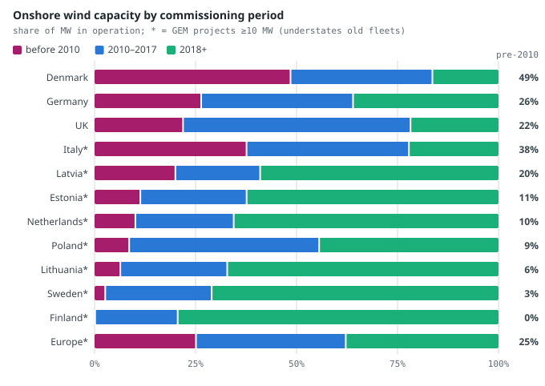
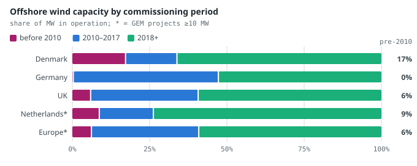
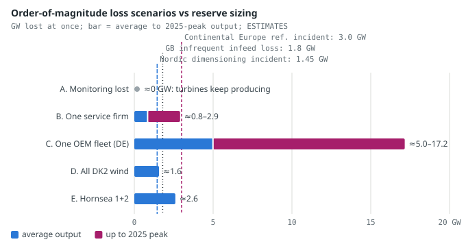

# Could a Refrigeration-Style Cyberattack Hit Wind Farms? Old vs New Turbines

*What the October–November 2026 supermarket-refrigeration attacks mean for wind: three turbine generations, fleet age and control-room concentration by country, system impact, rules and defences — November 2026.*

Gabriele Giuliani · Geo-economic Risk Monitor · November 2026 · data read on 10 November 2026

*Scope: a defensive risk briefing for operators, regulators and investors. It discusses architectures, exposure classes and impacts; it contains no exploit details, vulnerability identifiers, product weaknesses, lists or locations of exposed systems, or attack steps.* Every number has a source and a date. Paragraphs marked *Assessment* are the monitor's reasoning, not facts.

**Contents:** [Key points](#key-points) · [What happened in the refrigeration attacks, and why it worked](#refrigeration) · [Three generations of turbines](#generations) · [Where the analogy holds, and where it breaks](#analogy) · [Fleet age and concentration by country](#fleet) · [System impact: what a simultaneous loss would mean](#impact) · [Precedents, 2015–2026](#precedents) · [Rules and defences](#rules) · [Indicators to watch and three scenarios](#watch) · [Method, sources and limits](#method) · [Review](#review)

## 1. Key points

- **Yes, a refrigeration-style attack could hit wind, but mainly the oldest and smallest turbines, and the likely effect is lost remote control, not damage.** The pattern — series-made controllers, out of support, reachable remotely by contractors — fits pre-2010 onshore turbines and inverter clouds; it fits large offshore farms least (*assessment*, section 4).
- **The old fleet is large where wind matters most.** Turbines commissioned before 2010 hold 49% of onshore capacity in Denmark, 26% in Germany, 22% in the UK and 38% in Italy; offshore is young, with 59% of European capacity from 2018 or later (registers and GEM, 2026; [`raccolta/cyber/flotta_eta.json`](../raccolta/cyber/flotta_eta.json)).
- **Concentration sits in control rooms, not parks.** 96% of German wind capacity is flagged as remotely controllable by its direct marketer (MaStR, 10 Nov 2026), and one satellite-network attack in February 2022 cut the remote link to 5,800 Enercon turbines (≈11 GW, gigawatts) in central Europe at once.
- **One stopped OEM fleet could exceed the grid's design loss, but no real incident has cut output.** Continental Europe's reserves are sized for a 3.0 GW loss; one manufacturer's German fleet stopping at the 2025 peak would be ≈17 GW (*estimate*). Every wind incident so far, including Poland in December 2025, removed monitoring, not generation.
- **Rules have arrived for big operators, not for farmers.** NIS2 is in force in Denmark, Germany, Poland, the Netherlands and Lithuania (2024–2026); the Dutch draft permit for IJmuiden Ver Gamma-B (October 2026) requires an EEA-based operator in control and a digital bill of materials down to software and firmware. Most small, old turbines sit below every threshold.

*Assessment.* The direct answer for operators, regulators and investors: the analogy holds for the legacy, small-owner end of the fleet and for the shared platforms that reach it (service providers, direct marketers, inverter clouds). It breaks for modern offshore farms, whose realistic exposure is a vendor or supply-chain compromise, not an exposed panel. The impact most likely to matter is operational — losing the ability to curtail or restart turbines remotely — rather than physical.

## 2. What happened in the refrigeration attacks, and why it worked

On the night of 11–12 October 2026, attackers remotely changed the set-points of connected refrigeration controllers in French supermarkets: temperatures were pushed up to 50 °C or long defrost cycles were started, and stock was destroyed ([Al Jazeera, 13 Oct 2026](https://aljazeera.com/news/2026/10/13/unprecedented-cyberattack-hits-french-supermarkets-causing-food-losses); [`cyber-energia.json`](../docs/data/cyber-energia.json)). Store counts range from initial estimates of 500–700 (AP gave 700 on 13 Oct 2026) to more than 1,000 (Al Jazeera, 9 Nov 2026, as recorded in `report/agenti/cyber-energia.md`; article not re-read). A second wave on 1–2 November hit more than 115 stores in Belgium, the Netherlands, Luxembourg, Sweden, Ireland and Estonia ([SecurityWeek, 3 Nov 2026](https://securityweek.com/over-100-european-stores-hit-as-supermarket-fridge-attacks-resume)). France's blood service reported that refrigeration settings at three sites were changed through a supplier's remote-monitoring software (EFS statement, 3 Nov 2026, via TechSpot).

**Attribution, with its uncertainty.** Press reports on 9 November 2026 — Reuters (carried by Al-Monitor), AP, BBC and Al Jazeera, as recorded by the monitor's news agent — say French officials attributed the October attacks to Iran's Islamic Revolutionary Guard Corps (IRGC) and asked for EU sanctions ([Al-Monitor, 9 Nov 2026](https://www.al-monitor.com/originals/2026/11/french-officials-blame-iran-refrigerator-hacks-vow-retaliation)). **The monitor could not confirm this against a French government statement, and the reviewer could not open the press reports.** France's earlier public attributions of cyber operations pointed to Russian services (in July 2026 the foreign minister blamed the FSB for a 'vast cyber campaign' in Europe: [AFP via LBCI, 13 Jul 2026](https://v7cdn.lbcgroup.tv/news/world-news/946246/paris-to-summon-russia-envoy-over-vast-cyber-campaign-in-europe-minist/en)), pro-Russian groups had claimed some waves, and SentinelOne considers Russia-aligned groups credible suspects for the November wave. Any link between the IRGC and the November wave is unproven. Reliability of the attribution: medium (press reports only; no official text or technical evidence seen).

### Why it worked: five conditions (concept level)

| Condition | What public reporting says | Source |
|---|---|---|
| End-of-life devices | Most affected units were legacy products that no longer receive software or security updates | maker's statements to AFP and The Guardian, Oct 2026 (via Facilities Dive) |
| Reachable for contractors' convenience | Store control panels were reachable from the internet so maintenance contractors could adjust them remotely. Internet scanners counted ≈1,825 exposed French panels on 11 Oct and 537 by 14 Oct as operators took them offline | [Infosecurity Magazine, Oct 2026](https://www.infosecurity-magazine.com/news/france-expose-danfoss-controllers/) |
| Basic hygiene failures | ANSSI (France's cybersecurity agency) cited weak passwords and missing elementary defences; the exact initial access route has not been officially confirmed | ANSSI statements via press (medium) |
| Many identical units, one change | Hundreds of stores, a few vendor families, changed overnight; CERT-FR's alert covered three vendors' web supervisors | [Reuters via The Star, 14 Oct 2026](https://www.thestar.com.my/tech/tech-news/2026/10/14/copeland-dixell-refrigeration-systems-also-hacked-french-cybersecurity-agency-says) |
| Split responsibility | Store, refrigeration contractor, device maker and a third-party software component each held part of the chain | EFS statement, 3 Nov 2026; report/ricerca/eolico-cyber-architetture.md |

*Concept level only: no product weaknesses, access routes or device details are described.*

*Assessment.* The decisive factor was not sophistication but reach: one remote path, unchanged for years, leading to many identical devices whose owners did not manage them. The fastest fix also proved the point: the count of exposed French panels fell by 71% in three days once CERT-FR asked operators to remove internet exposure.

## 3. Three generations of turbines

Every wind plant has the same layers: a turbine controller (a programmable controller in the nacelle and tower base for yaw, pitch, start and stop), a protection or 'safety chain' that brings the rotor to a safe state, a park network with SCADA (supervisory control and data acquisition) and a power plant controller that follows the grid operator's set-points, the substation, and remote paths for the manufacturer (OEM), independent service providers (ISPs), the owner and power traders. What changes between generations is how each layer is built and connected (report/ricerca/eolico-cyber-architetture.md, section 1).

|  | Legacy, ≈1995–2010 | 2010–2018 | Current, 2018+ (offshore 10–15+ MW) |
|---|---|---|---|
| Typical unit | 0.2–2 MW | 2–4 MW onshore, 3–8 MW offshore | 5–7 MW onshore, 10–15+ MW offshore |
| Controller | Proprietary; the OEM may no longer exist | OEM platform, supported | OEM platform, software-defined, remote firmware updates |
| Park network | Serial or fieldbus, later bridged to IP | Ethernet/fibre rings, often flat (Tulsa study, 2017) | Segmented zones and conduits (IEC 62443) |
| Protocols | Proprietary or legacy industrial protocols without authentication | IEC 61400-25 / 61850 / 104; IEC 62351 security optional | Same, with more encryption and certificates; cloud interfaces |
| Remote paths | Retrofitted dial-up, cellular routers, satellite, DSL | VPN to OEM centre; ISP and trader links | Fibre in the export cable; OEM fleet centres; cloud analytics |
| Who operates | Farmers, cooperatives, small utilities; ISPs; direct marketers | Utilities and funds under OEM service contracts | Large utilities under NIS2; OEM; TSO interface |
| Patching reality | Often impossible; only boundary controls | OEM-scheduled, slowed by certification and grid-code testing | OEM-managed; secure-development claims where certified |
| Cyber certification | None | Rare | Emerging: a Chinese OEM's farm control system to IEC 62443-3-3 SL2 (Sep 2026) and a Siemens Energy plant control system used offshore; turbine OEMs' certificates not public |
| Exposure class (concept) | Exposed panels and routers, shared credentials, old operating systems | VPN appliances, OEM/ISP corporate IT, flat park networks | Supply chain, OEM and cloud platforms, vendor conduits, substation and HVDC OT |
| Strengths | Small, varied, partly hardwired protection | Standard protocols, OEM security teams | Segmentation, security operations centres, remoteness, professional owners |
| Remaining life | 0–10 years; repowering under way | 10–20 years | 25–30+ years |
| Close to the refrigeration case? | **Yes** | Partly (vendor remote path) | Mostly no, except via vendor or cloud compromise |

*Source: report/ricerca/eolico-cyber-architetture.md, section 4 (Tulsa/Staggs et al. 2017; INL 2024; DOE 2020; IEC; DNV; CIGRE 2026; OEM material). Generation boundaries are approximate; the fleet data in section 5 use before 2010 / 2010–2017 / 2018+.*

### Legacy fleet (≈1995–2010)

Controllers came from the original manufacturers, several of which merged or disappeared. Remote access was added later — first dial-up, then cellular routers, DSL and, in central Europe, satellite. The KA-SAT attack of 24 February 2022 showed what a single retrofitted link means: 5,800 Enercon turbines lost remote monitoring and control because their satellite modems were wiped, and many farms had no backup link ([pv magazine, 1 Mar 2022](https://www.pv-magazine.com/2022/03/01/satellite-cyber-attack-paralyzes-11gw-of-german-wind-turbines)). It was not only a legacy problem: an average of ≈1.9 MW per turbine points to a mix of older and middle-generation machines (*assessment*). After the warranty, service often passes to independent providers, and in Germany direct marketers must be able to read and curtail plants above 25 kW (kilowatts) that sell through direct marketing ([section 10b EEG](https://energysales.vattenfall.de/en/renewables/remote-controllability)). Patching the 1990s controller is rarely possible; the realistic controls sit at the network boundary.

### Middle generation (2010–2018)

IP park networks and standard data models (IEC 61400-25) arrived, with their security delegated to IEC 62351 and often left optional. OEM remote service centres began to reach whole fleets. All the documented incidents of this era were on the IT or vendor side: Vestas (November 2021), Nordex (March 2022) and Deutsche Windtechnik (April 2022) — in the last two, remote access to turbines was switched off as a precaution. In Denmark in May 2023, 22 energy companies, including small utilities with wind and solar assets, were breached through unpatched perimeter firewalls (SektorCERT, via Help Net Security, 14 Nov 2023). Patching is possible but scheduled by the OEM, and the owner rarely acts alone.

### Current generation (2018+, offshore 10–15+ MW)

OT (operational technology) networks are now designed with IEC 62443 zones and conduits. DNV's case study of a 750 MW Dutch offshore farm reports segmentation 'at various levels' and that more than half of the OT services had cloud connectivity, each subject to zone-and-conduit rules ([DNV case study](https://www.dnv.com/cyber/insights/cases/designing-ot-cybersecurity-into-an-offshore-wind-farm-to-provide-800000-homes-with-clean-energy/)). More functions are software-defined — curtailment, grid-forming and fast-frequency response — and firmware is updated remotely. **Gap:** no public OEM document describing how controller firmware updates are signed and rolled back was found. Public IEC 62443 product or system certification is rare among the large Western OEMs (not found does not mean not certified).

## 4. Where the analogy holds, and where it breaks

| Dimension | Refrigeration, Oct–Nov 2026 | Legacy and small-owner wind | Modern offshore wind | Analogy |
|---|---|---|---|---|
| Contractor or vendor remote access | Direct internet-facing panel | Retrofitted modems, ISP and trader links | OEM fleet centres and cloud, through controlled conduits | Holds for legacy; partly for offshore |
| End-of-life devices in service | Many | Yes: OEMs gone, 20+ years of operation | Not yet | Holds for legacy |
| Many identical units | Yes | Within parks; varied across parks | Large fleets per platform | Holds |
| Evidence of internet exposure | ≈1,825 French panels | 605 wind systems in 23 countries (aggregate count) | Not separated in public studies | Holds, on a smaller scale than solar |
| Safety layer independent of the network | Partly (food-safety alarms) | Hardwired safety chain (design principle) | Same, plus certified protection | Breaks — but see the open question below |
| Grid protection | n/a (a load) | Distribution-grid protection, small units | Grid codes, export-substation protection | Breaks |
| Owner's security capacity | Store or small chain | Farmer, cooperative, small utility | Large utility with a security team | Holds for legacy |
| Regulatory floor | Little until the CRA (2027) | Mostly below NIS2 thresholds | NIS2, network code, permit conditions | Holds for legacy |

*Sources: report/ricerca/eolico-cyber-architetture.md, section 2.2; exposure counts from [Modat and NCSC-NL via Security Magazine, 9 Oct 2026](https://www.securitymagazine.com/articles/102635-8-500-european-wind-solar-systems-exposed). Counts only; no locations, system types or access details are reported here.*

### The weaker segment: legacy turbines, farmer and cooperative owners, inverters and clouds

Modat and the Dutch NCSC presented in October 2026 a scan finding 8,547 wind and solar control systems reachable from the internet in 35 countries; 605 of them were wind systems ([Security Magazine, 9 Oct 2026](https://www.securitymagazine.com/articles/102635-8-500-european-wind-solar-systems-exposed)). Most of the rest were solar. For inverters the aggregation is larger: a DNV study for SolarPower Europe estimated that compromising about 3 GW of generation capacity could significantly affect the European grid ([SolarPower Europe, 29 Apr 2025](https://www.solarpowereurope.org/press-releases/new-report-solar-sector-proposes-solutions-to-mitigate-critical-cybersecurity-risks)), and that 7 inverter makers could each remotely manipulate more than 10 GW, assuming remote access to 70% of each installed base (2023 data; [full report](https://api.solarpowereurope.org/uploads/SPE_2025_Solutions_for_PV_Cyber_Risks_to_Grid_Stability_032dc2ae5a.pdf)). Forescout, citing earlier research, puts at about 4.5 GW the capacity an attacker would need to push frequency down to the 49 Hz load-shedding level ([Forescout, Mar 2025](https://www.forescout.com/research-labs/sun-down-a-dark-side-to-solar-energy-grids/)).

*Assessment.* For small turbines the owner is not a security organisation, the device is out of support, a third party holds remote access, and the plant is below NIS2 thresholds — the refrigeration recipe. The impact per site is small; the systemic risk comes from aggregation in a service provider, a direct marketer's trading platform or an inverter cloud. Of these, the inverter cloud is the larger aggregation risk.

### Modern offshore farms

Large offshore farms combine segmented OT, 24/7 security monitoring at large owners, protection relays at the export substation and physical remoteness. Their exposure is of a different class: a compromised OEM fleet centre or cloud service that reaches many farms, a long supply chain, and concentration — one farm is 1–2 GW behind one export system. A 2024 simulation by Concordia University and Hydro-Québec showed that corrupted sensor data inside an HVDC converter network could, in principle, amplify grid oscillations; no real incident is reported.

**Open question — how independent is the protection system?** The argument that 'turbines fail safe' rests on the protection system acting on physical limits (overspeed, vibration) regardless of commanded set-points. The research could not retrieve the clause text in DNV-ST-0438 or IEC 61400-1 on how far protection must be separated from the control system and network, nor whether any networked parameter can change protection thresholds. Until that is checked, 'mass physical damage is hard' is a design principle, not a verified fact. No cyber-induced turbine damage is publicly documented as of 10 November 2026.

## 5. Fleet age and concentration by country

Registers give every turbine in Denmark (Energistyrelsen, data to September 2026), Germany (Marktstammdatenregister, 10 Nov 2026) and the UK (REPD, sites ≥150 kW, Q2 2026). For other countries the monitor uses Global Energy Monitor's tracker (February 2026), which only covers projects of at least 10 MW and so **understates old fleets** ([`raccolta/cyber/flotta_eta.json`](../raccolta/cyber/flotta_eta.json)).

**Figure 1.** Onshore wind capacity by commissioning period, share of MW (megawatts) in operation. Registers: DK end-September 2026, DE 10 Nov 2026, UK Q2 2026; * = GEM projects ≥10 MW, February 2026. Right-hand figure: share before 2010. Source: [`raccolta/cyber/flotta_eta.json`](../raccolta/cyber/flotta_eta.json), read 10 Nov 2026.

Denmark has 3,335 onshore turbines from before 2010 (2.3 GW), averaging 0.7 MW each; 2,953 of its 4,123 onshore turbines (1.7 GW) are smaller than 1 MW. 2.14 GW onshore and 0.40 GW offshore are 20 or more years old. Germany has 18.9 GW onshore from before 2010 (13,590 turbines) and 11.9 GW already 20 or more years old, 2.5 GW of it from 2000 or earlier. In the Baltic states, Sweden and Finland, 59%–79% of the dated capacity is from 2018 or later (GEM). Italy's pre-2010 share (38%) is a GEM figure and probably low.

**Figure 2.** Germany: onshore capacity in operation by commissioning period, split by whether the brand is still active (MW; brands no longer active: NEG Micon, REpower/Senvion, Tacke, Fuhrländer, DeWind, BARD, Adwen, Südwind, AN, Enron; only brands with >50 MW per period counted). Source: Marktstammdatenregister, 10 Nov 2026, via [`raccolta/cyber/flotta_eta.json`](../raccolta/cyber/flotta_eta.json).

**Orphan brands.** In Germany 7.5 GW onshore and 2.3 GW offshore come from brands that no longer exist; their controllers are maintained, if at all, by independent providers or retrofitters. Natural persons are the registered operators of 1.03 GW of onshore capacity, 0.72 GW of it from before 2010 — a heavy understatement of citizen ownership, because citizen wind farms are usually registered as companies. Germany has 10,695 registered operators. Turbines from Chinese-owned makers are marginal: 155 units (393 MW) from Vensys, a German designer controlled by Goldwind, in Germany; none in the Danish register.

**Figure 3.** Offshore wind capacity by commissioning period, share of MW in operation. DK includes Thor (2026). Source: [`raccolta/cyber/flotta_eta.json`](../raccolta/cyber/flotta_eta.json) (ENS, MaStR, REPD, GEM), read 10 Nov 2026.

Offshore is young, and it is concentrated. In EMODnet's North Sea and Baltic data, the 20 farms built before 2010 total 1.6 GW (average 82 MW per farm); the 45 farms of 2010–2017 average 223 MW and the 45 farms from 2018 average 441 MW ([`raccolta/cyber/flotta_eta.json`](../raccolta/cyber/flotta_eta.json); EMODnet lags the registers).

### Control-room concentration

| Actor | Public figure | Source |
|---|---|---|
| Vestas | 161 GW and more than 56,000 turbines under active service (end-2025) | [Vestas AR 2025 via GreentechLead](https://greentechlead.com/wind/vestas-reports-record-2025-revenue-of-eur-18-8-billion-sets-stronger-2026-outlook-52164) |
| Siemens Gamesa | More than 10,000 remotely connected turbines monitored from its Brande centre (company figure, undated page; the same count appears in 2021 coverage) | [Siemens Gamesa (undated page)](https://www.siemensgamesa.com/explore/innovations/offshore-service-logistics-part-1) |
| Enercon (KA-SAT case) | 5,800 turbines (≈11 GW) lost their remote link through one satellite network, 24 Feb 2022; today Enercon has 12,356 turbines and 27.8 GW onshore in Germany | [pv magazine](https://www.pv-magazine.com/2022/03/01/satellite-cyber-attack-paralyzes-11gw-of-german-wind-turbines); [MaStR](https://www.marktstammdatenregister.de/MaStR/Datendownload) |
| Direct marketers (DE) | 96.3% of German wind capacity flagged as remotely controllable by its direct marketer | MaStR 10 Nov 2026, [`raccolta/cyber/flotta_eta.json`](../raccolta/cyber/flotta_eta.json) |
| Independent service providers | Deutsche Windtechnik switched off remote monitoring of ≈2,000 turbines in 2022; **no reliable public figure** for the ISP market share | [`cyber-energia.json`](../docs/data/cyber-energia.json) |
| Orphan brands | 7.5 GW onshore in Germany with no active OEM | [`raccolta/cyber/flotta_eta.json`](../raccolta/cyber/flotta_eta.json) |

*Figures are as published by each company and differ in scope (service, monitoring, control); none says how many turbines one centre can command at once.*

*Assessment.* The direct marketers' remote-control channel is the closest wind equivalent to the refrigeration vendor cloud: a third command path, besides OEM/ISP and owner, into old and new turbines alike, concentrated in a few trading platforms. The natural mitigation is repowering: WindEurope expects about 16 GW to be decommissioned in Europe in 2026–2030 ([WindEurope, Feb 2026](https://www.rinnovabili.it/wp-content/uploads/2026/02/WindEurope-European-Stats-2025.pdf)).

## 6. System impact: what a simultaneous loss would mean

Continental Europe — including Germany, the Netherlands, Poland, western Denmark (DK1), Italy and, since February 2025, the Baltic states — sizes its frequency containment reserve for a **reference incident of 3,000 MW** (EU System Operation Guideline, art. 153). The Nordic system (Sweden, Finland, Norway, eastern Denmark) is sized for its largest single loss, **1,450 MW**; Great Britain's infrequent infeed-loss limit is 1,800 MW ([`raccolta/cyber/flotta_eta.json`](../raccolta/cyber/flotta_eta.json); ENTSO-E; Fingrid; NESO).

Wind is large against these yardsticks. In 2025 wind met 47% of Danish gross consumption and exceeded consumption in 588 hours; eastern Denmark's wind peaked at 1,567 MW (Energinet). German wind peaked at 51.5 GW on 26 October 2025 against a load of 57.4 GW, and averaged ≈15 GW over the year (Fraunhofer ISE Energy-Charts).

**Figure 4.** Order-of-magnitude loss scenarios, GW (gigawatts) lost at once, against reserve sizing. *Estimates*, not network studies: each fleet is assumed to produce at the German average (18% of capacity in 2025) or at the 26 Oct 2025 peak (62%), with no ramp time and no interconnector help; German capacity from MaStR 10 Nov 2026 is applied to 2025 output. B uses the average German onshore turbine (2.36 MW). Sources: [`raccolta/cyber/flotta_eta.json`](../raccolta/cyber/flotta_eta.json); [`cyber-energia.json`](../docs/data/cyber-energia.json) (Hornsea 1+2, 2,604 MW); Enercon fleet: [MaStR](https://www.marktstammdatenregister.de/MaStR/Datendownload).

*Assessment (estimates).* A stop of one service provider's turbines would be ≈0.8 GW at average output and ≈2.9 GW at peak — near the 3.0 GW line only in the best wind. One OEM's German onshore fleet stopping in high wind (≈5.0–17.2 GW) would exceed the reference incident by a factor of 1.7–5.7. But turbines do not stop instantly, control centres usually act park by park, and no public evidence shows one command could stop a national fleet. The worrying case is therefore a prepared, coordinated attack on many SCADA systems at once, or a manipulation of protection settings across many units — not a single click.

### Why every real incident so far removed monitoring, not generation

KA-SAT (2022), Deutsche Windtechnik (2022), Nordex (2022) and Poland (December 2025) all ended the same way: turbines kept producing in automatic mode while owners lost visibility and remote control. In Poland, more than 30 wind and solar sites lost remote control at their grid-connection substations and control workstations were wiped, yet output did not stop ([CERT Polska, 30 Jan 2026](https://cert.pl/en/posts/2026/01/incident-report-energy-sector-2025/)). Turbines are designed to run unattended; the remote link is for optimisation, curtailment and restart.

*Assessment.* The real system risk of 'monitoring lost' is indirect: the grid operator cannot curtail wind when supply exceeds demand — as in Denmark's 588 such hours in 2025 — or restart plants after a blackout. The non-cyber precedent shows how losses combine: on 9 August 2019 an offshore farm lost about 737 MW alongside a gas plant after a lightning strike, and about 1.15 million customers were disconnected in Great Britain ([Ofgem, Jan 2020](https://www.ofgem.gov.uk/publications/investigation-9-august-2019-power-outage); Hornsea 1 deloaded by 737 MW).

## 7. Precedents, 2015–2026

| Date | Case | Effect | Attribution | Reliability |
|---|---|---|---|---|
| 23 Dec 2015 | [Western Ukraine: first blackout caused by a cyberattack](https://www.cisa.gov/news-events/ics-alerts/ir-alert-h-16-056-01) | About 225,000 customers lost power for a few hours; breakers opened remotely through the operators' own control systems | Sandworm (GRU), per US and UK governments | high |
| 17 Dec 2016 | [Kyiv: substation switched off by purpose-built grid malware](https://www.welivesecurity.com/2017/06/12/industroyer-biggest-threat-industrial-control-systems-since-stuxnet/) | About an hour of blackout in part of Kyiv; first malware written to speak grid protocols directly | Sandworm (GRU) | high |
| 05 Mar 2019 | [sPower (USA): denial of service on vendor firewalls](https://www.utilitydive.com/news/first-cyber-attack-on-solar-wind-assets-revealed-widespread-grid-weaknesse/566505/) | Repeated reboots for about 12 hours; loss of visibility over about a dozen wind and solar sites (≈500 MW); no generation lost | not attributed | high |
| 19 Nov 2021 | [Vestas: intrusion into corporate IT](https://www.itpro.com/security/cyber-attacks/367498/russian-affiliates-believed-to-be-behind-cyber-attacks-on-wind) | IT systems shut in several units; internal data compromised; company reported no impact on turbines | not declared; some sources cite a ransomware group | high |
| 24 Feb 2022 | [KA-SAT satellite network wiped: Enercon turbines lose remote link](https://www.sentinelone.com/labs/acidrain-a-modem-wiper-rains-down-on-europe/) | About 5,800 turbines (≈11 GW) without remote monitoring and control; they kept producing; over 95% reconnected by 19 Apr 2022 | Russia (GRU), per EU, US and UK (10 May 2022) | high |
| 31 Mar 2022 | [Nordex: ransomware on corporate IT](https://www.securityweek.com/conti-ransomware-gang-claims-cyberattack-wind-turbine-giant-nordex) | Remote access to turbines switched off as a precaution; company says the incident stayed in internal IT | claimed by a ransomware group | high |
| 08 Apr 2022 | [Ukraine: second grid-malware attempt on high-voltage substations](https://www.welivesecurity.com/2022/04/12/industroyer2-industroyer-reloaded/) | Detected and stopped before execution | Sandworm (GRU) | high |
| 11 Apr 2022 | [Deutsche Windtechnik (independent service provider): IT attack](https://therecord.media/german-wind-farm-operator-confirms-cybersecurity-incident-after-ransomware-group) | Remote monitoring of about 2,000 turbines switched off for about a day as a precaution; turbines kept running | not confirmed; a ransomware group's claim reported | high |
| 11 May 2023 | [Denmark: 22 energy companies breached through unpatched perimeter firewalls](https://www.securityweek.com/22-energy-firms-hacked-in-largest-coordinated-attack-on-denmarks-critical-infrastructure/) | Some firms isolated their networks ('island mode'); no customer impact | not determined | high |
| 25 Nov 2023 | [Water utilities (US and others): exposed industrial controllers defaced](https://www.cisa.gov/news-events/cybersecurity-advisories/aa23-335a) | Screens replaced with political messages; plants moved to manual operation; no harm to drinking water | CyberAv3ngers, linked to the IRGC | high |
| 15 Nov 2024 | [Inverters remotely deactivated by their manufacturer in some markets](https://borncity.com/win/2024/11/28/deye-deactivates-solar-inverters-in-usa-uk-and-pakistan/) | Units blocked with an error message; maker cited an authorisation check, not an attack | no attack: a manufacturer function | medium |
| 07 Apr 2025 | [Norway: dam valve opened remotely for four hours](https://securityaffairs.com/181143/hacktivism/norway-confirms-dam-intrusion-by-pro-russian-hackers.html) | About 500 litres per second released; no injuries | pro-Russian hackers, per Norway's PST | high |
| 14 May 2025 | [Reuters: undocumented communication parts in some Chinese inverters and batteries](https://www.insurancejournal.com/news/international/2025/05/16/824006.htm) | Possible channel around firewalls; makers not named; not confirmed by the US government | n/a | medium |
| 29 Dec 2025 | [Poland: coordinated destructive attack on 30+ wind and solar farms and a CHP plant](https://cert.pl/en/posts/2026/01/incident-report-energy-sector-2025/) | Remote control and communication with grid operators lost; control workstations wiped; power output not interrupted | CERT Polska: a cluster it links to Russian services; ESET and Dragos: Sandworm | high |
| 08 Aug 2026 | [Poland follow-up (incident Dec 2025, disclosed 8 Aug 2026): second CHP plant reached over a private cellular network](https://cert.pl/en/posts/2026/08/incident-follow-up-report-energy-sector-2025/) | A steam turbine and the process-water system of a CHP plant serving ≈50,000 residents shut down briefly; heat supply not disrupted. CERT Polska calls the private cellular (APN) route the first such case observed; press accounts of the report place its start at a wind farm | as for Poland 2025 | high (route via wind farm: secondary) |
| 23 Aug 2026 | [UK: small generator offline (incident in July, reported 23 Aug 2026)](https://www.irishtimes.com/world/uk/2026/08/23/iran-linked-hackers-accused-of-cyberattack-that-shut-down-british-power-plant/) | Offline for 4 days; government said there was no risk to the wider energy system | Iran-linked hackers blamed in press reports; no formal attribution | medium |
| 11 Oct 2026 | [France: supermarket refrigeration controllers tampered with remotely](https://aljazeera.com/news/2026/10/13/unprecedented-cyberattack-hits-french-supermarkets-causing-food-losses) | Overnight set-point changes (up to 50 °C or prolonged defrost); stock destroyed; mostly legacy controllers no longer updated | see section 2: attribution reported, not confirmed by the monitor | high |
| 02 Nov 2026 | [Second wave: 115+ stores in BE, NL, LU, SE, IE, EE](https://www.sentinelone.com/labs/defrost-and-disrupt-an-assessment-of-europe-s-refrigeration-attacks/) | Defrost functions triggered remotely | not attributed | high |

*Sources: [`cyber-energia.json`](../docs/data/cyber-energia.json) (curated entries, 9 Nov 2026) and report/ricerca/eolico-cyber-esposizione.md, section 5. Reliability refers to the event, not the attribution. No successful cyberattack on a European offshore wind farm is known as of 10 November 2026.*

## 8. Rules and defences

| Country | NIS2 law | In force | Note |
|---|---|---|---|
| Denmark | Energy-sector act on strengthened preparedness (Act no. 258 of 6 Mar 2025); general NIS 2 Act (Act no. 434 of 6 May 2025) | 7 Mar 2025 (energy); 1 Jul 2025 (general) | threat level for destructive attacks: medium |
| Germany | NIS2UmsuCG (amends BSIG and EnWG) | 6 Dec 2025 | published in the Federal Law Gazette on 5 Dec 2025 (BGBl. 2025 I No. 301); KRITIS threshold for generation 104 MW |
| Lithuania | Amended Law on Cyber Security | 18 Oct 2024 | further amended in 2026 (not verified) |
| Poland | Amended KSC Act of 23 Jan 2026 (Dz.U. 2026 poz. 252) | 3 Apr 2026 | published 2 Mar 2026; in force one month later (official ELI register) |
| Netherlands | Cyberbeveiligingswet (with the CER law, Wwke) | 15 Aug 2026 | 'thousands of organisations' in scope (Rijksoverheid); about 8,000 per cyber-energia.json |
| Latvia, Estonia | — | — | **Missing:** not covered by the research notes |

*Sources: report/ricerca/eolico-cyber-esposizione.md, section 4.1 (ECSO and other trackers, Rijksoverheid); [`cyber-energia.json`](../docs/data/cyber-energia.json); reviewer's checks of the Danish, German and Polish gazettes and registers, 10 Nov 2026. NIS2 transposition deadline: 17 Oct 2024.*

- **Cyber Resilience Act** (Regulation (EU) 2024/2847): reporting of actively exploited vulnerabilities since 11 Sep 2026; full application from 11 Dec 2027. It covers controllers, gateways and inverters sold as products — not the installed base.
- **Network Code on Cybersecurity** (Delegated Regulation (EU) 2024/1366): in force since 13 Jun 2024; national authorities are still designating high- and critical-impact entities. No final EU list was found.
- **Radio Equipment Directive** delegated act 2022/30: cybersecurity requirements for wireless equipment mandatory since 1 Aug 2025.
- **Lithuania**: remote access from high-risk countries to solar, wind and storage above 100 kW is banned; the law applied to new plants from 1 May 2025, existing plants had to comply by 1 June 2026, and grid operators can now disconnect non-compliant plants ([LRT, 12 Nov 2024](https://www.lrt.lt/en/news-in-english/19/2411602/lithuania-passes-law-to-block-chinese-access-to-solar-and-wind-farm-systems); [pv magazine, 5 Jun 2026](https://www.pv-magazine.com/2026/06/05/lithuanias-grid-operators-can-now-disconnect-solar-plants-without-cybersecurity-measures/)).
- **Netherlands, IJmuiden Ver Gamma-B draft permit** (October 2026): an operator based in the EEA keeps operational control and documents cybersecurity for itself and its ICT suppliers (rule 21); at least 75% of turbines not from China (so no more than 25% from China), drive trains and generators not from China, and digital bills of materials for hardware with digital functions and the software and firmware in it, with maker and country of origin (rule 22) ([RVO draft permit](https://www.rvo.nl/sites/default/files/2026-10/Concept-voorschriften-vergunning-IJmuiden-Ver-_kavel-Gamma-B_versie-oktober-2026.pdf)). The joint application window for Gamma-A and Gamma-B runs 26 November 2026 to 10 December 2026 ([`wind-calendar.json`](../docs/data/wind-calendar.json)).
- **United Kingdom**: the government blocked Mingyang's planned Ardersier turbine factory on 25 Mar 2026, saying it could not support the use of its turbines in UK offshore wind projects on national-security grounds ([Scottish Financial Review, 25 Mar 2026](https://scottishfinancialreview.com/2026/03/25/uk-govt-blocks-chinese-plan-for-1500-scots-jobs/)); in August 2026 a government source said there were no plans to reverse the decision ([energy-pedia, 12 Aug 2026](https://www.energy-pedia.com/news/united-kingdom/swinney-urges-burnham-to-rethink-%C2%A31-5bn-wind-factory-ban-204932)).
- **EU**: a Cybersecurity Act revision proposed in January 2026 would create a process to name high-risk suppliers; since April 2026 EU funds no longer go to projects using inverters from high-risk suppliers. Germany has no law excluding Chinese turbines; Denmark has no specific public measure.
- **Insurance**: the Lloyd's market's cyber-war clauses (LMA5564–5567, listed in the LMA model cyber clauses, version of 19 Mar 2026) exclude state-backed cyber operations, so attribution can decide cover — which is why the unconfirmed IRGC attribution matters for claims.

### Good practices, by who you are

| Owners of old turbines (farmers, cooperatives, small utilities) | Offshore and large operators | Ports and O&M bases |
|---|---|---|
| Take control panels and routers off the open internet; it was the first CERT-FR instruction and it worked | Treat OEM fleet centres and cloud services as untrusted conduits: gated, logged, time-limited, with a kill switch | Port-side O&M bases and control rooms are part of the farm's OT: segment them from port IT and tenants |
| Ask the service provider and direct marketer in writing: who can connect, from where, with what authentication, and how they notify incidents | Contract for software bills of materials and signed, staged firmware updates; ask OEMs for their IEC 62443 status | Plan for physical and cyber security of landfall substations and export-cable routes together |
| Inventory end-of-life devices (controllers, modems, satellite and 2G/3G links) and budget replacement or repowering | Rehearse manual and island operation, and loss of remote control across many farms at once | Include wind clients in port crisis exercises: a loss of remote control means more vessel and technician trips |
| Keep a backup communications link (the Enercon lesson) and a manual stop procedure | Monitor OT networks for anomalous mass commands (many units changed together, at night) | Share indicators with sector CERTs (SektorCERT, Z-CERT/NCSC, CERT Polska) |
| Join sector information sharing even below NIS2 thresholds | Check protection-system independence with the OEM and certifier (section 4) | Watch GNSS interference near Baltic bases (port-risk.json) |

*Sources: [`cyber-energia.json`](../docs/data/cyber-energia.json) (good practices), report/ricerca/eolico-cyber-architetture.md section 5, report/ricerca/eolico-cyber-esposizione.md section 6. Practices are generic and defensive.*

| Offshore wind base port | Country | Port Risk score (1–25) | Level |
|---|---|---|---|
| Rotterdam | NL | 7.5 | medium |
| Świnoujście (with Szczecin) | PL | 6.1 | medium |
| Eemshaven (Groningen Seaports) | NL | 5.7 | low |
| Rostock | DE | 4.3 | low |
| Esbjerg | DK | 3.2 | low |

*Source: [`port-risk.json`](../docs/data/port-risk.json), reference date 10 November 2026. The index has no cyber indicator: its security group covers physical events, GNSS interference and shadow-fleet tankers, so these scores say nothing about OT exposure.*

## 9. Indicators to watch and three scenarios

- **Official confirmation of the refrigeration access route** by ANSSI or CERT-FR (exposed interface, contractor platform or third-party component): it decides which wind segment the analogy fits best.
- **A French government statement** on the IRGC attribution, EU sanctions, and any link to the November wave.
- **Any sector-CERT report of tampering with wind or solar control panels** in DK, DE, NL, PL or the Baltic states — the first sign that the 'pick a brand of exposed controller' pattern has reached wind.
- **Follow-up on exposure counts** by NCSC-NL and Modat: a fall like France's after the refrigeration alert would show owners reacting.
- **Gamma-A/B applications** (26 November 2026 to 10 December 2026): whether bidders accept the EEA-control, origin and bill-of-materials conditions without fewer bids.
- **Network Code designations** of high- and critical-impact entities, and whether aggregators and direct marketers are included.
- **OEM disclosures** on IEC 62443 certification and firmware signing; the Cybersecurity Act revision; CRA full application on 11 Dec 2027.

*Assessment — scenario 1, base case: opportunistic tampering at the small end.* Hacktivists or state-linked groups change settings or stop a few small, internet-exposed turbines or solar sites, as with dams and water plants. Local loss of output, strong media attention, no grid effect. Recognise it by: claims with screenshots of wind panels; a national CERT alert naming wind; exposure counts falling afterwards.

*Assessment — scenario 2, escalation: a shared platform is compromised.* An ISP, direct-marketing platform or OEM service network is hit by ransomware or a wiper; thousands of turbines lose remote control for days (KA-SAT type). Output continues, but curtailment and restart become manual; costs fall on balancing and O&M logistics, including ports. Recognise it by: an operator announcing remote access switched off; grid-operator notices of manual curtailment; more than ≈2,000 turbines affected.

*Assessment — scenario 3, severe tail: a prepared, coordinated operation.* A state actor with long access to an OEM platform, many SCADA systems or substations causes a simultaneous loss of several GW, above the 3.0 GW reference incident. Low likelihood, high impact; it needs time and capability unlike the refrigeration campaign. Recognise it by: government attribution of pre-positioning in wind OT; an OEM security advisory to all customers; frequency events with simultaneous wind trips.

## 10. Method, sources and limits

- **Main material:** two research notes of 10 November 2026 (report/ricerca/eolico-cyber-architetture.md; report/ricerca/eolico-cyber-esposizione.md), the curated incident and rules file [`cyber-energia.json`](../docs/data/cyber-energia.json) (9 Nov 2026), [`port-risk.json`](../docs/data/port-risk.json) and [`wind-calendar.json`](../docs/data/wind-calendar.json) (10 Nov 2026), and the fleet aggregates in [`raccolta/cyber/flotta_eta.json`](../raccolta/cyber/flotta_eta.json) (10 Nov 2026).
- **Fleet data:** Energistyrelsen register (data to end-September 2026), Marktstammdatenregister export (10 Nov 2026, dl-de/by-2-0), DESNZ REPD (Q2 2026, OGL v3), Global Energy Monitor wind tracker (February 2026, CC BY 4.0, projects ≥10 MW), EMODnet (CC BY 4.0), WindEurope 2025 statistics.
- **Limits:** GEM understates old and small fleets (coverage 48–97% by country); the Danish register has no owner type; the German 'natural person' field understates citizen ownership; EMODnet lags the registers. No public data on ISP market share or on the share of turbines linked by satellite or cellular networks. **Missing:** NIS2 dates for Latvia and Estonia.
- **Scenarios** in section 6 are orders of magnitude with stated simplifications, not network studies. Section 9 scenarios are assessments without probabilities.
- **Unverified or secondary:** the IRGC attribution (press only); the UK July 2026 case (secondary sources); that the Polish APN route started at a wind farm (press reading of CERT Polska's report); the French exposed-panel counts (1,825 and 537); protection-system independence clauses (DNV-ST-0438, IEC 61400-1); OEM IEC 62443 status.
- **Scope:** defensive. The report deliberately omits exploit details, vulnerability identifiers, product weaknesses, lists or locations of exposed systems and attack steps.
- **Related reports, not repeated here:** [Offshore Wind in Northern Europe](../docs/report/en/offshore-wind-2026-11.html) (targets, auctions, ports) and [Northern Europe: Ports and Energy](../docs/report/en/northern-europe-2026-11.html) (ports, gas, Baltic security).

---

### Review · 10 November 2026

Independent review on 10 November 2026 under report/STANDARD.md: 100 claims checked against the data files, the research notes and, where reachable, the original sources (79 confirmed, 16 corrected, 5 not verifiable from here). Main corrections: the early French store count (500–700, not 250–350); Denmark's NIS2 law for energy (Act no. 258, in force 7 Mar 2025); German and Polish NIS2 dates confirmed in the official gazettes; Lithuania's deadline for existing plants (1 June 2026); the UK Mingyang statement (a government source, not Downing Street); the Polish follow-up, now from CERT Polska (heat supply not disrupted); the inverter-concentration figure and its assumption; the LMA clause date. Safety: two links whose articles reproduce device-level detail were replaced; no exploit details, identifiers, credentials or locations remain. Not verifiable from here: the IRGC attribution (press only), the 1,000-store and EFS figures, the French exposed-panel counts and ANSSI's wording, SentinelOne's assessment.

Review log: [report/revisioni/wind-cyber-2026-11.md](revisioni/wind-cyber-2026-11.md).

---

Gabriele Giuliani · Geo-economic Risk Monitor · November 2026

Note on AI use: this report was prepared with an AI assistant (Claude, Anthropic), which wrote the build script, the calculations, the charts and the draft text from the monitor's data files and two research notes that were also prepared with AI assistance and cite their sources. Numbers come from the data files and linked sources; assessments and estimates are marked. The independent review (10 November 2026) was also carried out with an AI assistant; its log lists every check. Gabriele Giuliani is responsible for publication.
